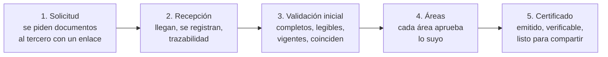

# Visión y alcance

| Estado | Fecha | Responsable |
|---|---|---|
| Borrador | 2026-10-28 | Arquitectura |

**Propósito.** Fijar por qué se construye Validasoft, para quién, qué resuelve, qué entra y qué no en cada hito, con qué restricciones y cómo se mide el éxito. Es el documento que Producto aprueba primero; los demás lo desarrollan.

**Relacionados**
- [01 Análisis del legado SRM ↔ Portal](01-analisis-legado-srm-portal.md)
- [02 Modelo documental compartido](02-modelo-documental-compartido.md)
- [03 Dominio y eventos](03-dominio-y-eventos.md)
- [04 Arquitectura de plataforma](04-arquitectura-plataforma.md)
- [09 Plan de hitos y responsabilidades](09-plan-de-hitos-y-responsabilidades.md)
- [10 Glosario](10-glosario.md)
- [Registro de decisiones](decisiones/registro.md)

---

## 1. El problema

Hoy la validación documental de proveedores de las constructoras clientes de Sincosoft vive repartida entre dos sistemas acoplados por HTTP:

| Sistema | Qué es | Qué posee |
|---|---|---|
| **SRM** | Módulo dentro del ERP Marco (.NET 7, SQL Server "Sinco"), **una instancia por empresa** | La matriz de qué documentos se exigen, el estado de la solicitud, el flujo de aprobación por perfiles, las auditorías |
| **Portal de Proveedores** | Aplicación aparte (.NET 8, Azure), **multi-constructora** | Los archivos (binarios en disco), sus versiones, el catálogo de tipos de documento, los usuarios del proveedor, las novedades |

Ninguno es dueño completo del dato. El detalle verificado está en [01](01-analisis-legado-srm-portal.md); el resumen de síntomas:

- La regla "qué documentos se exigen" está escrita **tres veces** en el SRM y las tres difieren.
- El estado del proveedor vive en **tres enums** con números mágicos (`-9 … 4`) y subestados ficticios (`-97`, `-100`).
- Cada constructora guarda una **"copia espejo"** del documento que aprobó, distinta de la última versión que subió el proveedor; nadie sabe sin consultar dos sistemas cuál es la verdad.
- En la vinculación **no se revisa documento por documento**: un documento "cuenta" con solo existir. Solo el flujo de "Actualización" revisa por detalle.
- Hay **tres mecanismos de vencimiento** que no se cruzan (plazo de 180 días, vigencia del proveedor, vigencia por documento solo en un informe).
- Los procesos "de fondo" son **endpoints HTTP** que otro sistema debe disparar (el Portal llama al job del SRM a las 22:00).
- Callbacks sin firma ni idempotencia; API key del Portal expuesta al navegador; API key de SendGrid en el código; **contraseñas en claro** por correo y en una tabla de cola; ningún endpoint del SRM exige autorización real.
- Un mismo proveedor que trabaja con tres constructoras sube el mismo RUT tres veces, recibe tres recordatorios distintos y es revisado tres veces a mano.

El resultado es lento para el proveedor, caro para la constructora, imposible de auditar de punta a punta y no sirve para otros vínculos (clientes, empleados, arrendatarios) que tienen exactamente la misma necesidad.

## 2. La solución: Validasoft

Un producto **independiente del ERP**, consumible por API por cualquier sistema (Marco, SRM, Portal, terceros), que lleva cualquier vínculo comercial **de la solicitud al certificado** en cinco pasos:

### 2.1 Objetivos

| # | Objetivo | Cómo se logra |
|---|---|---|
| O1 | **Una sola fuente de verdad** para cada documento del tercero | Bóveda del tercero con una única versión vigente por tipo; las empresas registran decisiones, no copias ([02](02-modelo-documental-compartido.md)) |
| O2 | **Cualquier tipo de vínculo** sin conflicto | Vínculo = (tenant, empresa, tercero, tipo de vínculo); el mismo tercero puede ser proveedor de A, cliente de B y empleado de C, y dos razones sociales del mismo grupo deciden por separado |
| O3 | **Flujos configurables** por empresa | Tipos de documento, reglas de exigencia por atributos, áreas, etapas, SLAs, vigencias, verificaciones y plantilla de certificado, versionados e inmutables ([03](03-dominio-y-eventos.md)) |
| O4 | **Trazabilidad total** | Event sourcing en vínculo, expediente, documento y certificado; línea de tiempo nativa |
| O5 | **Menos trabajo humano** | Validación inicial con IA una vez por versión y revisión automática por niveles contratables |
| O6 | **Experiencia orgánica para el tercero** | Enlace sin contraseña, una sola solicitud de renovación por documento aunque lo exijan varias empresas, siguiente paso siempre visible |
| O7 | **Integración fácil** | API REST v1 + webhooks firmados + SDK .NET/TS; el SRM, el Portal y Marco se integran sin tocar su núcleo ([08](08-integracion-y-migracion.md)) |
| O8 | **Operable en cualquier parte** | Docker Compose completo, on-premise o nube, PostgreSQL + MinIO, sin dependencias propietarias |

### 2.2 Actores

| Actor | Quién es | Qué hace en Validasoft |
|---|---|---|
| **Tenant (grupo)** | El cliente del SaaS: una organización o grupo empresarial con una o varias razones sociales | Comparte usuarios, catálogo, flujos, plantillas, API keys y facturación entre sus empresas |
| **Empresa (interna)** | Cada razón social del tenant: constructora, comercializadora, clínica, colegio… la que exige, revisa y certifica | Tiene sus vínculos y sus decisiones, aisladas de las demás empresas del grupo (P-11-2) |
| — Administrador | Usuario del tenant con control total | Empresas, flujos, áreas, usuarios, roles por empresa, API keys, webhooks, niveles de revisión automática |
| — Revisor de área | Analista de Legal, Financiera, Técnica, Cumplimiento… | Emite veredictos sobre requisitos de su área; asigna y se asigna |
| — Auditor | Control interno, revisoría | Solo lectura de todas las empresas del tenant, incluida la línea de tiempo y los accesos a documentos |
| **Tercero** | Proveedor, cliente, empleado, arrendatario, paciente… persona natural o jurídica | Entra por enlace, acepta cada invitación (solo entonces esa empresa ve su bóveda, ADR-0009), sube documentos a su bóveda, registra sus **personas relacionadas** (representantes, socios, UBO, miembros: terceros persona natural con bóveda propia, ADR-0010), corrige observaciones, ratifica, comparte su certificado; ve todas sus empresas en un solo lugar |
| **Sistema integrador** | SRM, Portal de Proveedores, Marco/SincoERP, cualquier ERP o CRM | Crea vínculos y expedientes, consulta certificación, recibe webhooks, importa históricos |
| **Plataforma** | Sincosoft como operador del SaaS | Alta de tenants, catálogo canónico de tipos de documento, lectura de IA (coste de plataforma), observabilidad, soporte; **nunca ve documentos ni decisiones de un tenant salvo con un acceso temporal concedido por su Administrador y auditado** (B-6) |

### 2.3 Principios de producto

1. **La bóveda del tercero es la verdad del archivo; la empresa es la verdad de su decisión.** Nunca copias; siempre decisiones sobre la versión actual.
2. **Un documento nuevo alerta a todas las empresas que lo exigen.** Si el tercero sube un RUT nuevo, nadie sigue trabajando con el viejo sin saberlo.
3. **Los hechos se calculan una vez; los juicios, por empresa.** Legibilidad, tipo, fechas, comparación con la versión anterior: una vez por versión. Si cumple mi regla de frescura y mi área lo aprueba: por empresa.
4. **Todo cambio es un evento.** No hay borrar-y-recrear, no hay estados que se infieren de otros estados.
5. **Nada depende de que otro sistema dispare un proceso.** Vencimientos, recordatorios y SLAs los programa Validasoft.
6. **Sin contraseñas para el tercero, sin secretos en el navegador, sin endpoints abiertos.**
7. **Tono de voz:** claro, breve, con el siguiente paso. "La póliza venció el 28/09. Sube la renovación para continuar." Nunca "¡Ups! Algo pasó" ni códigos de error.
8. **Cada pantalla se alimenta de una proyección real.** Nunca datos de muestra en producción; nunca un documento sin versión, fecha de carga y vigencia visibles.
9. **Consentimiento antes de compartir.** Una empresa ve la bóveda de un tercero solo cuando este acepta su invitación y autoriza el tratamiento; antes solo sabe cuántos requisitos podrían quedar cubiertos (ADR-0009).
10. **Las personas son terceros.** El representante legal, los socios, el beneficiario final y los miembros de un consorcio tienen su propia bóveda; su cédula se valida una vez y sirve a todas las empresas (ADR-0010).
11. **Sobre una versión solo se aprueba u observa; el rechazo es del expediente.** Una observación puede marcar "no volver a admitir esta versión"; rechazar cierra el expediente y solo lo hace un área con permiso (B-7).

## 3. Alcance por hito

El trabajo se divide en hitos pequeños y verificables (detalle, responsables y criterios en [09](09-plan-de-hitos-y-responsabilidades.md)). Esta tabla fija **qué entra** en cada uno; lo que no aparece está fuera de ese hito.

| Hito | Dentro del alcance | Fuera (queda para después) |
|---|---|---|
| **H0 Documentación** | Los documentos `00`–`11` y `MAPA` de `docs/`, los ADR (0001–0010), el cuestionario, el registro de decisiones y la relectura; las 22 decisiones bloqueantes cerradas y las dos auditorías externas resueltas | Código de cualquier tipo |
| **H1 Fundación técnica** | Solución .NET 10, Marten con los esquemas `plataforma`, `boveda`, `validacion` (conjoined por tenant + `empresa_id`) e `identidad` en un solo store, entidad **Empresa** dentro del tenant, Wolverine, OpenIddict + Identity (login, 2FA, API keys con alcance por empresa, grants de magic link y token del ERP), **auditoría de configuración e identidad**, **accesos de soporte** concedidos por el tenant, **catálogo multipaís de tipos de identificación**, **medición de uso** por tenant y empresa, **clave KMS por tenant** y región como atributo del tenant, Docker Compose, **GitHub Actions**, design system base, shell de las dos apps React y panel `/plataforma` (crear tenants y empresas) | Cualquier caso de uso de negocio |
| **H2 Bóveda del tercero** | Tercero (clave multipaís) y **personas relacionadas** con bóveda propia, documento, versiones inmutables, **formularios con esquema JSON**, subida en dos pasos, hash y dedupe, catálogo canónico con la semilla definitiva (03 Anexo A), **vínculo mínimo con invitación aceptada** (la compartición empieza al aceptar; sin exclusión), descarga prefirmada con auditoría de acceso, previews, hechos compartidos por versión (sin IA: hash, MIME, antivirus, páginas; con IA —lectura de plataforma, solo con consentimiento del tercero—: tipo, legibilidad, fechas, **comparación con versión anterior**, señales básicas de manipulación), regla de versión única con restitución al retirar | Decisiones de la empresa, flujos, vencimientos, autorregistro (H4) |
| **H3 Configuración y exigencia** | Catálogo canónico y tipos por tenant con **overrides por empresa** (jerarquía tenant → empresa → regla del flujo: ámbito restringible, regla de frescura, ratificación, campos clave/críticos, ayuda, plantilla versionada, aprobadores requeridos, nivel de revisión, plazo de revalidación), `TiposAceptados` en la regla, áreas, motivos base + propios, flujos versionados, motor de reglas de exigencia con atributos de **monto estimado y nivel de riesgo** y requisitos "de la persona relacionada", reglas de selección de flujo y flujo por defecto, semilla "Habilitación de proveedores", editor de flujo | Ejecución de expedientes |
| **H4 Expediente inicial y veredictos** | Vínculo completo por empresa (aceptación de invitación y consentimientos disparan la compartición), **autorregistro invisible**, expediente inicial con folio propio, requisitos snapshot, etapas (paralelo por defecto) y áreas, **veredicto sobre versión solo Aprobado/Observado** (con "no admitir esta versión") y **rechazo del expediente** como acción terminal del área, campos afectados, observar y reenviar, override de administrador, eximir con permiso, bloqueo privado del tercero, cuatro ojos, caducidad 30 días, SLA con escalamiento, cierre automático, cambio de flujo, bandejas, detalle, línea de tiempo, UI del revisor y del tercero (formularios dinámicos, fotos→PDF, aceptación de T&C/autorización con evidencia) | Certificado, correo transaccional completo, webhooks |
| **H5 Certificado, notificaciones y webhooks (MVP)** | Certificado por vínculo con folio, contenido canónico, hash, sello Ed25519, QR y PDF/A; verificador público con datos mínimos; motor de notificaciones (correo, campana, SSE) con catálogo de alertas y **evidencia de entrega**; webhooks firmados con dedupe por evento y modo pull; eventos públicos v1 (`certificado.emitido` canónico); tenant demo | Vigencias, renovaciones, verificaciones externas |
| **H6 Vigencias y revalidación** | Versión aceptada con vigencia en dos capas, vencimientos y avisos consolidados, renovación, ratificación (sin área), **revalidación obligatoria** de todas las empresas ante versión nueva (la saga decide por empresa si es cambio crítico o menor; 15 días y luego bloquea), expediente de actualización multi-empresa, comparación de versiones, **cuentas bancarias globales con cuenta designada por el tercero**, informe de vencimientos, bandeja de revalidaciones | Revisión automática |
| **H7 Verificaciones, cumplimiento y revisión automática** | Listas restrictivas y estudio de cumplimiento como verificaciones bloqueantes, coincidencias analizadas (una confirmada bloquea el cierre), reconsulta periódica, **beneficiario final (UBO) y PEP** referenciados por el formulario SARLAFT, expiración de cédula y listas del representante saliente tras confirmación humana, **suspensión y restablecimiento del certificado por bloqueo**, niveles Manual/Asistido/Automático con umbrales, muestreo, presupuesto de decisiones y degradación, derecho a revisión humana, **métricas de equidad**, detección completa de manipulación, informe SAGRILAFT | Integraciones externas al producto |
| **H8 Operación masiva, informes y administración** | Invitación masiva, **campañas de renovación**, delegación, separación de funciones, conflicto de intereses del revisor, ficha 360, informes y KPIs, auditoría consultable y **exportación ZIP firmada**, plantillas Liquid, digest, dominio propio de correo, marca blanca, **planes y límites**, **habeas data formal**, matriz de riesgo, embed, PWA offline | — |
| **H9 SDKs e integración** (depende de H7) | SDK .NET (multi-target hasta .NET 7) y TS, sandbox por API key, adaptador del SRM (flag, webhooks con dedupe por evento, AyF), embed en el Portal, consulta de certificación para Marco con **modo de respaldo de emergencia** | Migración de datos |
| **H10 Importador y piloto** | Importador idempotente (incluidas personas relacionadas), **corte por empresa**, aceptaciones importadas con 90 días para revalidar, IA solo sobre terceros que ya consintieron, sincronización inversa, rollback ensayado, una empresa piloto | Retiro del legado |
| **H11 Endurecimiento y retiro** | Carga (p99 < 50 ms en la consulta de certificación), backups, dashboards, Object Lock, antivirus, sello de tiempo, opcionales (RabbitMQ, Helm), apagado de endpoints legado por empresa migrada | — |

### 3.0 Adiciones del experto incorporadas (registro §5)

| Adición | Hito |
|---|---|
| Beneficiario final (UBO) como formulario global con cruce de listas por beneficiario | H7 |
| Personas expuestas políticamente (PEP) con reconsulta anual y debida diligencia intensificada | H7 |
| Expiración automática de cédula y listas del representante legal saliente | H7 |
| Evidencia de entrega de notificaciones (SMTP, apertura, clic) | H5 |
| Exportación de bóveda (tercero) y expediente (empresa) en ZIP con índice firmado | H8 |
| Detección de documentos manipulados como hecho compartido | H2 básico, H7 completo |
| Conflicto de intereses del revisor (cruce por identificación) | H8 |
| Reglas de exigencia por monto y nivel de riesgo del contrato en la semilla | H3 |
| Modo solo lectura de emergencia en Marco (`fuenteRespaldo=true`) | H9 |
| Métricas de equidad de la IA dentro del muestreo humano | H7 |

### 3.1 Fuera del alcance del producto (por ahora)

- Firma electrónica de documentos (se integra, no se construye).
- Facturación electrónica, pagos, informes de compras y contratos del Portal (siguen en el Portal/ERP).
- Licitaciones y cotizaciones (siguen en el SRM; Validasoft solo responde "¿este tercero está certificado?").
- Consulta directa a fuentes oficiales (RUES, DIAN) como verificación automática: se deja como verificador enchufable futuro.
- Despliegue multi-región activo: la región es atributo del tenant desde H1 (P-14-2), pero el MVP opera en una sola región más on-premise; regiones adicionales en H11.
- WhatsApp/SMS como canal, dominio de correo propio por empresa y firma electrónica acreditada: fases posteriores (H8+).

## 4. Supuestos

1. El equipo domina .NET y React + MUI; PostgreSQL, Marten, Wolverine y MinIO son nuevos pero documentados y con soporte comercial disponible.
2. Existe una clave de API de Anthropic para el módulo de IA desde H2; la **lectura** de cada versión es coste de plataforma (incluido en el cargo por vínculo activo) y el presupuesto por tenant limita solo las **decisiones** automáticas o asistidas (B-2).
3. Los clientes aceptan que el tercero entre por enlace sin contraseña (con OTP opcional) en lugar de usuario/clave.
4. Las constructoras aceptan el principio "versión nueva alerta a todas": prefieren revalidar a trabajar con información vieja.
5. El Portal y el SRM se pueden modificar lo mínimo (flag, cliente SDK, receptor de webhooks, embed) durante la coexistencia.
6. La BD del Portal y los archivos en disco son accesibles para el importador.

## 5. Restricciones

| Restricción | Implicación |
|---|---|
| Debe correr **completo en Docker** | Compose con api, worker, web, public, postgres, minio, mailpit; sin servicios gestionados obligatorios |
| **On-premise y nube** | Nada depende de Azure; MinIO es S3-compatible (Azure Blob/S3 como alternativas) |
| **Multi-tenant** desde el día uno | Tenant = grupo con una o varias empresas internas; aislamiento por tenant en BD (Marten conjoined) y por empresa en decisiones, buckets y clave KMS por tenant, API keys por tenant con alcance por empresa; la bóveda del tercero es global por diseño |
| **Multipaís** | Catálogo de tipos de identificación por país con validadores; la clave del tercero es `(país, tipo, número normalizado)` |
| **Español** | Dominio, API, documentación y UI en español; i18n preparado |
| **Event sourcing** en la validación | Vínculo, expediente, documento y certificado son streams; catálogos y usuarios son CRUD con auditoría |
| **Sin iframes legacy, sin datos mock** | Toda pantalla desde proyecciones; el único iframe es el embed propio y versionado |
| **Seguridad por defecto** | Autorización obligatoria, secretos fuera del repo, webhooks firmados, idempotencia en toda escritura de integración |

## 6. Métricas de éxito

| Métrica | Línea base (legado) | Meta |
|---|---|---|
| Tiempo de solicitud a certificado (mediana en días hábiles del calendario del tenant, `KpisDto.tiempoMedianaDias`) | Semanas (no medido; el dashboard del SRM muestra datos fijos) | ≤ 3 días hábiles en flujos de proveedores |
| % de requisitos aprobados sin intervención humana | 0 % (todo manual) | ≥ 60 % en tenants con nivel Automático en el primer año |
| Copias de documentos por empresa | 1 por constructora (`AdjuntosConstructora`) | **0**: un binario por versión, referenciado por N decisiones |
| Documentos con versión, fecha de carga y vigencia visibles en la revisión | 0 % en el React del SRM | 100 % |
| Contraseñas enviadas por correo o guardadas en claro | Sí (`InvitacionCorreoQueue.Password`, correos de invitación) | **0** |
| Solicitudes de renovación al tercero por documento vencido (`KpisDto.avisosPorDocumento`) | 1 por constructora | **1** consolidada por documento |
| Lecturas de IA por versión de documento (`UsoTenant.lecturasIa`, informativo; la lectura es de plataforma) | N (una por sistema que la pida) | **1** compartida |
| Expedientes con línea de tiempo completa y reproducible | Parcial (auditoría nueva del SRM no cubre renovar, desaprobar, validar admin) | 100 % (event sourcing) |
| Endpoints de negocio sin autorización | Todos (SRM) | **0** |

## 7. Riesgos y mitigaciones

| Riesgo | Probabilidad | Impacto | Mitigación |
|---|---|---|---|
| Curva de aprendizaje de Marten/Wolverine | Media | Medio | H1 dedicado a la fundación; ADR y plantillas de slice; sesiones de pareo |
| Coste o latencia de la IA fuera de control | Media | Medio | Preclasificación barata, caching de prompts, presupuesto por tenant, política fail-closed, nivel Manual por defecto |
| Las constructoras rechazan la revalidación obligatoria ante versión nueva | Baja | Alto | Nivel Asistido/Automático hace la revalidación casi gratis (`SinCambios` ⇒ un clic o automático); plazo de revalidación configurable |
| Migración de históricos con datos inconsistentes (ids mágicos, estados huérfanos) | Alta | Medio | Importador idempotente con dry-run e informe de rechazos; mapeo explícito de estados; piloto con un tenant |
| Coexistencia larga con SRM/Portal | Alta | Medio | Flag por tenant, sincronización inversa 90 días, rollback probado |
| Tenancy mal aplicada (una consulta sin tenant) | Media | Alto | Sesión tenant-aware obligatoria + test arquitectónico que falla el build |
| Un tercero sube un archivo erróneo que "rompe" la aceptación de todas las empresas | Media | Medio | Con IA, una versión de otro tercero o ilegible vuelve al tercero y nadie la ve. **Sin IA** (plataforma sin clave o tercero sin consentimiento) solo se verifican hash, antivirus y tipo MIME: el archivo sí se vuelve actual y desactualiza a todas; mitigación: el tercero puede **retirar** la versión y la anterior vuelve a ser la actual cancelando las revalidaciones abiertas (I-11), y el plazo de 15 días evita bloqueos inmediatos |
| Dependencia de un único proveedor de IA | Baja | Medio | `IVerificadorDocumental` enchufable; fixtures para pruebas |

## 8. Decisiones ya tomadas (Producto, 2026-10-28)

| Decisión | Elección |
|---|---|
| Stack backend | .NET 10 + PostgreSQL 17 + Marten + Wolverine + MinIO/S3 + Docker |
| Dueño de la UI del tercero | Validasoft (enlace/magic link); Portal/SRM/Marco integran por API y webhooks |
| Tenancy | Multi-tenant SaaS; **un tenant por grupo empresarial con empresas internas aisladas**; vínculo = (tenant, empresa, tercero, tipo de vínculo) |
| Identidad del tercero | Clave `(país, tipo, número normalizado sin DV)`, **multipaís** con catálogo de tipos de identificación |
| Datos maestros del tercero | El tercero propone; la IA (si está disponible) contrasta con el documento; las empresas revalidan según su nivel; nunca se bloquea al tercero |
| Formularios | Clase `Formulario` con esquema base canónico + campos privados por tenant; toda edición crea versión; solo campos críticos disparan revalidación |
| Cuentas bancarias | N cuentas globales del tercero; **el tercero elige** la cuenta designada con cada empresa; el cambio lo aprueba esa empresa (cuatro ojos) |
| Catálogo canónico | Lo administra la plataforma; semilla colombiana con defaults; el tenant restringe ámbito, nunca lo amplía |
| Seguimiento y CI | **GitHub** (Issues/Projects, PR con dos aprobaciones, GitHub Actions) |
| Definición de hecho | Criterios + pruebas + demo + docs/ADR + sin bloqueantes del siguiente hito |
| IA | Validación inicial con Claude desde el MVP; revisión automática por niveles como servicio |
| Frontend | React 18 + TypeScript strict + Vite + MUI v6 + TanStack Query + Zustand; dos apps |
| Identidad | OpenIddict embebido + ASP.NET Identity |
| Compartición de documentos globales | Automática con todas las empresas vinculadas que exijan ese tipo; sin exclusión por el tercero (A-8) |
| Revalidación desactualizada | 15 días de aviso y luego el certificado queda `ConPendientes` bloqueante hasta revalidar (A-2); la ratificación nunca pasa por un área (A-7) |
| Versión vigente | Una sola por tercero y tipo global; versión nueva válida alerta a todas y desactualiza sus aceptaciones |
| Vigencia | Dos capas: hecho del documento + regla de frescura por empresa; avisos consolidados al tercero |
| Compartición y consentimiento (B-1) | La bóveda se comparte con una empresa solo al aceptar su invitación y registrar la autorización; antes solo ve cuántos requisitos podrían quedar cubiertos |
| Lectura de IA (B-2) | Coste de plataforma, una vez por versión; el presupuesto del tenant limita solo decisiones; sin IA solo por plataforma deshabilitada o sin consentimiento del tercero |
| Personas relacionadas (B-3) | Representantes, socios, UBO y miembros son terceros persona natural con bóveda propia y una relación tipada con el tercero |
| Jerarquía de configuración (B-4) | Tenant define defaults por tipo; cada empresa puede sobreescribir; la regla del flujo sobreescribe ambos |
| Bloqueo (B-5) | Bloquear suspende el certificado y congela la compartición; desbloquear restituye o abre renovación |
| Soporte de plataforma (B-6) | Nunca por defecto; acceso temporal concedido por el Administrador del tenant, con alcance, horas y auditoría |
| Veredictos (B-7) | Sobre una versión: Aprobado u Observado (con "no admitir esta versión"); Rechazado solo para el expediente |
| Migración (B-8) | Aceptaciones importadas divergentes con 90 días para revalidar; IA solo tras consentimiento; H9 depende de H7 |
| Entregable inicial | Documentación por hitos (este conjunto), no un plan único |
| Nombre | "Validasoft" como nombre de trabajo, renombrable |

## Decisiones abiertas

1. **Nombre definitivo del producto.** Propuesta: mantener "Validasoft" hasta tener registro de marca; buscar/reemplazar en los documentos si cambia. Quién decide: Producto.
2. ~~**Plazo de revalidación y si bloquea**~~ — **cerrada** (A-2, registro §5-bis): 15 días de aviso y luego el certificado `ConPendientes` pasa a bloqueante hasta revalidar; 90 días para aceptaciones importadas (B-8).
3. **Empresa piloto y fecha de corte** — se decide en [09](09-plan-de-hitos-y-responsabilidades.md) (decisión abierta 2, A-3); aquí solo se referencia.
4. ~~Umbral para que una versión se vuelva `Actual`~~ — **cerrada** (D-3 en [02](02-modelo-documental-compartido.md) §5 y [03](03-dominio-y-eventos.md) §4.3: sin IA hash+antivirus+MIME; con IA además tipo, legibilidad e identidad).

Cerradas por el registro: modelo comercial de la revisión automática (P-6-7: por decisión + vínculo activo), residencia de datos (P-14-2: región como atributo del tenant).

## Fuentes verificadas

- Presentación de marca "Validasoft 2026" (artifact `P2qmmcKm4B1RaC9BoeSc7r`): flujo de 5 pasos, navegación, estados visuales, tono de voz.
- Lógica de exigencia triplicada: `C:\Fuentes_Git\SRM\BackEnd\SRM.Services\SRM.Services.Proveedores\DocumentosRequeridos\DocumentosRequericosBL.cs:354-522`, `...\Solicitudes\Validaciones\ValidarEstadoTercero.cs:834-1014`, `...\SRM.Services.Features\JobVencimientoProveedor\Queries\ObtenerProveedoresVencidos\Handler.cs:212-349`.
- Tres enums de estado: `C:\Fuentes_Git\SRM\BackEnd\SRM.Modelos\SRM.Models.Proveedores\Enums\EnumsProveedores.cs:12-29`; `C:\Fuentes_Git\SRM\BackEnd\SRM.BackgroundServices\Features\EnvioCorreo\Enums\EstadoTerceroEnum.cs:6-18`; `C:\Fuentes_Git\PortalProveedores\backend\librerias\Code.Model\Entity\dbo\Terceros.cs:8-24`.
- Copia espejo por constructora: `C:\Fuentes_Git\PortalProveedores\backend\librerias\Code.Model\Entity\dbo\AdjuntosConstructora.cs`; `...\Code.Services\Documents\Service\AdjuntoService.cs:619-770`.
- Un documento "cuenta" con existir: `ValidarEstadoTercero.cs:882-887, 907-909`.
- Job de vencimiento disparado por el Portal: `C:\Fuentes_Git\PortalProveedores\BITACORA_VENCIMIENTOS.md`; `C:\Fuentes_Git\SRM\BackEnd\SRM.API\Features\JobVencimientoProveedor\Endpoints\ProcesarVencimientosEndpoint.cs:44-49`.
- Contraseñas en claro: `C:\Fuentes_Git\SRM\BackEnd\SRM.Services\SRM.Services.Proveedores\Solicitudes\InvitarProveedoresERPBL.cs:386-390`; `...\SRM.Services.Features\InvitacionLote\Services\ProcesadorLoteService.cs:451-461`.
- API key expuesta y endpoints sin autorización: `C:\Fuentes_Git\SRM\BackEnd\SRM.API\Routes\MapConfig\MapConfigroutes.cs:52`; `C:\Fuentes_Git\SRM\BackEnd\SRM.API\Program.cs:58-70,128-132`.
- Dashboard con datos fijos: `C:\Fuentes_Git\SRM\Frontend\React\src\pages\Provedores\dashboard\store\useTodasLasSolicitudes.ts:10-495`.
