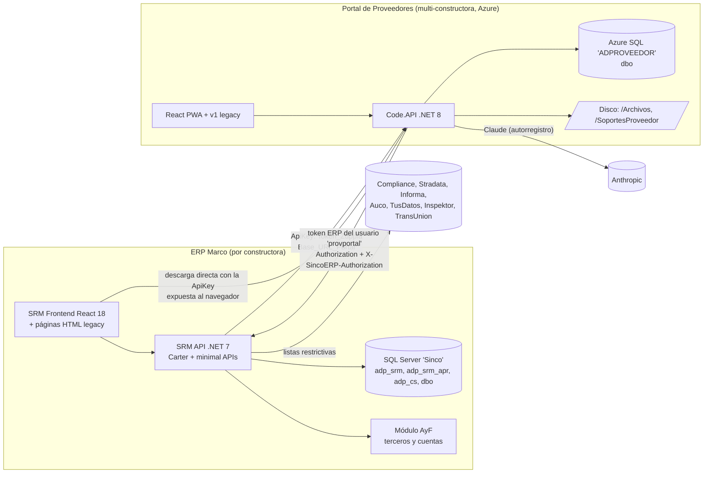
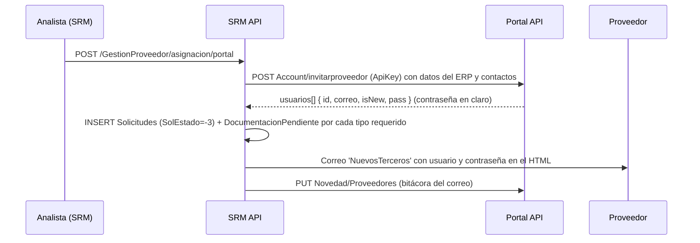
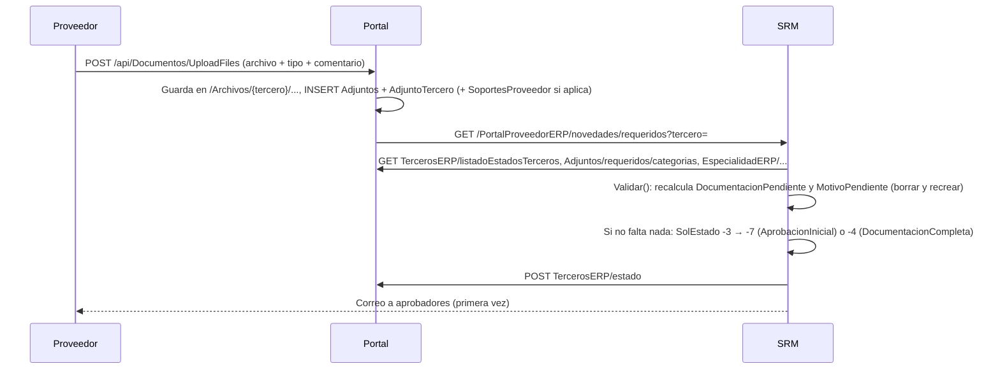

# Análisis del legado: SRM ↔ Portal de Proveedores

| Estado | Fecha | Responsable |
|---|---|---|
| Borrador | 2026-10-28 | Arquitectura |

**Propósito.** Dejar por escrito, con referencias verificables al código, cómo funciona hoy la validación documental repartida entre el SRM (`C:\Fuentes_Git\SRM`, rama `Develop`, HEAD `420a64def`) y el Portal de Proveedores (`C:\Fuentes_Git\PortalProveedores`), qué falla, qué se reemplaza y qué debe cubrir Validasoft como mínimo. Todas las rutas del SRM son relativas a `C:\Fuentes_Git\SRM\BackEnd\` y las del Portal a `C:\Fuentes_Git\PortalProveedores\backend\librerias\`, salvo que se indique otra cosa.

**Relacionados**
- [00 Visión y alcance](00-vision-y-alcance.md)
- [02 Modelo documental compartido](02-modelo-documental-compartido.md)
- [03 Dominio y eventos](03-dominio-y-eventos.md) (mapeo de estados legado → nuevo)
- [08 Integración y migración](08-integracion-y-migracion.md)
- [10 Glosario](10-glosario.md)

---

## 1. Resumen ejecutivo

1. **El SRM no guarda los documentos del proveedor.** Los archivos, sus versiones y el catálogo de tipos viven en el Portal. El SRM solo tiene la regla de qué se exige, el estado de la solicitud, el flujo de aprobación y auditorías.
2. **El Portal es otra aplicación con otra base de datos.** El SRM solo le habla por HTTP con una API key por constructora; el Portal llama al SRM de cada constructora autenticándose como un usuario fijo del ERP.
3. **En la vinculación no se aprueba documento por documento.** Un documento "está completo" con solo existir un adjunto de ese tipo; se aprueba la solicitud entera por perfiles en secuencia. Solo el feature "Actualización de proveedor" revisa por detalle.
4. **La lógica de "qué documentos se exigen" está repetida tres veces y las tres difieren.**
5. **No hay procesos periódicos dentro del SRM.** Los "background" son endpoints HTTP que alguien externo (el Portal, a las 22:00) debe llamar.
6. **Hay problemas de seguridad serios**: clave del Portal expuesta sin autenticación, API key de SendGrid en el código, contraseñas de usuarios en claro por correo y en una tabla, ningún endpoint con autorización efectiva.

## 2. Arquitectura actual



| Aspecto | SRM | Portal |
|---|---|---|
| Runtime | .NET 7, Carter 7.2 para features nuevos + `app.Map*` legacy | .NET 8, minimal APIs `app.Map*` por módulo |
| Persistencia | EF Core 7 + SPs en `SRM.ObjectSQL`; migraciones que ejecutan `.sql` idempotentes | EF Core; `Database.Migrate()` **al arrancar** (`Program.cs`); `.sql` idempotentes por tabla |
| Despliegue | Una instancia por empresa, cada una con su `appConnection` | Una instancia para todas las constructoras (`dbo.Constructoras`) |
| Autenticación de usuarios | Header `Authorization` con token cifrado del marco ERP, leído por `SincoSoft.Context.Core` en `ConstruirSession.ObtenerSession` (`SRM.Repository\ERP\Session\...ConstruirSession:48-73`); de ahí salen IdEmpresa, IdUsuario y **la cadena de conexión** | JWT propio, 2FA email/TOTP (`PLAN_2FA.md`), sesión por constructora seleccionada |
| Autorización | **Ninguna efectiva**: `AddJwtBearer()` sin parámetros y solo fuera de Development (`SRM.API\Program.cs:58-70,128-132`); `BaseCarterModule.RequireAuthorization()` no la hereda ningún módulo (`Features\Common\BaseCarterModule.cs:29`) | Atributo `[ApiKey]` por constructora (`Code.API\Attributes\ApiKeyAttribute.cs:19`) y `[Authorize]` JWT |
| SRM → Portal | `IStorePortal` legacy sobre `ICompositeRequest` (`SRM.Repository\Portal\StorePortal.cs:22,32-33`) y `IPortalApiService` nuevo (`SRM.Infrastructure\ExternalServices\Portal\Services\PortalApiService.cs:15-45`); header `ApiKey` con `TokenAdproveedor.Token_Zuppla`, URL en `ADPConfig.Base_URL_Portal` | — |
| Portal → SRM | — | `IERPSinco` → `ManagerToken.Peticion`: por constructora `Constructora.ConstRuta_API` + token generado con 4 llamadas al ERP (`/API/Auth/Usuario` → Empresas → Sucursales → `IniciarMovil`) con usuario fijo `provportal`, sesión cacheada 400 min (`Code.Services\Operations\ActualizacionProveedor\README.md` §5) |
| Modo desarrollo | `Enviroment == "Desarrollo"` fija usuario 50, empresa 1 y `appConnection`; **es el valor del `appsettings.json` base** (`SRM.API\appsettings.json:5`) | — |

## 3. Quién es dueño de qué hoy

| Dato | Dueño | Dónde | Referencia |
|---|---|---|---|
| Catálogo de tipos de documento | Portal | `TipoAdjuntoTercero` (`TipAdjId`, `TipAdjTexto`, `TipAdjEstandar`, `TipAdjRegion`) | `Code.Model\Entity\dbo\TipoAdjuntoTercero.cs` |
| Binarios y versiones | Portal | Disco `{rootPath}/Archivos/{nombreTerceroNormalizado}/{HH_mm_s}_{nombre}`; tablas `Adjuntos`, `AdjuntoTercero` (`AjdTerTipo`, `AjdConstructora`, `AjdIdSoporte`), `SoportesProveedor` | `Code.Services\Documents\Service\AdjuntoService.cs:447-540`; `Code.Model\Entity\dbo\Adjuntos.cs`, `AdjuntoTercero.cs`, `SoportesProveedor.cs` |
| Versión aprobada por constructora ("copia espejo") | Portal, la decide el SRM | `AdjuntosConstructora` (`ACActivo=1`); `AdjuntosAprobados` al crear el proveedor en el ERP | `Code.Model\Entity\dbo\AdjuntosConstructora.cs`; `AdjuntoService.cs:619-770` (`CopiaDocXConstructora`, `VersionDocumento`, `ActualizarDocumentoActual`); `Code.Services\Operations\TercerosService.cs:606-650` |
| Matriz "qué documentos se exigen" | SRM | `adp_srm.DocumentosRequeridos` (`IdTipoDocumento`, `TipoRequerido`, `IdEspecialidad`, `DiasVencimiento`, `DocPlantilla`, `Tipo` 'n'/'j') | `SRM.Repository\Entities\adp_srm\DocumentosRequeridos.cs:12-25`; el Portal la consume en `Code.Services\Documents\Service\DocumentosService.cs:54` |
| Estado del vínculo | Ambos (duplicado) | SRM `Solicitudes.SolEstado`, `SolEstadoVencimiento`, `SolFechaVencimiento`; Portal `TercerosConstructora.Estado`, `EstadoVencimiento`, `FechaVencimiento` | `SRM.Repository\Entities\adp_srm\Solicitudes.cs:7-35`; `Code.Model\Entity\dbo\TercerosConstructora.cs:17-32` |
| Flujo de aprobación | SRM | `adp_srm_apr.FlujosAprobacion`, `PerfilAprobacion` (`OrdenApr`, `Sarlaft`, `Anular`, `EditarDoc`), `PerfilAdministradorFlujo`, `LogAprobaciones`, `LogAprobacionesRechazo` (`LogTipoMotivo` documento/formulario/contacto, `logAprResuelto`) | `SRM.Repository\Entities\adp_srm_apr\RangoAprobacion.cs:6-30`, `LogAprobaciones.cs:6-25`, `LogAprobacionesRechazo.cs:6-15` |
| Vencimientos por sector | Portal, los calcula el SRM | `VencimientosProveedor` (Abierto/Cerrado por tipo de sector, `OrigenActualizacion`), `DocumentosVencimientoConstructora` | `Code.Model\Entity\dbo\VencimientosProveedor.cs:6-52`; `Code.Services\Operations\Vencimiento\VencimientoProveedor.cs:442-665` |
| Actualizaciones post-aprobación | Ambos | Portal `ActualizacionTerceroConstructora` (Pendiente/Rechazado/Completado por constructora); SRM `ADP_SRM.ActualizacionProveedor/Detalle/DetalleLog`, `SectoresActualizacion` | `Code.Model\Entity\dbo\ActualizacionTerceroConstructora.cs:9-104`; `SRM.Repository\Entities\adp_srm\ActualizacionProveedor*.cs` |
| Oficial de cumplimiento / SAGRILAFT | SRM | `EstudioSeguridad*`, `OficialCumplimiento*`, `AdjuntosSarlaft` | `SRM.Repository\Entities\adp_srm\OficialCumplimiento\OficialCumplimiento.cs:7-116`; `...\Adjuntos.cs:8-28` |
| Usuarios del tercero, 2FA, novedades | Portal | `Usuario`, `UsuarioMfa`, `Novedades*`, `Notificaciones` | `Code.Model\Entity\dbo\` |
| Correos | Ambos (tres motores en el SRM) | `EnvioCorreoPortal` (System.Net.Mail), `MailKitService`, cola `InvitacionCorreoQueue`; plantillas `plantillasNotificacion` con `{{V_*}}` | `SRM.Services\SRM.Services.Proveedores\Correo\EnvioCorreoPortal.cs:298-330,1121-1151` |
| Texto de ayuda y días de vencimiento por documento | Portal, los administra el SRM | `DocumentosObservacionConstructora`, `DocumentosVencimientoConstructora` | `C:\Fuentes_Git\SRM\PLAN_FEATURE_ObsDocumentos.md`; `DocumentosRequericosBL.cs:330-347,1232-1273` |

## 4. Modelo de datos relevante

### 4.1 Portal (`dbo`)

| Tabla / enum | Campos clave | Nota |
|---|---|---|
| `Terceros` | `Terid`, `TerEstado`, `TerEmailConfirmado`, `TerEstadoWizard` | Estado global del tercero |
| `TercerosConstructora` | `IdTercero`, `IdConstructora`, `Estado` (`EstadoTercero`), `Autorizo`, `ExisteERP`, `EstadoWizard`, `EstadoVencimiento`, `FechaVencimiento` | El vínculo tercero↔constructora |
| `enum EstadoTercero` | `PendienteOficialCumplimiento=-9, Desvinculado=-8, AprobacionInicial=-7, Vencido=-6, RequiereAprobacion=-5, DocumentacionCompleta=-4, DocumentacionPendiente=-3, Anulado=-2, Rechazado=-1, SinEstado=0, Aprobado=1, Validado=2, Completada=3, Actualizacion=4` | `Code.Model\Entity\dbo\Terceros.cs:8-24` |
| `enum EstadoVencimiento` | `Vigente=0, PorVencer=1, Vencido=2` | `TercerosConstructora.cs:9-14` |
| `Adjuntos` | `AjdId`, `Adjruta` (ruta física completa), `AjdNombre`, `AjdExtension`, `AjdTipo`, `AjdIdUsuario`, `AjdFechaCreacion` | Un registro por archivo subido |
| `AdjuntoTercero` | `AdjTerId`, `AjdTerTerId`, `AjdTerIdAdjunto`, `AjdTerTipo` (tipo de documento), `AjdConstructora`, `AjdIdSoporte` | Asocia archivo ↔ tercero ↔ tipo; `AjdConstructora` solo para tipos "por constructora" |
| `AdjuntosConstructora` | `ACConstId`, `ACTerId`, `ACTipoDocumentoId`, `ACAdjuntoId`, `ACActivo`, `ACFecha` | **Copia espejo**: la versión que cada constructora aprobó |
| `AdjuntosAprobados` | `IdAdjuntoTercero`, `IdConstructora`, `IdTercero`, `IdAdjunto` | Marca al crear proveedor en el ERP |
| `TipoAdjuntoTercero` | `TipAdjId`, `TipAdjTexto`, `TipAdjEstandar`, `TipAdjRegion` | Ids mágicos: 12 Cámara PJ, 18 Cámara PN, 1011 Tratamiento de datos, 1013/1015/1019/1183/1185 por constructora (`AdjuntoService.cs:638,734`; `VencimientoProveedor.cs:645`) |
| `SoportesProveedor` | `TipoSoporte` (Documento=1…General=6), `NombreArchivo`, `Ruta`, `Comentario` | Soportes de actualizaciones; **no guarda dueño** (`TercerosGestionInformacionService.cs:3971`) |
| `VencimientosProveedor` | `IdProveedor`, `IdConstructora`, `Tipo` (`TipoVencimientoProveedor`: Documento=1, Bancaria, Tributaria, Financiera, Legal, SISO, General, TerminosCondiciones, TratamientoDatos, Especialidades=10), `IdRelacion`, `Estado` (Abierto/Cerrado), `OrigenActualizacion` (SinActualizar/Ratificacion/Actualizacion) | `IdRelacion = -1` es un centinela (`AdjuntoService.cs:427-444`) |
| `ActualizacionTerceroConstructora` | `IdTercero`, `IdConstructora`, `Tipo` (Documento=1, Bancaria, Tributaria, Financiera, Legal, General=6), `IdTipoRegistro`, `Estado` (Pendiente=0, Rechazado=1, Completado=2), `IdSoporte`, `UltimoComentario`, `FechaCreacion`, `FechaCambioEstado` | Historial de actualizaciones por constructora |
| `DocumentosVencimientoConstructora` | `TipoDocumento`, `IdEspecialdiad`, `IdConstructora`, `DiasVencimiento`, `TipoRequerido` (Obligatorio=0, Grupos, Categorias, Especialidad, TipoPersona=4) | Copia de la matriz del SRM |
| `Constructoras` | `ConstId`, `ConstNIT`, `ConstRuta_API`, `ConsApiKey` (Guid), `ConsRequiere2FA` | Un registro por SRM cliente |

### 4.2 SRM (`adp_srm`, `adp_srm_apr`)

| Tabla / enum | Campos clave | Referencia |
|---|---|---|
| `Solicitudes` | `SolIdTercero` (id del Portal), `SolNIT`, `SolEstado`, `SolEstadoVencimiento`, `SolFechaVencimiento`, `SolFechaPreVencimiento`, `SolFlujoId`, `SolTags`, `SolTipoProveedor` | `Entities\adp_srm\Solicitudes.cs:7-35` |
| `enum EstadoTerceros` | `-11 RechazadoOficialCumplimiento, -10 NovedadCompletada (ficticio), -9, -8, -7, -6, -5, -4, -3, -2, -1, 1, 2, 3, 4` (mismos nombres que el Portal) | `SRM.Modelos\SRM.Models.Proveedores\Enums\EnumsProveedores.cs:12-29` |
| `DocumentosRequeridos` | `IdTipoDocumento`, `IdEspecialidad` (0 = todos), `TipoRequerido`, `DiasVencimiento`, `DocPlantilla`, `Tipo` ('n'/'j') | `Entities\adp_srm\DocumentosRequeridos.cs:12-25` |
| `enum TipoDocumentoRequerido` | `Todos=0, Grupos=1, Categorias=2, Especialidad=3, TipoPersona=4, Etiquetas=5` | `EnumsProveedores.cs:39-49` |
| `DocumentacionPendiente` | `IdDocumentacion`, `IdTercero` | Se borra y recrea en cada validación (`ValidarEstadoTercero.cs:1221-1237`) |
| `AuditoriaTipoDocumento` | `IdSolicitud`, `TipoDocumento`, `AdjuntoOld`/`AdjuntoNew` (JSON), `Tipo` | Historial de "sincronizar copia" |
| `AdjuntoTercero` (espejo) | `IdAdjuntoPortal`, `FechaVigencia` (= fecha de copia, no vigencia) | `Entities\adp_srm\Espejo\AdjuntoTercero.cs:9-19`; `Mapper\Espejo\MapAdjuntoTercero.cs:15` |
| `PerfilAprobacion` | `IdPerfil`, `OrdenApr`, `FlujoId`, `Sarlaft`, `Anular`, `EditarDoc` | `Entities\adp_srm_apr\RangoAprobacion.cs:6-19` |
| `LogAprobaciones` | `LogAprDocumento` (= IdTercero), `LogIdPerfil`, `LogIsApr`, `LogDesaprobo`, `LogComentarios`, `OrdenAprobado`, `LogCompletado`, `EsPerfilAdministrador` | `Entities\adp_srm_apr\LogAprobaciones.cs:6-25` |
| `LogAprobacionesRechazo` | `IdAprobacion`, `IdMotivo` (id del tipo de documento o del motivo), `LogTipoMotivo`, `logAprResuelto` | `Entities\adp_srm_apr\LogAprobacionesRechazo.cs:6-15` |
| `SolicitudesAuditoria` / `SolicitudesAuditoriaEstado` / `...Detalle` | Bitácora plana legacy y línea de tiempo nueva (`TipoAccion`, `SubEstado`, `DatosCambio` JSON) | `Entities\adp_srm\SolicitudesAuditoria*.cs`; `EnumsAuditoria.cs:3-38` |
| `ActualizacionProveedor` / `Detalle` / `DetalleLog` | `Tipo`, `IdTipoRegistro` (PK de `AdjuntoTercero` del Portal), `Estado` (Pendiente/Rechazado/Completado), `IdUsuarioAprueba` | `SRM.Repository\Enum\ActualizacionProveedor.cs:11-46` |
| `SectoresVencimiento` / `SectoresActualizacion` | `Codigo`, `Dias`, `PreDias` / `Habilitado`, `IdUsuarioResponsable` | `Entities\adp_srm\SectoresVencimiento.cs:39-60`, `SectoresActualizacion.cs:16-50` |
| `EstudioSeguridad*`, `AdjuntosSarlaft` | `EstadoEstudio`, `EstadoSagrilaft`, `NivelRiesgo`, `DiasVence`; `RutaResumido`, `RutaDetallado` | `OficialCumplimiento.cs:7-116`; `Enum\OficialCumplimiento.cs:52-88` |
| `InvitacionLote` / `Item` / `InvitacionCorreoQueue` | Estados como texto (`Programado`, `Procesando`…), `Password` en claro | `Entities\adp_srm\InvitacionLote*.cs`; `ProcesadorLoteService.cs:451-461` |
| `TokenAdproveedor`, `ADPConfig` | `Token_Zuppla`, `Base_URL_Portal`, `URLBase`; configuración como texto (`SRM_ValidaOficial`, `AplicaSarlaft`, `Prov_AplicaVence`, `Prov_DiasVencimiento`, `Prov_DiasProxVencer`, `DiasVencimiento`, `UserAprInicial`, `HabilitaEdiDocPortal`) | `StorePortal.cs:36-48`; `ValidarEstadoTercero.cs:641` (clave con espacio al final) |

## 5. Los seis flujos verificados

### 5.1 Invitación de un proveedor



- Entrada: `SRM.API\Routes\MapProveedores\Endpoint\SolicitudesProvRoutes.cs:33,44` → `InvitarProveedoresERPBL.InvitarProveedorPortal` (`SRM.Services\SRM.Services.Proveedores\Solicitudes\InvitarProveedoresERPBL.cs:205-418`).
- Portal: `Code.API\MapRoutes\MapLogin\MapAccountRoutes.cs:42` → `RegistroTerceroServices.registroTerceros`.
- Contraseña en el correo: `InvitarProveedoresERPBL.cs:386-390`; reenvío de clave en claro: `CambioCorreoPortal.cs:165-200` (`account/recordarclaveerp`).
- Variante masiva por lote: endpoints `SRM.API\Features\InvitacionLote\Endpoints\*`; ejecución con `Task.Run` sin esperar (`EjecutarLoteHandler.cs:59-85`); cola `InvitacionCorreoQueue` con `Password` en claro (`ProcesadorLoteService.cs:451-461`). **No existe** el polling ni la ventana horaria que describe `BackEnd\INVITACION_MASIVA_BACKEND.md`.

### 5.2 Carga de documentos y recálculo de estado



- Portal: `AdjuntoService.GuardarArchivos` (`AdjuntoService.cs:447-540`); el Portal pide la matriz al SRM en `DocumentosService.GetDocumentosRequeridosconstructora` (`DocumentosService.cs:46-275`), excluyendo tipo 12 para PN y 18 para PJ (`:63-67`).
- SRM: `NovedadesRoutes.cs:34` → `ValidarEstadoTercero.Validar` (`ValidarEstadoTercero.cs:466-637`); un documento cuenta con existir (`:882-887, 907-909`); regla ternaria `UserAprInicial` (`:584-585`); también exige datos generales, representante legal, especialidades, cuenta, tributaria y T&C (`:1127-1170, 1261-1352`).
- Consulta de documentos desde el SRM: `DocumentosRequericosBL.GetDocumentosProveedor` (`:352-520`) → `Documentos/tercero/tipodocumento`; si el Portal falla devuelve lista vacía sin avisar (`:513-520`).

### 5.3 Aprobación por perfiles y rechazo con motivos

```mermaid
sequenceDiagram
  participant R as Perfil n (SRM)
  participant S as SRM
  participant P as Portal
  participant T as Proveedor
  R->>S: POST /GestionProveedor/aprobacion/proveedor (aprueba o rechaza con motivos)
  alt Rechazo
    S->>S: LogAprobaciones + LogAprobacionesRechazo (motivo por documento/formulario/contacto)
    S->>P: NovedadERP con detalle {tipoDocumento, tipo, nombre}; POST TercerosERP/estado (-1)
    S->>T: Correo 'RechazoSolicitud'
    T->>P: Corrige / sube de nuevo
    P->>S: POST /PortalProveedorERP/novedades/cerrarDetalle (logAprResuelto=1; LogCompletado cuando todos)
  else Aprobación
    S->>S: LogAprobaciones; ValidarAprobacionCompleta()
    S->>S: ¿todos los perfiles + estudio oficial (si SRM_ValidaOficial=2) + ≥1 consulta SARLAFT (si AplicaSarlaft≠0)?
    S->>S: Crea proveedor en AyF, SolEstado=3 (Completada); copia adjuntos a adp_srm.AdjuntoTercero
    S->>P: POST TercerosERP/estado (3) → Portal marca ExisteERP y AdjuntosAprobados
  end
```

- Rutas: `AprobacionProvRoutes.cs:28,51,60,75,90,105,114,125,219`. Lógica: `AprobacionBL.GuardarAprobacion` (`AprobacionBL.cs:327`), turno por `QuienAprueba` (`:348-363`), Perfil Administrador (`:353-359`), motivos (`:178-214`, "contacto" si el id empieza por "20"), rechazo (`:437-457, 1262-1291`), `ValidarAprobacionCompleta` (`:868-993`), creación automática (`:995+`).
- El estado -1 (Rechazado) lo aplica el Portal, no el SRM (`AprobacionBL.cs:1262-1291, 413-433`); la fila de auditoría `→ 1 Aprobado` es ficticia (`:371-385`).
- Cierre de novedades: `NotificacionPortalBL.cs:180-235, 282-330`.
- SARLAFT: `IntegracionesProvSarlaftRoutes.cs:15` → `ApiSagrilaft.cs:79-217`; proveedor según `AplicaSarlaft` (1 Compliance, 2 Stradata, 3 Informa, 4 Auco, 6 TusDatos, 7 Inspektor, 8 TransUnion); evidencias en `AdjuntosSarlaft`; `Task.Run` sin esperar (`ApiSagrilaft.cs:138`).
- Oficial de cumplimiento: `ValidarEstadoTercero.cs:618-621, 638-717`; `OficialCumplimientoBL.cs:222-328, 892`; rechazo definitivo -11 solo si `RechazoOficial=1`.
- Copia de adjuntos al ERP: `FinancieroBL.cs:303-338`; `AdjuntoTercero.FechaVigencia = DateTime.Now` (`MapAdjuntoTercero.cs:15`).

### 5.4 Los tres vencimientos

```mermaid
sequenceDiagram
  participant P as Portal (job 22:00)
  participant S as SRM
  participant T as Proveedor
  Note over S: (a) Plazo para completar: GET background/GestionProveedor → -3 con más de DiasVencimiento (180) días → -6 Vencido
  P->>S: GET background/vencimiento-proveedor/procesar (timeout 30 min)
  S->>S: (b) Vigencia del proveedor: fecha última aprobación + Prov_DiasVencimiento; aviso Prov_DiasProxVencer
  S->>P: POST Vencimientos/GuardarVencimiento?corrida= (lotes de 50, todos los sectores + documentos exigidos)
  P->>P: TercerosConstructora Completada→DocumentacionPendiente; abre/cierra VencimientosProveedor por sector
  P-->>S: [{IdProveedor, Success}]
  S->>S: SolEstado 3 → -3, SolEstadoVencimiento, auditoría
  S->>T: Correo 'VencimientoActualizacion'
  T->>P: Ratifica ("no cambió") o actualiza con soporte → RatificarFormularios cierra el vencimiento
  Note over S: (c) Vigencia por documento: solo en el informe (fecha adjunto + DiasVencimiento, alerta fija 15 días)
```

- (a) `SolicitudVencidaBackgroud.cs:52-129` (filtra -3/-4 pero solo procesa -3: `:53` vs `:61`; empresa fija 1: `:121`).
- (b) `JobVencimientoProveedor\Queries\ObtenerProveedoresVencidos\Handler.cs:48-113, 170-210`; `Commands\ProcesarVencimientos\Handler.cs:114-214, 279-326`; Portal `VencimientoProveedor.GuardarVencimiento` (`:442-591`), `ObtieneIdRelacion` (`:593-665`), `RatificarFormularios` (`:229-268`), `ReiniciarVencimiento` (`:315-344`); bitácora en `BITACORA_VENCIMIENTOS.md` (ambos repos). El disparador es el Portal (`ServiceBackgroudVencimiento`, comentario en `ProcesarVencimientosEndpoint.cs:44-49`).
- (c) `InformeProveedoresVencidos\Queries\ConsultarInforme\ConsultarInformeHandler.cs:413-466` (365 días por defecto `:428`, alerta 15 días `:441`).
- Días por documento también se empujan al Portal en `Documentos/proximosvencer` cada vez que se edita la matriz (`DocumentosRequericosBL.cs:330-347, 848-865, 946-963`), con payload inconsistente entre las tres copias.
- `SectoresVencimiento.Dias/PreDias` (`COMMAND_INSERT_SECTORES_VENCIMIENTO.sql:1-40`) solo lo leen sus endpoints de mantenimiento. **Tres fuentes de días que no se cruzan.**

### 5.5 Actualización post-aprobación

```mermaid
sequenceDiagram
  participant T as Proveedor
  participant P as Portal
  participant S as SRM (por constructora)
  participant AYF as AyF
  T->>P: POST multipart sector (bancaria/tributaria/financiera/legal/general/documento) + soporte
  P->>P: SoportesProveedor + ActualizacionTerceroConstructora Pendiente por cada constructora con ExisteERP; TercerosConstructora → Actualizacion(4)
  P->>S: GET actualizacion-proveedor/sectores-habilitados (cache 10 min, fail-open 8 s)
  P->>S: POST /srm/api/GestionProveedor/actualizacion-proveedor/crear {IdProveedor, Detalles[], ComentarioProveedor}
  S->>S: ActualizacionProveedor + Detalle (asigna revisor por SectoresActualizacion); SolEstado=4
  S->>S: Revisor aprueba/rechaza detalle (compara versiones: DocumentosERP/copia/version)
  S->>P: PUT /api/ActualizacionesERP/estado (callback sin firma)
  S->>AYF: Aplica cambio (General, Tributaria, Legal, Bancaria); Documento y Financiera no se aplican
  S->>P: POST TercerosERP/estado (3) al aprobar el último detalle
  P->>T: Novedad de campana (RechazoActualizacion=5) si rechazo
```

- Portal: `Code.Services\Operations\ActualizacionProveedor\README.md` y `FLUJO_ESTADOS.md` (documentación viva); `SoportesActualizacionService.CrearActualizacionesParaConstructoras`; `ActualizacionTerceroService.ActualizarEstadoSRM`; audiencia por tipo de dato (README §8). Deuda reconocida: el envío al SRM falla en silencio y no revierte (README §8 🔴).
- SRM: `ActualizacionProveedor\Commands\CrearActualizacion\CrearActualizacionHandler.cs:313-316, 458-466, 558`; `AprobarDetalleHandler.cs:74-207, 256-268`; `RechazarDetalleHandler.cs:61-125`; endpoints `SRM.API\Features\ActualizacionProveedor\Endpoints\*`. UI: `Frontend\React\src\pages\Provedores\SolicitudesActualizacion\components\DocumentReview\*` (comparar versiones solo por nombre: `DocumentComparison\helpers\comparacionArchivo.ts:4-8`).

### 5.6 Autorregistro con validación por IA (Portal)

- `POST /api/login/register` (`Code.API\MapRoutes\MapLogin\MapLoginRoutes.cs:296`) → `ValidacionDocumentalService.ValidarAsync` (`Code.Services\Integraciones\ValidacionDocumentalService.cs:181-284`): RUT + cédula (+ cámara si PJ) como bloques nativos PDF/imagen, modelo `claude-opus-5`, salida estructurada `{resultado: coincide|no_coincide|no_legible, mensaje, discrepancias[]}`, `effort: high`, timeout 120 s, tope 20 MB, fail-closed sin clave; prompt con reglas de tolerancia (sufijos societarios, NIT con/sin puntos, documento vencido no es discrepancia).
- Solo aplica al autorregistro; invitaciones del SRM no pasan por aquí (`:19-23`).

## 6. Mapa de endpoints que Validasoft reemplaza

### 6.1 SRM → Portal (header `ApiKey`)

| Familia | Endpoints | Referencia SRM |
|---|---|---|
| Cuentas y usuarios | `Account/invitarproveedor`, `account/invitarproveedor/masivo/basedatos`, `account/agregarcontacto`, `Account/desasociartercero`, `account/recordarclaveerp`, `account/solicitar-reset-clave`, `account/contactos`, `account/validarCorreo`, `Usuario/registroERP`, `Usuario/actualizarRegistro`, `Usuario/activarERP` | `InvitarProveedoresERPBL.cs:74,240,530,890`; `CambioCorreoPortal.cs:52,62,167,212,229,438`; `SolicitudesBL.cs:834` |
| Estado del tercero | `TercerosERP/estado` | `AprobacionBL.cs:1184,1946,2068`; `ValidarEstadoTercero.cs:738,756`; `SolicitudVencidaBackgroud.cs:120`; `DesaprobacionBL.cs:150`; `NotificadorVeredictoPortal.cs:119` |
| Datos del tercero | `TercerosERP/informacion[/detallada]`, `/detallado`, `/listadoEstadosTerceros`, `/proveedores[/autocomplete]`; `TercerosGI/*` | `PDFSolicitud.cs`, `SolicitudesBL.cs`, comparadores de `ActualizacionProveedor` |
| Documentos | `Documentos/tercero/tipodocumento`, `Documentos/obtenerDocXId`, `Documentos/proximosvencer`, `Documentos/observaciones`, `DocumentosERP/copia/version[/actualizar]`, `DocumentosERP/requeridos/constructora`, `Adjuntos/tipos`, `Adjuntos/requeridos/categorias` | `DocumentosRequericosBL.cs:347,500,865,963,1063,1121-1122,1236,1256`; `TerceroBL.cs:317`; `ApiSagrilaft.cs:270`; `AprobacionBL.cs:195`; `ValidarEstadoTercero.cs:113,460,534` |
| Novedades y vencimientos | `Novedad/Proveedores` (PUT), `NovedadERP/cerrarNovedad`, `Novedad/DeclaracionAutorizacion`, `Vencimientos/GuardarVencimiento?corrida=`, `Vencimientos/DetalleSectores` | `EnvioCorreoPortal.cs:85,133`; `NotificacionPortalBL.cs:290`; `AprobacionBL.cs:410,1822`; `ProcesarVencimientos\Handler.cs:317`; `ValidarEstadoTercero.cs:568` |
| Catálogos | `EspecialidadERP/*`, `Especialidad/todas`, `Contactos/*`, `ContactoNotificacionERP/proveedor`, `EstadoTercero/rechazo/motivos`, `Constructora/vincular`, `erp/constructora` | `EnvioCorreoPortal.cs:105`; `AprobacionBL.cs:708`; `ContructoraBL.cs:73-100` |

### 6.2 Portal → SRM (token ERP de `provportal`)

| Endpoint SRM | Qué hace | Referencia |
|---|---|---|
| `GET /PortalProveedorERP/novedades/requeridos?tercero=` | Recalcula el estado al subir documentos | `NovedadesRoutes.cs:34` |
| `POST /PortalProveedorERP`, `novedades/cerrarDetalle`, `cambiosPendientes`, `novedades/notificar`, `novedades/notificar/vencimiento`, `novedades/cierre` | Novedad completada, motivos resueltos, cambios por sincronizar, notificaciones a sectores internos | `NovedadesRoutes.cs:51-140` |
| `GET /PortalProveedorERP/documentos/requeridos` | Entrega la matriz de exigencia | `DocumentosRoutes.cs:144`; consumido en `DocumentosService.cs:54` |
| `GET /GestionProveedor/Etiquetas?proveedor=` | Etiquetas del proveedor para la matriz | `DocumentosService.cs:55` |
| `GET background/GestionProveedor` | Plazo de documentación vencido | `MapBackGroundProveedor.cs:14`; disparado por `ServiceBackgoundPortal.cs:48` |
| `GET background/vencimiento-proveedor/procesar` | Job de vigencia del proveedor | `ProcesarVencimientosEndpoint.cs:12,44-49` |
| `POST /GestionProveedor/actualizacion-proveedor/crear`, `GET .../sectores-habilitados`, `POST .../actualizar-estado-portal` | Actualización post-aprobación | `CrearActualizacionHandler.cs`; `ActualizarEstadoPortalEndpoint.cs:73` (valida solo `OrigenPortal.StartsWith("PORTAL")`, `ActualizarEstadoPortalHandler.cs:45`) |
| `POST /GestionProveedor/usuarios-portal/inactivacion/notificar` | Aviso de usuario inactivado | `NotificarInactivacionUsuarioEndpoint.cs:10-18` |
| `GET Externo/Proveedor/Info`, `Externo/Proveedor/CamaraComercio` | API "pública" | `Ex_ProveedorRoutes.cs:13,26` |

### 6.3 Portal expuesto al ERP (`[ApiKey]`)

`/api/DocumentosERP/*`, `/api/Documentos/proximosvencer|observaciones`, `/api/TercerosERP/*` (33 rutas: `Code.API\MapRoutes\MapTerceros\MapTercerosERPRoutes.cs:26-330`), `/api/ActualizacionesERP/estado|soporte/{id}/archivo|auditoria/old-data`, `/api/Vencimientos/DetalleSectores|GuardarVencimiento`, `api/account/*`.

## 7. La interfaz actual

### 7.1 Revisor (SRM)
- **Bandeja "Estado de solicitudes"** (`Frontend\React\src\pages\Provedores\EstadoSolicitudes\`): Vinculación / Seguimiento / Actualizaciones con sub-bandejas Pendientes, Pre-validación, Validación, Vencidas; tabla con estado, chip "Próximo a vencer"/"Vencido" con fecha en tooltip, doc. pendiente, novedades, validador inicial; **una columna por perfil del flujo** con Pendiente por aprobar / Esperando / Aprobado (por quién) / Rechazado (`TablaFlujos\view\FlujoCard.tsx:242-272`); correo individual y masivo; modal de documentos pendientes. El botón "Ver" navega a la página **legacy** `menuProveedor.html` (`hook\useEstadoSolicitudes.ts:443-450`): la aprobación de proveedores nuevos ocurre fuera de React.
- **Revisión de actualizaciones** (`SolicitudesActualizacion\components\DocumentReview\`): pestañas Documentos/Formularios, filtros, tarjetas por documento con chip de estado, Aprobar (observación opcional), Rechazar (motivo obligatorio), asignar revisor (admin), comparar versiones lado a lado (visor PDF/imagen), historial lateral, validación SAGRILAFT del representante legal. **No muestra versión, fecha de carga ni vencimiento.**
- **Oficial de cumplimiento**: ficha con pestañas casi todas en iframes legacy (`MenuOficialCumplimiento.tsx:306-424`), pestaña Documentos de solo lectura con visor, formulario de verificación (listas, conflicto de interés, nivel de riesgo, debida diligencia, evidencias).
- **Maestros**: documentos requeridos en iframe legacy `MaestroEspecialidades.html` (`Configuracion\components\OpenV3\OpenV3.tsx:12-13`), flujos y perfiles, vencimientos por sector, grupos de acceso, usuarios de notificación.
- **Invitación masiva** (manual, Excel, consultar lote), directorio del Portal, informes (próximos a vencer con Excel, estado de solicitudes, SAGRILAFT, hoja de vida PDF).
- Piezas incompletas: tablero "Solicitudes" con datos fijos (`dashboard\store\useTodasLasSolicitudes.ts:10-495`), historial del oficial oculto con datos fijos (`MenuListOficial.tsx:122`), notificación individual de vencimiento comentada (`TableProximosVencer.tsx:73-77, 296-316`).
- Permisos: `SessionContext` no tiene roles; se consultan "grupos de acceso" por opción (`Grupos/user?idOpcion=N`) y el perfil de aprobación (`GestionProveedor/usuario/perfil`).

### 7.2 Tercero (Portal)
Wizard por sectores (general, tributaria, bancaria, financiera, legal, SISO, documentos, T&C, tratamiento de datos, especialidades), subida por tipo de documento con texto adicional y plantilla, estado por documento, pendientes y vencimientos por sector con ratificar/actualizar, novedades (campana) con motivo de rechazo, 2FA, PWA; un proveedor ve varias constructoras (`frontend\reactapp\src\Pages\`: `Wizard`, `MiEmpresa`, `Pendientes`, `Vencimiento`, `Novedades`, `CompletarRegistro`).

## 8. Errores del pasado → reglas para Validasoft

| # | Problema verificado | Dónde | Regla |
|---|---|---|---|
| 1 | Estados en tres enums distintos con números mágicos y subestados ficticios (-10, -97, -98, -100, -200 guardados en `EstadoNuevo`) | `EnumsProveedores.cs:12-29`; `EstadoTerceroEnum.cs:6-18`; `Terceros.cs:8-24`; `ValidarEstadoTercero.cs:1107` | Un solo enum **textual** por agregado, derivado de eventos |
| 2 | Regla de exigencia triplicada y divergente ("Todos" exige `Tipo` vacío en una copia y no en otra; Grupos se resuelve distinto) | `DocumentosRequericosBL.cs:354-522`; `ValidarEstadoTercero.cs:834-1014,1180-1353`; `ObtenerProveedoresVencidos\Handler.cs:212-349` | Un motor de reglas puro, evaluado en un lugar, con snapshot en el expediente |
| 3 | Ids de tipo de documento hardcodeados (12, 18, 1011, 1013, 1015, 1019, 1183, 1185), motivo 6, prefijo "20", usuarios 50 y -1 | `DocumentosRequericosBL.cs:373-378`; `AdjuntoService.cs:638,734`; `AprobacionBL.cs:189,407` | Catálogo canónico con `Codigo` semántico y condiciones; sin ids especiales |
| 4 | Sin historial por documento; `DocumentacionPendiente` y `MotivoPendiente` se borran y recrean | `ValidarEstadoTercero.cs:1182-1187,1221-1226,1255-1258` | Event sourcing; versiones inmutables |
| 5 | Dos dueños del mismo dato: última versión del proveedor vs copia espejo por constructora | `AdjuntosConstructora.cs`; `AdjuntoService.cs:619-770` | Una versión vigente por tercero y tipo; decisiones (`VersionAceptada`) por empresa |
| 6 | Integración síncrona con fail-open/fail-closed inconsistente; callbacks sin firma; sin idempotencia (`ActualizarEstadoSRM` falla en reintentos) | README del Portal §8; `ActualizarEstadoPortalHandler.cs:45`; `CompositeRequest.cs:64-74` lee errores como éxito | Webhooks HMAC con reintentos; `Idempotency-Key`; outbox transaccional |
| 7 | "Background" = endpoints HTTP que otro sistema dispara; `IntervalInMinutes=10` no lo lee nadie; servicios de cola registrados pero sin productores | `MapBackGroundProveedor.cs:14`; `appsettings.json:24-26`; `SRM.BackgroundServices\Features\*` | Scheduled messages y jobs propios |
| 8 | API key del Portal expuesta por `GET /TokenAdproveedor` al navegador; API key de SendGrid en código; contraseñas en claro por correo y en `InvitacionCorreoQueue.Password`; API key en logs de error | `MapConfigroutes.cs:52`; `apiPortal.ts:13-32`; `ContructoraBL.cs:~112,~123`; `InvitarProveedoresERPBL.cs:386-390`; `ProcesadorLoteService.cs:461`; `StorePortal.cs:84-210` | Sin contraseñas para el tercero; secretos fuera del repo; API keys con scopes y rotación; nunca en el cliente |
| 9 | Ningún endpoint exige autorización; `Enviroment: "Desarrollo"` fija usuario 50 | `Program.cs:58-70,128-132`; `BaseCarterModule.cs:29`; `appsettings.json:5` | AuthN/AuthZ obligatoria por defecto; sin modos mágicos |
| 10 | Tres pilas de correo; dos clientes HTTP del Portal con manejo de errores opuesto; tres formas de capturar la sesión en background | `EnvioCorreoPortal.cs`; `MailKitService`; `EnvioCorreoLoteService.cs:247-428`; `StorePortal.cs` vs `PortalApiService.cs` | Un motor de notificaciones; un cliente por integración |
| 11 | Dashboards con datos fijos; iframes legacy; pantallas de revisión sin versión/fecha/vencimiento por documento; comparación de versiones solo por nombre | `useTodasLasSolicitudes.ts:10-495`; `OpenV3.tsx:12-13`; `comparacionArchivo.ts:4-8` | Toda pantalla desde una proyección; documento siempre con versión, fecha y vigencia |
| 12 | Configuración como texto libre (clave `"SRM_ValidaOficial "` con espacio; `AplicaSarlaft` comparado con `=="1"` y `!="0"` en dos sitios) | `ValidarEstadoTercero.cs:641,1091`; `AprobacionBL.cs:979` | Configuración tipada por tenant y por versión de flujo |
| 13 | Tres fuentes de días de vencimiento que no se cruzan; `Save*` ignoran los días recibidos y fijan 180 | `DocumentosRequericosBL.cs:221,809,908` vs `286,825,926`; `SectoresVencimiento`; `Prov_*` | Vigencia única por versión aceptada: hecho del documento + regla de frescura por empresa |

## 9. Deuda técnica adicional detectada

- **Bugs**: `DocumentosRequeridosPorExpecialidad` devuelve la lista completa en lugar de categorías (`ValidarEstadoTercero.cs:452` vs `463`); código muerto en `Validar` (`:514-559`); `SaveGrupo`/`SaveEtiqueta` insertan con `IdEspecialidad=0` y quedan como obligatorios para todos (`DocumentosRequericosBL.cs:793-817,892-916`); `GuardarDocPlantilla` calcula días y no los guarda (`:563-573`); `viculaConstructora` no funciona en instalación nueva (`StorePortal.cs:36-48`; `ContructoraBL.cs:83`); SP `InstalarADPROVEEDOR` no versionado; `insertaURLBase` sin filtrar por código (`SolicitudVencidaBackgroud.cs:169`); `DBContextERP` ejecuta `Migrate()` en cada request (`DBContextERP.cs:33-36`); tareas sin `await` (`DocumentosRequericosBL.cs:1191-1194`; `ApiSagrilaft.cs:138`); reintentos de POST no idempotentes con timeout de 5 min (`httpclientServices.cs:11-18`); payload de `proximosvencer` con claves que solo difieren en mayúsculas (`DocumentosRequericosBL.cs:858-860,956-958`).
- **SP legacy `InfEstadoSolicitudes`** con SQL dinámico concatenado, HTML dentro del SQL y `CASE` incompleto (`SRM.ObjectSQL\Procedures\ADP_SRM_INF\[adp_srm_inf].[InfEstadoSolicitudes].sql:71-100`).
- **Nombres con espacios**: `[Table("EstudioSeguridad ")]` (`OficialCumplimiento.cs:51,71,92,105`); archivo `[adp_srm] .[AuditoriaTipoDocumento].sql`.
- **Portal**: `SoportesProveedor` no guarda dueño; mappers que pisan `IdSoporte`/`TerLogo` en cada guardado (README §8); dependencia de nombres de carpeta derivados del nombre del tercero.
- **Documentación desactualizada en el SRM**: `INVITACION_MASIVA_BACKEND.md` describe hosted services, ventana 19–02 y polling que no existen; `IMPLEMENTACION_ACTIVAR_USUARIO_PORTAL.md` cita clases y rutas distintas a las reales (`CambioCorreoPortal`, `TerceroRoutes.cs:351`, `Usuario/activarERP`); `PROCESO_TEMPORAL_IMPLEMENTACION.md` es una propuesta sin implementar; `CLAUDE.md` habla de intervalos de 10 minutos que nadie lee.

## 10. Checklist de paridad funcional

Lo que Validasoft debe cubrir como mínimo y el hito que lo cubre según [09](09-plan-de-hitos-y-responsabilidades.md):

| Funcionalidad del legado que debe tener paridad | Hito que lo cubre |
|---|---|
| Catálogo de tipos de documento con ayuda, plantilla descargable y vigencia; reglas de exigencia por tipo de persona, país, categorías/etiquetas/especialidades y tipo de vínculo (hoy `TipoDocumentoRequerido` 0–5 y excepciones 12/18) | H2 (catálogo canónico) + H3 (tipos por tenant, reglas, plantillas) |
| Invitación individual y masiva (lista/Excel, lote con estado, pausa/reanudación, reintentos de correo) | H4 (individual) + H8 (masiva) |
| Carga por el tercero con estado por documento, ayuda, observaciones a corregir, novedades y siguiente paso; un tercero con varias empresas; autorregistro (hoy con validación IA en el Portal) | H2 (bóveda, personas relacionadas con bóveda propia) + H4 (expediente, UI pública, autorregistro invisible) + H5 (campana) |
| Validación inicial automática: completo, legible, tipo correcto, vigente, coincide con lo declarado (hoy solo en el autorregistro) | H2 (hechos compartidos) + H7 (niveles de revisión) |
| Aprobación por áreas configurables en secuencia o paralelo, por documento y por área; motivos tipificados; observar vs rechazar; reenvío; administrador/override; desaprobar; anular; reintegrar; desvincular; caducidad por plazo | H4 (todo salvo reintegrar) + H8 (reintegrar, delegación) |
| Verificaciones externas como condición de cierre: listas restrictivas con evidencia PDF; estudio de cumplimiento con listas, conflicto de interés, nivel de riesgo, debida diligencia, evidencias y vigencia de 30 días | H7 |
| Vigencia por documento y por vínculo, avisos previos configurables, vencimiento, renovación por ratificación o versión nueva, recordatorios individuales y masivos | H6 (+ campañas en H8) |
| Actualización post-aprobación revisada por cada empresa, comparación de versiones, historial, aplicación en AyF al aprobar | H6 (revalidación y comparación) + H9 (AyF vía SRM) |
| Formularios de sectores (general, tributaria, bancaria, financiera, legal, SISO, T&C, tratamiento de datos, especialidades) con soporte y versionado; representante legal y socios (hoy `TerCamaraComercio`, "el Principal de menor id") | H2 (modelo `Formulario`; representantes y socios como personas relacionadas con bóveda propia) + H4 (render dinámico, T&C/autorización) + H6 (cuentas designadas por el tercero) |
| Certificado de vinculación verificable (hoy "Completada" + hoja de vida PDF) | H5 |
| Bandejas por área, revisor y estado; "mis pendientes"; ficha del tercero; línea de tiempo completa | H4 (bandejas, timeline) + H6 (revalidaciones) + H8 (ficha 360) |
| Informes: vencimientos por documento y por vínculo, estado de expedientes, SAGRILAFT; exportes Excel/PDF; KPIs reales | H6 (vencimientos) + H7 (SAGRILAFT) + H8 (estado, KPIs, exportes) |
| Usuarios, roles por área, 2FA, API keys, webhooks con log de entregas, texto de ayuda por documento por empresa | H1 (usuarios, 2FA, API keys) + H3 (ayuda) + H5 (webhooks) |
| SDK .NET y TS; adaptadores para SRM, Portal y Marco; importación de históricos con los mapeos de estado y de "copia espejo" → versión aceptada | H9 (SDKs, adaptadores) + H10 (importador) |

## Decisiones abiertas

1. ~~**Alcance de los formularios de sectores.**~~ **Cerrada** (P-3-1, P-3-2): los sectores se modelan como tipos de documento clase `Formulario` con esquema base canónico y campos privados por tenant; el modelo entra en H2 y el render dinámico en H4.
2. **Aplicación en AyF.** ¿Sigue haciéndola el SRM al recibir `certificado.emitido` / `vinculo.revalidado` (como hoy) o la hace un conector de Validasoft hacia Marco? Propuesta: la sigue haciendo el SRM durante la coexistencia; conector directo cuando el SRM se retire. Quién decide: Arquitectura con el equipo de Marco.
3. **Proveedores de listas restrictivas a mantener.** De los siete integrados, ¿cuáles están en uso por algún cliente? Propuesta: migrar solo los activos; el resto como adaptadores opcionales. Quién decide: Producto con Operaciones.
4. **Retiro de las páginas HTML legacy del SRM** (`menuProveedor.html`, `AprobacionProveedor.html`, `MaestroEspecialidades.html`): ¿se congelan al activar el flag o se reemplazan por enlaces a Validasoft? Propuesta: enlaces a Validasoft con el token exchange del ERP. Quién decide: Producto.

## Fuentes verificadas

Informes de exploración del 2026-10-28 sobre `C:\Fuentes_Git\SRM` (rama `Develop`, HEAD `420a64def`) y lectura directa de `C:\Fuentes_Git\PortalProveedores`. Archivos principales:

- SRM: `SRM.API\Program.cs`, `SRM.API\appsettings.json`, `SRM.API\Routes\MapProveedores\Endpoint\{DocumentosRoutes,AprobacionProvRoutes,NovedadesRoutes,SolicitudesProvRoutes,TerceroRoutes}.cs`, `SRM.API\Routes\MapConfig\MapConfigroutes.cs`, `SRM.API\Routes\BackgroundService\MapBackGroundProveedor.cs`, `SRM.API\Features\JobVencimientoProveedor\Endpoints\ProcesarVencimientosEndpoint.cs`, `SRM.API\Features\ActualizacionProveedor\Endpoints\*`, `SRM.API\Features\InvitacionLote\Endpoints\*`, `SRM.API\ServicesHTTP\httpclientServices.cs`, `SRM.Repository\Portal\StorePortal.cs`, `SRM.Repository\CompositeRequest\CompositeRequest.cs`, `SRM.Repository\ERP\Session\DBContext\{DbSetEntities,DBContextERP}.cs`, `SRM.Repository\Entities\adp_srm\*`, `SRM.Repository\Entities\adp_srm_apr\*`, `SRM.Repository\Enum\*`, `SRM.Modelos\SRM.Models.Proveedores\Enums\*`, `SRM.Services\SRM.Services.Proveedores\{DocumentosRequeridos\DocumentosRequericosBL,Solicitudes\Validaciones\ValidarEstadoTercero,Aprobacion\AprobacionBL,Notificacion\NotificacionPortalBL,Integraciones\ApiSagrilaft,Integraciones\FinancieroBL,OficialCumplimiento\OficialCumplimientoBL,BackgroundServicesSRM\SolicitudVencidaBackgroud,Solicitudes\InvitarProveedoresERPBL,Correo\EnvioCorreoPortal,PerfilConstructora\ContructoraBL}.cs`, `SRM.Services\SRM.Services.Features\{JobVencimientoProveedor,InformeProveedoresVencidos,ActualizacionProveedor,InvitacionLote}\**`, `SRM.Services\SRM.Services.Features\AuditoriaSolicitudes\CICLO_VIDA_SOLICITUD.md`, `SRM.Infrastructure\ExternalServices\Portal\Services\PortalApiService.cs`, `SRM.BackgroundServices\**`, `SRM.ObjectSQL\**`, `Frontend\React\src\pages\Provedores\**`, `Frontend\React\src\adapter\api\apiPortal.ts`.
- Portal: `CLAUDE.md`, `README.md`, `BITACORA_VENCIMIENTOS.md`, `PLAN_2FA.md`, `Code.Model\Entity\dbo\*`, `Code.API\MapRoutes\{MapDocumentos,MapTerceros,MapActualizaciones,MapVencimientos,MapAprobaciones,MapRegistro,MapLogin}\*`, `Code.API\Attributes\ApiKeyAttribute.cs`, `Code.API\BackService\*`, `Code.Services\Documents\Service\{AdjuntoService,DocumentosService}.cs`, `Code.Services\Operations\Vencimiento\VencimientoProveedor.cs`, `Code.Services\Operations\TercerosService.cs`, `Code.Services\Operations\ActualizacionProveedor\{README,FLUJO_ESTADOS}.md`, `Code.Services\Integraciones\ValidacionDocumentalService.cs`.
- SRM raíz: `PLAN_FEATURE_ObsDocumentos.md`, `BackEnd\INVITACION_MASIVA_BACKEND.md`, `BackEnd\IMPLEMENTACION_ACTIVAR_USUARIO_PORTAL.md`, `BackEnd\PROCESO_TEMPORAL_IMPLEMENTACION.md`.
