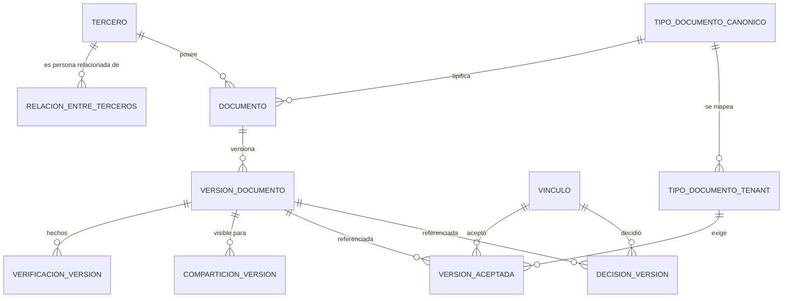

# 02 — Modelo documental compartido (terceros ↔ empresas, muchos a muchos)

| Estado | Fecha | Responsable |
|---|---|---|
| Borrador | 2026-10-28 | Arquitectura |

**Propósito.** Definir, sin ambigüedad, cómo se guardan, comparten, versionan, validan y vencen los documentos cuando **un tercero** (proveedor, cliente, empleado…) se relaciona con **muchas empresas** y cada empresa aplica sus propias reglas. Es el documento que resuelve el mayor dolor del legado: dos sistemas dueños parciales del mismo dato y "copias espejo" por constructora.

**Relacionados.** [00-vision-y-alcance.md](00-vision-y-alcance.md) · [01-analisis-legado-srm-portal.md](01-analisis-legado-srm-portal.md) · [03-dominio-y-eventos.md](03-dominio-y-eventos.md) · [04-arquitectura-plataforma.md](04-arquitectura-plataforma.md) · [07-seguridad-identidad-y-tenancy.md](07-seguridad-identidad-y-tenancy.md) · [08-integracion-y-migracion.md](08-integracion-y-migracion.md) · [10-glosario.md](10-glosario.md) · ADR-0004, ADR-0005.

---

## 1. El problema en una frase

Un RUT es **un hecho sobre el tercero**; la aprobación de ese RUT es **una opinión de cada empresa**. El legado mezcló las dos cosas: el Portal guardaba el archivo y además una "copia espejo" por constructora (`AdjuntosConstructora`), el SRM decidía cuándo actualizar la copia, y nadie sabía con certeza qué versión era la verdadera ni quién la había validado ([01](01-analisis-legado-srm-portal.md)).

## 2. Principios (las respuestas)

| # | Principio | Consecuencia práctica |
|---|---|---|
| P1 | **La bóveda del tercero es la única fuente de verdad del archivo.** | Un documento global existe **una vez por tercero y tipo canónico**, con versiones inmutables v1, v2, v3… Ninguna empresa tiene copias. |
| P2 | **Hay una sola versión vigente ("actual") por documento global.** | Las empresas no eligen versión: validan la actual. Si el tercero sube una versión nueva válida, la anterior quedó superada para **todas**. |
| P3 | **Cada empresa es dueña de su decisión, no del archivo.** | `VersionAceptada(vínculo, tipo)` registra qué versión validó esa empresa, cuándo, con qué vigencia. Si la actual cambia, esa aceptación queda `Desactualizada` hasta que la empresa revalide. Nunca existen dos "verdades aceptadas" en paralelo: la divergencia solo existe como *pendiente de revalidar*. |
| P4 | **Las decisiones son privadas por empresa.** | Lo que A aprobó, observó o rechazó no lo ve B. Esto aplica también **dentro de un mismo tenant (grupo empresarial)**: cada razón social es una `Empresa` del tenant y sus decisiones están aisladas de las demás empresas del grupo (P-11-2, ADR-0008). El tercero sí ve el estado por empresa. |
| P5 | **Los hechos sobre el archivo se calculan una vez y se comparten.** | Tipo detectado, legibilidad, antivirus, hash, fechas extraídas, campos clave y comparación con la versión anterior se computan por versión, no por empresa. |
| P6 | **La vigencia tiene dos capas.** | Capa 1: hecho del documento (fecha propia de vencimiento, fecha de expedición, periodo). Capa 2: exigencia de frescura de cada empresa. La vigencia *para A* es el mínimo de ambas. |
| P7 | **El ámbito lo define el tipo canónico.** | `Global` (bóveda del tercero, compartido) o `PorVinculo` (privado de la relación: formato de vinculación de A, póliza a favor de A, autorización de datos de A, contrato). Un tipo propio de un tenant sin equivalente canónico es siempre `PorVinculo`. |
| P8 | **Compartición automática sin excepciones, pero solo con quien el tercero ya aceptó.** | Una versión global se comparte con todos los vínculos **cuya invitación el tercero aceptó** y que exigen ese tipo (A-8: el tercero no puede excluir a ninguna empresa; B-1/ADR-0009: nada se comparte con una empresa antes de `InvitacionAceptada` + consentimientos). Antes de aceptar, la empresa invitante solo ve "tercero existente; N requisitos podrían quedar cubiertos". La compartición se **congela** hacia adelante por desvinculación o bloqueo del vínculo; lo ya compartido sigue legible por retención. |
| P9 | **Nada se borra si está referenciado.** | Una versión referenciada por una `VersionAceptada` o un certificado de cualquier empresa es inmutable e imborrable por retención legal. El tercero puede **retirar** (no vuelve a usarse) pero no borrar. Nunca se anonimiza una versión referenciada (rompería el hash del certificado). |
| P10 | **Una sola acción del tercero sirve a todas.** | Avisos de vencimiento consolidados; una subida nueva satisface a todas las empresas; la revalidación automática hace el resto. |
| P11 | **La lectura es de la plataforma; la decisión, de cada empresa.** | La IA lee cada versión **una vez** como coste de plataforma (B-2), sin presupuesto de lectura por tenant; los hechos los ven todas las empresas con compartición. El presupuesto de cada tenant limita solo las **decisiones** (Asistido/Automático). La IA solo falta si está deshabilitada a nivel plataforma o el tercero no consintió. |
| P12 | **Las personas relacionadas son terceros.** | Representante legal, suplentes, socios/beneficiarios finales y miembros de consorcio son terceros persona natural con **bóveda propia** y una relación tipada con el tercero jurídico (B-3/ADR-0010). Su cédula se valida una vez y sirve a todas las empresas y a todos los terceros donde figuran. |
| P13 | **Configuración en tres niveles.** | Frescura, nivel de revisión, plazo de revalidación, política, aprobadores y muestreo se resuelven tenant → empresa → regla del flujo (B-4), con un solo nombre por parámetro. |

## 3. Vocabulario mínimo

| Término | Significado |
|---|---|
| Tenant (grupo) | Cliente del SaaS. Agrupa una o varias **empresas** (razones sociales) que comparten usuarios, catálogo, configuración y facturación. |
| Empresa (interna) | Razón social dentro del tenant que exige, revisa y certifica. El vínculo es `(tenant, empresa, tercero, tipo de vínculo)`. Sus decisiones son privadas incluso frente a otras empresas del mismo tenant. |
| Bóveda del tercero | Conjunto de documentos globales de un tercero, con sus versiones. Esquema `boveda`. |
| Versión actual | La versión más reciente que pasó los hechos compartidos. Única por documento global. |
| Versión aceptada | Puntero por (vínculo, tipo de documento del tenant) a la versión que esa empresa validó, con vigencia y motivo. |
| Desactualizada | Marca de una versión aceptada cuya versión ya no es la actual. Obliga a revalidar. |
| Revalidación | Expediente de tipo `Actualizacion` que una empresa abre automáticamente cuando la versión actual cambió. |
| Hecho compartido | Resultado objetivo sobre una versión (tipo, legibilidad, fechas, comparación). Lo calcula la plataforma una vez. |
| Decisión privada | Veredicto de una empresa sobre una versión en su vínculo. |
| Regla de frescura | Exigencia de una empresa sobre la antigüedad máxima o el periodo mínimo de un tipo de documento. |
| Compartición | Autorización de una empresa (vía su vínculo, ya aceptado por el tercero) para ver una versión concreta. |
| Persona relacionada | Tercero persona natural con relación tipada (`RepresentanteLegal`, `Suplente`, `Socio`, `BeneficiarioFinal`, `MiembroDe`) con otro tercero; tiene bóveda propia. |
| Configuración efectiva | Parámetros de un requisito ya resueltos por la jerarquía tenant → empresa → regla y congelados en el expediente. |

## 4. Ámbitos y catálogo canónico

### 4.1 Dos niveles de catálogo

```mermaid
flowchart LR
  subgraph Plataforma
    C[tipo_documento_canonico<br/>RUT, CAMARA_COMERCIO, CEDULA,<br/>ESTADOS_FINANCIEROS, CERTIFICACION_BANCARIA, POLIZA...]
  end
  subgraph Tenant A
    TA[tipo_documento_tenant<br/>"RUT actualizado" → RUT<br/>"Formato vinculación A" → sin canónico]
  end
  subgraph Tenant B
    TB[tipo_documento_tenant<br/>"Registro Único Tributario" → RUT]
  end
  C --> TA
  C --> TB
```

- El **canónico** hace que "RUT" en A y "Registro Único Tributario" en B sean el mismo documento compartible. Lo administra la plataforma; el tenant mapea sus tipos o propone un canónico nuevo que la plataforma aprueba (P-2-1, cerrada). **La semilla definitiva de códigos y defaults es el Anexo A de [03](03-dominio-y-eventos.md)**; este documento solo la cita. Al aprobarse una propuesta, los documentos `PorVinculo` que ya existían bajo ese tipo se convierten en globales: la versión más reciente de cada tercero pasa a ser la actual y las aceptaciones que no coincidan nacen `Desactualizada` con plazo de 90 días (03 §4.5).
- El **tipo de tenant** aporta los defaults del grupo (nombre, ayuda, plantilla, regla de frescura, áreas, nivel de revisión…); el **tipo de empresa** los sobreescribe opcionalmente para una razón social; la **regla de exigencia** del flujo sobreescribe ambos (§4.3-bis).

### 4.2 Atributos del tipo canónico (hechos y naturaleza del documento)

| Atributo | Significado | Ejemplos |
|---|---|---|
| `codigo` | Identificador estable (nunca numérico mágico); lista cerrada en 03 Anexo A | `RUT`, `CAMARA_COMERCIO`, `CEDULA`, `ESTADOS_FINANCIEROS`, `CERTIFICACION_BANCARIA`, `CUENTA_BANCARIA`, `DATOS_MAESTROS`, `POLIZA`, `AUTORIZACION_TRATAMIENTO_DATOS` |
| `ambito` | `Global` o `PorVinculo` | RUT = Global; `FORMATO_VINCULACION` = PorVinculo |
| `clase` | `Archivo` o `Formulario` (datos estructurados con esquema JSON, misma mecánica de versiones; ver §4.4) | `CUENTA_BANCARIA` = Formulario |
| `dePersonaRelacionada` | El documento pertenece a la bóveda de una persona natural relacionada (rol) y no a la del tercero jurídico (B-3) | `CEDULA` (RepresentanteLegal…), `CERTIFICADO_ANTECEDENTES`, `DECLARACION_PEP` |
| `esquemaFormulario` + `versionEsquema` | Solo clase `Formulario`: JSON Schema **base canónico** de plataforma, versionado. Cada versión de documento guarda con qué versión del esquema se capturó (P-2-2, P-3-2). | `INFO_TRIBUTARIA` v2 |
| `aplicaA` | `PersonaNatural`, `PersonaJuridica`, `Ambas` | Cámara de comercio = Jurídica (y natural comerciante: condición en la regla) |
| `tieneVencimientoIntrinseco` | El documento trae su propia fecha de fin | Póliza = sí; RUT = no |
| `tieneFechaExpedicion` | Se extrae `fecha_expedicion` | Cámara = sí |
| `esPeriodico` + `periodicidad` | Se emite por periodo | EEFF = anual |
| `permiteRatificacion` | El tercero puede declarar "no cambió" sin subir versión | RUT = sí; Cámara = no; EEFF = no |
| `camposClave[]` | Campos que la IA extrae y compara entre versiones | RUT: NIT, razón social, dirección, actividad CIIU, responsabilidades, representante legal |
| `camposCriticos[]` | Subconjunto cuyo cambio exige revisión humana aunque el nivel sea Automático | RUT: NIT, razón social, representante legal |
| `esquemaDatos` | JSON Schema de `datos_extraidos`/`datos_declarados` | — |
| `sensibilidad` | `Identidad`, `Financiera`, `Personal` (informativo para UI y retención) | EEFF = Financiera |

### 4.3 Atributos del tipo de tenant (defaults del grupo) y del tipo de empresa (override)

| Atributo | Significado | Por defecto |
|---|---|---|
| `tipoCanonicoId` (nullable) | Enlace al canónico; `null` ⇒ `PorVinculo` | — |
| `nombre`, `textoAyuda`, `plantillaVersionId` | Lo que ve el tercero | Hereda del canónico |
| `reglaFrescura` | `Ninguna` · `MaxDiasDesdeExpedicion(n)` · `PeriodoMinimo(regla)` · `MaxDiasDesdeAprobacion(n)` | Según el Anexo A de 03 |
| `diasAviso[]` | Avisos previos al vencimiento | `[30, 15, 5]` (`[60, 30, 7]` pólizas y EEFF) |
| `diasGracia` | Días después del vencimiento antes de pasar el vínculo a `Vencido` | **15** (P-7-2); 0 para requisitos `criticoDeCumplimiento` |
| `politicaDesactualizada` | `BloquearTrasGracia` (vencido `diasRevalidacion`, la marca `ConPendientes` del certificado pasa a **bloqueante**: la consulta responde `bloqueado: true`) · `SoloAviso` | `BloquearTrasGracia` (A-2). Único nombre; no existe `desactualizadaBloquea` |
| `diasRevalidacion` | Plazo desde que la aceptación quedó `Desactualizada`; durante él el certificado sigue `Vigente` con marca `ConPendientes` informativa | 15 (A-2); 90 para aceptaciones importadas (B-8) |
| `nivelRevision` | `Manual` · `Asistido` · `Automatico` | `Manual` |
| `camposCuyoCambioExigeHumano[]` | Campos cuyo cambio, para esta empresa, abre revalidación aunque no sean críticos canónicos | `[]` |
| `porcentajeMuestreo` | % de decisiones automáticas enviadas a revisión humana | 5 |
| `areasQueRevisan[]` | Áreas del flujo que emiten veredicto | — |
| `permiteRatificacion` | Puede ser más estricta que el canónico (`false`), nunca más laxa | Hereda |
| `camposPrivados[]` | Solo clase `Formulario`: campos adicionales propios del tenant. Viven `PorVinculo` (no se comparten) y se renderizan junto al esquema base (P-3-2) | "Código de proveedor interno" |
| `aprobadoresRequeridos` | 1 o 2 ("cuatro ojos", P-4-7). Por defecto 2 para `CERTIFICACION_BANCARIA`, `CUENTA_BANCARIA` y cambio de cuenta designada | 1 |

(`tiposAceptados[]` no es atributo del tipo: pertenece a la regla de exigencia del flujo.)

### 4.3-bis Jerarquía de configuración (B-4)

```
tipo_documento_tenant   (defaults del grupo)
   ← tipo_documento_empresa   (override opcional de una razón social: solo los campos que cambia)
      ← ReglaDeExigencia.Overrides   (override del flujo: solo los campos que cambia)
= ConfiguracionEfectiva del requisito, congelada al abrir o recalcular el expediente
```

Un parámetro tiene **un solo nombre** en los tres niveles. Ejemplo: Acme Construcciones (Automático, Cámara ≤ 30 días) y Acme Inmobiliaria (Asistido, Cámara ≤ 90 días) son dos empresas del mismo tenant con `tipo_documento_empresa` distintos sobre el mismo `tipo_documento_tenant`.

### 4.4 Formularios (datos estructurados) y cuentas bancarias

**Formularios.** Los sectores del Portal (información general, tributaria, financiera, legal, SISO, contactos, T&C, autorización de datos, SARLAFT) son tipos canónicos de clase `Formulario` (P-3-1): la versión de documento guarda `datos_declarados` conforme al `esquemaFormulario` canónico (compartible) y, aparte, los `camposPrivados` del tenant (PorVinculo). Reglas:
1. **Toda edición crea una versión nueva** (trazabilidad), igual que un archivo.
2. La versión nueva pasa a **`Actual`** y la bóveda emite `VersionActualCambiada(CamposCambiados[], CamposCriticosCambiados[])` como **hecho** (T-7). Cada empresa decide: si cambió un campo crítico canónico **o** uno de sus `camposCuyoCambioExigeHumano`, abre revalidación (§7); si no, lo registra como **cambio menor** (campana/digest) sin desactualizar su aceptación (P-3-6). La misma versión puede ser cambio menor para A y revalidación para B.
3. Si el formulario exige soporte (p. ej. certificación bancaria para `CUENTA_BANCARIA`, RUT para `INFO_TRIBUTARIA`), la IA, cuando está disponible, cruza los campos clave declarados con los extraídos del soporte; la discrepancia es un hecho compartido (P-3-4).
4. Los datos maestros del tercero (razón social, dirección, relaciones con personas) son el formulario global `DATOS_MAESTROS`: **el tercero propone**, la plataforma contrasta contra el RUT/Cámara si hay IA, y la versión se publica; sin IA se publica igual y queda pendiente de revalidación manual en cada empresa. Nunca se bloquea al tercero ni una empresa puede "corregir" datos globales (P-1-7). Las empresas solo anotan datos privados del vínculo (código ERP, categorías, etiquetas).

**Cuentas bancarias (P-3-3).** El tercero registra **N cuentas globales** (`CUENTA_BANCARIA`, formulario global con su `CERTIFICACION_BANCARIA` como soporte validado una vez). Cada vínculo tiene una **`CuentaDesignada`** (dato privado del vínculo) que **elige el tercero** al vincularse o cuando quiera cambiarla; el cambio de cuenta designada lo aprueban dos usuarios de esa empresa con `cuentas:aprobar` (antifraude) y, aprobado, viaja al ERP de esa empresa. **Un solo cuatro ojos:** esa misma aprobación deja `Aprobado` el requisito `CUENTA_BANCARIA` del expediente; no se revisa dos veces. Si el tipo de vínculo exige cuenta designada (proveedor), el expediente no se cierra sin ella. Cambiar la cuenta designada con A no afecta a B. Una certificación bancaria nueva sigue la regla general de versión única (todas las empresas que tienen esa cuenta designada revalidan).

### 4.5 Personas relacionadas (B-3, ADR-0010)

El representante legal, los suplentes, los socios/beneficiarios finales y los miembros de un consorcio son **terceros persona natural** con bóveda propia, unidos al tercero jurídico por `RelacionEntreTerceros { tipo, principal, vigencia, fuente }` ([03 §4.5](03-dominio-y-eventos.md)).

- La `CEDULA`, el `CERTIFICADO_ANTECEDENTES`, la `DECLARACION_PEP` y el `BENEFICIARIO_FINAL` son documentos **de la persona**: se validan una vez y sirven a todas las empresas y a todos los terceros jurídicos donde esa persona figura. `IdentidadCoincide` compara la cédula con la identificación de la persona, no con el NIT.
- Un requisito del flujo puede exigir "cédula de la persona relacionada con rol `RepresentanteLegal`" (`dePersonaRelacionada`); se resuelve contra la relación principal vigente al abrir o recalcular el expediente.
- El `FORMULARIO_SARLAFT` de cada empresa es `PorVinculo` y **referencia** las versiones vigentes de `BENEFICIARIO_FINAL` y `DECLARACION_PEP` en vez de duplicar los datos (I-20).
- Un cambio de representante detectado por la IA en una Cámara nueva **no** cambia la relación por sí solo: la relación cambia cuando el tercero lo confirma, un revisor lo confirma al revalidar, o la confianza es ≥ 0,98 y la Cámara fue aprobada por alguna empresa; solo entonces expiran la cédula y las listas del saliente en todas las empresas (esc. 6).

## 5. Ciclo de vida de una versión

`EstadoVersion { Recibida, EnAnalisis, Actual, Superada, Devuelta, Retirada }` (dueño del enum: [03](03-dominio-y-eventos.md)).

```mermaid
stateDiagram-v2
  [*] --> Recibida: VersionCargada (PUT prefirmado + confirmar)
  Recibida --> EnAnalisis: AnalisisDeVersionIniciado
  EnAnalisis --> EnAnalisis: HechosDeVersionRegistrados (parciales)
  EnAnalisis --> Devuelta: VersionDevueltaAlTercero (virus / MIME inválido / con IA: tipo incorrecto, ilegible, identidad no coincide)
  EnAnalisis --> Actual: PromoverAActual → VersionActualCambiada (camposCambiados, camposCriticosCambiados)
  Devuelta --> [*]: vuelve al tercero, no alerta a nadie
  Actual --> Superada: llega una versión nueva Actual
  Actual --> Retirada: el tercero la retira (solo si nadie la referencia)
  Superada --> Actual: VersionActualRestituida (se retiró la actual)
  Superada --> Superada: inmutable; sigue referenciada por aceptaciones históricas y certificados
```



Reglas:
1. **Dedupe**: mismo `sha256` (o `hash_datos` en formularios) en el mismo documento ⇒ no hay versión nueva; la UI ofrece "es el mismo archivo, ¿quieres ratificar?" si el tipo lo permite.
2. **Solo `Actual` dispara alertas** a las empresas (evento `VersionActualCambiada`). `Devuelta` es un diálogo privado con el tercero ("esto no parece un RUT", "página 2 ilegible").
3. **Nunca se edita una versión.** Correcciones de datos extraídos por un humano se registran como evento (`DatosDeVersionCorregidos`) sin tocar el binario.
4. **Condición para volverse `Actual`** (D-3, cerrada con la regla de [03](03-dominio-y-eventos.md) §4.3): sin IA bastan hash verificado, antivirus `Limpio` y MIME real permitido; con IA se exige además tipo correcto, legibilidad distinta de `NoLegible` e identidad coincidente (con el tercero o con la persona relacionada dueña); si no, `Devuelta`. En producción sin antivirus la versión **espera** en `EnAnalisis` (T-11).
5. **La IA puede no estar disponible** solo por dos causas: deshabilitada a nivel plataforma (configuración u on-premise sin clave) o el tercero no ha dado su `ConsentimientoIa` (B-2, B-8). Entonces solo existen los hechos básicos de la tabla siguiente (`con_ia = false`) y la versión pasa a `Actual` con `pendiente_revision_humana = true`; cada empresa la revisa manualmente. Nunca se bloquea al tercero (P-1-7, P-6-4). El presupuesto del tenant **no** afecta a la lectura: solo a las decisiones automáticas.
6. **Retiro de la versión actual (I-11).** Si el tercero retira la `Actual` (p. ej. subió por error el RUT de otra empresa y ninguna aceptación la referencia), la `Superada` anterior vuelve a ser `Actual` (`VersionActualRestituida`) y las revalidaciones que la versión retirada había abierto se cancelan; las aceptaciones vuelven a `AlDia`.
7. **Riesgo sin IA (documentado).** Sin IA, un RUT de otra empresa pasa a `Actual` (hash/antivirus/MIME no lo detectan), desactualiza a todas las empresas y arranca el plazo de revalidación; el humano lo detecta al revalidar y lo observa con `NoAdmitirEstaVersion`, y el tercero puede retirarlo (regla 6). Es el precio de no contratar la lectura por IA a nivel plataforma; la mitigación del riesgo del 00 §7 solo existe con IA.

### 5.1 Hechos compartidos por versión (`verificacion_version`)

| Tipo | Resultado | Quién lo produce | Requiere IA | Cuándo |
|---|---|---|---|---|
| `Hash` | sha256 verificado contra el declarado y contra MinIO; dedupe | Worker | No | Al confirmar la subida |
| `TipoMime` | tipo real por magic bytes vs declarado; páginas; tamaño | Worker | No | Al confirmar |
| `Antivirus` | `Limpio` · `Infectado` · `Cuarentena` · `NoDisponible` (solo continúa en dev; en prod espera) | Worker (ClamAV) | No | Antes del análisis |
| `Preview` | miniaturas/páginas PNG; texto nativo si existe | Worker (PDFium) | No | En paralelo |
| `Comparacion` (básica, por hash) | `SinAnterior` · `Identica` (mismo hash) · `Distinta` | Plataforma | No | Tras hash |
| `TipoYLegibilidad` | tipo detectado, coincide con el esperado, legible | IA (preclasificación `claude-haiku-5-5`) | Sí | Tras antivirus |
| `Extraccion` | `camposClave`, `fecha_expedicion`, `fecha_vencimiento_doc`, `periodo`, firmas/sellos, confianza por campo, señales de manipulación | IA (`claude-opus-5-5` o `claude-sonnet-5-5` según tipo) | Sí | Tras legibilidad |
| `Comparacion` (por campos) | `SinCambios` (campos clave iguales) · `CambiosDetectados{campos[]}` | Plataforma sobre las extracciones de v(n) y v(n−1) | Sí | Tras extracción |
| `CoherenciaFormularioSoporte` | campos declarados vs extraídos del soporte (P-3-4) | Plataforma + IA | Sí | Tras extracción |

Sin IA, la comparación es solo por hash (`Distinta`) y no hay revisión automática (la ratificación nunca es automática, A-7). La lectura con IA es **coste de plataforma** (P11): se hace una vez por versión cuando la IA está habilitada y el tercero consintió, sin importar qué tenants la exigen. Todo hecho se registra como evento del stream `Documento-{id}` y, cuando interviene la IA, se archiva prompt y respuesta en `ia/{terceroId}/{documentoId}/v{n}.json` para auditoría ([04](04-arquitectura-plataforma.md) §IA).

## 6. Compartición y visibilidad

### 6.1 Cuándo se comparte (B-1, ADR-0009)
- **Nunca antes de que el tercero acepte la invitación de esa empresa.** Al crear un vínculo, la empresa solo recibe "tercero existente en Validasoft; N de tus requisitos podrían quedar cubiertos con lo que ya tiene", sin nombres de documentos ni versiones. Esto cierra la cosecha de información por NIT y cumple la Ley 1581 (autorización previa por responsable).
- Al aceptar la invitación (`InvitacionAceptada` + consentimientos para esa empresa), se comparte la versión actual de cada tipo exigido que ya exista en la bóveda; el tercero no vuelve a subir el RUT para cada empresa.
- Al volverse `Actual` una versión nueva, se comparte automáticamente con **todos los vínculos ya aceptados** del tercero cuyo snapshot de requisitos incluya ese tipo canónico (P8).
- El tercero **no puede excluir** a una empresa vinculada (A-8): la única forma de que una empresa deje de recibir versiones nuevas es la desvinculación o el bloqueo del vínculo.
- Al desvincularse o bloquearse, la compartición se **congela** hacia adelante (`ComparticionCongelada`: no llegan versiones nuevas); lo ya compartido sigue legible para la empresa por retención. Al desbloquear se reanuda y se comparte la versión actual si cambió.

### 6.2 Quién ve qué

| Dato | Tercero | Empresa A | Empresa A2 (mismo tenant que A) | Empresa B (otro tenant) | Integración de A (API key) | Auditor del tenant de A | Plataforma |
|---|---|---|---|---|---|---|---|
| Binario de la versión actual | Sí | Sí, si compartida | Sí, si compartida con su propio vínculo | Sí, si compartida | Sí (prefirmada) | Sí | **No**; solo con acceso temporal concedido por un Administrador del tenant (alcance y horas), auditado con actor `Plataforma` (B-6) |
| Versiones anteriores | Sí | Las que le fueron compartidas | Ídem | Ídem | Ídem | Ídem | Ídem |
| Hechos compartidos | Sí (resumen en lenguaje llano) | Sí | Sí | Sí | Sí | Sí | Sí |
| Decisión de A (veredictos, motivos) | Sí, como estado y motivo | Sí | **No** | **No** | Sí (si la key tiene alcance a A) | Sí (todas las empresas del tenant) | No (solo métricas) |
| Decisión de B | Sí | **No** | **No** | Sí | No | No | No |
| Estado por empresa de un documento | Sí (todas sus empresas) | Solo la suya | Solo la suya | Solo la suya | Solo las de su alcance | Todas las del tenant | Agregado |
| Reglas de frescura de A | Solo el resultado ("A exige máx. 30 días") | Sí | Sí (defaults del tenant; los overrides de A son de A) | No | Sí | Sí | No |

Dentro de un tenant, las empresas comparten **configuración por defecto** (catálogo, flujos, usuarios, plantillas) con overrides propios por empresa, pero **no decisiones ni aceptaciones**. Un usuario puede tener roles en varias empresas del tenant; el Auditor del tenant ve todas. Las API keys son del tenant y declaran su alcance (`empresas: [A]` o `*`).

Autorización técnica: toda descarga pasa por `comparticion_version` (o propiedad en `PorVinculo`) antes de emitir la URL prefirmada; cada emisión registra `DocumentoAccedido` ([07](07-seguridad-identidad-y-tenancy.md)).

## 7. Versión nueva ⇒ revalidación de todas las empresas

```mermaid
sequenceDiagram
  participant T as Tercero
  participant V as Bóveda
  participant W as Worker (hechos)
  participant A as Vínculo con A
  participant B as Vínculo con B
  T->>V: Sube RUT v3
  V->>W: VersionCargada
  W-->>V: Hechos OK (tipo RUT, legible, CambiosDetectados: dirección)
  V->>V: v3 = Actual; v2 = Superada
  V-->>A: VersionActualCambiada(RUT, v3, camposCambiados=[direccion], criticos=[])
  V-->>B: VersionActualCambiada(RUT, v3, camposCambiados=[direccion], criticos=[])
  Note over A,B: es un archivo ⇒ ambas revalidan (en formularios cada empresa decide según sus campos)
  A->>A: VersionAceptada(v2) ← Desactualizada; abre Expediente(Actualizacion)
  B->>B: Ídem
  Note over A: nivelRevision=Automatico, dirección no es crítica ⇒ VeredictoAutomatico(Aprobado) ⇒ aceptada = v3
  Note over B: nivelRevision=Manual ⇒ bandeja "Revalidaciones"
  B-->>T: (si observa) "Página 2 cortada. Sube de nuevo."
  T->>V: Sube v4 → vuelve a empezar para TODAS (A incluida)
```

Reglas:
1. La alerta llega a **todas** las empresas con vínculo aceptado que exigen el tipo, sin excepción (decisión del usuario: garantizar información verídica). La bóveda emite el **hecho** (`CamposCambiados`, `CamposCriticosCambiados`); cada empresa decide si revalida: siempre en archivos; en formularios, si cambió un crítico canónico o uno de sus propios `camposCuyoCambioExigeHumano` (T-7).
2. La aceptación anterior **no se borra**: queda en el histórico con `estado_aceptacion = Desactualizada` y `version_actual_en_ese_momento = v3`.
3. Mientras exista una aceptación desactualizada, el vínculo muestra **"revalidación pendiente"** y el certificado pasa a `ConPendientes` **informativo** (sigue valiendo). Tras `plazo_revalidacion` (15 días por defecto; 90 en aceptaciones importadas) sin revalidar, y con `politicaDesactualizada = BloquearTrasGracia` (por defecto), `ConPendientes` pasa a **bloqueante**: la consulta de certificación responde `bloqueado: true, motivo: RevalidacionVencida` y el evento `certificado.con_pendientes` viaja con `bloqueante: true`, hasta que la empresa revalide (A-2). Es responsabilidad de la empresa, no del tercero; el vínculo no cambia de estado por esto.
4. Si una empresa **observa** la versión actual, la decisión es privada; el tercero ve el motivo y, si corrige, sube una versión nueva que **vuelve a alertar a todas**, incluidas las que ya habían aprobado (porque la verdad cambió otra vez). Sobre una versión no existe "rechazar": existe observar con `noAdmitirEstaVersion` (B-7); rechazar es cerrar el expediente.
5. Una versión **no admitida** por A nunca vuelve a aceptarse en A (invariante del `Vinculo`, [03](03-dominio-y-eventos.md)).
6. Para documentos `PorVinculo` solo se alerta a esa empresa.

## 8. Vigencias en dos capas y vencimiento

### 8.1 Cálculo por versión aceptada

```
capa1 = fecha_vencimiento_doc (si tieneVencimientoIntrinseco)        -- hecho del documento
capa2 = según reglaFrescura del tenant:
        MaxDiasDesdeExpedicion(n)  → fecha_expedicion + n
        MaxDiasDesdeAprobacion(n)  → fecha_aceptacion + n
        PeriodoMinimo(regla)       → fin del periodo permitido (p. ej. EEFF 2025 válidos hasta 2027-04-30)
        Ninguna                    → ∞
vigente_hasta = mín(capa1, capa2);  motivo_vigencia = cuál ganó
```

| Caso | A (Cámara máx. 30 días) | B (Cámara máx. 90 días) |
|---|---|---|
| Cámara expedida 2026-10-01 | vigente_hasta 2026-10-31 (frescura A) | vigente_hasta 2026-12-30 (frescura B) |
| Póliza fin 2026-11-15, regla `Ninguna` | 2026-11-15 (vencimiento propio) | 2026-11-15 |
| RUT, regla `MaxDiasDesdeExpedicion(365)` (Anexo A de 03) | 365 días desde la generación del PDF; ratificable | según B |

Es correcto que A vea vencida la misma versión que B ve vigente: **el hecho es uno; la exigencia es de cada una**.

### 8.2 Qué pasa al vencer en A
1. `version_aceptada` de A pasa a `Vencida`; el requisito de A queda `Vencido`.
2. El vínculo de A pasa a `PorVencer` en `vigente_hasta − diasAviso` y a `Vencido` en `vigente_hasta + diasGracia` (**15 días** por defecto; 0 si el requisito es `criticoDeCumplimiento`) si el requisito es **crítico** (regla de exigencia del flujo); si no es crítico, el vínculo sigue `Activo` con el requisito vencido visible.
3. Un crítico vencido abre `Renovacion` automáticamente (si no hay expediente abierto; si lo hay, se agrega el requisito, [03 §5.2](03-dominio-y-eventos.md)). El certificado de A pasa a `ConPendientes` (P-7-3) por un no crítico; vence si el vínculo pasa a `Vencido` por un crítico o por `DiasFijosDesdeAprobacion`.
4. Al aprobarse **cualquier** expediente (Renovación o Actualización) que deje sin críticos vencidos, el vínculo vuelve a `Activo` (I-15).
5. B no se afecta.

### 8.3 Flujo orgánico para el tercero: frescura consolidada
La proyección `FrescuraDocumentoTercero` mantiene, por documento global del tercero: `vigente_hasta` por empresa, el **próximo vencimiento** (el mínimo) y las empresas afectadas en cada fecha. Con ella:
- El tercero recibe **una** secuencia de avisos por documento ("Tu Cámara de comercio vence para A el 31/10 y para B el 30/12; renuévala antes del 31/10 y quedas al día con las dos").
- La campana del tercero agrupa por documento, no por empresa.
- La subida nueva sigue la sección 7: una acción, todas revalidan.

### 8.4 Renovación y ratificación
| Mecanismo | Cuándo aplica | Efecto |
|---|---|---|
| Versión nueva | Siempre | Nueva actual ⇒ revalidación de todas (sección 7); para A es renovación, para B puede ser actualización anticipada |
| Ratificación | **Condición única (I-14):** `permiteRatificacion` en el canónico **y** en la configuración efectiva, la versión es la actual y no tiene `fecha_vencimiento_doc` pasada | `RequisitoRatificado` en el vínculo de la empresa que lo pidió; **reinicia la frescura** (la fecha base pasa a ser la de la ratificación: `vigente_hasta = fecha_ratificacion + n`); no cambia la versión actual ni alerta a otras; reemite el certificado si cambia la vigencia. **Nunca pasa por un área ni la emite el sistema** (A-7): "si no cambia ni la información ni el documento, con la declaración basta"; si algo cambió, es versión nueva (§7) |
| Renovación periódica (EEFF) | Tipos periódicos | La versión nueva lleva `periodo`; cada empresa evalúa `PeriodoMinimo` |

## 9. Revisión automática por niveles (servicio contratable)

| Nivel | Qué hace la plataforma | Qué hace el humano |
|---|---|---|
| `Manual` | Calcula los hechos básicos siempre (hash, tipo MIME, antivirus, preview, comparación por hash) y, si la IA está disponible a nivel plataforma, también los hechos de IA; los muestra en el PanelIA sin decidir | Decide todo |
| `Asistido` | Propone veredicto con evidencia (requiere hechos de IA) | Confirma en un clic o cambia |
| `Automatico` | Emite `VeredictoAutomaticoEmitido` cuando se cumplen las reglas (requiere hechos de IA) | Ve excepciones (`ColaDeExcepciones`) y la muestra de auditoría (`porcentajeMuestreo`) |

La lectura por IA es **coste de plataforma** (una vez por versión, P11); `Asistido` y `Automatico` son el servicio que contrata cada **empresa** para decidir, y el presupuesto del tenant limita solo esas decisiones. Si la IA no está disponible (deshabilitada a nivel plataforma o sin consentimiento del tercero) o el presupuesto de decisiones se agotó, `Asistido`/`Automatico` degradan a `Manual` con alerta al administrador (P-6-4); no sobrevive ninguna regla automática. La ratificación **nunca** es automática (A-7).

Reglas de decisión automática (por empresa, sobre hechos compartidos):

| Situación | Resultado automático |
|---|---|
| `SinCambios`, frescura cumple, sin señales de manipulación | Aprobado |
| `CambiosDetectados` solo en campos no críticos, identidad coincide, frescura cumple, confianza ≥ 0,95 por campo | Aprobado (con el diff en la evidencia) |
| Cambio en `camposCriticos` o `camposCuyoCambioExigeHumano`, señales de manipulación, formulario incoherente con su soporte | Humano (`ColaDeExcepciones`) |
| Frescura incumplida (p. ej. Cámara de 45 días, A exige 30) | **Observado al tercero** con motivo `frescura-incumplida` y el siguiente paso, sin pasar por humano |
| Identidad no coincide (NIT distinto) | No llega a la empresa: con IA la versión fue `Devuelta` en la bóveda; sin IA no se detecta y el humano la observa con `noAdmitirEstaVersion` |
| Confianza 0,80–0,95 | Se degrada a `Asistido` (sugerencia) |
| Confianza < 0,80, `NoLegible`, error de IA, presupuesto agotado | Humano (fail-closed) |

- Toda decisión automática es un veredicto con `OrigenVeredicto = Sistema` (los humanos `Humano`; el override `Administrador`) y con evidencia (hechos usados, campos comparados, modelo, confianza, coste), **reversible** por un humano con permiso, y entra en la muestra de auditoría.
- Modelo de negocio (B-2): la plataforma **lee cada versión una vez** (hecho compartido, coste incluido en el cargo por vínculo activo) y cada empresa **paga por decidir** con sus reglas (nivel contratado por tipo de documento). Tres empresas que comparten un tercero generan una lectura y tres decisiones. `UsoTenant.lecturasIa` es informativo; `decisionesIa` es lo facturable.
- El tercero ve el resultado por empresa de inmediato: "A: aprobado automáticamente · B: en revisión manual · C: observado: tu documento tiene 45 días y C exige máximo 30".

## 10. Estructura de almacenamiento

### 10.1 Tres esquemas en PostgreSQL (copia literal de [03 §2.2](03-dominio-y-eventos.md), que es la fuente)

Un solo `DocumentStore` de Marten con eventos conjoined: `validacion` usa el `tenant_id` real; `boveda` y `plataforma` usan tenants técnicos (T-1, T-2).



**Esquema `plataforma` (tenant técnico `plataforma`; administra Sincosoft)**

| Tabla | Columnas clave | Notas |
|---|---|---|
| `tenant` | `id`, `slug`, `nombre`, `region`, `clave_kms`, `plan_id`, `ia_habilitada` (hereda de la plataforma), `activo` | Región y clave KMS por tenant (P-14-2, P-14-3) |
| `empresa` | `tenant_id`, `id`, `pais`, `tipo_identificacion`, `numero`, `razon_social`, `prefijo_folio`, `logo`, `reply_to`, `activa` | Razones sociales del tenant (grupo), P-11-2 / ADR-0008 |
| `plan`, `uso_tenant` | `tenant_id`, `periodo`, `usuarios`, `vinculos_activos`, `gb`, `lecturas_ia` (informativo), `decisiones_ia` (facturable), `webhooks` | Medición desde H1 (P-11-1, B-2) |
| `catalogo_tipo_identificacion` | `pais` (ISO 3166-1 alpha-2), `codigo` (`NIT`, `CC`, `CE`, `PA`, `RFC`, `CUIT`, `RUC`, `TAX_ID`…), `nombre`, `aplica_a` (natural/jurídica), `validador` (regex o algoritmo de DV), `normalizacion` | Multipaís desde el MVP (P-1-1, P-1-4) |
| `tipo_documento_canonico` | `id`, `codigo`, `version`, `ambito`, `clase`, `aplica_a`, `de_persona_relacionada JSONB NULL` (roles), `tiene_vencimiento_intrinseco`, `tiene_fecha_expedicion`, `es_periodico`, `periodicidad`, `permite_ratificacion`, `campos_clave JSONB`, `campos_criticos JSONB`, `sensibilidad`, `regla_frescura_defecto JSONB`, `retencion_anios_defecto` | Semilla en 03 Anexo A; versionado (P-2-2) |
| `esquema_formulario` | `tipo_canonico_id`, `version`, `json_schema JSONB`, `publicado_en` | Esquema base canónico de los formularios (P-3-2) |
| `propuesta_tipo_canonico`, `motivo_base`, `concesion_acceso_soporte` | — | Propuestas del tenant (P-2-1); motivos base (P-5-1); acceso temporal de soporte con alcance y expiración (B-6) |

**Esquema `boveda` (global; tenant técnico `boveda`; sin `tenant_id` salvo en documentos `PorVinculo`)**

| Tabla | Columnas clave | Notas |
|---|---|---|
| `tercero` | `id`, `pais`, `tipo_identificacion`, `numero` (normalizado: solo dígitos/letras, sin puntos, guiones ni DV), `digito_verificacion NULL`, `nombre`, `tipo_persona` (`Natural|Juridica|Consorcio`), `sucesor_de NULL`, `atributos JSONB`, `creado_en` | Único `(pais, tipo_identificacion, numero)`; el DV se valida con el algoritmo del catálogo. Las personas relacionadas son filas de esta tabla |
| `relacion_entre_terceros` | `id`, `origen_tercero_id` (persona natural), `destino_tercero_id`, `tipo` (`RepresentanteLegal|Suplente|Socio|BeneficiarioFinal|MiembroDe`), `principal`, `vigente_desde`, `vigente_hasta NULL`, `fuente` (`DeclaradaPorTercero|ExtraidaDeDocumento|Importada`), `version_fuente_id NULL`, `confirmada_por NULL`, `confirmada_en NULL` | B-3 / ADR-0010; una sola `principal` vigente por `(destino, tipo = RepresentanteLegal)` |
| `consentimiento_tercero` | `tercero_id`, `tipo` (`Plataforma|Ia`), `texto_version_id`, `fecha`, `ip`, `otp_verificado` | Consentimiento a la plataforma y a la IA externa (P-6-5, B-8) |
| `documento` | `id`, `tercero_id` (dueño: tercero o persona relacionada), `tipo_canonico_id`, `ambito`, `tenant_id NULL`, `empresa_id NULL`, `vinculo_id NULL`, `tipo_tenant_id NULL`, `version_actual_id NULL`, `retirado_en NULL`, `retencion_hasta NULL` | Único `(tercero_id, tipo_canonico_id)` para `Global`; `(vinculo_id, tipo_tenant_id)` para `PorVinculo` |
| `version_documento` | `id`, `documento_id`, `n`, `clase`, `sha256 NULL` (archivo), `hash_datos NULL` (formulario), `clave_s3`, `bucket`, `mime`, `tamano`, `nombre_original`, `paginas`, `cargada_en`, `cargada_por`, `contexto_vinculo_id`, `version_tipo_canonico`, `version_esquema NULL`, `datos_declarados JSONB`, `datos_extraidos JSONB`, `estado` (`Recibida|EnAnalisis|Actual|Superada|Devuelta|Retirada`), `con_ia BOOL`, `pendiente_revision_humana BOOL`, `antivirus` (`Limpio|Infectado|Cuarentena|NoDisponible`), `legibilidad NULL` (`Legible|Parcial|NoLegible`), `identidad_coincide NULL`, `fecha_expedicion`, `fecha_vencimiento_doc`, `periodo`, `comparacion` (`SinAnterior|Identica|Distinta|SinCambios|CambiosDetectados`), `campos_cambiados JSONB`, `campos_criticos_cambiados JSONB`, `senales_manipulacion JSONB` | **Append-only**; único `(documento_id, sha256)` en archivos y `(documento_id, hash_datos)` en formularios. Sin `requiere_revalidacion`: la bóveda emite hechos (T-7) |
| `verificacion_version` | `id`, `version_id`, `tipo`, `resultado JSONB`, `proveedor`, `modelo`, `confianza`, `costo_usd`, `fecha`, `ruta_evidencia`, `con_ia BOOL` | Un hecho por fila |
| `comparticion_version` | `version_id`, `tenant_id`, `empresa_id`, `vinculo_id`, `compartida_en`, `origen` (`AlAceptarInvitacion|Automatica|Importada`) | PK `(version_id, vinculo_id)`. **Solo existe tras `InvitacionAceptada`** (B-1). Las filas nunca se "revocan": el congelamiento vive en `vinculo.comparticion_congelada` |
| `cuenta_bancaria` | `id`, `tercero_id`, `documento_id` (formulario `CUENTA_BANCARIA`), `banco`, `tipo`, `numero_enmascarado`, `titular`, `certificacion_documento_id`, `activa` | N cuentas globales por tercero (P-3-3). Nombre único en todos los documentos (#36) |
| `acceso_documento` | `id`, `version_id`, `tenant_id NULL`, `empresa_id NULL`, `vinculo_id NULL`, `actor_tipo`, `actor_id`, `ip`, `fecha`, `motivo`, `concesion_soporte_id NULL` | Auditoría de cada URL prefirmada emitida (incluye accesos de soporte, B-6) |
| `referencias_de_version` (proyección) | `version_id`, `tenant_id`, `empresa_id`, `tipo_referencia` (`Aceptacion|Certificado`) | Impide retirar versiones referenciadas |
| `frescura_documento_tercero` (proyección) | `tercero_id`, `documento_id`, `proximo_vencimiento`, `por_empresa JSONB [{tenant, empresa, vigente_hasta, motivo}]`, `ultima_notificacion` | Avisos consolidados |
| `solicitud_supresion` | `tercero_id`, `estado`, `resolucion JSONB`, `constancia` | Habeas data (P-14-5) |
| Event store | streams `Documento-{id}`, `auditoria-accesos-{terceroId}` | Las tablas anteriores son proyecciones inline |

**Esquema `validacion` (multi-tenant, Marten *conjoined tenancy*: `tenant_id` en toda fila + filtro obligatorio `empresa_id` vía `ISesionDeEmpresa`, T-3)**

| Tabla | Columnas clave | Notas |
|---|---|---|
| `tipo_documento_tenant` | `tenant_id`, `id`, `codigo`, `nombre`, `tipo_canonico_id NULL`, `ambito`, `texto_ayuda`, `plantilla_version_id`, `regla_frescura JSONB`, `dias_aviso JSONB`, `dias_gracia`, `politica_desactualizada`, `dias_revalidacion`, `nivel_revision`, `campos_cambio_exige_humano JSONB`, `porcentaje_muestreo`, `permite_ratificacion`, `campos_privados JSONB`, `aprobadores_requeridos` | Único `(tenant_id, codigo)`; **defaults** del grupo (B-4). Sin `tipos_aceptados` (va en la regla) ni `ia_hechos` (B-2) |
| `tipo_documento_empresa` | `tenant_id`, `empresa_id`, `tipo_documento_tenant_id`, mismos campos **opcionales** (solo los que sobreescribe) | Override por razón social (B-4) |
| `vinculo` | `tenant_id`, `empresa_id`, `id`, `tercero_id`, `tipo_vinculo_id`, `flujo_id`, `estado`, `estado_previo_al_bloqueo NULL`, `invitacion_aceptada_en NULL`, `comparticion_congelada BOOL`, `vigente_hasta`, `certificado_vigente_id`, `revalidacion_pendiente`, `expediente_abierto_id`, `cuenta_designada_id NULL` | Único `(tenant_id, empresa_id, tercero_id, tipo_vinculo_id)` |
| `requisito` (proyección de `Expediente`) | `tenant_id`, `empresa_id`, `expediente_id`, `id`, `tipo_documento_tenant_id`, `tipos_aceptados JSONB`, `de_persona_relacionada NULL`, `dueno_resuelto_tercero_id`, `obligatorio`, `critico`, `critico_de_cumplimiento`, `configuracion_efectiva JSONB`, `estado`, `version_actual_id NULL` | Una fila por requisito; `ExpedienteDetalle` |
| `version_aceptada` | `tenant_id`, `empresa_id`, `vinculo_id`, `tipo_documento_tenant_id`, `version_id`, `vigente_desde`, `vigente_hasta`, `motivo_vigencia`, `aceptada_en`, `aceptada_por`, `origen_veredicto` (`Humano|Sistema|Administrador`), `expediente_id`, `version_anterior_id`, `estado_aceptacion` (`AlDia|Desactualizada|PorVencer|Vencida`), `desactualizada_desde`, `plazo_revalidacion NULL` (15 días; 90 si importada, B-8), `version_actual_en_ese_momento`, `vencida_en`, `critico` | Histórico: una fila por aceptación; la vigente es la última no superada |
| `decision_version` | `tenant_id`, `empresa_id`, `vinculo_id`, `expediente_id`, `requisito_id`, `version_id`, `decision` (`Aprobada|Observada`), `no_admitir_version BOOL`, `area_id`, `origen` (`Humano|Sistema|Administrador`), `actor_id`, `motivos JSONB`, `campos_afectados JSONB`, `comentario`, `evidencia JSONB`, `fecha`, `revertida_por NULL` | **Privada por empresa** (también frente a otras empresas del tenant). Sin `Rechazada` (B-7) |
| `version_no_admitida` | `tenant_id`, `empresa_id`, `vinculo_id`, `tipo_documento_tenant_id`, `version_id`, `decision_id`, `fecha` | La versión no vuelve a aceptarse en ese vínculo |
| `ratificacion` | `tenant_id`, `empresa_id`, `vinculo_id`, `tipo_documento_tenant_id`, `version_id`, `declarada_por`, `fecha`, `nueva_vigente_hasta` | — |
| `cuenta_designada` (histórico) | `tenant_id`, `empresa_id`, `vinculo_id`, `cuenta_bancaria_id`, `designada_por` (tercero), `fecha`, `estado` (`Propuesta|Aprobada|Rechazada|Reemplazada`), `aprobada_por JSONB` (2 aprobadores con `cuentas:aprobar`) | El tercero elige; la empresa aprueba (P-3-3, P-4-7); saga `CambioCuentaDesignada` |
| `bloqueo` | `tenant_id`, `empresa_id`, `vinculo_id`, `motivo`, `desde`, `hasta NULL`, `por`, `levantado_en NULL`, `levantado_por NULL`, `justificacion` | Privado de la empresa (P-5-3, B-5) |
| `certificado`, `emision_certificado` | `tenant_id`, `empresa_id`, `vinculo_id`, `folio`, `emision_n`, `estado` (`Vigente|ConPendientes|Suspendido|Vencido|Revocado|Reemplazado`), `bloqueante`, `hash_contenido`, `contenido_canonico JSONB`, `vigente_hasta`, `sello` | Uno por vínculo; historial por emisión |
| `revalidacion_pendiente` (proyección `BandejaRevalidaciones`) | `tenant_id`, `empresa_id`, `vinculo_id`, `tipo_documento_tenant_id`, `version_actual_id`, `version_aceptada_id`, `desde`, `vence_el`, `nivel_revision`, `estado` | Bandeja "Revalidaciones" de la empresa |
| `comandos_idempotentes`, `auditoria_configuracion` | Ver [05 §3.1](05-api-contratos-y-webhooks.md) y [03 §2.1](03-dominio-y-eventos.md) | — |
| Event store | streams `Vinculo-{id}`, `Expediente-{id}`, `Certificado-{id}`, `auditoria-configuracion-{tenantId}` | Conjoined por tenant; todo evento de empresa lleva `EmpresaId` |

### 10.2 Binarios (MinIO / S3)

| Ámbito | Bucket | Clave | Metadatos | Cifrado |
|---|---|---|---|---|
| Global | `boveda` | `terceros/{terceroId}/{sha256}` | `nombre-original`, `documento-id`, `version-n`, `mime` | SSE con clave de plataforma |
| PorVinculo | `tenant-{tenantId}` | `empresas/{empresaId}/vinculos/{vinculoId}/{sha256}` | Ídem | SSE-KMS con clave del tenant (P-14-3) |
| Evidencias IA | `boveda` | `ia/{terceroId}/{documentoId}/v{n}.json` | `modelo`, `hash-prompt` |
| Previews | `boveda` | `previews/{sha256}/p{n}.png` | — |

- Content-addressed por hash: el mismo archivo subido dos veces ocupa un objeto.
- Subida: `POST …/documentos` devuelve URL prefirmada PUT con `x-amz-checksum-sha256`; `POST /documentos/{docId}/versiones/{n}/confirmar` verifica existencia y hash y emite `VersionCargada`. El API nunca proxea bytes ([05 §2.4](05-api-contratos-y-webhooks.md)).
- Descarga: URL prefirmada GET (5 min) solo tras autorizar; registra `acceso_documento`.
- Inmutabilidad: versionado de bucket + Object Lock en modo **compliance** (irreversible, retención = política legal) sobre objetos referenciados por certificados y en modo *governance* sobre el resto de referenciados por `version_aceptada` (T-14); SSE en reposo; backup `mc mirror` ([04](04-arquitectura-plataforma.md)).

### 10.3 Retención y habeas data

| Situación | Comportamiento |
|---|---|
| Versión superada no referenciada por ninguna aceptación/certificado | Se conserva `diasGraciaRetencion` (90 por defecto, configurable) y se elimina |
| Versión referenciada por aceptación o certificado de cualquier empresa | Inmutable hasta cumplir la retención legal más larga de las empresas que la referencian (P-14-1: 10 años desde el fin del vínculo; Legal valida) |
| Tercero solicita supresión (Ley 1581) | Se retiran versiones no referenciadas; las referenciadas se conservan **íntegras** con base legal documentada (nunca se anonimizan: romperían el hash del certificado) y se bloquea su uso para nuevas comparticiones; cuando varias empresas las referencian gana la retención **más larga**; se registra la solicitud y la respuesta con constancia (plazo legal 15 días hábiles) |
| Tenant se da de baja | Sus `version_aceptada`, `decision_version` y certificados se exportan y se eliminan al vencer su retención; los binarios globales siguen en la bóveda del tercero |

## 11. Escenarios paso a paso

### E1 — Primer RUT, tres empresas, un archivo
1. A invita a T con el flujo "Habilitación de proveedores" (exige RUT). Se crea `Vinculo(A,T)` y `Expediente(Inicial)` con requisito RUT `Pendiente`.
2. T abre el enlace y sube `rut.pdf` → `VersionCargada` v1 → hechos: RUT, legible, NIT coincide, `fecha_expedicion` 2026-09-10 → **Actual**.
3. Compartición automática con A (y con B y C si ya tuvieran vínculo que exija RUT).
4. A (Manual): el área Legal aprueba → `decision_version(A, v1, Aprobada)` → `version_aceptada(A, RUT, v1, vigente_hasta = 2027-09-10 por MaxDiasDesdeExpedicion 365)`. La cédula del representante legal se exigió a la **persona** (bóveda propia) y se aprobó en el mismo expediente.
5. B invita a T un mes después. Hasta que T acepte, B solo ve "tercero existente; 4 de tus 5 requisitos podrían quedar cubiertos". T acepta la invitación (consentimientos para B) → se comparten las versiones actuales → el requisito RUT de B nace `Cargado` con v1; como todos los obligatorios nacen `Cargado`, el expediente pasa solo a `EnRevision`. B (Automático) → `VeredictoAutomaticoEmitido(Aprobado)` en segundos.

### E2 — Versión nueva y revalidación divergente
1. T sube v2 (cambió la dirección). Hechos: `CambiosDetectados{direccion}`, `campos_criticos_cambiados = []` → **Actual**.
2. Es un archivo, así que la saga abre revalidación en A y B: ambas `version_aceptada(v1)` → `Desactualizada` con `plazo_revalidacion = +15 días`. Se abren `Expediente(Actualizacion)` en A y en B.
3. A (Manual) revisa en 3 días y aprueba → aceptada = v2. B (Automático, dirección no es crítica) aprueba al instante.
4. Entre el paso 2 y el 3, el vínculo con A muestra "revalidación pendiente" y su certificado queda `ConPendientes` informativo; como A revalidó en 3 días (< 15), nunca llegó a ser bloqueante.

### E3 — Observación privada y corrección pública
1. T sube v3 (re-escaneo con página 2 cortada). Hechos: `Legibilidad = Parcial` (≠ `NoLegible`), tipo e identidad correctos ⇒ pasa → **Actual** (regla D-3 cerrada: solo `NoLegible` devuelve).
2. A observa: "página 2 cortada". B aprueba (su área no necesita la página 2).
3. T ve "A: observado — página 2 cortada · B: aprobado". Sube v4 completa → **Actual** → A y **B** revalidan (B automático: `SinCambios` ⇒ aprobado).

### E4 — Cámara de comercio con frescuras distintas
1. T sube Cámara expedida 2026-10-01. A exige 30 días, B 90.
2. `version_aceptada(A)` vence 2026-10-31; `(B)` 2026-12-30.
3. 2026-10-16: aviso consolidado a T ("vence para A el 31/10; para B el 30/12").
4. 2026-11-01: requisito de A `Vencido` (crítico) ⇒ la saga abre `Expediente(Renovacion)` en A; el vínculo A está `PorVencer` desde el 2026-10-01 (aviso 30) y pasa a `Vencido` el 2026-11-16 (gracia **15**); B intacta.
5. T sube Cámara nueva (expedida 2026-11-03) → **Actual** → en A la versión entra en la `Renovacion` abierta (automático: frescura cumple ⇒ aprobado; al cerrarse sin críticos vencidos el vínculo vuelve a `Activo`, I-15); B revalida también vía `Actualizacion` (aprobado; su `vigente_hasta` se extiende a 2027-02-01).

### E5 — Documento por vínculo
1. A exige `FORMATO_VINCULACION_A` (sin canónico ⇒ `PorVinculo`). T lo sube en el expediente de A.
2. Se guarda en `tenant-{tenantA}/empresas/{empresaA}/vinculos/{vinculoId}/{sha256}` (cifrado con la clave KMS del tenant); no existe para B ni para C; ninguna alerta cruzada.

### E6 — Versión no admitida (sin IA) y retiro
1. Plataforma **sin IA** (o T sin consentimiento): T sube por error el RUT de otra empresa. Los hechos sin IA (hash, antivirus, MIME) no lo detectan ⇒ **Actual**; A y B quedan `Desactualizada` con plazo de 15 días.
2. El revisor de A lo detecta: `Observado` con motivo `no-corresponde-al-tercero` y `noAdmitirEstaVersion = true` ⇒ `version_no_admitida(A, v2)`; v2 no volverá a aceptarse en A. B, en Automático degradado a Manual, también lo verá.
3. T **retira** v2 (nadie la aceptó): v1 vuelve a ser `Actual` (`VersionActualRestituida`), las revalidaciones abiertas se cancelan y las aceptaciones vuelven a `AlDia`. Si en cambio sube v3 correcta, A y B revalidan v3 normalmente.
4. Con IA, v2 habría sido `Devuelta` en la bóveda (identidad no coincide) y nadie se habría enterado.

### E7 — Desvinculación y retención
1. A desvincula a T. `ComparticionCongelada` (no llegan versiones nuevas); `comparticion_version`, `version_aceptada` y `decision_version` de A se conservan; A puede seguir leyendo las versiones que ya tenía compartidas durante su retención.
2. T sube v5 del RUT: B y C revalidan; A no recibe nada.

### E9 — Bloqueo y desbloqueo (B-5)
1. A bloquea a T por sanción: certificado de A `Suspendido` (consulta `bloqueado: true, motivo: Bloqueo`), compartición con A congelada, `estado_previo_al_bloqueo = Activo`.
2. Dos meses después A desbloquea: la compartición se reanuda (se comparte la versión actual del RUT, que cambió entre tanto ⇒ revalidación) y el certificado vuelve a `Vigente` con `ConPendientes` informativo hasta revalidar; si la Cámara venció durante el bloqueo, se abre `Renovacion` y el vínculo queda `EnValidacion`.

### E10 — Cambio de representante legal (esc. 6)
1. T sube Cámara nueva; la IA extrae otro representante (confianza 0,97) ⇒ hecho `campos_criticos_cambiados = [representanteLegal]` + `CambioDeRelacionDetectado`. Todas las empresas revalidan la Cámara (crítico canónico).
2. La relación **no cambia todavía**: cambia cuando T confirma en su bóveda, un revisor confirma al revalidar, o la confianza ≥ 0,98 y alguna empresa aprobó la Cámara.
3. Al confirmarse: `RelacionTerminada` (saliente) + `RelacionRegistrada(principal)` (entrante, tercero persona natural con su propia bóveda) ⇒ en cada vínculo `ExpirarVerificacionesDeRepresentante`: cédula del saliente `Desactualizada`, listas del saliente `Expirada`, requisito de cédula del entrante `Cargado` si su bóveda ya la tiene (porque es representante de otra empresa) o `Pendiente`.

### E8 — Migración desde el Portal
1. Para cada tercero del Portal, la **última versión** cargada de cada tipo global pasa a ser la **Actual**.
2. Cada `AdjuntosConstructora.ACActivo = 1` se convierte en `version_aceptada` de esa constructora; si no coincide con la actual, nace `desactualizada = true` con `revalidacion_pendiente` (la constructora decide, con revisión automática si la contrata, sin molestar al tercero).
3. `VencimientosProveedor` abiertos → requisitos `Vencido`; `OrigenActualizacion = Ratificacion` → `ratificacion` ([08](08-integracion-y-migracion.md)).

## 12. Lo que ve cada actor (resumen de UX)

| Actor | Vista principal | Ejemplo de texto |
|---|---|---|
| Tercero | `BovedaTercero`: por documento, versión actual, próximo vencimiento y estado **por empresa** (razón social, no grupo); cuentas bancarias y cuál está designada con cada empresa | "RUT · versión del 28/10 · Acme Construcciones ✓ aprobado · Acme Inmobiliaria en revisión · Beta observó: página 2 cortada" |
| Revisor de la empresa A | Requisito: versión actual, versión que A aceptó, hechos (PanelIA, con o sin IA), comparación, decisiones de A | "Versión nueva del 28/10, pendiente de revalidar. Antes validaste la del 02/03. Cambió: dirección." |
| Administrador del tenant | `BandejaRevalidaciones` por empresa + `ColaDeExcepciones` de la revisión automática + muestra de auditoría; configuración compartida del grupo | "Acme Construcciones: 12 revalidaciones automáticas hoy · 2 excepciones (cambio de representante legal)" |
| Auditor del tenant | Todas las empresas del grupo, solo lectura | — |
| Integración (SRM/Marco) | Webhooks `certificado.emitido`, `documento.version_nueva`, `vinculo.revalidacion_pendiente`, `vinculo.revalidado`, `certificado.con_pendientes` (con `empresaId`; dedupe por `Validasoft-Event-Id`); consulta `GET /api/v1/consultas/certificacion?pais&tipoIdentificacion&numero&tipoVinculo` con header `X-Empresa` ([05 §4](05-api-contratos-y-webhooks.md) `ConsultaCertificacionDto`) | `{ estadoVinculo: "Activo", estadoCertificado: "ConPendientes", bloqueado: false, revalidacionPendiente: [{ tipo: "RUT", plazo: "2026-11-12" }], documentosVencidos: [] }` |

## 13. Invariantes (verificables por pruebas)

1. Un documento global tiene a lo sumo una versión `Actual`.
2. Una versión `Devuelta` nunca se comparte ni alerta.
3. `version_aceptada.version_id` siempre fue `Actual` en `aceptada_en`.
4. Si `documento.version_actual_id ≠ version_aceptada.version_id` y la saga de esa empresa decidió revalidar (archivo, crítico canónico o campo propio de la empresa) ⇒ `estado_aceptacion = Desactualizada`; si decidió cambio menor, la aceptación apunta a la versión nueva y sigue `AlDia`.
5. `decision_version` solo es legible por su `tenant_id` (ninguna consulta cruza tenants).
6. Una versión referenciada por `version_aceptada` o certificado no se elimina del bucket ni se anonimiza.
7. Un mismo `sha256` (o `hash_datos`) dentro de un documento no crea dos versiones.
8. Una `VersionActualCambiada` llega a **todos** los vínculos **con invitación aceptada** y requisito de ese tipo, exactamente una vez por versión (idempotente por `(vinculo_id, version_id)`); la decisión revalidar/cambio menor es por empresa.
9. Para `PorVinculo`, ninguna otra empresa recibe compartición ni alerta.
10. `vigente_hasta ≤ fecha_vencimiento_doc` siempre que esta exista.
11. Las decisiones (`decision_version`, `version_aceptada`, `cuenta_designada`, `bloqueo`) de una empresa no son legibles por otra empresa del mismo tenant: toda consulta filtra por `(tenant_id, empresa_id)`.
12. Si la IA no está disponible, la versión igualmente alcanza `Actual` (con `pendiente_revision_humana = true`) y la carga del tercero nunca se bloquea.
13. Un cambio menor de formulario nunca cambia `estado_aceptacion` de la empresa que lo clasificó así.
15. Ninguna fila de `comparticion_version` existe para un vínculo sin `invitacion_aceptada_en` (B-1).
16. Un documento global nunca queda sin versión `Actual` mientras tenga alguna versión no devuelta (al retirar la actual, la anterior se restituye).
17. `decision_version.decision ∈ {Aprobada, Observada}`; el rechazo solo existe como `EstadoExpediente.Rechazado` (B-7).
18. La cédula de un representante vive en la bóveda de la persona natural y nunca en la del tercero jurídico (B-3).
14. Ninguna entidad de configuración (tipos de documento, flujos, reglas de selección, áreas, motivos, políticas, usuarios, roles, API keys, webhooks) se modifica sin un `RegistroDeCambioDeConfiguracion` con `antes`, `despues`, `diff`, actor y fecha ([03 §2.1](03-dominio-y-eventos.md)); el registro se escribe en la misma transacción que el cambio.

## Decisiones abiertas

| Id | Decisión | Estado |
|---|---|---|
| D-1 Gobierno del catálogo canónico | **Cerrada** por P-2-1: la plataforma administra; el tenant mapea o propone; mientras se aprueba, el tipo opera como `PorVinculo` | ✔ |
| D-2 Reglas de frescura por defecto | **Cerrada** por P-2-3: semilla colombiana del cuestionario | ✔ |
| D-3 Umbral para que una versión se vuelva `Actual` | **Cerrada** (regla fijada en [03](03-dominio-y-eventos.md) §4.3 y aplicada aquí en §5): sin IA, hash verificado + antivirus limpio + MIME permitido; con IA, además tipo correcto, `Legibilidad ≠ NoLegible` e identidad coincidente; si no ⇒ `Devuelta` | ✔ |
| D-4 Consentimiento y región para IA | **Cerrada** por P-6-5 (consentimiento expreso con transferencia internacional), P-14-2 (región como atributo del tenant) y P-6-6 (retención del prompt igual al documento) | ✔ |
| D-5 Certificado ante vencimiento | **Cerrada** por P-7-3: el certificado pasa a `ConPendientes` ante vencimiento no crítico; vence/revoca solo por críticos o por `DiasFijosDesdeAprobacion` | ✔ |
| D-6 Retención | **Cerrada** por P-14-1 (10 años comerciales; Legal valida); gracia de 90 días para versiones no referenciadas queda como valor por defecto configurable | ✔ |
| D-7 Exclusión por el tercero | **Cerrada** por A-8: el tercero **no puede excluir** a ninguna empresa; la compartición solo se revoca por desvinculación o bloqueo | ✔ |
| D-8 Plazo de revalidación por defecto | **Cerrada** por A-2: `dias_revalidacion = 15`, `politica_desactualizada = BloquearTrasGracia`; aviso 15 días y luego `ConPendientes` bloqueante hasta revalidar; 90 días para aceptaciones importadas (B-8) | ✔ |
| D-9 Compartición antes del consentimiento | **Cerrada** por B-1 (ADR-0009): solo tras `InvitacionAceptada` | ✔ |
| D-10 Economía de la lectura IA | **Cerrada** por B-2: coste de plataforma; presupuesto solo para decisiones | ✔ |
| D-11 Cédula del representante / personas relacionadas | **Cerrada** por B-3 (ADR-0010): tercero persona natural con bóveda propia | ✔ |
| D-12 Jerarquía de configuración | **Cerrada** por B-4: tenant → empresa → regla | ✔ |
| D-13 Bloqueo del vínculo | **Cerrada** por B-5: suspende y restituye | ✔ |
| D-14 Acceso de soporte | **Cerrada** por B-6: nunca por defecto; concesión temporal del administrador del tenant | ✔ |
| D-15 "Rechazado" sobre versiones | **Cerrada** por B-7: solo `Aprobado`/`Observado` + `noAdmitirEstaVersion` | ✔ |

## Fuentes verificadas

- Copia espejo por constructora: `C:\Fuentes_Git\PortalProveedores\backend\librerias\Code.Model\Entity\dbo\AdjuntosConstructora.cs:7-19`; actualización de la copia desde el SRM: `...\Code.Services\Documents\Service\AdjuntoService.cs:659-768` (`VersionDocumento`, `ActualizarDocumentoActual`) y `C:\Fuentes_Git\SRM\BackEnd\SRM.Services\SRM.Services.Proveedores\DocumentosRequeridos\DocumentosRequericosBL.cs:1058-1150`.
- Binarios en disco por nombre de tercero: `...\Code.Services\Documents\Service\AdjuntoService.cs:447-510`.
- Vencimientos por sector y ratificación: `...\Code.Services\Operations\Vencimiento\VencimientoProveedor.cs:229-268, 442-591`; `...\Code.Model\Entity\dbo\VencimientosProveedor.cs:6-52`.
- Actualizaciones por constructora: `...\Code.Model\Entity\dbo\ActualizacionTerceroConstructora.cs:9-104`; `...\Code.Services\Operations\ActualizacionProveedor\README.md`.
- Días de vencimiento por documento en el SRM: `C:\Fuentes_Git\SRM\BackEnd\SRM.Repository\Entities\adp_srm\DocumentosRequeridos.cs:12-25`; tres mecanismos de vencimiento: informe del análisis del legado ([01](01-analisis-legado-srm-portal.md) §vencimientos).
- Tipos de documento con ids especiales: `...\Code.Services\Documents\Service\AdjuntoService.cs:638, 734`.
