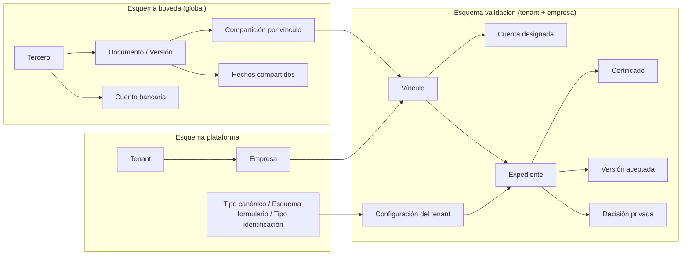
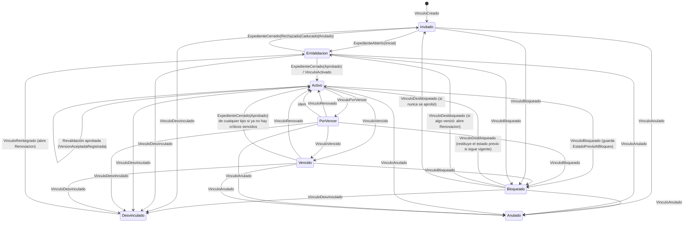
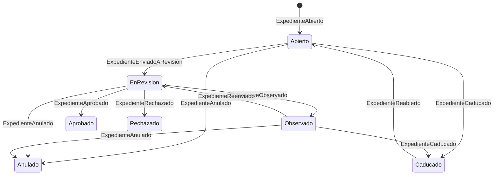
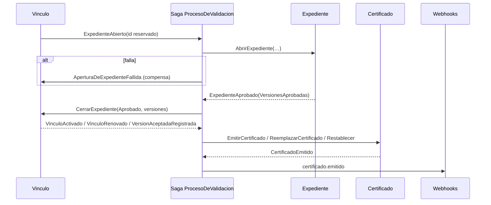

# 03 — Dominio y eventos

| Estado | Fecha | Responsable |
|---|---|---|
| Borrador (decisiones del registro propagadas) | 2026-10-28 | Arquitectura |

**Propósito.** Definir el modelo de dominio de Validasoft: lenguaje, contextos, agregados event-sourced con sus estados, comandos, eventos e invariantes, el motor de reglas de exigencia, el modelo de áreas y veredictos, las vigencias en dos capas con revalidación obligatoria, la revisión automática por niveles, las proyecciones de lectura y las garantías de consistencia. Es la referencia que el código del Hito 1 en adelante debe implementar literalmente. **Este documento es el dueño de los nombres de estados, eventos de dominio y proyecciones**; 05, 06 y 10 se alinean a él.

**Relacionados.** [00-vision-y-alcance.md](00-vision-y-alcance.md) · [01-analisis-legado-srm-portal.md](01-analisis-legado-srm-portal.md) · [02-modelo-documental-compartido.md](02-modelo-documental-compartido.md) · [04-arquitectura-plataforma.md](04-arquitectura-plataforma.md) · [05-api-contratos-y-webhooks.md](05-api-contratos-y-webhooks.md) · [07-seguridad-identidad-y-tenancy.md](07-seguridad-identidad-y-tenancy.md) · [10-glosario.md](10-glosario.md) · [decisiones/registro.md](decisiones/registro.md) · ADR-0004, ADR-0005, ADR-0008, ADR-0009, ADR-0010.

---

## 1. Lenguaje ubicuo (resumen)

El glosario completo con equivalencias del legado está en [10-glosario.md](10-glosario.md). Aquí solo los términos que este documento usa con significado preciso.

| Término | Significado en este documento |
|---|---|
| **Tenant** | Cliente del SaaS = **grupo empresarial** (ADR-0008). Comparte usuarios, catálogo, flujos, plantillas, API keys, medición de uso, región y clave KMS. Todo dato de `validacion` lleva `TenantId`. |
| **Empresa** | Razón social dentro del tenant (NIT, nombre, logo, `Reply-To`). Un tenant tiene ≥ 1 empresa. Las **decisiones están aisladas por empresa**: ni se ven ni se heredan dentro del grupo. |
| **Tercero** | Persona natural, jurídica o consorcio identificado por (`Pais`, `TipoIdentificacion`, `NumeroNormalizado`) — **multipaís**: el tipo pertenece a un catálogo por país con validador; el dígito de verificación es atributo, no clave. Global, no pertenece a ningún tenant. **Las personas relacionadas** (representante legal, suplente, socio, beneficiario final, miembro de consorcio) son también terceros persona natural con bóveda propia (B-3, ADR-0010). |
| **Relación entre terceros** | `RelacionEntreTerceros { Origen (persona natural), Destino (tercero), Tipo: RepresentanteLegal \| Suplente \| Socio \| BeneficiarioFinal \| MiembroDe, Principal, VigenteDesde, VigenteHasta? }`. Un requisito puede exigir documentos "de la persona relacionada con rol X" (`DePersonaRelacionada`). |
| **Vínculo** | Relación `Tercero ↔ Empresa (de un Tenant) ↔ TipoDeVinculo`. Agregado de vida larga. |
| **Flujo / FlujoVersion** | Plantilla configurable; se publica en versiones inmutables. |
| **Expediente** | Instancia de una `FlujoVersion` para un vínculo, con alcance `Inicial`, `Renovacion` o `Actualizacion`. Agregado de vida corta. |
| **Requisito** | Línea del expediente: "este expediente exige el tipo de documento X" (o cualquiera de `TiposAceptados[]`). |
| **Tipo de documento canónico** | Catálogo de plataforma, **versionado** (`RUT`, `CAMARA_COMERCIO`, …). Hace compartible un documento entre empresas y tenants. |
| **Tipo de documento de tenant** | Configuración del tenant sobre un canónico (o propio, sin canónico ⇒ `PorVinculo`). Puede restringir el ámbito Global → PorVinculo, nunca ampliarlo. |
| **Documento / Versión** | Contenedor de versiones inmutables para un dueño (tercero o vínculo) y tipo. Clase `Archivo` (binario) o `Formulario` (datos JSON con esquema). |
| **Versión actual** | La única versión vigente de un documento global del tercero. |
| **Versión aceptada** | Registro, por vínculo y tipo, de qué versión validó la empresa, cuándo y con qué vigencia. Puede quedar `Desactualizada`. |
| **Hecho compartido** | Resultado calculado una vez por versión y visible para todas las empresas con compartición (hash, antivirus, MIME real, páginas; y con IA: tipo, legibilidad, extracción, comparación por campos, señales de manipulación). **La lectura por IA es coste de plataforma** (B-2): no existe presupuesto de lectura por tenant; solo falta cuando la IA está deshabilitada a nivel plataforma o el tercero no ha dado su consentimiento. |
| **Decisión privada** | Veredicto de una empresa; invisible para otras empresas, incluidas las del mismo tenant. |
| **Cuenta bancaria / Cuenta designada** | Cuenta global del tercero (con su certificación como documento) y la cuenta que **el tercero elige** para cobrar a una empresa concreta; la empresa aprueba el cambio. |
| **Área / Etapa** | Grupo revisor configurable; las áreas de una etapa revisan en paralelo (por defecto una sola etapa), las etapas en secuencia. |
| **Veredicto** | Sobre una versión de un requisito solo existen `Aprobado` y `Observado` (recuperable, vuelve al tercero; puede marcar `NoAdmitirEstaVersion`). **`Rechazado` queda reservado al expediente** (`RechazarExpediente`, terminal, solo áreas con `PuedeRechazarExpediente`) (B-7). |
| **Verificación externa** | Comprobación enchufable del **expediente** (listas restrictivas, estudio de cumplimiento, ERP, fuente oficial) que puede bloquear el cierre. No confundir con los **hechos** de la bóveda (IA, hash, antivirus), que son datos sobre la versión. |
| **Revalidación** | Expediente de tipo `Actualizacion` que la saga `Revalidacion` abre en un vínculo cuando cambia la versión actual de un documento global y el cambio toca campos críticos canónicos **o** campos que esa empresa marcó como `camposCuyoCambioExigeHumano` (T-7). La bóveda solo emite hechos; cada empresa decide si revalida. |
| **Certificado** | Evidencia verificable del resultado de un expediente aprobado; uno por vínculo con historial de emisiones. |

---

## 2. Mapa de contextos

| Contexto | Responsabilidad | Persistencia | Esquema |
|---|---|---|---|
| **Plataforma** | Tenants, empresas, planes, catálogo canónico de tipos de documento (versionado), catálogo de tipos de identificación por país, esquemas de formulario canónicos, motivos base, medición de uso, concesiones de acceso de soporte (B-6) | CRUD con auditoría de diff | `plataforma` |
| **Configuración** | Tipos de documento de tenant y sus **overrides por empresa** (`tipo_documento_empresa`, B-4), campos privados de formulario, áreas, motivos propios, tipos de vínculo, flujos y `FlujoVersion`, reglas de selección de flujo, políticas, plantillas, proveedores de verificación, delegaciones | CRUD (documentos Marten) con auditoría de diff | `validacion` (tenant) |
| **Terceros** | Identidad del tercero (multipaís, `SucesorDe`, sucursales), **relaciones entre terceros** (representantes, suplentes, socios, beneficiarios finales, miembros de consorcio: cada uno un tercero persona natural con bóveda propia, B-3), contactos, cuentas bancarias globales, consentimientos a la plataforma (incluido el de IA), autorregistro invisible | CRUD con auditoría | `boveda` |
| **Bóveda documental** | Agregado `Documento` (versiones de archivo y formulario), hechos compartidos, compartición automática sin exclusión (A-8) | **Event-sourced** (stream corto por documento) + S3 inmutable | `boveda` |
| **Validación** (núcleo) | Agregados `Vinculo`, `Expediente`, `Certificado`; sagas `ProcesoDeValidacion`, `Revalidacion` | **Event-sourced** | `validacion` |
| **Verificaciones** | Adaptadores `IVerificador` (IA, listas restrictivas, estudio de cumplimiento, ERP) | Sin estado; resultados como eventos en `Documento` (hechos) o `Expediente` (juicios) | — |
| **Vigencias** | Cálculo y disparo de vencimientos, avisos consolidados, campañas | Proyección `VencimientoProgramado` + job diario | `validacion` / `boveda` |
| **Notificaciones** | Plantillas, correo, campana, webhooks, evidencia de entrega | CRUD + outbox | `validacion` |
| **Integraciones** | API keys (alcance por empresa), suscripciones de webhook, entregas, modo pull | CRUD + outbox | `validacion` |
| **Identidad** | Usuarios internos (roles por tenant o por empresa), 2FA, magic links, token exchange ERP, rol `Plataforma` | ASP.NET Identity + OpenIddict | `identidad` |
| **Habeas data** | Solicitudes de supresión, retención por tipo, exportaciones firmadas | CRUD + jobs | `boveda` / `validacion` |
| **Lecturas** | Bandejas, KPIs, informes, verificación pública | Proyecciones Marten | `validacion` / `boveda` |
| **Auditoría** | Registro unificado: eventos de dominio (timelines), **cambios de configuración**, **eventos de identidad** y **accesos a documentos**; exportación firmada | Append-only (streams `auditoria-*` + tablas planas) | `validacion` / `identidad` / `boveda` |

### 2.1 Auditoría de configuración e identidad ("de todo debe haber auditoría e historial")

Todo cambio en una entidad de **Configuración** o **Plataforma** y todo evento de **Identidad** se registra de forma append-only, con la misma retención que los documentos del tenant (P-14-7). Invariante: **ninguna entidad de configuración se modifica sin registro de cambio**; el handler de cada comando de configuración escribe el registro en la misma transacción Marten (un test arquitectónico falla si un comando de `Configuracion`/`Plataforma`/`Identidad` no produce su registro).

| Registro | Campos | Dónde |
|---|---|---|
| `RegistroDeCambioDeConfiguracion` | `Id`, `TenantId`, `EmpresaId?`, `Entidad` (`Flujo \| FlujoVersion \| ReglaDeSeleccionDeFlujo \| TipoDocumentoTenant \| Area \| Motivo \| TipoVinculo \| Usuario \| Rol \| ApiKey \| Webhook \| PoliticaTenant \| Empresa \| PlantillaNotificacion \| MatrizRiesgo \| TipoDocumentoCanonico`), `EntidadId`, `Accion` (`Creado \| Modificado \| Publicado \| Archivado \| Eliminado \| Rotado \| Revocado \| Aplicado`), `Antes JSONB`, `Despues JSONB`, `Diff[] {campo, antes, despues, tipoCambio}`, `Actor {tipo, id, nombre, ip}`, `Fecha`, `Justificacion?`, `CorrelationId`, `TraceId` | Stream `auditoria-configuracion-{tenantId}` + tabla `auditoria_configuracion` (índices por entidad, actor, fecha) |
| `RegistroDeIdentidad` | `Id`, `TenantId?`, `EmpresaId?`, `Accion` (`Login \| LoginFallido \| Logout \| DosFactoresActivado \| DosFactoresFallido \| Bloqueado \| Desbloqueado \| ContrasenaCambiada \| RolAsignado \| RolRetirado \| ApiKeyUsada \| ApiKeyRechazada \| TokenErpCanjeado \| EnlaceCanjeado \| OtpVerificado \| DelegacionActivada \| AccesoSoporteConcedido \| AccesoSoporteUsado \| AccesoSoporteExpirado`), `Sujeto {tipo: Usuario \| Tercero \| ApiKey \| Plataforma, id}`, `Ip`, `UserAgent`, `Resultado`, `Detalle JSONB` (nunca secretos), `Fecha`, `CorrelationId` | Tabla `auditoria_identidad` (append-only; `ApiKeyUsada` se agrega por minuto para no inflar) |
| `DocumentoAccedido` | Ver [07 §5.2](07-seguridad-identidad-y-tenancy.md) | `auditoria-accesos-{terceroId}` |

Lectura unificada: `GET /auditoria?tipo=dominio|configuracion|identidad|acceso` ([05 §2.7](05-api-contratos-y-webhooks.md)); exportación ZIP firmado con `auditoria:exportar`. Los registros de configuración viajan a webhooks solo como referencia (`configuracion.cambiada`), nunca con `antes/despues`.

**Qué es event-sourced y por qué.** Solo lo que necesita trazabilidad completa y reconstrucción: `Documento`, `Vinculo`, `Expediente`, `Certificado`. Catálogos, usuarios y suscripciones son CRUD con auditoría de diff.

### 2.2 Tres esquemas y un solo `DocumentStore` (fuente única; 02, 04, 07 y 11 copian esta tabla)

Un único `DocumentStore` de Marten con eventos **conjoined**: los streams de `validacion` usan el `tenant_id` real; los de la bóveda el tenant técnico `boveda`; los de plataforma el tenant técnico `plataforma`. Así se conserva la transacción única evento + proyección + outbox (T-2; se valida con un *spike* en H1).

| Esquema | Tenancy | Tablas / documentos | Streams |
|---|---|---|---|
| `plataforma` | tenant técnico `plataforma` | `tenant`, `empresa`, `plan`, `uso_tenant`, `tipo_documento_canonico`, `esquema_formulario`, `catalogo_tipo_identificacion`, `motivo_base`, `propuesta_tipo_canonico`, `concesion_acceso_soporte` | `auditoria-configuracion-plataforma` |
| `boveda` | tenant técnico `boveda` (global) | `tercero`, `relacion_entre_terceros`, `contacto_tercero`, `consentimiento_tercero`, `cuenta_bancaria`, `documento`, `version_documento`, `verificacion_version`, `comparticion_version`, `acceso_documento`, `referencias_de_version`, `frescura_documento_tercero`, `solicitud_supresion` | `Documento-{id}`, `auditoria-accesos-{terceroId}` |
| `validacion` | conjoined por `tenant_id` **+ filtro obligatorio `empresa_id`** (T-3: `ISesionDeEmpresa`) | `tipo_documento_tenant`, `tipo_documento_empresa`, `tipo_vinculo`, `area`, `motivo`, `flujo`, `flujo_version`, `regla_seleccion_flujo`, `flujo_por_defecto`, `usuario_rol`, `api_key`, `webhook`, `entrega_webhook`, `plantilla_notificacion`, `vinculo`, `expediente`, `requisito`, `version_aceptada`, `decision_version`, `version_no_admitida`, `ratificacion`, `cuenta_designada`, `bloqueo`, `certificado`, `emision_certificado`, `revalidacion_pendiente`, `vencimiento_programado`, `lote_invitacion`, `campania`, `delegacion`, `comandos_idempotentes`, `auditoria_configuracion` | `Vinculo-{id}`, `Expediente-{id}`, `Certificado-{id}`, `auditoria-configuracion-{tenantId}` |
| `identidad` | ASP.NET Identity | `usuario`, `credencial`, `magic_link`, `auditoria_identidad` | — |



---

## 3. Convenciones de los agregados

- Un stream por instancia: `Documento-{guid}`, `Vinculo-{guid}`, `Expediente-{guid}`, `Certificado-{guid}`.
- Metadatos obligatorios en cada evento: `TenantId` (técnico `boveda`/`plataforma` fuera de `validacion`), **`EmpresaId`** (nulo en `boveda` y en eventos de alcance tenant), `ActorId`, `ActorTipo` (`Usuario | Tercero | Integracion | Sistema | Plataforma | Migracion`), `CorrelationId`, `CausationId`, `IdempotencyKey`, `OcurridoEn` (UTC).
- Todos los enums de estado son **textuales**, únicos por agregado y se persisten como string. No existen enteros de estado.
- Los eventos se nombran en pasado y en español. Los comandos en infinitivo.
- Un agregado nunca lee otro agregado para decidir; lo que necesite viaja en el comando o lo coordina la saga.
- **Aislamiento doble** en `validacion`: toda consulta filtra por `TenantId` (conjoined) **y** por `EmpresaId` cuando el recurso es de empresa (vínculos, expedientes, aceptaciones, decisiones, certificados, cuentas designadas, bloqueos). Lo verifica un test arquitectónico y un `IAuthorizationHandler`.

### 3.1 Enums canónicos (fuente única)

```
enum EstadoVersion        { Recibida, EnAnalisis, Actual, Superada, Devuelta, Retirada }
enum EstadoRequisito      { Pendiente, Cargado, EnRevision, Observado, Aprobado, Eximido, NoAplica, Vencido, Desactualizado }   // sin Rechazado (B-7)
enum EstadoVinculo        { Invitado, EnValidacion, Activo, PorVencer, Vencido, Bloqueado, Desvinculado, Anulado }
enum EstadoExpediente     { Abierto, EnRevision, Observado, Aprobado, Rechazado, Anulado, Caducado }
enum EstadoCertificado    { Vigente, ConPendientes, Suspendido, Vencido, Revocado, Reemplazado }          // Suspendido por bloqueo (B-5)
enum EstadoAceptacion     { AlDia, Desactualizada, PorVencer, Vencida }
enum TipoExpediente       { Inicial, Renovacion, Actualizacion }
enum Veredicto            { Aprobado, Observado }                                                          // Rechazado solo existe para el expediente (B-7)
enum OrigenVeredicto      { Humano, Sistema, Administrador }
enum EstadoEtapa          { Esperando, Activa, Aprobada }
enum EstadoVerificacion   { Pendiente, CoincidenciaPorAnalizar, Satisfecha, Fallida, Expirada }
enum ClaseDocumento       { Archivo, Formulario }
enum AmbitoDocumento      { Global, PorVinculo }
enum Comparacion          { SinAnterior, Identica, Distinta, SinCambios, CambiosDetectados }   // Distinta = solo por hash (sin IA)
enum Antivirus            { Limpio, Infectado, Cuarentena, NoDisponible }                      // T-11
enum Legibilidad          { Legible, Parcial, NoLegible }
enum NivelRevision        { Manual, Asistido, Automatico }
enum PoliticaDesactualizada { BloquearTrasGracia, SoloAviso }                                  // único nombre (B-4, #7)
enum EstadoCuentaDesignada{ Propuesta, Aprobada, Rechazada, Reemplazada }
enum TipoRelacionTerceros { RepresentanteLegal, Suplente, Socio, BeneficiarioFinal, MiembroDe }  // B-3
enum ActorTipo            { Usuario, Tercero, Integracion, Sistema, Plataforma, Migracion }
```

---

## 4. Agregado `Documento` (bóveda)

### 4.1 Identidad y estado

Clave natural: `(DuenoTipo: Tercero | Vinculo, DuenoId, TipoCanonicoId | TipoTenantId)`. Un documento global existe una vez por tercero y tipo canónico; un documento `PorVinculo` pertenece a un vínculo (y por tanto a una empresa de un tenant). **Las personas relacionadas son terceros**: la cédula del representante legal vive en la bóveda de esa persona natural (clave `(persona, CEDULA)`), no en la del tercero jurídico; `IdentidadCoincide` compara contra la identificación de la persona (B-3). Un tercero con dos representantes tiene dos relaciones y dos bóvedas de persona, cada una con su cédula.

Estado interno: `Clase`, `Ambito`, `Dueno`, `TipoCanonicoId`, `VersionCatalogoCanonico`, `VersionActualId?`, `Versiones[] { VersionId, Numero, Estado, CargadaEn, CargadaPor, ContextoVinculoId?, // Archivo: Sha256, ClaveS3, Mime, Tamano, NombreOriginal, Paginas // Formulario: Datos (JSON), EsquemaVersion, HashDatos // DatosDeclarados, Hechos: HechosRegistrados }`. (No existe lista de exclusiones: el tercero no puede excluir empresas, A-8.)

```
HechosRegistrados {
  ConIa: bool,
  // siempre (sin IA)
  HashVerificado, Antivirus (Limpio | Infectado | Cuarentena | NoDisponible), MimeReal, Paginas, PreviewGenerada,
  ComparacionPorHash: Comparacion (SinAnterior | Identica | Distinta),
  // solo con IA
  TipoDetectado?, CoincideTipoEsperado?, Legibilidad? { Legible | Parcial | NoLegible },
  IdentidadCoincide?, FechaExpedicion?, FechaVencimientoDoc?, Periodo?,
  CamposClave{}?, Comparacion? (por campos), CamposCambiados[]?, CamposCriticosCambiados[]?,
  SenalesManipulacion[]? (capas, fuentes, metadatos de edición, fecha de creación posterior a expedición),
  Confianza?, ConfianzaPorCampo{}?, Modelo?, HashPrompt?, Costo?
}
```

### 4.2 Máquina de estados de una versión

```mermaid
stateDiagram-v2
  [*] --> Recibida: VersionCargada
  Recibida --> EnAnalisis: AnalisisDeVersionIniciado
  EnAnalisis --> Actual: VersionActualCambiada (hechos OK)
  EnAnalisis --> Devuelta: VersionDevueltaAlTercero (virus / MIME inválido / tipo incorrecto / ilegible / identidad no coincide)
  EnAnalisis --> EnAnalisis: HechosDeVersionRegistrados (parciales; sin IA disponible queda PendienteRevisionHumana como bandera)
  Actual --> Superada: VersionActualCambiada (de otra versión)
  Actual --> Retirada: VersionRetirada (solo si nadie la referencia)
  Superada --> Actual: VersionActualRestituida (se retiró la actual; vuelve la anterior)
  Devuelta --> [*]
  Superada --> [*]
```



**Retiro de la versión actual (I-11).** Si el tercero retira la versión `Actual` (p. ej. subió el RUT de otra empresa y ninguna aceptación la referencia), la versión `Superada` inmediatamente anterior vuelve a ser `Actual` (`VersionActualRestituida`) y la saga `Revalidacion` **cancela** las revalidaciones abiertas que esa versión había provocado (`RevalidacionCancelada`); las aceptaciones recuperan `AlDia`. Si la versión retirada ya tiene aceptaciones, no se puede retirar (invariante): se sube otra versión.

### 4.3 Comandos y eventos

| Comando | Evento(s) | Invariante / regla |
|---|---|---|
| `CrearDocumento(Dueno, Tipo, Clase, Ambito)` | `DocumentoCreado` | Uno por clave natural. |
| `RegistrarVersionArchivo(Sha256, ClaveS3, Mime, Tamano, NombreOriginal, DatosDeclarados, ContextoVinculoId?)` | `VersionCargada(VersionId, Numero, Clase: Archivo, …)` | El binario ya existe en S3 (confirmado por hash). `Sha256` repetido en el documento ⇒ `VersionDuplicadaDetectada`, sin versión nueva. Límite 20 MB / 50 páginas validado antes. |
| `RegistrarVersionFormulario(Datos, EsquemaVersion, ContextoVinculoId?)` | `VersionCargada(VersionId, Numero, Clase: Formulario, HashDatos, …)` | `Datos` válido contra el esquema canónico + campos privados del tenant de contexto. `HashDatos` repetido ⇒ duplicada. |
| `IniciarAnalisis(VersionId)` | `AnalisisDeVersionIniciado(ConIa)` | Saga `VerificacionDocumental`. `ConIa = true` solo si la IA está habilitada a nivel plataforma **y** el tercero dueño registró `ConsentimientoIa` (B-2, B-8); de lo contrario se registran únicamente los hechos sin IA. |
| `RegistrarHechos(VersionId, HechosRegistrados)` | `HechosDeVersionRegistrados(ConIa, …)` | Idempotente por `(VersionId, TipoHecho)`. La comparación se hace contra la **versión actual** en ese momento. Sin IA (deshabilitada a nivel plataforma, sin consentimiento del tercero o proveedor caído) se registran los hechos mínimos y `PendienteRevisionHumana = true`. En producción sin antivirus la versión **espera** en `EnAnalisis`; `NoDisponible` solo continúa en perfiles de desarrollo (T-11). |
| `PromoverAActual(VersionId)` | **`VersionActualCambiada(VersionId, VersionAnteriorId?, Comparacion, CamposCambiados[], CamposCriticosCambiados[], ConIa)`** | **Sin IA**: requiere `HashVerificado`, `Antivirus = Limpio`, `MimeReal` permitido. **Con IA**: además `CoincideTipoEsperado`, `Legibilidad ≠ NoLegible`, `IdentidadCoincide` (contra el tercero o la persona relacionada dueña). `CamposCriticosCambiados` se calcula **solo** con `CamposCriticos` del canónico: la bóveda emite hechos, no decide revalidaciones (T-7). La anterior pasa a `Superada`. |
| `DevolverVersion(VersionId, Motivo)` | `VersionDevueltaAlTercero(Motivo)` | No reemplaza a la actual, no alerta a empresas. |
| `CorregirDatos(VersionId, Campo, Valor, Por)` | `DatosDeVersionCorregidos(Antes, Despues)` | Solo revisores humanos; recalcula vigencias derivadas. |
| `CompartirConVinculo(VersionId, TenantId, EmpresaId, VinculoId, Origen)` | `VersionCompartida` | **Solo con vínculos cuya invitación fue aceptada** (`InvitacionAceptada` + `ConsentimientosRegistrados` para esa empresa, B-1): automático al promover (para los vínculos ya aceptados que exigen el tipo) y, para un vínculo nuevo, en el momento en que el tercero acepta su invitación. Antes de aceptar, la empresa solo ve "tercero existente; N requisitos podrían quedar cubiertos" sin nombres de documentos ni versiones. El tercero **no** puede excluir empresas (A-8). |
| `CongelarComparticion(TenantId, EmpresaId, VinculoId, Motivo)` | `ComparticionCongelada` | Solo al desvincular o bloquear el vínculo. **Semántica**: impide comparticiones **nuevas** con ese vínculo; las filas ya compartidas siguen legibles por la empresa durante su retención (obs. 5). Al desbloquear, `ReanudarComparticion` → `ComparticionReanudada` comparte la versión actual si cambió mientras tanto. (Antes se llamaba `ComparticionRevocada`; el nombre cambia porque no revoca nada ya compartido.) |
| `RetirarVersion(VersionId, Motivo)` | `VersionRetirada`; si era la actual: `VersionActualRestituida(VersionAnteriorId)` | Rechazado si alguna `VersionAceptada` o `Certificado` de cualquier tenant la referencia (proyección `ReferenciasDeVersion`). Ver §4.2. |
| `MarcarRetencion(VersionId, RetenidaHasta, BaseLegal)` | `RetencionLegalMarcada` | Lo invoca el módulo de habeas data al resolver una supresión. |

**Invariantes.** Append-only; única versión `Actual` por documento; hash único por documento; una versión `Devuelta` nunca se promueve; el binario se sube antes de `VersionCargada`; un formulario se valida contra su esquema antes de `VersionCargada`.

### 4.4 Entidad `CuentaBancaria` (bóveda, CRUD con auditoría)

`CuentaBancaria { CuentaId, TerceroId, Pais, Banco, TipoCuenta, Numero (cifrado, últimos 4 en claro), Titular, IdentificacionTitular, Moneda, DocumentoCertificacionId (documento canónico `CERTIFICACION_BANCARIA` ligado a esta cuenta), Estado { Activa, Retirada } }`. Eventos de auditoría: `CuentaBancariaRegistrada`, `CertificacionAsociadaACuenta`, `CuentaBancariaRetirada`. La IA cruza `Titular/IdentificacionTitular/Numero` del formulario con la certificación (hecho compartido `IdentidadCoincide` de la certificación). La elección de cuenta por empresa vive en el `Vinculo` (§5).

### 4.5 Entidad `RelacionEntreTerceros` (bóveda, CRUD con auditoría; B-3, ADR-0010)

`RelacionEntreTerceros { RelacionId, OrigenTerceroId (persona natural), DestinoTerceroId, Tipo: TipoRelacionTerceros, Principal: bool, VigenteDesde, VigenteHasta?, Fuente: DeclaradaPorTercero | ExtraidaDeDocumento(VersionId) | Importada, ConfirmadaPor? }`. Eventos: `RelacionRegistrada`, `RelacionMarcadaPrincipal`, `RelacionTerminada`, `RelacionConfirmada`.

- La **persona relacionada** es un `Tercero` persona natural con bóveda propia: su `CEDULA`, `CERTIFICADO_ANTECEDENTES` y `DECLARACION_PEP` se validan una vez y sirven a todos los terceros jurídicos donde figura y a todas las empresas.
- Un requisito con `DePersonaRelacionada = RepresentanteLegal` se resuelve, al abrir o recalcular el expediente, contra la relación **principal vigente**; si hay varias (suplentes), el flujo puede exigir `TodasLasRelaciones`.
- **Dos fuentes, una regla de reconciliación (esc. 6):** la relación la declara el tercero (`DATOS_MAESTROS`) o la extrae la IA de la Cámara de comercio. Un cambio de representante detectado por la IA **no** modifica la relación por sí solo: emite `CambioDeRelacionDetectado(Confianza)` y la relación cambia cuando (a) el tercero lo confirma en su bóveda, (b) un revisor humano confirma al revalidar la Cámara, o (c) la confianza es ≥ 0,98 y la Cámara nueva fue **aprobada** por al menos una empresa. Solo entonces se ejecuta `ExpirarVerificacionesDeRepresentante` en los vínculos (§5.3).
- **Beneficiario final y PEP (adiciones 1–2, I-20):** `BENEFICIARIO_FINAL` y `DECLARACION_PEP` son formularios **globales** de la persona natural; el `FORMULARIO_SARLAFT` de cada empresa es `PorVinculo` y **referencia** las versiones actuales de esos formularios en lugar de duplicar sus datos.
- **Conversión `PorVinculo` → `Global` al aprobar una propuesta de tipo canónico (esc. 10):** por cada tercero con documentos de ese tipo en varios vínculos, la versión **más reciente** pasa a ser la `Actual` del documento global nuevo; las demás quedan `Superada`; las aceptaciones existentes se conservan y nacen `Desactualizada` solo si su versión no es la actual (misma regla que la migración, con `plazoRevalidacion = 90`). Evento `TipoConvertidoAGlobal(TipoCanonicoId, Terceros[])`.

---

## 5. Agregado `Vinculo`

### 5.1 Identidad y estado

`VinculoId`. Clave natural única **`(TenantId, EmpresaId, TerceroId, TipoDeVinculoId)`** garantizada por índice en la proyección inline `VinculoResumen`.

Estado interno: `TenantId`, `EmpresaId`, `Estado`, `EstadoPrevioAlBloqueo?`, `FlujoId`, `Atributos` (categorías, etiquetas, especialidades, `montoEstimado`, `nivelRiesgo`, personalizados), `InvitacionAceptada: bool`, `ExpedienteAbiertoId?`, `VersionesAceptadas: Dictionary<TipoTenantId, VersionAceptada { VersionId, VigenteDesde, VigenteHasta?, MotivoVigencia, Estado: EstadoAceptacion, ExpedienteId, AceptadaEn, VersionActualEnEseMomento, PlazoRevalidacion? (fecha; 15 días por defecto, 90 en importadas — B-8) }>`, `VersionesNoAdmitidas: HashSet<(TipoTenantId, VersionId)>` (B-7), `VigenteHasta?`, `CertificadoVigenteId?`, `RevalidacionesPendientes: HashSet<TipoTenantId>`, `CuentaDesignada? { CuentaId, Estado: EstadoCuentaDesignada, PropuestaPor, AprobadaPor[] }`, `Bloqueo? { Motivo, Desde, Hasta?, Por }`, `Consentimientos { TyC: VersionDocumentoId?, AutorizacionDatos: VersionDocumentoId? }`.

### 5.2 Máquina de estados



`RevalidacionPendiente` no es un estado: es una **bandera derivada** (`RevalidacionesPendientes.Count > 0`) que la proyección expone. El vínculo **no cambia de estado** por ella (T-8): según `PoliticaDesactualizada` efectiva (`BloquearTrasGracia` por defecto con `DiasRevalidacion = 15`; `SoloAviso` opcional, A-2), al vencer `PlazoRevalidacion` el certificado pasa a `ConPendientes` **bloqueante** (`CertificadoMarcadoConPendientes(Bloqueante = true)`, consulta de certificación `bloqueado: true, motivo: RevalidacionVencida`) hasta revalidar.

**Bloqueo = suspensión (B-5).** `Bloqueado` (P-5-3) es privado de la empresa: impide invitar, abrir expedientes y emitir certificado; no se comparte con otras empresas ni tenants. Al bloquear, el certificado pasa a `Suspendido` (consulta `bloqueado: true, motivo: Bloqueo`) y la compartición con ese vínculo se **congela** (no llegan versiones nuevas). Al desbloquear se **restituye**: el certificado vuelve a su estado previo si sigue vigente (`CertificadoRestablecido`), la compartición se reanuda compartiendo la versión actual, y si algún requisito crítico venció durante el bloqueo se abre `Renovacion` (`EnValidacion`). Nada de esto borra historial.

**Un expediente abierto a la vez: tabla de casos (obs. 7).** Qué hace la saga cuando llega un evento y ya hay un expediente abierto en el vínculo:

| Expediente abierto | Llega `VersionActualCambiada` con revalidación | Llega `DocumentoVencidoEnVinculo` crítico | Llega `VinculoReintegrado` / `Desbloqueado` con vencidos |
|---|---|---|---|
| Ninguno | abre `Actualizacion` | abre `Renovacion` | abre `Renovacion` |
| `Inicial` | `MarcarRequisitoDesactualizado` + `VersionAdjuntadaARequisito` en el mismo expediente | `MarcarRequisitoVencido` en el mismo expediente | — (no aplica) |
| `Renovacion` | `AgregarRequisitoAExpediente` si el tipo no estaba; si estaba, adjunta la versión nueva | `AgregarRequisitoAExpediente` | — |
| `Actualizacion` | `AgregarRequisitoAExpediente` (nunca un segundo expediente) | la `Actualizacion` se **convierte** en `Renovacion` (`ExpedienteReclasificado`) y agrega el requisito | — |

`CerrarExpediente(Aprobado)` de **cualquier** tipo recalcula el estado del vínculo desde sus requisitos: si ya no hay críticos vencidos, `Vencido`/`PorVencer` → `Activo` (I-15).

### 5.3 Comandos y eventos

| Comando | Evento(s) | Regla |
|---|---|---|
| `CrearVinculo(EmpresaId, TerceroId, TipoDeVinculoId, FlujoId, Atributos, Origen)` | `VinculoCreado(TenantId, EmpresaId, Origen: Invitacion \| Autorregistro \| Migracion \| Api)` | Clave natural única. Tercero no `Bloqueado` en esa empresa. |
| `EnviarInvitacion(Canal, LoteId?)` | `InvitacionEnviada(EnlaceExpira)` | Solo en `Invitado` o con expediente `Abierto`. |
| `AceptarInvitacion(ConsentimientoPlataforma, ConsentimientoIa, AutorizacionEmpresaVersionId, TyCVersionId)` | `InvitacionAceptada`, `ConsentimientosRegistrados(Aceptaciones[] { Tipo: Plataforma \| Ia \| AutorizacionEmpresa \| TyC, TextoVersionId, HashTexto, Fecha, Ip, UserAgent, OtpVerificado, Canal: Web \| Embed, DocumentoVersionId })` | Primer acceso del tercero; evidencia clic + OTP + IP/fecha/versión (P-3-5, P-16-4). Cada aceptación se materializa además como versión de un documento `PorVinculo` (`TERMINOS_Y_CONDICIONES`, `AUTORIZACION_TRATAMIENTO_DATOS`) y se expone como `AceptacionDto` ([05 §4](05-api-contratos-y-webhooks.md)). **Solo a partir de aquí la saga comparte la bóveda con este vínculo** (`CompartirConVinculo` para cada tipo exigido con versión actual, B-1/ADR-0009) y, si todos los requisitos obligatorios quedan `Cargado`, el expediente pasa solo a `EnRevision` (`EnviarARevision` automático, esc. 1). |
| `ActualizarAtributos(Antes, Despues)` | `AtributosDeVinculoActualizados` | Si hay expediente abierto, la saga pide `RecalcularRequisitos`. |
| `AbrirExpediente(Tipo, FlujoVersionId, Alcance[])` | `ExpedienteAbierto(ExpedienteId, Tipo, FlujoVersionId, Alcance)` | Máximo un expediente abierto. `Renovacion` y `Actualizacion` exigen al menos un expediente aprobado previo. No en `Bloqueado`. |
| `CerrarExpediente(ExpedienteId, Resultado, VersionesAprobadas[])` | `ExpedienteCerrado(Resultado)`; si `Aprobado`: `VersionAceptadaRegistrada(TipoTenantId, VersionId, VigenteDesde, VigenteHasta?, MotivoVigencia, VersionAnteriorId?)` por tipo, y `VinculoActivado(CertificadoId, VigenteHasta)`, `VinculoRenovado` o `EstadoDeVinculoRecalculado` | Lo invoca la saga. Recalcula `VigenteHasta` del vínculo (§10) **siempre desde los hechos de la versión aceptada** (P-7-5) y **el estado del vínculo desde sus requisitos** (I-15: `Vencido`/`PorVencer` → `Activo` si ya no hay críticos vencidos). Quita el tipo de `RevalidacionesPendientes`. Si el tipo de vínculo exige cuenta designada (`TipoVinculo.ExigeCuentaDesignada`, proveedor por defecto), el cierre `Aprobado` requiere `CuentaDesignada.Estado = Aprobada` (esc. 1). |
| `RegistrarVersionNoAdmitida(TipoTenantId, VersionId, ExpedienteId, Motivos[])` | `VersionNoAdmitidaEnVinculo` | Deriva de una observación con `NoAdmitirEstaVersion = true` (B-7): la versión no vuelve a aceptarse en este vínculo. La aceptada anterior **no cambia** pero sigue `Desactualizada`. (Sustituye a `RegistrarRechazoDeVersion`/`VersionRechazadaParaVinculo`.) |
| `MarcarAceptacionDesactualizada(TipoTenantId, VersionNuevaId, CamposCambiados[], Motivo: CriticoCanonico \| CriticoDeEmpresa \| Archivo \| Importacion)` | `AceptacionDesactualizada(TipoTenantId, VersionAceptadaId, VersionNuevaId, PlazoRevalidacion)` | Lo dispara la saga `Revalidacion` cuando la versión es un archivo, o `VersionActualCambiada.CamposCriticosCambiados ≠ ∅`, o `CamposCambiados ∩ camposCuyoCambioExigeHumano(efectiva de la empresa) ≠ ∅` (T-7). `PlazoRevalidacion = hoy + DiasRevalidacion` (15; 90 si `Motivo = Importacion`, B-8). Añade el tipo a `RevalidacionesPendientes`. |
| `RegistrarCambioMenor(TipoTenantId, VersionNuevaId, CamposCambiados[])` | `CambioMenorRegistrado` | Formulario cuya versión nueva no toca críticos canónicos ni los propios de **esta** empresa: la aceptación pasa a apuntar a la versión nueva sin revalidar; se notifica como "cambio menor". Una misma `VersionActualCambiada` puede ser cambio menor para A y revalidación para B. |
| `CancelarRevalidacion(TipoTenantId, VersionRetiradaId)` | `RevalidacionCancelada` | Al restituirse la versión anterior por retiro de la actual (§4.2): la aceptación vuelve a `AlDia` y el `Expediente(Actualizacion)` se anula con motivo `VersionRetirada`. |
| `RatificarRequisito(TipoTenantId, VersionId, DeclaradoPor)` | `RequisitoRatificado(NuevaVigenteHasta)` | **Condición única (I-14):** el canónico **y** la configuración efectiva `PermiteRatificacion`, la versión es la actual y no tiene `FechaVencimientoDoc` pasada. La ratificación **reinicia la frescura**: la fecha base pasa a ser la de la ratificación. Nunca pasa por área (A-7) y nunca la emite el sistema. Reemite el certificado si cambia la vigencia. |
| `MarcarDocumentoPorVencer / Vencido(TipoTenantId)` | `DocumentoPorVencerEnVinculo(VigenteHasta, DiasRestantes)` / `DocumentoVencidoEnVinculo(Critico)` | Job diario (§10). Si `Critico`, el requisito pasa a `Vencido` y la saga abre `Renovacion` (tabla de casos §5.2). |
| `MarcarPorVencer / MarcarVencido` | `VinculoPorVencer(Causa: Vigencia)` / `VinculoVencido(CausaTipos[])` | Job diario; `DiasGracia` 15 por defecto, 0 para requisitos `CriticoDeCumplimiento`. (`RevalidacionVencida` ya no es causa: T-8.) |
| `DesignarCuenta(CuentaId)` | `CuentaDesignadaPropuesta(CuentaId, CuentaAnteriorId?)` | **Solo el tercero.** La cuenta debe ser suya y tener certificación `Actual`. |
| `AprobarCuentaDesignada(UsuarioId)` / `RechazarCuentaDesignada(Motivo)` | `CuentaDesignadaAprobada(AprobadaPor[])` / `CuentaDesignadaRechazada` | Requiere `AprobadoresRequeridos` (2 por defecto, P-4-7) distintos con `cuentas:aprobar`. **Un solo cuatro ojos (esc. 1):** la aprobación marca `Aprobado` el requisito `CUENTA_BANCARIA` del expediente abierto (si existe) con los mismos aprobadores; no se aprueba aparte. Al aprobarse se publica `vinculo.cuenta_designada` al ERP de la empresa. |
| `Bloquear(Motivo, Hasta?)` / `Desbloquear(Justificacion)` | `VinculoBloqueado(EstadoPrevio)` / `VinculoDesbloqueado(EstadoRestituido)` | Permiso `vinculos:bloquear`; privado de la empresa. Saga: `SuspenderCertificado` + `CongelarComparticion`; al desbloquear `RestablecerCertificado` + `ReanudarComparticion` o `AbrirExpediente(Renovacion)` si algo venció (B-5). |
| `Desvincular(Motivo)` | `VinculoDesvinculado` | Desde cualquier estado no terminal. Congela la compartición (saga → `Documento`); histórico intacto. |
| `Reintegrar` | `VinculoReintegrado` | Abre `Renovacion`. |
| `Anular(Motivo)` | `VinculoAnulado` | Terminal; desde cualquier estado no terminal, incluido `Bloqueado`. |
| `ExpirarVerificacionesDeRepresentante(RelacionSalienteId, RelacionEntranteId)` | `VerificacionesDeRepresentanteExpiradas(Tipos[])` | Adición 3: solo tras `RelacionConfirmada` (§4.5). La cédula aceptada y las listas del saliente quedan `Desactualizadas`/`Expiradas`; el requisito de cédula del entrante nace `Pendiente` (o `Cargado` si su bóveda ya la tiene). |

**Invariantes.** (1) un expediente abierto (tabla de casos §5.2); (2) `Renovacion`/`Actualizacion` solo tras aprobación previa; (3) una versión **no admitida** no se vuelve a aceptar en este vínculo; (4) `Anulado`/`Desvinculado`/`Bloqueado` no aceptan versiones ni expedientes; (5) una `VersionAceptada` siempre referencia una versión que fue `Actual` en el momento de aceptarse; (6) nada de este agregado es legible fuera de su `EmpresaId`; (7) ninguna versión se comparte con este vínculo antes de `InvitacionAceptada` (B-1); (8) un cierre `Aprobado` de un vínculo que exige cuenta designada tiene `CuentaDesignada = Aprobada`.

---

## 6. Agregado `Expediente`

### 6.1 Máquina de estados



Para `Actualizacion` (revalidación) el expediente nace directamente en `EnRevision` con el requisito ya `Cargado`: no hay fase de carga. `Rechazado` es **terminal** (P-5-5): el administrador abre un expediente nuevo. `Caducado` (plazo 30 días por defecto, recordatorios 15/7/1) se **reabre** en un clic (P-4-2).

### 6.2 Estado interno

`TenantId`, `EmpresaId`, `VinculoId`, `Tipo`, `Folio` (`{PrefijoEmpresa}-E-{Año}-{Secuencia}`, T-9), `FlujoVersionId`, `PlazoCargueHasta`, `Reaperturas`, `ContextoEvaluado` (snapshot de atributos), `Requisitos[] { RequisitoId, TipoTenantId, TiposAceptados[] (canónicos alternativos, P-2-5), TipoCanonicoId?, ReglaId, Obligatorio, Critico, CriticoDeCumplimiento, Ambito, Clase, DePersonaRelacionada?: TipoRelacionTerceros, DuenoResuelto (TerceroId de la persona o del tercero), AreasQueRevisan[], ConfiguracionEfectiva { ReglaFrescura, NivelRevision, DiasRevalidacion, PoliticaDesactualizada, AprobadoresRequeridos, PorcentajeMuestreo, CamposCuyoCambioExigeHumano[] } (resuelta tenant → empresa → regla, B-4), Estado, VersionActualId?, HistorialVersiones[], Reenvios, VeredictosPorArea: Dictionary<AreaId, Veredicto[] { Veredicto, Origen, RevisorId?, Fecha, Motivos[], CamposAfectados[], Observacion, NoAdmitirEstaVersion, SobreVersionId, Evidencia? }> }`, `Etapas[] { Orden, Areas[], Estado, SlaVence, Escalamientos }`, `Verificaciones[] { Tipo, Proveedor, Bloqueante, Estado, Resultado, EvidenciaVersionId?, VigenteHasta?, ReferenciaExterna, Coincidencias[] { Id, Decision: Descartada \| Confirmada, Justificacion, VigenteHasta } }`, `RevisoresAsignados: (AreaId, RequisitoId?) → UsuarioId`, `Delegaciones[]`, `ConflictosDeInteres[]`.

### 6.3 Comandos y eventos

| Comando | Evento(s) | Invariante / regla |
|---|---|---|
| `AbrirExpediente(VinculoId, EmpresaId, Tipo, FlujoVersionId, Alcance[])` | `ExpedienteAbierto(Folio, PlazoCargueHasta)` + `RequisitosCalculados(Requisitos[], ContextoEvaluado, MotorVersion)` | Snapshot inmutable. Si el tercero ya tiene versión actual del tipo **y la invitación está aceptada**, el requisito nace `Cargado`; si **todos** los obligatorios nacen `Cargado`, se emite `ExpedienteEnviadoARevision` automáticamente (esc. 1). Para `Actualizacion`, además `VersionAdjuntadaARequisito` y `ExpedienteEnviadoARevision`. |
| `AgregarRequisitoAExpediente(TipoTenantId, Motivo: VersionNueva \| Vencimiento \| PersonaRelacionadaNueva)` | `RequisitoAgregadoAExpediente` | Lo emite la saga sobre un `Renovacion`/`Actualizacion` abierto (tabla de casos §5.2). Nunca abre un segundo expediente. |
| `ReclasificarExpediente(NuevoTipo)` | `ExpedienteReclasificado(Actualizacion → Renovacion)` | Solo de `Actualizacion` a `Renovacion` cuando vence un crítico mientras la revalidación está abierta. |
| `RecalcularRequisitos(Motivo, FlujoVersionId?)` | `RequisitosRecalculados(Agregados[], MarcadosNoAplica[], Conservados[], ContextoEvaluado)` | Nunca elimina: pasa a `NoAplica` conservando veredictos. |
| (al abrir) `SeleccionarFlujo(FlujoVersionId?)` | `FlujoSeleccionado(ExpedienteId, FlujoVersionId, Origen: Explicito \| Regla(ReglaId) \| PorDefecto)` | Si el llamador no indica flujo, se evalúan las `ReglaDeSeleccionDeFlujo` de la empresa en orden (§12.1); sin coincidencia, el flujo por defecto de `(empresa, tipo de vínculo)`, que es obligatorio. |
| `CambiarFlujoDeExpediente(NuevoFlujoVersionId, Justificacion)` | `FlujoDeExpedienteCambiado(Anterior, Nuevo, Justificacion)` + `RequisitosRecalculados` | Solo `Administrador`, solo en `Abierto` u `Observado`; conserva los veredictos de los requisitos cuyo tipo sigue existiendo en el flujo nuevo; los demás pasan a `NoAplica`. Queda en `auditoria_configuracion` y en el timeline. |
| (desde el editor) `AplicarVersionDeFlujoAExpedientesAbiertos(FlujoVersionId, Filtro, Simular)` | Por expediente: `RequisitosRecalculados`; global: `VersionDeFlujoAplicada(FlujoVersionId, Expedientes[], Impacto)` | `Simular = true` devuelve el impacto (cuántos expedientes, requisitos agregados/quitados por cada uno) sin emitir eventos; solo expedientes `Abierto`, `Observado` o `EnRevision` sin etapa aprobada. |
| `AdjuntarVersionARequisito(RequisitoId, VersionId)` | `VersionAdjuntadaARequisito`; si había veredictos: `VeredictosInvalidadosPorNuevaVersion(RequisitoId, VersionAnteriorId, AreasAfectadas[])` | La versión debe ser la **actual** del documento y de un tipo en `TiposAceptados`. Con `PoliticaNuevaVersion = InvalidarEtapa` reabre la etapa completa. Incrementa `Reenvios`; al tercer reenvío del mismo requisito `AlertaReenviosEmitida` al administrador (P-4-3). |
| `RegistrarHechosEnRequisito(RequisitoId, VersionId, Hechos)` | `HechosDeVersionAplicadosARequisito(FrescuraCumplida, VigenciaCalculada, Comparacion, CamposCriticosCambiados[], CamposQueExigenHumano[], Confianza, ConIa)` | Cruza hechos compartidos con la `ConfiguracionEfectiva` del requisito (tenant → empresa → regla, B-4). No aprueba por sí mismo. |
| `EmitirVeredictoAutomatico(RequisitoId, AreaId, Veredicto, Evidencia, Modelo, Confianza)` | `VeredictoAutomaticoEmitido(…, Origen: Sistema)` | Solo si `NivelRevision = Automatico` y según §11. Reversible. |
| `SugerirVeredicto(RequisitoId, AreaId, Veredicto, Evidencia)` | `VeredictoSugerido` | `NivelRevision = Asistido`; el humano confirma con `EmitirVeredictoDeRequisito`. |
| `EximirRequisito(RequisitoId, Justificacion)` | `RequisitoEximido(Por, Justificacion)` | Permiso `requisitos:eximir`; justificación obligatoria; visible en el certificado (P-5-4). |
| `EnviarARevision` | `ExpedienteEnviadoARevision`, `EtapaActivada(Orden, Areas[], SlaVence)` | Todos los obligatorios en `Cargado`/`Aprobado`/`Eximido`. |
| `AsignarRevisor(AreaId, RequisitoId?, UsuarioId)` / `DelegarRevision(De, A, AreaId, Desde, Hasta)` | `RevisorAsignado` / `RevisionDelegada` | Área en etapa activa. Delegación auditada (P-4-6). Conflicto de intereses (adición 7, I-21): si la `identificacion` del usuario interno (campo opcional de `UsuarioDto`) coincide con el tercero, con una persona relacionada o con un contacto del tercero ⇒ `ConflictoDeInteresDetectado` y se rechaza la asignación. |
| `EmitirVeredictoDeRequisito(AreaId, RequisitoId, Veredicto: Aprobado \| Observado, Motivos[], CamposAfectados[], Observacion, NoAdmitirEstaVersion)` | `VeredictoDeRequisitoEmitido(SobreVersionId, Origen: Humano, NumeroAprobador)`; si `NoAdmitirEstaVersion`: la saga emite `RegistrarVersionNoAdmitida` en el vínculo | Área activa con el requisito en alcance. `Observado` exige ≥1 motivo tipificado. Rechazado si `SobreVersionId` ya no es la actual (409). El mismo chequeo de conflicto de intereses que en `AsignarRevisor` se aplica aquí (cubre auto-asignación y veredicto directo). Con `AprobadoresRequeridos = 2` el requisito queda `Aprobado` solo con dos aprobadores distintos; `separacionDeFunciones` (opcional) impide que quien invitó apruebe. **No existe `Rechazado` sobre una versión** (B-7): rechazar es cerrar el expediente. |
| `AprobarArea(AreaId, Observacion?)` | `VeredictoDeAreaEmitido(Aprobado)`; si cierra etapa `EtapaAprobada` + `EtapaActivada(siguiente)` | Todo el alcance del área en `Aprobado`/`Eximido`/`NoAplica`. |
| `DevolverAlTercero` | `ExpedienteObservado(RequisitosObservados[])` | Automático con `PoliticaDevolucion = Inmediata`; manual con `AlCerrarArea`. |
| `Reenviar` | `ExpedienteReenviado` | Todos los observados tienen versión nueva o respuesta. Misma etapa. |
| `SolicitarRevisionHumana(RequisitoId, Comentario)` | `RevisionHumanaSolicitada` | Tercero, sobre un veredicto automático `Observado` (P-6-8); entra en `ColaDeExcepciones` con prioridad. |
| `RechazarExpediente(AreaId, Motivos[], Justificacion)` | `ExpedienteRechazado(AreaId, Motivos[], Justificacion)` | Área con `PuedeRechazarExpediente`. Terminal. No es un veredicto de requisito: `Veredicto` solo tiene `Aprobado`/`Observado` (B-7). |
| `RegistrarVerificacionExterna(Tipo, Resultado, EvidenciaVersionId?, VigenteHasta?, ReferenciaExterna, Coincidencias[])` | `VerificacionExternaRegistrada` | Idempotente por `(ExpedienteId, Tipo, ReferenciaExterna)`. Coincidencias ⇒ estado `CoincidenciaPorAnalizar`. |
| `ResolverCoincidencia(Tipo, CoincidenciaId, Decision, Justificacion)` | `CoincidenciaResuelta(VigenteHasta = +12 meses)` | Área de cumplimiento (P-9-4). |
| `AnularVeredictoComoAdministrador(AreaId, RequisitoId?, Justificacion)` / `AprobarAreaComoAdministrador(AreaId, Justificacion)` | `VeredictoAnuladoPorAdministrador` / `VeredictoDeAreaEmitido(Origen: Administrador, EnNombreDe)` | Siempre con rastro; no puede revertir `ExpedienteRechazado`. |
| `EvaluarCierre` (interno) | `ExpedienteAprobado(VersionesAprobadas[(TipoTenantId, VersionId, FechaExpedicion?, FechaVencimientoDoc?, Periodo?)])` | Todas las etapas `Aprobada` **y** todas las verificaciones bloqueantes `Satisfecha` y vigentes. |
| `CaducarExpediente` / `ReabrirExpediente` / `AnularExpediente(Motivo)` | `ExpedienteCaducado` / `ExpedienteReabierto(NuevoPlazo)` / `ExpedienteAnulado` | Job / administrador. |
| `RegistrarIncumplimientoSla(AreaId)` / `EscalarSla(AreaId, Nivel)` | `SlaIncumplido` / `SlaEscalado(Nivel: ResponsableArea \| Administrador)` | Scheduled message al activar la etapa; nunca auto-aprueba (P-4-5). |
| `MarcarRequisitoDesactualizado(RequisitoId, VersionNuevaId)` / `MarcarRequisitoVencido(RequisitoId)` | `RequisitoDesactualizado` / `RequisitoVencido` | Lo emite la saga sobre expedientes `Inicial`/`Renovacion` abiertos cuando cambia la versión actual o vence la aceptada. |
| `ExportarExpediente` | `ExpedienteExportado(HashZip)` | Adición 5: ZIP con índice firmado. |

**Alcance por tipo.** `Inicial`: toda la matriz. `Renovacion`: requisitos `Vencido`/`PorVencer` + `SiempreEnRenovacion`. `Actualizacion`: solo los tipos cuya versión actual cambió; si cambian más mientras está abierto, `AgregarRequisitoAExpediente` (nunca un segundo expediente; tabla de casos en §5.2).

**Disparador de `Renovacion` (I-15).** La saga abre `Renovacion` (si no hay expediente abierto) al primer `DocumentoVencidoEnVinculo` con `Critico = true`, o al `DocumentoPorVencerEnVinculo` de un requisito con `SiempreEnRenovacion`, o en `Reintegrar`/`Desbloquear` con vencidos. Un vencido **no crítico** no abre expediente: queda visible y marca el certificado `ConPendientes` informativo (P-7-3) hasta que el tercero suba versión nueva (que, al revalidarse, lo cierra).

---

## 7. Agregado `Certificado`

Uno por **vínculo**, con historial de emisiones (P-8-2): folio `{PrefijoEmpresa}-C-{Año}-{Secuencia}` y sufijo de emisión `-{n}` (T-9; el expediente tiene su propio folio `{PrefijoEmpresa}-E-{Año}-{Secuencia}`); cada revalidación, renovación o ratificación que cambia contenido o vigencia emite `-{n+1}` y `Reemplaza` a la anterior.

| Comando | Evento | Regla |
|---|---|---|
| `EmitirCertificado(VinculoId, ExpedienteId, Contenido)` | `CertificadoEmitido(Folio, Emision, VinculoId, EmpresaId, ExpedienteId, TenantId, Contenido { Tercero (nombre, identificación enmascarada), TipoVinculo, Requisitos[(Codigo, VersionId, Sha256 \| HashDatos, VigenteHasta, Eximido?, Justificacion?)], Verificaciones[], Areas[(Area, Origen: Humano \| Sistema \| Administrador, Fecha)] }, HashContenido, VigenteHasta?, UrlVerificacion, SelloPlataforma)` | Saga `EmisionCertificado` tras `VinculoActivado`. Sin nombres de revisores (#61). |
| `ReemplazarCertificado(Contenido)` | `CertificadoReemplazado(NuevaEmision)` + nuevo `CertificadoEmitido(-{n+1})` | Renovación, revalidación o ratificación que cambió vigencia o contenido. |
| `MarcarConPendientes(Causa: RevalidacionPendiente \| DocumentoVencidoNoCritico \| VerificacionExpirada, Bloqueante)` | `CertificadoMarcadoConPendientes(Causa, Bloqueante)` | Estado `ConPendientes` (P-7-3). `Bloqueante = false` al marcar; `true` por `PlazoRevalidacionVencido` si `PoliticaDesactualizada = BloquearTrasGracia` (A-2). Se expone en `CertificadoPublico.bloqueante` y `ConsultaCertificacionDto.bloqueado`. |
| `Restablecer` | `CertificadoRestablecido` | Vuelve a `Vigente` (revalidación completada o desbloqueo). |
| `Suspender(Motivo)` | `CertificadoSuspendido` | Por `VinculoBloqueado` (B-5). La consulta responde `bloqueado: true, motivo: Bloqueo`. No es revocación: al desbloquear, `Restablecer` si sigue vigente. |
| `Vencer` | `CertificadoVencido` | `VigenteHasta` alcanzado o vínculo `Vencido` por documento crítico. |
| `Revocar(Motivo, Por)` | `CertificadoRevocado` | Solo decisión humana del administrador (fraude confirmado, error de emisión). Irreversible: un desbloqueo posterior exige `Renovacion` y emisión nueva. |

No existe certificado parcial (P-8-4). La vista pública expone solo razón social, identificación enmascarada, empresa emisora, flujo, estado, emisión, vigencia, huella y `bloqueante` (P-8-1).

### 7.1 Contenido canónico, `HashContenido` y plantilla

| Aspecto | Regla |
|---|---|
| Esquema | `validasoft.certificado.v1` (campo `esquema` dentro del contenido; cambios incompatibles ⇒ `v2`, los certificados viejos se verifican con su esquema) |
| Qué entra | `folio`, `emision`, `empresa {id, nombre, identificacion}`, `tercero {nombre, identificacionEnmascarada, pais, tipoPersona}`, `tipoVinculo`, `flujo {codigo, version}`, `requisitos[] {codigo, versionN, sha256 \| hashDatos, vigenteHasta, eximido, justificacion}` ordenados por `codigo`, `verificaciones[] {tipo, proveedor, resultado, fecha}`, `areas[] {area, origen: Humano \| Sistema \| Administrador, fecha}`, `emitidoEn`, `vigenteHasta` (`CertificadoContenidoDto` en [05 §4](05-api-contratos-y-webhooks.md)) |
| Qué **no** entra | Contactos, direcciones, nombres de revisores, URLs de descarga, decisiones de otras empresas, datos privados del tenant |
| Canonicalización | JSON Canonicalization Scheme **RFC 8785** (claves ordenadas, sin espacios, UTF-8, números sin ceros a la izquierda), fechas ISO-8601 en UTC con `Z`, `null` omitidos |
| `HashContenido` | `sha256(bytes del JSON canónico)`; se muestra como **huella** en formato `xxxx·xxxx·xxxx` (primeros 12 hex) y completo en el PDF y en `GET /certificados/{folio}` |
| Sello | `SelloPlataforma = firma Ed25519 del HashContenido` con la clave de la plataforma (rotación anual, clave pública publicada en `/.well-known/validasoft-certificados.json`); sello de tiempo RFC 3161 opcional en H11 (P-8-3) |
| Verificación pública | `GET /public/v1/verificar/{folio}` devuelve `CertificadoPublico` + `huella`; la UI recalcula el hash a partir del contenido canónico que también devuelve (`contenidoCanonico`) y compara; el PDF incluye el QR con `urlVerificacion` y el hash completo |
| PDF/A-2b | Plantilla por tenant (`plantillaCertificado` en `FlujoDefinicion`): logo y colores de la empresa, bloque de datos (los mismos del contenido canónico), tabla de requisitos, tabla de áreas, QR (abajo a la derecha, 25 mm), huella y folio en Geist Mono, bloque bilingüe opcional (P-8-5); se genera en la saga `EmisionCertificado` y se guarda con Object Lock |
| Reemisión | Cada `CertificadoReemplazado` genera un contenido nuevo (sufijo `-{n+1}`) y un hash nuevo; el anterior sigue verificable como `Reemplazado` |

---

## 8. Relación Vínculo ↔ Expediente y sagas



`ProcesoDeValidacion` también escucha: `InvitacionAceptada` → `CompartirConVinculo` por cada tipo exigido con versión actual (B-1); `ExpedienteRechazado|Caducado|Anulado` → `CerrarExpediente(Resultado)`; `VinculoDesvinculado` → `CongelarComparticion`; `VinculoBloqueado` → `SuspenderCertificado` + `CongelarComparticion`; `VinculoDesbloqueado` → `RestablecerCertificado` + `ReanudarComparticion` o `AbrirExpediente(Renovacion)` (B-5); `DocumentoVencidoEnVinculo(Critico)` → tabla de casos §5.2. El evento público canónico de la emisión es **`certificado.emitido`** (T-15; `expediente.certificado` desaparece). La saga **`Revalidacion`** escucha `VersionActualCambiada` (§9) y la saga `VerificacionDocumental` orquesta los hechos (§4).

---

## 9. Versión única y revalidación obligatoria

1. **Una versión actual por tercero y tipo global.** Las empresas no eligen versión: validan la actual.
2. **Promoción.** `VersionActualCambiada` se emite cuando los hechos son aceptables (§4.3). Una versión que no los pasa se devuelve al tercero y **no toca** a ninguna empresa.
3. **La bóveda emite hechos; cada empresa decide (saga `Revalidacion`, T-7).** Al recibir `VersionActualCambiada(Comparacion, CamposCambiados, CamposCriticosCambiados)`, la saga consulta `VinculosPorTerceroYTipo` y, para cada vínculo **con invitación aceptada** (B-1) de **cualquier empresa de cualquier tenant** que exige ese tipo (sin exclusión, A-8) en estado `Activo | PorVencer | Vencido`, **o `EnValidacion` con expediente abierto** (#33), decide por empresa:
   - **Revalida** si la versión es un archivo, o si `CamposCriticosCambiados ≠ ∅`, o si `CamposCambiados ∩ camposCuyoCambioExigeHumano(efectiva de esa empresa) ≠ ∅`: `MarcarAceptacionDesactualizada(Motivo)`, `AbrirExpediente(Actualizacion, alcance = [tipo])` o la acción de la tabla de casos §5.2 si ya hay expediente, `CertificadoMarcadoConPendientes(RevalidacionPendiente, Bloqueante = false)` y programa `PlazoRevalidacionVencido` a `DiasRevalidacion` (15; 90 en importadas).
   - **Cambio menor** en caso contrario: `RegistrarCambioMenor` y notificación; sin expediente.
   Idempotente por `(VinculoId, TipoTenantId, VersionId)`. Vínculos `Invitado` (sin aceptar) no reciben nada: ni compartición ni alerta.
4. **Formularios.** La misma `VersionActualCambiada` puede ser cambio menor para A y revalidación para B (depende de los campos propios de cada empresa).
5. **Revalidación.** Cada empresa revisa con sus áreas y reglas (o automáticamente, §11). `Aprobado` ⇒ `VersionAceptadaRegistrada(VersionAnteriorId)` con vigencia recalculada desde los hechos de la versión nueva, `CertificadoRestablecido` o `CertificadoReemplazado`. `Observado` (con o sin `NoAdmitirEstaVersion`) ⇒ privado de la empresa; el tercero sube otra versión → vuelve a 2. Rechazar el expediente de revalidación es posible pero excepcional (área con permiso).
6. **Divergencia.** A y B pueden tener aceptadas versiones distintas **solo** mientras una esté `Desactualizada`. Dos empresas del **mismo tenant** se tratan igual que dos tenants: revalidan por separado.
7. **Bloqueo por plazo.** `PoliticaDesactualizada` efectiva (tenant → empresa → regla, B-4) `{ BloquearTrasGracia (default, A-2) | SoloAviso }`; con bloqueo, superado `PlazoRevalidacion` ⇒ `CertificadoMarcadoConPendientes(Bloqueante = true)` y `certificado.con_pendientes { bloqueante: true }`; el vínculo sigue `Activo` (T-8). Al revalidar ⇒ `CertificadoRestablecido`.
8. **Documentos `PorVinculo`.** Solo alerta a su vínculo.
9. **Retiro de la actual.** Si la versión que provocó la revalidación se retira (§4.2), la saga emite `CancelarRevalidacion` en cada vínculo afectado.

```mermaid
sequenceDiagram
  participant T as Tercero
  participant D as Documento (bóveda)
  participant S as Saga Revalidacion
  participant A as Vínculo A (empresa A1, tenant X)
  participant B as Vínculo B (empresa B1, tenant Y)
  T->>D: RegistrarVersionArchivo v3
  D->>D: Hechos (con o sin IA)
  D-->>S: VersionActualCambiada(v3, anterior v2, CamposCambiados=[direccion], CamposCriticosCambiados=[])
  Note over S: archivo ⇒ revalida en todas; en formularios decide por empresa
  S->>A: MarcarAceptacionDesactualizada + AbrirExpediente(Actualizacion)
  S->>B: MarcarAceptacionDesactualizada + AbrirExpediente(Actualizacion)
  A-->>A: Automatico: SinCambios ⇒ VeredictoAutomaticoEmitido(Aprobado)
  B-->>B: Manual: área Legal revisa
  A-->>S: ExpedienteAprobado ⇒ VersionAceptadaRegistrada(v3)
  B-->>S: ExpedienteObservado ⇒ T sube v4 ⇒ vuelve a empezar para A y B
```

---

## 10. Vigencias en dos capas

**Capa 1 — hecho del documento (compartido).** `FechaExpedicion?`, `FechaVencimientoDoc?`, `Periodo?`. El canónico declara `TieneVencimientoIntrinseco`, `TieneFechaExpedicion`, `EsPeriodico`, `PermiteRatificacion`.

**Capa 2 — exigencia de frescura (jerarquía tenant → empresa → regla, B-4).** `ReglaFrescura { Ninguna | MaxDiasDesdeExpedicion(n) | PeriodoMinimo(regla) | MaxDiasDesdeAprobacion(n) }`, `DiasAviso[]` (`[30,15,5]`; `[60,30,7]` para pólizas y EEFF), `DiasGracia` (15; 0 para `CriticoDeCumplimiento`), `RetencionAnios`. Cada parámetro tiene **un solo nombre** y se resuelve así: `tipo_documento_tenant` (default) ← `tipo_documento_empresa` (override opcional de la razón social) ← `ReglaDeExigencia` del flujo (override). El resultado se congela en `Requisito.ConfiguracionEfectiva` al abrir o recalcular el expediente. Parámetros de la jerarquía: `reglaFrescura`, `diasAviso`, `diasGracia`, `nivelRevision`, `diasRevalidacion`, `politicaDesactualizada`, `aprobadoresRequeridos`, `porcentajeMuestreo`, `camposCuyoCambioExigeHumano`, `permiteRatificacion` (solo puede restringirse), `textoAyuda`, `plantillaVersionId`.

```
VigenteDesde   = FechaExpedicion ?? FechaAprobacion
candidatos     = { FechaVencimientoDoc, FechaExpedicion + MaxDias, FechaAprobacion + MaxDiasDesdeAprobacion, FinPeriodoPermitido }
VigenteHasta   = mín(candidatos)   // null ⇒ no vence
MotivoVigencia = VencimientoPropio | ReglaFrescura | DiasDesdeAprobacion | Periodo
```

Una `ReglaFrescura` incumplida al aceptarse impide la aprobación humana sin `RequisitoEximido` y la automática: se observa al tercero. **Toda revalidación recalcula la vigencia desde los hechos de la versión aceptada** (P-7-5).

**Vigencia del vínculo.** `PoliticaVigenciaVinculo { MinimoDeRequisitosCriticos | DiasFijosDesdeAprobacion(n) | Ambas }`. `VinculoPorVencer` desde `VigenteHasta − máx(DiasAviso)`; `VinculoVencido` en `VigenteHasta + DiasGracia`. Vencimiento de un requisito **no crítico** ⇒ `CertificadoMarcadoConPendientes` y el vínculo sigue `Activo` (P-7-3).

**Scheduler.** Proyección async `VencimientoProgramado(TenantId?, EmpresaId?, VinculoId?, TerceroId, TipoId, TipoEvento { AvisoDocumento, DocumentoVencido, AvisoVinculo, VinculoVencido, CaducidadExpediente, RecordatorioCargue, VerificacionExpirada, PlazoRevalidacion, ReconsultaListas, RetencionCumplida }, FechaDisparo, Disparado, ClaveIdempotencia)`. Job diario Wolverine emite comandos idempotentes. Scheduled messages solo para SLAs y enlaces.

**Avisos consolidados al tercero.** Proyección `FrescuraDocumentoTercero(TerceroId, TipoCanonicoId, VersionActualId, PorEmpresa[(TenantId, EmpresaId, NombreEmpresa, VigenteHasta, EstadoAceptacion)], ProximoVencimiento, EmpresasAfectadas[], PermiteRatificacion)`. Una secuencia de avisos por documento; una versión nueva cubre a todas (§9). **Campañas** de renovación por tenant/tipo (P-7-4) programan `AvisoDocumento` masivo con ventana.

**Renovación y ratificación.** `DocumentoPorVencerEnVinculo` → el tercero **ratifica** (condición única, I-14: el canónico y la configuración efectiva lo permiten, la versión es la actual y no tiene `FechaVencimientoDoc` pasada; la ratificación **reinicia la frescura** desde la fecha de ratificación; `RequisitoRatificado` renueva la vigencia **sin pasar por ningún área** y **nunca la emite el sistema**, A-7) o sube versión nueva → §9. Un crítico vencido ⇒ `Renovacion` (disparador en §6); al aprobarse ⇒ `VinculoRenovado` y emisión `-{n+1}` del certificado. La regla de frescura del RUT en la semilla es `MaxDiasDesdeExpedicion(365)` (fecha de generación del PDF) y es ratificable (Anexo A).

**Representante saliente (adición 3).** `CamposCriticosCambiados ∋ representanteLegal` en la Cámara ⇒ `CambioDeRelacionDetectado(Confianza)` en la bóveda; solo tras `RelacionConfirmada` (§4.5) ⇒ `ExpirarVerificacionesDeRepresentante` en cada vínculo: cédula aceptada del saliente `Desactualizada`, verificación `ListasRestrictivas` del saliente `Expirada`, requisito de cédula del entrante `Pendiente` (o `Cargado` si su bóveda ya la tiene).

---

## 11. Revisión automática por niveles

La IA produce **hechos** una vez por versión (en `Documento`, **costo de plataforma** incluido en el cargo por vínculo activo, B-2) y **veredictos** por empresa (en `Expediente`, nivel contratado por el tenant/empresa por tipo; el presupuesto del tenant limita solo decisiones). Si la IA está deshabilitada a nivel plataforma (configuración u on-premise sin clave) o el tercero no dio `ConsentimientoIa`, los hechos son los mínimos (`ConIa = false`) y todos los niveles se comportan como `Manual` (P-1-7, B-8). `UsoTenant.lecturasIa` es informativo, no facturable.

| Nivel | Qué hace el sistema | Qué hace el humano |
|---|---|---|
| `Manual` | Registra hechos y `FrescuraCumplida`; muestra en `PanelIA` | Emite todos los veredictos |
| `Asistido` | `VeredictoSugerido` con evidencia | Confirma en un clic (`Origen: Humano`) |
| `Automatico` | `VeredictoAutomaticoEmitido` según la tabla | Ve `ColaDeExcepciones` y la muestra (`PorcentajeMuestreo` 5 %, mínimo 1 por semana por tipo) |

**Umbrales por defecto (P-6-1):** `Confianza ≥ 0,95` por campo clave ⇒ puede aprobar; `0,80–0,95` ⇒ se degrada a `Asistido`; `< 0,80` ⇒ humano. Ajustables por tipo canónico y tenant.

| Condición | Veredicto automático |
|---|---|
| `Comparacion ∈ {Identica, SinCambios}` ∧ `FrescuraCumplida` ∧ `IdentidadCoincide` ∧ confianza ≥ umbral ∧ sin `SenalesManipulacion` | `Aprobado` |
| `CambiosDetectados` solo fuera de `CamposCriticos ∪ CamposCuyoCambioExigeHumano` ∧ frescura ∧ identidad ∧ confianza | `Aprobado` (diff en evidencia) |
| `FrescuraCumplida = false` | `Observado` al tercero con motivo `frescura-incumplida` y el siguiente paso |
| `IdentidadCoincide = false` | No llega aquí: la versión fue devuelta en la bóveda (con IA). Sin IA no se detecta y es el humano quien observa con `NoAdmitirEstaVersion` |
| Cambio en campos críticos, `SenalesManipulacion`, confianza < umbral, formulario con soporte incoherente (P-3-4) | Sin veredicto ⇒ `ColaDeExcepciones` con evidencia |
| Ratificación | **Nunca automática** (A-7): es una declaración del tercero. `Identica` no ocurre como versión nueva (dedupe por hash). |

**Presupuesto (P-6-4).** `PresupuestoIa` mensual por tenant; al 80 % alerta al administrador; agotado ⇒ `NivelRevisionEfectivo = Manual` con alerta; nunca se bloquea la carga del tercero. **Derecho a revisión humana (P-6-8).** `SolicitarRevisionHumana`. **Equidad (adición 10).** `KpisTenant` incluye tasa de observación automática por tipo de persona, tamaño y región; la muestra humana audita sesgos. Toda decisión automática registra `Origen: Sistema`, `Evidencia { CamposComparados, Confianza, Modelo, HashPrompt, Costo }`, aparece en el certificado como "Sistema" y es reversible.

---

## 12. Motor de reglas de exigencia

```
ReglaDeExigencia {
  ReglaId, TipoTenantId, TiposAceptados[]?, Obligatorio, Critico, CriticoDeCumplimiento, SiempreEnRenovacion,
  DePersonaRelacionada?: TipoRelacionTerceros (+ TodasLasRelaciones: bool),
  AreasQueRevisan[],
  Overrides? { reglaFrescura, nivelRevision, diasRevalidacion, politicaDesactualizada,
               aprobadoresRequeridos (2 en CERTIFICACION_BANCARIA y CUENTA_BANCARIA), porcentajeMuestreo,
               camposCuyoCambioExigeHumano[], permiteRatificacion (solo false), textoAyuda, plantillaVersionId },
  Condicion: Nodo
}
Nodo = Y(Nodo[]) | O(Nodo[]) | No(Nodo) | Predicado(Atributo, Operador, Valor)
Operador = Igual | Distinto | En | NoEn | ContieneAlguno | ContieneTodos | Existe | Mayor | Menor | Entre
```

Atributos del contrato: `tercero.tipoPersona` (`Natural | Juridica | Consorcio`), `tercero.pais`, `tercero.tipoIdentificacion`, `tercero.regimenTributario`, `tercero.esExtranjero`, `tercero.atributos.*`, `vinculo.tipo`, `vinculo.empresa`, `vinculo.categorias`, `vinculo.etiquetas`, `vinculo.especialidades`, `vinculo.montoEstimado`, `vinculo.nivelRiesgo`, `vinculo.atributos.*`. Condición vacía = aplica a todos. Para consorcios la regla puede exigir documentos de `tercero.miembros[]` (se generan requisitos por miembro).

`IEvaluadorDeExigencia.Evaluar(FlujoVersion, ContextoTercero, ContextoVinculo) → RequisitoCalculado[]` es una **función pura** con tabla de casos. El recálculo es un comando explícito.

### 12.1 Selección automática y cambio de flujo

```
ReglaDeSeleccionDeFlujo {
  ReglaId, TenantId, EmpresaId?, Orden, Nombre, Activa,
  Condicion: Nodo   -- mismo motor y mismos atributos que ReglaDeExigencia (tercero.*, vinculo.* incl. tipo, categorias, montoEstimado, nivelRiesgo)
  FlujoId           -- se resuelve a la FlujoVersion publicada vigente al abrir
}
FlujoPorDefecto { EmpresaId, TipoVinculoId, FlujoId }   -- obligatorio: publicar un flujo exige que exista uno por defecto para (empresa, tipo)
```

- **Al crear un expediente** sin `flujoId` explícito: se evalúan las reglas de la empresa en `Orden`; la primera que cumple decide; si ninguna, el flujo por defecto. Resultado en `FlujoSeleccionado(ExpedienteId, FlujoVersionId, Origen: Explicito | Regla(ReglaId) | PorDefecto)`. `IEvaluadorDeSeleccion.Seleccionar(Reglas, Contexto) → (FlujoId, Origen)` es función pura con tabla de casos.
- **Cambiar el flujo de un expediente**: `CambiarFlujoDeExpediente(NuevoFlujoVersionId, Justificacion)` solo por `Administrador` y solo en `Abierto` u `Observado`; emite `FlujoDeExpedienteCambiado` y dispara `RecalcularRequisitos` conservando veredictos de los requisitos cuyo tipo sigue existiendo; los que desaparecen pasan a `NoAplica` (nunca se borran).
- **Aplicar una versión nueva a expedientes abiertos** desde el editor: `AplicarVersionDeFlujoAExpedientesAbiertos(FlujoVersionId, Filtro, Simular)`; con `Simular` se devuelve el impacto (expedientes, requisitos agregados/quitados, veredictos conservados) sin emitir eventos; sin simular, un `RequisitosRecalculados` por expediente y `VersionDeFlujoAplicada` global. Solo expedientes `Abierto`, `Observado` o `EnRevision` sin etapa aprobada.
- Todo lo anterior deja `RegistroDeCambioDeConfiguracion` (§2.1) y aparece en el timeline del expediente.

---

## 13. Etapas, áreas, veredictos y políticas

`FlujoVersion.Etapas[] { Orden, Areas[] { AreaId, RolesPermitidos[], UsuariosPermitidos[], SlaHoras, EscalamientoA[], PuedeEximir, PuedeRechazarExpediente, RequisitosEnAlcance } }` — por defecto **una etapa con todas las áreas en paralelo** (P-4-4). `PoliticaDevolucion`, `PoliticaNuevaVersion`, `VerificacionesRequeridas[] { Tipo, Proveedor, Bloqueante, VigenciaDias, EtapaEnLaQueSeExige, FrecuenciaReconsultaMeses (12) }`, `PoliticaVigenciaVinculo`, `PlazoCargueDias (30)`, `RecordatoriosCargue [15,7,1]`, `SeparacionDeFunciones (false)`, `PlantillaCertificado`. (`PoliticaDesactualizada` **no** vive en el flujo: pertenece a la jerarquía tenant → empresa → regla, #7/B-4.)

**Coincidencia confirmada en listas (f-4).** `CoincidenciaResuelta(Confirmada)` ⇒ la verificación queda `Fallida`, el expediente no puede cerrarse, se notifica al área de Cumplimiento y al administrador, y el área puede `RechazarExpediente` o `Bloquear` el vínculo; nunca es automático.

- Semilla "Habilitación de proveedores": áreas Compras (completitud), Legal, Financiera, Cumplimiento; SST opcional (P-4-9).
- Motivos: base de plataforma (`ilegible`, `incompleto`, `vencido`, `no-corresponde-al-tercero`, `datos-no-coinciden`, `formato-no-vigente`, `firma-faltante`, `frescura-incumplida`) + propios del tenant, con `camposAfectados[]` opcionales (P-5-1, P-5-2).
- Verificaciones externas (`IVerificador`): `ListasRestrictivas` (proveedores con contrato vigente + `EvidenciaManual`; cada empresa consulta con su contrato, P-9-3; cubre al tercero y a sus personas relacionadas vigentes), `EstudioDeCumplimiento` (legado + matriz configurable en H8), `ConsultaErp`, `FuenteOficial` (RUES/DIAN/Registraduría, fase posterior). `BENEFICIARIO_FINAL` y `DECLARACION_PEP` son formularios **globales de la persona natural**; `FORMULARIO_SARLAFT` es `PorVinculo` y los referencia (§4.5, I-20).
- Cierre automático: `EvaluarCierre` tras cada evento.

---

## 14. Proyecciones

| Proyección | Tipo | Fuente | Uso |
|---|---|---|---|
| `VinculoResumen` | Inline | `Vinculo` | Lista de vínculos, índice único `(tenant, empresa, tercero, tipo)`, estado, vigencia, revalidaciones, certificado, cuenta designada |
| `ExpedienteDetalle` | Inline | `Expediente` | Pantalla del revisor y del tercero |
| `BovedaTercero` | Inline | `Documento`, `Tercero`, `CuentaBancaria` | Bóveda del tercero: documentos, versiones, hechos, estado por empresa, cuentas |
| `ReferenciasDeVersion` | Inline | `Vinculo`, `Certificado` | Impide retirar versiones referenciadas |
| `VinculosPorTerceroYTipo` | Inline (global) | `Vinculo` | La saga `Revalidacion` decide a quién alertar |
| `BandejaRevision` | Async | `Expediente`, `Vinculo` | Fila por expediente × área, por empresa |
| `BandejaRevalidaciones` | Async | `Expediente(Actualizacion)`, `Vinculo` | Revalidaciones abiertas con comparación y sugerencia |
| `ColaDeExcepciones` | Async | `Expediente` | Lo que la revisión automática no decidió, muestras de auditoría y revisiones humanas solicitadas |
| `TimelineExpediente` / `TimelineVinculo` / `TimelineDocumento` | Async | Todos | Auditoría humana |
| `VencimientoProgramado` | Async | `Vinculo`, `Expediente`, config | Scheduler + informe de vencimientos |
| `FrescuraDocumentoTercero` | Async (global) | `Documento`, `Vinculo` | Avisos consolidados y estado por empresa en la bóveda |
| `NovedadesDelTercero` / `NovedadesDeUsuario` | Async | Todos | Campana |
| `KpisTenant` / `KpisFlujo` / `KpisEmpresa` | Async diaria | `Expediente`, `Documento`, `UsoRegistrado` | Campos: `activos`, `tiempoPromedioDias`, `pctAprobacionAutomatica`, `precisionIa`, `slaCumplidoPorArea`, `porEtapa`, `decisionesAutomaticas {aprobadas, observadas, rechazadas, revertidas, muestreoRevisado, horasAhorradasEstimadas}`, `consumoIa {lecturas, decisiones, costoUsd, presupuestoUsd}`, `equidad {porTipoPersona, porRegion, porTipoDocumento, alertas}` (adición 10; desviación > 2× dispara alerta y sube el muestreo del segmento al 20 %). Sustituye a las antiguas `KpisRevisionAutomatica` y `KpisEquidadIA`, que ya no existen como proyecciones separadas |
| `MisPendientes` | **Consulta compuesta** (no proyección; obs. 4) sobre `BandejaRevision`, `BandejaRevalidaciones`, `ColaDeExcepciones` | — | Inicio del revisor: `porArea[] {areaId, cantidad, masAntiguoDias}`, `revalidaciones {cantidad, conCriticos}`, `excepciones`, `cuentasPorAprobar`; `GET /mis-pendientes` |
| `Tercero360` | Async (por empresa) | `Tercero`, `RelacionEntreTerceros`, `Vinculo`, `Documento`, `Certificado` | Ficha del tercero para la empresa activa: identificación, contactos, personas relacionadas vigentes, `vinculoConEstaEmpresa {flujo, expedienteId, folio, estado, certificado, cuentaDesignada, bloqueo}`, `otrasEmpresasDelGrupo[] {empresaId, estadoVinculo}` (solo existencia), `documentos[] {tipo, versionActual, aceptadaPorMi {n, vigenteHasta, motivoVigencia}, estado}`; `GET /terceros/{id}/ficha` |
| `CuentasTercero` | Inline | `CuentaBancaria`, `Vinculo` | Vista del tercero: `cuentas[] {id, banco, tipo, numeroEnmascarado, certificacion {versionActual, estado}, designadaEn[] {empresaId, empresa, estado: EstadoCuentaDesignada}}`; `GET /public/v1/boveda/cuentas-bancarias` |
| `FlujosResumen` | Async | `FlujoVersion`, `Expediente` | `flujos[] {id, codigo, nombre, versionPublicada, expedientesActivos, tiempoPromedioDias, pctAprobacionAutomatica}`; `GET /flujos/resumen` |
| `VencimientosProximos` | Vista sobre `VencimientoProgramado` | `VencimientoProgramado` | Filtro `vigenteHasta ≤ hoy + N`, por empresa; `GET /vencimientos/proximos?dias=` (mismo `VencimientoDto`) |
| `CertificadoPublico` | Inline | `Certificado` | `GET /public/v1/verificar/{folio}` (UI `/verificar/:folio` en `apps/public`) |
| `EstadoCertificacionTercero` | Inline | `Vinculo`, `Certificado` | `GET /consultas/certificacion` (ETag) por empresa |
| `InformeCumplimiento` | Async | `Expediente` | Verificaciones, riesgo, coincidencias, evidencias |
| `EntregasNotificacion` | Async | Notificaciones | Evidencia de envío/entrega/apertura (adición 4) |
| `UsoTenant` | Async | Todos | Medición desde H1 (usuarios, vínculos activos, GB, lecturas IA —informativas—, decisiones IA —facturables—, webhooks) |
| `SolicitudesSupresion` | Inline | Habeas data | Estado y constancias |
| `EntregasWebhook` | Async | Webhooks | Log de entregas por suscripción (`Validasoft-Event-Id`, intentos, respuesta) |
| `InformeEstadoExpedientes` | Async | `Expediente`, `Vinculo` | Informe/Excel de estado por flujo y empresa |
| `Auditoria` | Vista sobre streams `auditoria-*` + `auditoria_identidad` + `acceso_documento` | — | `GET /auditoria?tipo=` |
| `LotesImportacion` | Inline | Importación | Estado, rechazos CSV |

**Lecturas que no son proyecciones propias (#19).** `RequisitoDetalle`, `RequisitoPublico`, `EnlaceContexto`, `VinculosTercero`, `Certificados`, `CertificadoDetalle`, `AreasFlujo`, `Campanas`, `PlataformaTenants`, `CatalogoCanonico`, `UsoPlataforma` y `DocumentoHistorial` son **DTOs de 05** servidos desde `ExpedienteDetalle`, `BovedaTercero`, `VinculoResumen`, `CertificadoPublico`/`Certificado`, `FlujoVersion`, `campania`, `tenant`, `tipo_documento_canonico` y `UsoTenant`; 06 y 11 los citan como DTOs, no como proyecciones.

---

## 15. Idempotencia, concurrencia y consistencia

- **Idempotencia.** `Idempotency-Key` en todo comando externo; tabla `comandos_idempotentes` con la definición de [05 §3.1](05-api-contratos-y-webhooks.md) (`tenant_id, clave, hash_cuerpo, codigo_respuesta, cuerpo_respuesta, creado_en, expira_en`) en la misma transacción Marten. Claves naturales internas: `(VersionId, TipoHecho)`, `(ExpedienteId, Tipo, ReferenciaExterna)`, `(VinculoId, TipoTenantId, VersionId)`. Webhooks: dedupe en el receptor por `Validasoft-Event-Id` (T-6).
- **Streams de auditoría.** `auditoria-configuracion-{tenantId}`, `auditoria-configuracion-plataforma`, `auditoria-accesos-{terceroId}`; tabla `auditoria_identidad` (#38).
- **Concurrencia.** `FetchForWriting<T>(id, versionEsperada)`; `ETag`/`If-Match`; 412 en conflicto; veredicto sobre versión superada ⇒ 409.
- **Invariantes cruzados.** Unicidad de vínculo → índice inline. Un expediente abierto → `Vinculo` decide y la saga crea/compensa. Versión adjuntada actual → `BovedaTercero` inline. Folio → secuencia por empresa. Retiro → `ReferenciasDeVersion`.
- **Orden entre esquemas.** La saga `Revalidacion` consume `VersionActualCambiada` del outbox y emite comandos por tenant/empresa en transacciones separadas; una falla en B no afecta a A.

---

## 16. Mapeo del legado

### 16.1 Estados

| Legado | `EstadoVinculo` | `EstadoExpediente` |
|---|---|---|
| SinEstado 0 / Anulado −2 | Invitado / Anulado | — / Anulado |
| DocumentacionPendiente −3 | EnValidacion | Abierto |
| DocumentacionCompleta −4 | EnValidacion | EnRevision (etapa 1) |
| RequiereAprobacion −5 / AprobacionInicial −7 | EnValidacion | EnRevision (veredictos desde `LogAprobaciones`) |
| PendienteOficialCumplimiento −9 | EnValidacion | EnRevision + `EstudioDeCumplimiento` Pendiente |
| Rechazado −1 | Invitado | Rechazado (motivos no resueltos → Observado) |
| Aprobado 1 / Validado 2 / Completada 3 | Activo | Aprobado + `CertificadoEmitido` retroactivo |
| Actualizacion 4 | Activo (revalidación pendiente) | Actualizacion EnRevision |
| Vencido −6 por plazo | Invitado | Caducado |
| Vencido −6 por vigencia / `EstadoVencimiento=Vencido` | Vencido | — |
| `EstadoVencimiento=PorVencer` | PorVencer | — |
| Desvinculado −8 | Desvinculado | — |
| RechazadoOficialCumplimiento −11 | Bloqueado (motivo cumplimiento) | Rechazado |

### 16.2 Tipos y estructuras

| Legado | Nuevo |
|---|---|
| Constructora (Portal) / instancia SRM | `Empresa` dentro de un `Tenant` (uno por cliente; una empresa por NIT) |
| `TipoAdjuntoTercero` 12 / 18 | `CAMARA_COMERCIO` con reglas por `tercero.tipoPersona` |
| 1011 | `AUTORIZACION_TRATAMIENTO_DATOS` `PorVinculo` |
| Cédula / representante legal en `TerCamaraComercio` | `Tercero` persona natural + `RelacionEntreTerceros(RepresentanteLegal)`; su `CEDULA` vive en su bóveda |
| 1013 / 1015 / 1019 / 1183 / 1185 | tipos de tenant `PorVinculo` |
| `DocumentosRequeridos.TipoRequerido` | `Condicion` del motor |
| `DocumentosRequeridos.DiasVencimiento`, `Prov_DiasVencimiento`, `SectoresVencimiento.Dias` | `ReglaFrescura` / `PoliticaVigenciaVinculo` |
| Sectores (Bancaria, Tributaria, Financiera, Legal, SISO, General, T&C) | tipos canónicos clase `Formulario` con esquema versionado |
| `BancosConstructora` | `CuentaBancaria` global + `CuentaDesignada` por vínculo |
| `AdjuntosConstructora.ACActivo=1` | `VersionAceptadaRegistrada` (importada; `Desactualizada` si no es la actual) |
| Última versión del Portal | `VersionCargada` más reciente → `VersionActualCambiada` |
| `VencimientosProveedor` / `OrigenActualizacion=Ratificacion` | `DocumentoVencidoEnVinculo` + `Renovacion` / `RequisitoRatificado` |
| `ActualizacionTerceroConstructora` | `Expediente(Actualizacion)` |
| `PerfilAprobacion` + `OrdenApr` | Áreas (una etapa paralela por defecto; secuencia donde el legado la tenía) |
| Flag `Sarlaft` / `SRM_ValidaOficial=2` | verificaciones bloqueantes |
| `LogAprobacionesRechazo.LogTipoMotivo` | Motivos tipificados con categoría |

Durante la coexistencia los webhooks incluyen `legacy.estadoTercero` ([05](05-api-contratos-y-webhooks.md)).

---

## 16-bis. Eventos de entidades CRUD y de sagas (lista definitiva, #20)

No son eventos de agregados event-sourced: son **registros de auditoría** (`RegistroDeCambioDeConfiguracion`/`RegistroDeIdentidad`, §2.1) o mensajes internos de sagas que, cuando tienen efecto externo, se publican como eventos públicos de [05 §7](05-api-contratos-y-webhooks.md). 04, 08 y 11 deben citar exactamente estos nombres.

| Ámbito | Nombres |
|---|---|
| Plataforma | `TenantCreado`, `TenantSuspendido`, `EmpresaCreada`, `EmpresaDesactivada`, `PlanAsignado`, `LimiteAlcanzado`, `TipoCanonicoPublicado`, `PropuestaTipoRecibida`, `PropuestaTipoAprobada`, `TipoConvertidoAGlobal`, `AccesoSoporteConcedido`, `AccesoSoporteExpirado` |
| Identidad | `UsuarioCreado`, `UsuarioDesactivado`, `RolAsignado`, `RolRetirado`, `ApiKeyCreada`, `ApiKeyRotada`, `ApiKeyRevocada`, `DelegacionCreada`, `DelegacionTerminada` |
| Terceros | `TerceroCreado`, `TerceroActualizado`, `SucesorRegistrado`, `RelacionRegistrada`, `RelacionMarcadaPrincipal`, `RelacionTerminada`, `RelacionConfirmada`, `CambioDeRelacionDetectado`, `ConsentimientoPlataformaRegistrado`, `ConsentimientoIaRegistrado`, `CuentaBancariaRegistrada`, `CertificacionAsociadaACuenta`, `CuentaBancariaRetirada` |
| Configuración | `TipoDocumentoTenantCreado`, `TipoDocumentoTenantActualizado`, `TipoDocumentoEmpresaDefinido`, `AreaCreada`, `MotivoCreado`, `FlujoCreado`, `FlujoPublicado`, `ReglaDeSeleccionActualizada`, `FlujoPorDefectoDefinido`, `PlantillaActualizada` |
| Integraciones y notificaciones | `WebhookCreado`, `WebhookSecretoRotado`, `WebhookDeshabilitado`, `EntregaIntentada`, `EntregaFallidaDefinitiva`, `NotificacionEncolada`, `NotificacionEnviada`, `NotificacionEntregada`, `NotificacionFallida` |
| Operación masiva | `LoteCreado`, `LoteIniciado`, `LotePausado`, `LoteCompletado`, `CampaniaCreada`, `CampaniaIniciada`, `CampaniaCerrada` |
| Habeas data y exportación | `SolicitudSupresionRegistrada`, `SolicitudSupresionResuelta`, `BovedaExportada`, `ExpedienteExportado` |
| IA | `PresupuestoIaAl80`, `PresupuestoIaAgotado`, `NivelRevisionDegradado` |
| Importación | `LoteImportacionIniciado`, `LoteImportacionTerminado`, `VersionCargada(Origen: Importada)`, `VeredictoImportado`, `AceptacionImportada(PlazoRevalidacion = 90 días)` |

---

## 17. Riesgos de diseño y alternativas descartadas

| Decisión | Alternativa descartada | Riesgo residual / mitigación |
|---|---|---|
| Versión única + revalidación obligatoria | Propuestas opcionales | Más revalidaciones; la automática absorbe `SinCambios` |
| Tenant = grupo con empresas aisladas | Tenant por razón social | Doble clave de aislamiento; test arquitectónico |
| Expediente separado del Vínculo | Un solo agregado | Sagas acotadas y probadas |
| Hechos en `Documento`, juicios en `Expediente` | Todo en el expediente | `ExpedienteDetalle` incrusta los hechos |
| Scheduler por proyección + job diario | Scheduled message por vencimiento | Granularidad diaria |
| `FlujoVersion` inmutable | Reglas vivas | Expedientes viejos con reglas viejas, visible |
| IA nunca promueve ni aprueba sin nivel contratado | Autoaprobación global | Configurable por tenant y tipo |
| Formularios como documentos | Agregado aparte | Un solo motor de exigencia, versiones y vigencias |

---

## Anexo A — Semilla canónica definitiva (T-10; fuente única de códigos)

Ámbito y `permiteRatificacion` pueden **restringirse** por tenant/empresa, nunca ampliarse. `dePersonaRelacionada` indica que el documento pertenece a la bóveda de la persona natural relacionada (B-3). Frescura = default de la jerarquía tenant → empresa → regla.

| Código | Clase | Ámbito | Sensibilidad | Venc. intrínseco | Frescura por defecto | Ratificable | De persona relacionada | Campos clave | Campos críticos |
|---|---|---|---|---|---|---|---|---|---|
| `RUT` | Archivo | Global | Identidad | No | `MaxDiasDesdeExpedicion(365)` (fecha de generación del PDF) | Sí | — | NIT, razón social, actividad CIIU principal, responsabilidades, dirección, representante legal | NIT, razón social, representante legal |
| `CAMARA_COMERCIO` | Archivo | Global | Identidad | No | `MaxDiasDesdeExpedicion(30)` | No | — | NIT, razón social, matrícula, representante legal, suplentes, objeto, capital, estado de matrícula, fecha de expedición | Representante legal, razón social, estado de matrícula |
| `CEDULA` | Archivo | Global | Identidad | No | `Ninguna` | Sí | Sí (`RepresentanteLegal`, `Suplente`, `Socio`, `BeneficiarioFinal`, `MiembroDe`; o el propio tercero persona natural) | Número, nombres, fecha de expedición | Número, nombres |
| `PASAPORTE` | Archivo | Global | Identidad | Sí (fecha de vencimiento) | — | No | Sí | Número, nombres, país, vencimiento | Número |
| `CERTIFICADO_ANTECEDENTES` | Archivo | Global | Personal | No | `MaxDiasDesdeExpedicion(30)` | No | Sí (persona natural) | Número, nombre, resultado, fecha, entidad | Resultado |
| `ESTADOS_FINANCIEROS` | Archivo | Global | Financiera | No | `PeriodoMinimo(último año fiscal cerrado)` | No | — | Periodo, activos, pasivos, patrimonio, ingresos, firma contador/revisor | Periodo |
| `DECLARACION_RENTA` | Archivo | Global | Financiera | No | `PeriodoMinimo(último año gravable)` | No | — | Año gravable, NIT, formulario | Año gravable |
| `CERTIFICACION_BANCARIA` | Archivo | Global | Financiera | No | `MaxDiasDesdeExpedicion(90)` | No | — | Banco, tipo, número, titular, identificación del titular, fecha | Número, titular |
| `CUENTA_BANCARIA` | Formulario | Global | Financiera | No | `Ninguna` | Sí | — | Banco, tipo, número, titular, identificación del titular, moneda | Número, titular |
| `DATOS_MAESTROS` | Formulario | Global | Identidad | No | `Ninguna` | Sí | — | Razón social, nombre comercial, dirección, ciudad, teléfono, correo, representantes (relaciones) | Razón social, representantes |
| `INFO_TRIBUTARIA` | Formulario | Global | Financiera | No | `MaxDiasDesdeAprobacion(365)` | Sí | — | Régimen, responsabilidades, retenciones, gran contribuyente | Régimen |
| `INFO_LEGAL` | Formulario | Global | Identidad | No | `MaxDiasDesdeAprobacion(365)` | Sí | — | Tipo societario, representantes, socios (relaciones), revisor fiscal | Representantes |
| `BENEFICIARIO_FINAL` | Formulario | Global | Personal | No | `MaxDiasDesdeAprobacion(365)` | Sí | Sí (persona natural con ≥ 5 %) | Identificación, porcentaje, cadena de control | Identificación, porcentaje |
| `DECLARACION_PEP` | Formulario | Global | Personal | No | `MaxDiasDesdeAprobacion(365)` | Sí | Sí | Condición PEP, cargo, vinculados | Condición PEP |
| `SG_SST` | Archivo | Global | Identidad | Sí (vigencia anual) | — | No | — | Empresa, puntaje, fecha | Puntaje |
| `HOJA_DE_VIDA` | Archivo | Global | Personal | No | `Ninguna` | Sí | — (el tercero es la persona) | Nombre, identificación | — |
| `TITULO_ACADEMICO` | Archivo | Global | Personal | No | `Ninguna` | Sí | — | Institución, título, fecha | Título |
| `POLIZA` | Archivo | PorVinculo | Financiera | Sí (fecha fin) | — | No | — | Aseguradora, número, tomador, asegurado/beneficiario, amparos, vigencia desde/hasta, valor | Beneficiario, vigencia, amparos |
| `AUTORIZACION_TRATAMIENTO_DATOS` | Formulario (aceptación) | PorVinculo | Personal | No | `Ninguna` (cambia con el texto) | Sí | — | Firmante, fecha, versión del texto, empresa destinataria | Firmante |
| `TERMINOS_Y_CONDICIONES` | Formulario (aceptación) | PorVinculo | — | No | `Ninguna` (cambia cuando la empresa publica T&C nuevos) | Sí | — | Versión aceptada | Versión |
| `FORMULARIO_SARLAFT` | Formulario | PorVinculo | Personal | No | `MaxDiasDesdeAprobacion(365)` | No | — | Origen de fondos, referencias a `BENEFICIARIO_FINAL` y `DECLARACION_PEP` vigentes | Beneficiario final, PEP |
| `AFILIACION_SEGURIDAD_SOCIAL` | Archivo | PorVinculo | Personal | Sí (mes) | `PeriodoMinimo(mes en curso)` | No | — | Periodo, EPS/AFP/ARL, estado | Estado |
| `PAZ_Y_SALVO` | Archivo | PorVinculo | — | No | `MaxDiasDesdeExpedicion(30)` | No | — | Emisor, fecha, concepto | — |
| `FORMATO_VINCULACION` | Archivo | PorVinculo (plantilla de la empresa) | — | No | `Ninguna` | No | — | Versión de plantilla, firma | Versión de plantilla |

Códigos **retirados** (no usar): `CERT_BANCARIA`, `INFO_BANCARIA`, `TRATAMIENTO_DATOS`, `INFO_GENERAL`, `CEDULA_REPRESENTANTE`, `POLIZA_RC` (es `POLIZA` con amparo RC), `INFO_FINANCIERA` (es `ESTADOS_FINANCIEROS`).

---

## Convenciones de tiempo y de esquemas (cierre de huecos 18 y 19 de 11)

- **Plazos**: todo plazo expresado "en días" en este documento (cargue, SLA, revalidación, gracia, habeas data) se evalúa en **días hábiles del calendario del tenant** (`TenantConfigDto.calendarioHabil {pais, festivosExtra}`, 05 §4) y en su `zonaHoraria`; las **vigencias documentales** (`fecha_vencimiento_doc`, `fecha_expedicion + n`) se evalúan en días calendario. El job diario de vencimientos corre a las 02:00 de la zona horaria de cada tenant.
- **Esquemas de formulario**: cada versión de documento de clase `Formulario` guarda `versionEsquema` (05 `EsquemaFormularioDto.versionEsquema`). Publicar un esquema nuevo **no invalida** versiones aceptadas ni abre revalidación; los campos nuevos obligatorios solo se exigen en la siguiente versión que el tercero cargue, y la comparación por campos usa la intersección de ambos esquemas.

## Decisiones abiertas

1. ~~Umbral de confianza para `Automatico`~~ **Cerrada** por P-6-1 (0,95 / 0,80–0,95 / < 0,80).
2. ~~¿`Desactualizada` bloquea por defecto?~~ **Cerrada** por A-2: `BloquearTrasGracia` por defecto con `DiasRevalidacion = 15`; el certificado pasa a `ConPendientes` bloqueante, el vínculo sigue `Activo`.
3. ~~Ratificación con aprobación humana~~ **Cerrada** por A-7: nunca pasa por área; si algo cambió es versión nueva.
4. ~~Exclusión de empresas por el tercero~~ **Cerrada** por A-8: sin exclusión para ningún tipo; `ComparticionCongelada` solo por desvinculación o bloqueo.
5. ~~Periodo de gracia para retirar binarios no referenciados~~ **Cerrada**: 90 días (registro, consecuencia de P-14-1).
6. ~~Compartición antes del consentimiento~~ **Cerrada** por B-1 (ADR-0009): solo tras `InvitacionAceptada`.
7. ~~Quién paga la lectura IA~~ **Cerrada** por B-2: coste de plataforma; presupuesto solo para decisiones.
8. ~~Cédula del representante en el modelo~~ **Cerrada** por B-3 (ADR-0010): persona relacionada con bóveda propia.
9. ~~Jerarquía de configuración~~ **Cerrada** por B-4: tenant → empresa → regla.
10. ~~Bloqueo revoca o suspende~~ **Cerrada** por B-5: suspende; `Suspendido` en `EstadoCertificado`.
11. ~~"Rechazado" con dos significados~~ **Cerrada** por B-7: `Veredicto { Aprobado, Observado }` + `NoAdmitirEstaVersion`; `Rechazado` solo del expediente.
12. ~~Plazo de revalidación para importadas e IA sobre históricos~~ **Cerrada** por B-8: 90 días; IA solo tras consentimiento.
13. **Umbral de confianza para confirmar automáticamente un cambio de representante (0,98 propuesto).** *Quién decide:* Cumplimiento/Producto antes de H7.

## Fuentes verificadas

Ver [01-analisis-legado-srm-portal.md](01-analisis-legado-srm-portal.md) para las citas archivo:línea del legado y [decisiones/registro.md](decisiones/registro.md) para el origen de cada regla (P-x-y, A-x, B-x, T-x).
