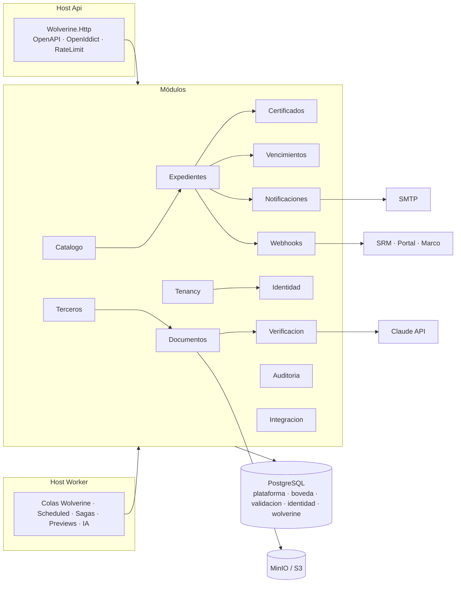

# 04 — Arquitectura de plataforma

| Estado | Fecha | Responsable |
|---|---|---|
| Borrador | 2026-10-28 | Arquitectura |

**Propósito.** Definir cómo se construye, despliega y opera Validasoft: estructura de la solución, persistencia (Marten), mensajería (Wolverine), almacenamiento documental (MinIO/S3), módulo de IA con revisión automática por niveles, notificaciones, observabilidad, Docker, CI y testing. El *qué* del dominio está en `03-dominio-y-eventos.md`; el *cómo se comparte un documento entre empresas* en `02-modelo-documental-compartido.md`.

**Relacionados:** [00-vision-y-alcance.md](00-vision-y-alcance.md) · [02-modelo-documental-compartido.md](02-modelo-documental-compartido.md) · [03-dominio-y-eventos.md](03-dominio-y-eventos.md) · [05-api-contratos-y-webhooks.md](05-api-contratos-y-webhooks.md) · [06-frontend-y-ux.md](06-frontend-y-ux.md) · [07-seguridad-identidad-y-tenancy.md](07-seguridad-identidad-y-tenancy.md) · [08-integracion-y-migracion.md](08-integracion-y-migracion.md) · [09-plan-de-hitos-y-responsabilidades.md](09-plan-de-hitos-y-responsabilidades.md) · [decisiones/registro.md](decisiones/registro.md) · ADR-0001, 0002, 0003, 0004, 0007, 0008

> Actualizado el 2026-10-28 con las decisiones del registro: tenant = grupo con empresas internas aisladas (P-11-2, ADR-0008), GitHub Actions (P-17-2), IA opcional y niveles (P-1-7, P-6-x), formularios como documentos (P-3-x), KMS y región por tenant (P-14-2/3), medición de uso desde H1 (P-11-1).

---

## 1. Decisiones estructurales

| Tema | Decisión | Por qué |
|---|---|---|
| Estilo | **Monolito modular** con dos roles de host (`Api`, `Worker`) sobre un único código | Una BD y una transacción cubren evento + outbox; dos contenedores de aplicación caben on-premise; el dominio aún se está formando. Extraer un módulo después = cambiar el transporte local por RabbitMQ (ADR-0001). |
| Runtime | .NET 10 LTS, C# 14, `TreatWarningsAsErrors` | Lenguaje del equipo; base nueva sin arrastrar EF/legacy. |
| Persistencia | **PostgreSQL 17 + Marten** (event store, document DB, proyecciones) | Event sourcing nativo, proyecciones inline/async, tenancy conjoined, sin ORM relacional (ADR-0002). |
| Mensajería | **Wolverine** con transporte PostgreSQL, outbox transaccional con Marten, scheduled messages, sagas | Un solo mecanismo para comandos, eventos internos, temporizadores y procesos largos; RabbitMQ solo si hace falta (ADR-0002). |
| Tenancy | **Tenant = grupo empresarial** con **empresas internas** (razones sociales) **aisladas** entre sí en decisiones; doble clave `tenant_id + empresa_id` en `validacion`; región y clave KMS **por tenant**; medición de uso por tenant y por empresa desde H1 | Decisión de Producto P-11-2 (ADR-0008): administración unificada del grupo sin mezclar las decisiones legales de cada razón social. |
| Binarios | **MinIO** (S3) en dev/on-prem; S3/Azure Blob vía la misma interfaz en nube; bucket **por tenant** (no por empresa) cifrado con la clave KMS del tenant; bucket `boveda` con clave de plataforma | Prefirmadas, versionado, Object Lock, SSE-KMS; el API nunca proxea bytes. |
| Identidad | **OpenIddict + ASP.NET Identity** embebidos (OIDC estándar) | Sin contenedor Java; grants propios para magic link y token del ERP; federable después (ADR-0003, doc 07). |
| Frontend | Dos apps React en el mismo monorepo (`apps/web`, `apps/public`) + paquetes | Bundle público ligero y aislado; design system compartido (ADR-0006, doc 06). |
| IA | Claude vía SDK oficial `Anthropic` .NET; la **lectura de hechos es coste de plataforma** (una vez por versión, sin presupuesto de lectura por tenant, B-2); la decisión es **por empresa y nivel contratado** y es lo único que limita el presupuesto del tenant; la IA es **opcional** solo a nivel de plataforma (sin clave o deshabilitada) o por **falta de consentimiento del tercero** (B-8), y el sistema funciona sin ella en nivel `Manual` | Coste de lectura incluido en el cargo por vínculo activo; ingreso proporcional a decisiones automatizadas (§7); nunca se bloquea al tercero por ausencia de IA (P-1-7, P-6-4). |
| Formularios | Datos estructurados (bancaria, tributaria, financiera, legal, SISO, contactos, UBO, PEP) son documentos de clase **`Formulario`** con esquema JSON canónico versionado + campos privados por tenant; misma mecánica de versiones, hechos y revalidación que los archivos | Un solo motor (P-3-1, P-3-2, P-3-6); evita repetir las tablas por sector del Portal. |
| Contenedores | Docker Compose como contrato de despliegue; Helm opcional | Debe correr completo en un portátil y en un servidor del cliente. |
| Entregas | **GitHub** (repositorio, Issues/Projects, Actions, GHCR) | Decisión de Producto P-17-2; reemplaza Azure Pipelines (§11). |

Lo que **no** se hereda del SRM: mezcla de Carter + minimal APIs + controladores; dos `HttpClient` al Portal; tres pilas de correo; endpoints "background" que otro sistema debe disparar; secretos en BD o código; token del ERP como única autenticación; estados como enteros mágicos; configuración como texto libre.

Lo que **sí** se hereda: español en dominio y docs; vertical slice por caso de uso; FluentValidation; OpenAPI documentado; tests por tipo; MUI + TanStack Query + Zustand en el frontend.

---

## 2. Módulos y reglas de aislamiento



| Módulo | Responsabilidad | Persistencia |
|---|---|---|
| `Tenancy` | Tenants (grupos), **empresas internas** (NIT, nombre, logo, colores, `Reply-To`, contacto de soporte), región, clave KMS, prefijos de folio por empresa, **medición de uso** (`uso_tenant`: usuarios, vínculos activos, GB, lecturas y decisiones de IA, webhooks; agregado por tenant y por empresa), planes y cuotas (H8), **accesos de soporte** concedidos por un Administrador del tenant (B-6) | Documentos Marten, esquema `plataforma` |
| `Identidad` | Usuarios, roles (por empresa o por todo el tenant), permisos, 2FA, API keys con alcance opcional por empresa, magic links, token exchange, rol `Plataforma`, `RegistroDeIdentidad` | ASP.NET Identity + Marten, esquema `identidad` |
| `Catalogo` | Tipos de documento canónicos (plataforma, versionados) y por tenant, **esquemas de formulario** (canónico + campos privados), **catálogo de tipos de identificación por país** con validador, áreas, motivos base + propios, flujos y `FlujoVersion`, reglas de exigencia, `ReglaFrescura`, `NivelRevision`, `CamposCriticos` adicionales | Documentos Marten (plataforma/tenant) con auditoría diff |
| `Terceros` | Tercero global (clave `país + tipo + número normalizado`), atributos, contactos, **relaciones entre terceros** (representantes, socios, UBO, miembros: personas naturales con bóveda propia, ADR-0010), **cuentas bancarias globales**, consentimientos (plataforma e IA externa) | Documentos Marten en `boveda` |
| `Documentos` | Agregado `Documento` (versiones inmutables), compartición, hechos compartidos, almacenamiento S3, previews | Event-sourced en `boveda` + S3 |
| `Verificacion` | Adaptadores `IVerificador` (IA, antivirus, listas restrictivas, estudio de cumplimiento, ERP); **motor de decisión automática** | Sin estado propio; emite eventos a `Documentos`/`Expedientes` |
| `Expedientes` | Agregados `Vinculo` (por **empresa interna**: `tenantId + empresaId + terceroId + tipoVinculo`), `Expediente`; saga `ProcesoDeValidacion`; revalidaciones; `CuentaDesignada` por vínculo (la elige el tercero, la aprueba la empresa con 4 ojos); bloqueo privado por empresa | Event-sourced en `validacion` (conjoined + `empresa_id`) |
| `Certificados` | Agregado `Certificado` por vínculo (folio raíz + sufijo por reemisión), PDF/A-2b, hash, sello de plataforma, verificación pública | Event-sourced en `validacion` |
| `Vencimientos` | Proyección `VencimientoProgramado`, `FrescuraDocumentoTercero`, job diario, avisos consolidados | Proyecciones async |
| `Notificaciones` | Plantillas Fluid, correo, campana, SSE, preferencias | Documentos + cola |
| `Webhooks` | Suscripciones, firma, entregas, reintentos, pull | Documentos + outbox |
| `Auditoria` | Streams `auditoria-configuracion-{tenantId}` y `auditoria-accesos-{terceroId}` (03 §2.1), `auditoria_identidad`, accesos a documentos, export firmado | Event store |
| `Integracion` | Endpoints `/importacion/*`, sincronización inversa al legado | Comandos idempotentes |

**Reglas de aislamiento (verificadas por NetArchTest en CI):**
1. `Validasoft.Dominio` no referencia ningún paquete salvo BCL.
2. Un módulo de `Aplicacion` no referencia tipos internos de otro módulo; se comunica por mensajes de `Validasoft.Contratos.Eventos` o por consultas de lectura declaradas en `Validasoft.Contratos.Lecturas`.
3. Ninguna consulta a `validacion` sin `TenantId` **y**, para vínculos, expedientes, aceptaciones, decisiones, certificados y bandejas, sin `EmpresaId`: el `IDocumentSession` se abre siempre por el middleware de tenant; la empresa activa llega en el token (claim `empresa`), en la cabecera `X-Empresa` (usuarios con rol en varias empresas; T-5) o en el alcance de la API key; un `IAuthorizationHandler` verifica que el usuario tenga rol en esa empresa y toda lectura de `validacion` pasa por `ISesionDeEmpresa` (un `IQuerySession` envuelto que añade el predicado `empresa_id`, T-3); un recurso de otro tenant o empresa responde **404** (T-4). `boveda` se consulta por `TerceroId` y el acceso a versiones pasa por `comparticion_version` (que apunta a un **vínculo**, es decir, a una empresa).
4. Todo proceso periódico es un *scheduled message* o un job del `Worker`; ningún endpoint HTTP dispara trabajo recurrente.
5. La IA es un `IVerificador` más: si está deshabilitada, el pipeline de hechos "sin IA" (§7.3) sigue funcionando y las decisiones caen en nivel `Manual`.

---

## 3. Estructura de la solución (monorepo)

```
C:\Fuentes_Git\Validasoft\
├── .github/
│   ├── workflows/{ci.yml, e2e.yml, imagenes.yml, desplegar.yml}
│   ├── ISSUE_TEMPLATE/{entregable.yml, bug.yml, decision.yml}
│   ├── PULL_REQUEST_TEMPLATE.md  CODEOWNERS  dependabot.yml
├── Validasoft.sln
├── Directory.Build.props            # net10.0, nullable, warnings as errors, analizadores
├── global.json                      # SDK fijado
├── src/
│   ├── Validasoft.Api/              # host HTTP
│   │   ├── Program.cs               # composición: Marten, Wolverine, OpenIddict, OTel, RateLimit, ProblemDetails
│   │   ├── Hosting/                 # middleware de tenant, correlación, idempotencia
│   │   └── appsettings*.json
│   ├── Validasoft.Worker/           # host sin HTTP (misma imagen, VALIDASOFT_ROL=worker)
│   ├── Validasoft.Dominio/          # agregados, eventos, invariantes, EvaluadorDeExigencia, cálculo de vigencia
│   │   ├── Validacion/{Vinculo,Expediente,Certificado}/
│   │   ├── Documentos/              # Documento (archivo y formulario), hechos, comparación de versiones
│   │   ├── Terceros/Identificacion/ # validadores por país (NIT, CC, CE, PA, RFC, CUIT…)
│   │   └── Configuracion/{Exigencia,Formularios}/
│   ├── Validasoft.Aplicacion/       # un folder por módulo; un caso de uso = una carpeta
│   │   └── Expedientes/
│   │       ├── CrearExpediente/{Endpoint,Comando,Validador,Handler}.cs
│   │       ├── EmitirVeredicto/
│   │       └── Procesos/ProcesoDeValidacionSaga.cs
│   ├── Validasoft.Infraestructura/  # Marten (config, proyecciones), Wolverine, MinIO, MailKit, Anthropic, ClamAV, PDFium
│   ├── Validasoft.Contratos/        # DTOs públicos, eventos de webhook, enums, lecturas (NuGet)
│   ├── Validasoft.Sdk/              # cliente .NET + WebhookVerifier (NuGet, multi-target net7.0;net8.0;net10.0 mientras exista el SRM, T-16)
│   └── Validasoft.Herramientas.Importacion/   # CLI de migración (doc 08)
├── apps/
│   ├── web/                         # revisor/admin (OIDC PKCE)
│   └── public/                      # tercero (PWA), verificador, embed
├── packages/
│   ├── ui/  forms/  api-client/  sdk-ts/  i18n/  domain/  config/
├── tests/
│   ├── Validasoft.Dominio.Tests/
│   ├── Validasoft.Aplicacion.Tests/
│   ├── Validasoft.Integracion.Tests/      # Testcontainers Postgres + MinIO + Mailpit
│   ├── Validasoft.Api.ContractTests/      # Verify: snapshot de OpenAPI y payloads
│   ├── Validasoft.Arquitectura.Tests/     # NetArchTest
│   ├── e2e/                               # Playwright
│   └── carga/                             # k6
├── infra/
│   ├── compose/{compose.yaml, compose.dev.yaml, compose.prod.yaml, .env.example}
│   ├── grafana/                           # dashboards versionados
│   └── k8s/                               # Helm chart opcional
├── docs/  (este conjunto) + docs/adr/ + docs/decisiones/
├── pnpm-workspace.yaml  turbo.json  Makefile  build.ps1
└── README.md
```

### Convenciones de código
| Regla | Detalle |
|---|---|
| Vertical slice | `Endpoint.cs` (Wolverine.Http, un verbo+ruta), `Comando.cs`/`Consulta.cs`, `Validador.cs` (FluentValidation), `Handler.cs` (compound handler `Load`/`Validate`/`Handle`) en la misma carpeta |
| Nombres | Español en dominio, rutas, eventos, tablas y docs. Inglés solo en identificadores impuestos por librerías |
| Enums | Textuales (`string` en BD), uno por agregado; nunca enteros arbitrarios |
| DTOs | Públicos solo en `Contratos`; internos no salen del módulo |
| Errores | ProblemDetails RFC 9457 con `codigo` y `traceId`; excepciones de dominio tipadas |
| Configuración | `IOptions<T>` validadas al arranque (`ValidateOnStart`); nada se lee como texto libre |
| Fechas | UTC en BD y API; zona horaria del tenant solo en presentación |
| Commits | Convencionales en español: `feat(expedientes): …`, `docs(adr): …` |
| ADR | Obligatorio para toda decisión estructural; numerados en `docs/adr/` |

---

## 4. Persistencia con Marten

### 4.1 Tres esquemas (más `identidad`) y un solo `DocumentStore` (T-1, T-2)
La lista de tablas por esquema la fija **03 §2.2**; aquí se copia el reparto y se añade cómo se configura Marten.

| Esquema | Tenancy | Contenido (03 §2.2) | Clave de acceso |
|---|---|---|---|
| `plataforma` | Tenant técnico `plataforma` | `tenant` (región, clave KMS, plan), `empresa`, `plan`, `uso_tenant`, `tipo_documento_canonico` (versionado), `esquema_formulario`, `catalogo_tipo_identificacion`, `motivo_base`, `propuesta_tipo_canonico`, `concesion_acceso_soporte` | rol `Plataforma` o administrador del tenant |
| `boveda` | Tenant técnico `boveda` (clave = tercero) | `tercero`, `relacion_entre_terceros`, `contacto_tercero`, `consentimiento_tercero`, `cuenta_bancaria`, `documento`, `version_documento`, `verificacion_version`, `comparticion_version`, `acceso_documento`, `referencias_de_version`, `frescura_documento_tercero`, `solicitud_supresion`, streams `Documento-{id}` | `tercero_id`; la lectura de una versión por una empresa exige fila en `comparticion_version` (que referencia `tenant_id + empresa_id + vinculo_id`), creada solo tras aceptar la invitación (ADR-0009) |
| `validacion` | **Conjoined** (`tenant_id` del cliente en cada fila y stream) **+ `empresa_id` obligatorio** en vínculo, expediente, requisito, aceptación, decisión, bloqueo, cuenta designada, certificado y bandejas | `tipo_documento_tenant`, `tipo_documento_empresa` (overrides, B-4), `tipo_vinculo`, `area`, `motivo`, `flujo`, `flujo_version`, `regla_seleccion_flujo`, `flujo_por_defecto`, `usuario_rol`, `api_key`, `webhook`, `entrega_webhook`, `plantilla_notificacion`, `vinculo`, `expediente`, `requisito`, `version_aceptada`, `decision_version`, `version_no_admitida`, `ratificacion`, `cuenta_designada`, `bloqueo`, `certificado`, `emision_certificado`, `revalidacion_pendiente`, `vencimiento_programado`, `lote_invitacion`, `campania`, `delegacion`, `comandos_idempotentes`, `auditoria_configuracion`, streams `Vinculo-`, `Expediente-`, `Certificado-` | `tenant_id` del token/API key inyectado por middleware; `empresa_id` del claim/cabecera/alcance validado por `IAuthorizationHandler` y aplicado por `ISesionDeEmpresa` |
| `identidad` | Tenant técnico `plataforma` | `usuario`, `credencial`, `magic_link`, `auditoria_identidad` (ASP.NET Identity + Marten) | OpenIddict |
| `wolverine` | — | Colas, inbox/outbox, scheduled, dead letters, sagas | — |

Configuración: **un solo `DocumentStore` con `Events.TenancyStyle = Conjoined` para todos los streams** (Marten admite un único estilo por store); los streams de la bóveda usan el tenant técnico `boveda` y los de plataforma/identidad el tenant `plataforma`, de modo que un comando que toca `boveda` y `validacion` (p. ej. `VersionCargada` + apertura de revalidaciones) sigue siendo **una transacción** (T-2; se valida con un *spike* en H1 que es criterio de aceptación). `empresa_id` no es una dimensión de tenancy de Marten sino una **columna duplicada e indexada** (`Duplicate(x => x.EmpresaId)`) en cada documento/proyección de `validacion`; como Marten no tiene filtros globales, toda lectura pasa por **`ISesionDeEmpresa`** (envuelve `IQuerySession` y añade el predicado) y NetArchTest prohíbe `IQuerySession` crudo fuera de `Infraestructura` y falla si un tipo de `validacion` no declara `EmpresaId` (T-3).

**Medición de uso (P-11-1).** Desde H1, cada caso de uso relevante emite `UsoRegistrado(tenant, empresa, métrica, cantidad)` (usuarios activos, vínculos activos, GB almacenados, lecturas de IA, decisiones automáticas/asistidas, entregas de webhook) hacia la proyección `uso_tenant` (agregada por día). Los planes y límites (H8) leen de ahí; no se añade medición a posteriori.

**Cifrado (P-14-3).** Clave KMS por tenant: MinIO con SSE-KMS (KES o KMS del proveedor en nube) usando `tenant-{id}` como clave; `IDataProtector` por tenant para secretos SMTP/API keys; bucket `boveda` con la clave de plataforma. Cerrar un tenant = destruir su clave (borrado criptográfico de lo privado) y aplicar retención a lo global.

### 4.2 Proyecciones
| Proyección | Tipo | Fuente | Razón del tipo |
|---|---|---|---|
| `VinculoResumen`, `ExpedienteDetalle`, `BovedaTercero` (documento × versión actual × estado por **empresa**), `CertificadoPublico`, `EstadoCertificacionTercero`, `CuentasTercero`, `ReferenciasDeVersion` | Inline | su agregado | Lectura-tras-escritura en la propia UI y en `GET /consultas/certificacion` (ETag) |
| `BandejaRevision` (expediente × área, por empresa), `BandejaRevalidaciones` (vínculo × tipo con aceptación `Desactualizada`, por empresa), `ColaDeExcepciones` (lo que la revisión automática no decidió + muestras de auditoría), `Tercero360`, `FlujosResumen`, `VencimientosProximos` | Async (multi-stream) | `Expediente`, `Vinculo`, `Documento` | Cruzan streams; tolerancia a segundos de retraso |
| `MisPendientes` | **Consulta compuesta** (no proyección: una inline no puede derivar de async, obs. 4) | `BandejaRevision`, `BandejaRevalidaciones`, `ColaDeExcepciones` | `web:/inicio` |
| `TimelineExpediente`, `TimelineVinculo`, `TimelineDocumento` | Async (event projection a tabla plana) | todos | Auditoría humana |
| `VencimientoProgramado`, `FrescuraDocumentoTercero` | Async | `Vinculo`, `Documento`, `Catalogo` | Alimentan el job diario y los avisos consolidados |
| `KpisTenant`, `KpisFlujo`, `KpisEmpresa` (con `decisionesAutomaticas`, `consumoIa` y `equidad` como campos) | Async (agregación diaria) | `Expediente`, `Documento`, `UsoRegistrado` | Inicio, facturación del servicio automático y métricas de equidad (adición 10) |
| `uso_tenant` | Async (agregación diaria) | `UsoRegistrado` | Medición y planes |

Reconstrucción: `dotnet Validasoft.Api -- proyecciones rebuild <nombre>` (comando JasperFx), con el daemon async en el `Worker` (un solo nodo líder; HA con *hot/cold*).

### 4.3 Migraciones
- Dev: `AutoCreate.CreateOrUpdate`.
- Test/prod: `dotnet Validasoft.Api -- migrar` como job previo al despliegue (nunca en el arranque del API; lección del Portal, cuyo `Database.Migrate()` al arrancar provocaba timeouts en la primera petición).
- Versionado de eventos: *upcasters* en `Infraestructura/Marten/Upcasters`; nunca se reescriben eventos.

---

## 5. Mensajería y procesos con Wolverine

| Aspecto | Decisión |
|---|---|
| Transporte | PostgreSQL (`UsePostgresqlPersistenceAndTransport`); colas durables `validasoft.expedientes`, `validasoft.documentos`, `validasoft.verificacion`, `validasoft.notificaciones`, `validasoft.webhooks`, `validasoft.importacion` |
| Outbox | `IntegrateWithWolverine()` sobre Marten + `UseDurableOutboxOnAllSendingEndpoints()`; los eventos de dominio se publican con *event forwarding* a los suscriptores |
| Inbox | Durable; los handlers son idempotentes por clave natural (`documentoId+version`, `expedienteId+requisitoId+versionId`) |
| Scheduled messages | SLA de etapa (`VencerSlaRevision`), expiración de magic link, recordatorio de carga pendiente, `PlazoRevalidacionVencido` (tras `diasRevalidacion`, 15 por defecto ⇒ certificado `ConPendientes` bloqueante, A-2) |
| Job diario | `ProcesarVencimientosDelDia` lee `VencimientoProgramado` y `FrescuraDocumentoTercero` y emite comandos idempotentes (`MarcarPorVencer`, `MarcarVencido`, `EnviarAvisoConsolidado`) |
| Errores | `RetryWithCooldown(1s, 5s, 30s)` para transitorios; `MoveToErrorQueue` tras N; panel de dead letters en Configuración con reintento manual |

### Sagas (persistidas en Marten)
| Saga | Dispara | Pasos | Compensación |
|---|---|---|---|
| `ProcesoDeValidacion` | `ExpedienteAbierto` en `Vinculo` | crear stream `Expediente` → calcular requisitos → al `InvitacionAceptada` + `ConsentimientosRegistrados`: `CompartirConVinculo` por cada tipo exigido con versión actual (ADR-0009; antes la empresa solo ve `requisitosCubribles`) → al `ExpedienteAprobado`: registrar versiones aceptadas en `Vinculo` → emitir certificado → webhook; `VinculoBloqueado` → `SuspenderCertificado` + `CongelarComparticion`; `VinculoDesbloqueado` → `RestablecerCertificado` + `ReanudarComparticion` o `AbrirExpediente(Renovacion)` (B-5) | `AperturaDeExpedienteFallida`; reintentos idempotentes |
| `VerificacionDocumental` | `VersionCargada` | `IniciarAnalisis(ConIa)` → `AnalisisDeVersionIniciado` (`Recibida → EnAnalisis`; `ConIa` solo si la plataforma tiene IA habilitada **y** el tercero registró `ConsentimientoIa`, B-2/B-8; el presupuesto del tenant no afecta la lectura) → hechos sin IA (hash, antivirus, MIME real, páginas, preview, comparación por hash) → **si `ConIa`**: preclasificación → extracción → comparación por campos → señales de manipulación → **promover a versión actual** (comando `PromoverAActual`) si pasa → `VersionActualCambiada(Comparacion, CamposCambiados[], CamposCriticosCambiados[], ConIa)` a todos los vínculos que exigen el tipo → aplicar motor de decisión por empresa | Si falla un hecho: `VersionDevueltaAlTercero(motivo)` → notificación al tercero; nada llega a las empresas. Sin IA: se promueve con hechos básicos y la decisión cae en `Manual` |
| `Revalidacion` | `VersionActualCambiada` (por vínculo/empresa) | **la saga decide por empresa** (T-7): abre revalidación si cambiaron `CamposCriticosCambiados[]` del canónico **o** algún campo de `camposCuyoCambioExigeHumano` de esa empresa, o si es un archivo; si no, `RegistrarCambioMenor` → marcar aceptación `Desactualizada` → abrir/reutilizar `Expediente(Actualizacion)` (también `EnValidacion` con expediente abierto: `MarcarRequisitoDesactualizado`) → según `NivelRevision` efectivo de **esa empresa**: veredicto automático o cola humana → al aprobar, nueva `VersionAceptada` → recalcular vigencia y certificado | `PlazoRevalidacionVencido` según `politicaDesactualizada` (`BloquearTrasGracia` por defecto) y `plazoRevalidacion` de la aceptación (15 días; 90 en importadas, B-8): certificado `ConPendientes` bloqueante, el vínculo **no** cambia de estado (T-8) |
| `EmisionCertificado` | `ExpedienteAprobado` | validar completitud (incluida cuenta designada si el tipo de vínculo la exige) → folio `{PrefijoEmpresa}-C-{Año}-{Seq}-{n}` (secuencia PostgreSQL por empresa, T-9) → PDF/A-2b → contenido canónico RFC 8785 → hash → sello **Ed25519** de plataforma (T-12) → Object Lock *compliance* (T-14) → `CertificadoEmitido` → webhook `certificado.emitido` (canónico, T-15) | Reintento idempotente por `expedienteId` |
| `InvitacionMasiva` | `LoteCreado` | validar filas (identificación multipaís) → crear vínculos/expedientes por lotes de 100 → encolar correos → contadores | Pausa/reanudación; informe por fila |
| `CambioCuentaDesignada` | `CuentaDesignadaPropuesta` (el tercero elige otra cuenta para una empresa) | verificar certificación de la cuenta → exigir 2 aprobadores de la empresa (P-4-7) → `CuentaDesignadaAprobada` → webhook `vinculo.cuenta_designada` a su ERP | `CuentaDesignadaRechazada` deja la designada anterior |
| `SupresionDatos` (H8) | `SolicitudSupresionRegistrada` | evaluar retención por documento → retirar lo no retenido → anonimizar → constancia al titular en ≤ 15 días hábiles | — |

---

## 6. Almacenamiento documental

| Regla | Detalle |
|---|---|
| Buckets | `boveda` para documentos globales (clave de plataforma); `tenant-{id}` para `PorVinculo` de todas las empresas del tenant (SSE-KMS con la clave del tenant); **no** hay bucket por empresa: el aislamiento entre empresas del grupo es lógico (`empresa_id` en la clave y en la autorización) |
| Clave | `terceros/{terceroId}/{sha256}.{ext}` y `empresas/{empresaId}/vinculos/{vinculoId}/{sha256}.{ext}`; nombre original en `x-amz-meta-nombre-original` (nunca en la clave: el Portal usaba el nombre del tercero como carpeta) |
| Subida | Dos pasos: `POST …/documentos` declara nombre, tamaño, mime y sha256 → URL prefirmada PUT (5 min) con `x-amz-checksum-sha256` → `POST /documentos/{docId}/versiones/{n}/confirmar` verifica existencia y hash, emite `VersionCargada` |
| Descarga | Solo URL prefirmada GET (5–15 min) emitida tras comprobar `comparticion_version` o propiedad; cada emisión registra `DocumentoAccedido` |
| Dedupe | Único `(documento_id, sha256)`: subir el mismo archivo devuelve la versión existente y propone "ratificar" si el tipo lo permite |
| Inmutabilidad | Versionado de bucket + Object Lock: modo **compliance** (irreversible) para versiones referenciadas por certificados con retención legal, *governance* para las referenciadas solo por `version_aceptada` (T-14); retención legal por tipo (p. ej. 10 años, P-14-1) |
| Previews | Worker: PDF→PNG (PDFium), miniaturas, extracción de texto nativo; OCR (Tesseract) solo si no hay capa de texto y el tipo lo exige (la IA lee la imagen nativa) |
| Límites | **20 MB por archivo, PDF/JPG/PNG/WebP/HEIC, 50 páginas** (P-16-2, T-17); HEIC y varias fotos se convierten a PDF **en el cliente** antes de subir (P-16-3); XLSX para EEFF opcional en H7; magic bytes vs mime declarado; PDF con JavaScript o formularios activos → `Devuelta` con motivo |
| Antivirus | ClamAV opcional en dev (`profile: av`), **obligatorio en producción** (doc 07 §ingesta); hecho `Antivirus { Limpio, Infectado, Cuarentena, NoDisponible }` (T-11): en prod sin AV la versión **espera** en `EnAnalisis`; en dev `NoDisponible` permite continuar |
| Formularios | Una versión de un documento clase `Formulario` guarda el JSON validado contra el esquema (canónico + extensión del tenant) en `version_documento.datos_declarados`; no hay binario salvo el soporte adjunto; `Comparacion` es un diff de campos determinista (sin IA) |
| Exportación | ZIP firmado (manifiesto JSON + hash + sello) de la bóveda completa para el tercero y del expediente completo para la empresa (adición 5, H8) |
| Backup | `mc mirror` incremental + snapshot semanal; restauración probada trimestralmente en pipeline |

---

## 7. Módulo de IA: `VerificadorDocumental` y revisión automática

### 7.0 La IA es opcional (solo a nivel de plataforma o por consentimiento)
La plataforma puede operar **sin IA** en dos casos: **(a)** la plataforma no la tiene habilitada (sin clave, on-premise sin acceso, deshabilitada por configuración) o **(b)** el tercero no ha registrado `ConsentimientoIa` (B-8; hasta su primer ingreso y aceptación de la autorización, incluidos los históricos importados). **El presupuesto del tenant no afecta la lectura**: solo limita las decisiones automáticas/asistidas (B-2). Sin IA el pipeline produce solo los hechos **sin IA** (§7.3) y toda decisión cae en nivel `Manual`; nunca se bloquea la carga del tercero ni la publicación de sus datos maestros (P-1-7, P-6-4). El consentimiento para el procesamiento con un proveedor externo es parte de la autorización de tratamiento de la plataforma (P-6-5; texto de Legal; opción *zero data retention* del proveedor cuando exista).

### 7.1 Principio económico
La IA **lee cada versión una sola vez** como **coste de plataforma** (incluido en el cargo por vínculo activo; no existe presupuesto de lectura por tenant ni el campo `iaHechos`, B-2) y produce **hechos compartidos** guardados en `boveda.verificacion_version`, visibles para todas las empresas con compartición. Cada empresa aplica después **su** regla de decisión sobre esos hechos según el **nivel contratado**; ingreso ∝ **decisiones** automáticas/asistidas **más el cargo por vínculo activo** (P-6-7). Tres empresas que comparten un tercero generan una lectura y tres decisiones. `uso_tenant.lecturasIa` es informativo; `decisionesIa` es la base facturable (§4.1).

### 7.2 Interfaz y proveedores
```
IVerificadorDocumental
  Task<HechosDeVersion> AnalizarAsync(VersionDocumento version, TipoDocumentoCanonico tipo, VersionDocumento? anteriorActual, CancellationToken ct)
IMotorDeDecision
  Decision Decidir(HechosDeVersion hechos, ReglasDeEmpresa reglas, NivelRevision nivel)
```
Proveedores: `ClaudeVerificador` (SDK `Anthropic` .NET), `VerificadorNulo` (sin clave → `FailClosed`), `VerificadorFixture` (pruebas, respuestas grabadas).

### 7.3 Pipeline por versión

| Hecho | Sin IA | Con IA | Quién lo produce |
|---|---|---|---|
| `Hash` (sha256 declarado = objeto = recalculado) | ✔ | ✔ | Worker |
| `Antivirus` | ✔ (ClamAV) | ✔ | Worker |
| `TipoMimeReal` (magic bytes), `Paginas`, `Preview` | ✔ | ✔ | Worker (PDFium) |
| `Comparacion = SinAnterior | Identica | Distinta` (por hash) | ✔ | ✔ | Worker |
| Diff de campos de un **formulario** | ✔ (determinista) | ✔ | Worker |
| `TipoDetectado`, `Legible` | — | ✔ (`claude-haiku-5-5`) | Verificacion |
| `Extraccion` (campos clave, fechas, periodo, firmas/sellos) | — | ✔ (`claude-opus-5-5` / `claude-sonnet-5-5`) | Verificacion |
| `Comparacion = SinCambios | CambiosDetectados` + `CamposCambiados[]`, `CamposCriticosCambiados[]` (archivos) | — | ✔ | Verificacion |
| `CoherenciaFormularioSoporte` (campos digitados vs extraídos del soporte, P-3-4) | — | ✔ | Verificacion |
| `SenalesManipulacion` (capas, fuentes, metadatos, fecha de creación posterior a expedición; adición 6: básico en H2, completo en H7) | parcial (metadatos) | ✔ | Verificacion |

```mermaid
sequenceDiagram
  participant T as Tercero
  participant D as Documentos
  participant V as Verificacion (Worker)
  participant C as Claude
  participant E as Expedientes (por empresa)
  T->>D: confirmar subida (hash)
  D->>V: VersionCargada
  V->>V: hechos sin IA: hash · antivirus · MIME real · páginas · preview · comparación por hash
  alt IA habilitada (configuración de plataforma + consentimiento del tercero; el presupuesto no aplica a la lectura)
    V->>C: preclasificación (haiku-5-5): ¿qué documento es? ¿legible?
    alt tipo incorrecto / ilegible
      V-->>T: VersionDevueltaAlTercero (motivo claro)
    else
      V->>C: verificación (opus-5-5 | sonnet-5-5): extracción + comparación con versión anterior + señales de manipulación
    end
  else sin IA
    V->>V: hechos básicos; marca "hechos IA no disponibles"
  end
  V->>D: HechosDeVersionRegistrados → PromoverAActual → VersionActualCambiada
  D->>E: alerta a TODOS los vínculos (empresas) que exigen el tipo
  E->>E: por empresa: NivelRevision + ReglaFrescura + CamposCriticos → veredicto automático o cola humana (Manual si no hay hechos IA)
```

Latencia objetivo (P-6-9): resultado al tercero en **< 60 s para el 95 %**; si supera 60 s la UI muestra "te avisamos por correo" y el resultado llega por SSE/correo.

### 7.4 Modelos y parámetros
| Paso | Modelo | Parámetros | Por qué |
|---|---|---|---|
| Preclasificación | `claude-haiku-5-5` | structured output `{tipoDetectado, legible, confianza}`; 1 página o miniaturas | Descarta basura barato antes del modelo caro |
| Verificación | `claude-opus-5-5` por defecto; `claude-sonnet-5-5` configurable por tipo canónico (cédula, RUT) | `effort: high`; structured output con JSON Schema; PDF/imagen como bloques nativos (≤20 MB / 50 páginas); `system` con reglas del tipo bajo `cache_control` (TTL 1 h); `max_tokens` 4 000 | Falsos positivos cuestan horas de revisor; caching reduce el coste del prompt fijo |
| Re-verificación masiva (migración) | Batches API | 50 % de coste | Volumen histórico sin prisa |

Esquema de salida de la verificación (resumen):
```json
{
  "tipoDetectado": "CAMARA_COMERCIO", "coincideTipoEsperado": true, "legible": true, "confianza": 0.97,
  "datos": { "identificacion": "900123456-7", "razonSocial": "FERRETERIA EL TORNILLO SAS",
             "fechaExpedicion": "2026-10-20", "fechaVencimientoDoc": null, "periodo": null,
             "emisor": "CCB", "paginas": 6, "firmas": true, "sellos": true,
             "camposClave": { "representanteLegal": "ANA PEREZ", "direccion": "CL 80 # 10-20", "capital": "…" } },
  "comparacionConVersionAnterior": { "resultado": "CambiosDetectados",
     "cambios": [ { "campo": "direccion", "anterior": "CR 7 # 1-2", "actual": "CL 80 # 10-20", "critico": false } ] },
  "discrepanciasConTercero": [], "resumen": "Cámara vigente, cambió la dirección."
}
```
`Identica` se decide por hash antes de llamar al modelo; `SinCambios` cuando todos los `camposClave` coinciden normalizados; `CambiosDetectados` lista los campos.

### 7.5 Niveles de revisión y motor de decisión (por empresa y tipo)
| Nivel | Qué hace la IA | Qué hace el humano | Para quién |
|---|---|---|---|
| `Manual` | Muestra hechos y sugerencia | Decide todo | Tenants sin contrato de automatización |
| `Asistido` | Pre-aprueba u observa; deja el veredicto propuesto | Confirma en un clic o corrige | Áreas con responsabilidad legal fuerte |
| `Automatico` | Emite veredicto con actor `Sistema (IA)` | Solo excepciones (`ColaDeExcepciones`) y muestra de auditoría (`PorcentajeMuestreo`, default 5 %, mínimo 1 por semana por tipo, P-6-3) | Revalidaciones y renovaciones de alto volumen |

El nivel es parte de la **configuración efectiva** con jerarquía **tenant → empresa → regla del flujo** (B-4): `tipo_documento_tenant.nivel_revision` (default) ← `tipo_documento_empresa` (override por razón social) ← `ReglaDeExigencia.override` (03 §10); sin hechos IA disponibles el nivel efectivo es `Manual`.

Reglas del motor en `Automatico` (evaluadas en orden; la primera que aplica decide):
1. `coincideTipoEsperado=false`, `legible=false` o identidad que no coincide → ya no llegó aquí: la bóveda devolvió la versión al tercero (03 §4.3); si la identidad es **ambigua** (confianza < umbral) → **humano**.
2. Frescura: `fechaExpedicion + ReglaFrescura < hoy` o `fechaVencimientoDoc < hoy` → `Observado` automático al tercero con el siguiente paso (sin pasar por humano).
3. `comparacion = Identica | SinCambios` y confianza de los campos clave ≥ 0,95 → `Aprobado` automático (nunca se registra como ratificación: la ratificación es siempre una declaración del tercero, A-7).
4. `CambiosDetectados` solo en campos no críticos y confianza ≥ 0,95 → `Aprobado` automático con nota de cambios.
5. Cambio en `CamposCriticos` del canónico o en `camposCuyoCambioExigeHumano` de la empresa (representante legal, razón social, cuenta bancaria, NIT) o `SenalesManipulacion` → **humano** (`ColaDeExcepciones`).
6. Confianza entre 0,80 y 0,95 → se degrada a `Asistido` (sugerencia + confirmación); < 0,80 → **humano** (umbrales P-6-1, defaults por tipo canónico, ajustables por tenant).
7. Muestreo: el `PorcentajeMuestreo` de las aprobaciones automáticas se envía además a `ColaDeExcepciones` *sin bloquear* (auditoría).

Sobre una versión el motor solo emite `Aprobado` u `Observado` (con `noAdmitirEstaVersion` cuando la identidad es de otro tercero); `Rechazado` es un veredicto del **expediente** y nunca lo emite el sistema (B-7).

Cada decisión automática emite `VeredictoAutomaticoEmitido(expediente, requisito, versión, resultado, reglaAplicada, evidencia{hechos, confianza, modelo, costoUsd})`; es reversible por un humano con justificación y se cuenta en `KpisTenant.decisionesAutomaticas` (base de facturación). El tercero puede pedir **revisión humana** de toda observación o rechazo automático (P-6-8): el botón crea una excepción que la empresa debe responder; se mide el tiempo de respuesta.

**Equidad (adición 10).** `KpisTenant.equidad` registra tasa de observación/devolución automática por tipo de persona, tamaño de empresa, región y tipo de documento; una desviación > 2× respecto a la media del tipo dispara alerta al administrador y sube el muestreo humano de ese segmento al 20 % hasta revisarlo.

### 7.6 Operación, coste y seguridad
| Aspecto | Decisión |
|---|---|
| Presupuesto | Tope mensual de USD **de decisiones** por tenant (la lectura es coste de plataforma, B-2); alerta al administrador y al comercial al 80 %; al agotarse las decisiones se **degradan a `Manual` con alerta** (P-6-4) y los hechos IA siguen produciéndose; la carga del tercero **nunca se bloquea**; `accionAlAgotar = Continuar` (facturar excedente) es opción contractual que vive en `PlanDto`, administrado por Plataforma, no en la configuración del tenant (I-23) |
| Consentimiento | Hasta que el tercero acepte la autorización que incluye IA externa (primer ingreso), sus versiones —incluidas las importadas— se procesan solo con hechos sin IA; es una condición de uso (P-6-5, B-8), no un estado estable: al aceptar, la siguiente versión ya se lee con IA y las existentes pueden re-leerse con Batches API |
| Concurrencia | Semáforo global y por tenant en la cola `verificacion`; timeout 120 s; reintento ×2 solo en 429/5xx |
| Fallos del modelo | `stop_reason=refusal` o `max_tokens` → `NoLegible` + humano; JSON inválido → reintento una vez con instrucción de reparación, luego humano |
| Registro | `verificacion_version` guarda modelo, versión de prompt, hash del prompt, tokens, coste; prompt y respuesta completos en `ia/{terceroId}/{documentoId}/v{n}.json` (S3, **retención igual al documento**, P-6-6) |
| Privacidad | Datos del tercero viajan solo los necesarios (identificación y razón social declaradas); sin PII de terceros ajenos; contrato de no entrenamiento del proveedor |
| Clave | `ANTHROPIC_API_KEY` por variable/secret; nunca en appsettings versionado (lección del Portal) |
| Pruebas | Fixtures PDF reales anonimizados (RUT, Cámara, cédula, EEFF, póliza) con respuestas grabadas; test de humo `[Trait("Externo")]` contra el API real; tabla de casos del motor de decisión (100 % determinista) |
| Métricas | `ia_lecturas_total{modelo,tipo}`, `ia_costo_usd_total{tenant}`, `ia_cache_hit_ratio`, `decisiones_automaticas_total{tenant,empresa,resultado,regla}`, `decisiones_revertidas_total`, `revisiones_humanas_solicitadas_total`, `tiempo_lectura_segundos` (p95 < 60 s), `equidad_tasa_observacion{segmento}` |

### 7.7 Formularios: esquema canónico versionado
- `esquema_formulario(tipo_canonico_id, version, json_schema, campos_clave[], campos_criticos[])` lo administra la plataforma (P-3-2); cada tenant puede **añadir** propiedades privadas (`extension_tenant(tenant_id, tipo_tenant_id, json_schema_adicional)`) que viven `PorVinculo` y nunca viajan a otras empresas.
- El backend valida el JSON contra `esquema canónico + extensión del tenant` (NJsonSchema) antes de emitir `VersionCargada`; la versión guarda `esquema_version`.
- Toda edición crea versión (P-3-6); el diff de campos es un hecho determinista y la bóveda siempre emite `VersionActualCambiada(CamposCambiados[], CamposCriticosCambiados[])`; es la saga `Revalidacion` de **cada empresa** la que decide si abre revalidación (críticos del canónico o `camposCuyoCambioExigeHumano` propios) o registra `CambioMenorRegistrado` (notificación, sin revalidación) (T-7).
- Soporte adjunto (certificación bancaria, RUT para la tributaria): se vincula como versión de archivo y la IA produce `CoherenciaFormularioSoporte` (P-3-4).
- Cuentas bancarias: `cuenta_bancaria` (global, N por tercero, cada una con su certificación) y `cuenta_designada(tenant, empresa, vinculo)` elegida por el tercero; el cambio dispara la saga `CambioCuentaDesignada` (4 ojos, P-4-7), que es el **único** cuatro ojos: su aprobación cubre el requisito `CUENTA_BANCARIA` del expediente (03 §6.3).
- Personas relacionadas (ADR-0010): el representante legal, socios/UBO y miembros de consorcio son terceros persona natural con bóveda propia; `IdentidadCoincide` de su cédula se contrasta contra la persona, no contra el NIT; un cambio de relación principal detectado en una Cámara nueva expira las verificaciones del saliente **tras confirmación humana** o con confianza ≥ 0,98 (03 §4.5).

---

## 8. Notificaciones (un solo motor)

| Elemento | Decisión |
|---|---|
| Disparo | Suscripción a eventos de dominio (`ExpedienteObservado`, `VersionActualCambiada`, `CertificadoEmitido`, `DocumentoPorVencerEnVinculo`…) |
| Catálogo | El de P-10-1 (evento × tercero/revisor/administrador/webhook) es la configuración por defecto de cada tenant; se materializa en `docs/11-trazabilidad-por-hito.md` |
| Plantillas | **Fluid** (sintaxis Liquid, sandbox) por `(tenant, evento, canal, idioma)`, variables tipadas por evento. MVP: el tenant edita solo cabecera, pie, logo y colores (P-10-5, P-11-3); H8: editor Liquid restringido con vista previa y variables validadas |
| Canales MVP | Correo (MailKit; Mailpit en dev), novedad in-app (`Novedad` + SSE para la campana), webhook (módulo aparte). WhatsApp/SMS en H8+ como canal enchufable (P-10-2) |
| Remitente | Dominio de la plataforma con el nombre de la **empresa** como remitente visible y `Reply-To` de la empresa (P-10-4); dominio propio del tenant con DKIM/SPF verificado en H8 |
| Consolidación | Los avisos de vencimiento al tercero se agrupan por documento y día (`FrescuraDocumentoTercero`): un correo lista todas las empresas afectadas y la fecha más temprana; **máximo 1 correo por tercero, hecho y día** (P-10-3); digest diario opcional para revisores |
| Evidencia de entrega | Se guarda el acuse SMTP (id de mensaje, código), y apertura/clic cuando el canal lo permite, por notificación (adición 4) para disputas "nunca me avisaron" |
| Dedupe | `(destinatario, evento, agregado, ventana)` |
| Preferencias | Por usuario: evento × canal; resumen diario opcional |
| Soporte | Todo correo y pantalla del tercero muestra el contacto de soporte de la **empresa** (primer nivel, P-15-4); la plataforma solo aparece para incidentes técnicos |
| Prohibido | Enviar contraseñas; enlaces sin expiración; HTML sin escape del comentario de la empresa (bug conocido del Portal) |

---

## 9. Observabilidad y operación

| Área | Decisión |
|---|---|
| Telemetría | OpenTelemetry en Api y Worker (ASP.NET, HttpClient, Npgsql, Marten, Wolverine, Anthropic) → OTLP → `grafana/otel-lgtm` (Loki, Tempo, Prometheus) en compose; Seq como alternativa ligera on-prem |
| Health | `/health/live` (proceso), `/health/ready` (Postgres, MinIO, colas, SMTP opcional; Anthropic = *degraded*) |
| Métricas de negocio | `expedientes_certificados_total{tenant,empresa}`, `tiempo_hasta_certificacion_segundos`, `revalidaciones_pendientes{tenant,empresa}`, `documentos_vencidos{tenant,empresa}`, `webhooks_entregas_total{estado}`, `uso_*` por tenant/empresa, más las de IA (§7.6) |
| Auditoría | Event store append-only + streams `auditoria-configuracion-{tenantId}` (cambios administrativos con diff), `auditoria-accesos-{terceroId}` (accesos a documentos) y `auditoria_identidad` (03 §2.1); decisiones automáticas revertidas; export firmado mensual; logs de acceso con la misma retención que el documento (P-14-7) |
| SLA y respaldo (P-15-1) | MVP: **99,5 % mensual, RPO 15 min, RTO 4 h** → WAL archiving continuo con pgBackRest (`archive_timeout = 15 min`), `pg_dump` diario, retención 30 días; MinIO versionado + `mc mirror` a bucket/espacio externo cada 15 min; *runbook* de restauración automatizado y ensayado en `e2e.yml` mensual. Plan Empresarial (99,9 %, RPO 5 min, RTO 1 h): réplica caliente de PostgreSQL + replicación de bucket; segunda zona |
| Alertas | Dead letters > 0 durante 15 min; `ready` degradado > 5 min; presupuesto IA al 80 % y agotado; entregas de webhook fallidas > 3 reintentos; retraso de WAL > RPO; desviación de equidad IA |

---

## 10. Docker Compose y entornos

| Servicio | dev | test (CI) | prod |
|---|---|---|---|
| `api`, `worker` (misma imagen, `VALIDASOFT_ROL`) | ✔ | ✔ | ✔ (réplicas; un líder del daemon async) |
| `web`, `public` (nginx estático) | Vite dev server | ✔ | ✔ |
| `postgres:17` | ✔ | Testcontainers | ✔ o gestionado |
| `minio` | ✔ | Testcontainers | ✔ o S3/Blob |
| `mailpit` | ✔ | ✔ | SMTP real |
| `otel-lgtm` | ✔ | — | `profile: observabilidad` |
| `clamav` | `profile: av` | — | `profile: av` |

```yaml
# infra/compose/compose.yaml (extracto)
services:
  api:
    image: validasoft/app:${VERSION:-dev}
    environment:
      VALIDASOFT_ROL: api
      VALIDASOFT__Postgres__ConnectionString_FILE: /run/secrets/pg
      VALIDASOFT__Minio__Endpoint: http://minio:9000
      VALIDASOFT__Ia__ApiKey_FILE: /run/secrets/anthropic
      VALIDASOFT__Ia__ModeloVerificacion: claude-opus-5-5
    depends_on: [postgres, minio]
    ports: ["8080:8080"]
  worker:
    image: validasoft/app:${VERSION:-dev}
    environment: { VALIDASOFT_ROL: worker }
```

Comandos: `make up | down | migrar | seed | test | e2e | logs` y `build.ps1` equivalentes. `-- seed demo` crea el tenant `demo` con **dos empresas internas** (`Constructora Norte`, `Constructora Sur`), flujo "Habilitación de proveedores" (Compras, Legal, Financiera, Cumplimiento; SST opcional), semilla de tipos canónicos (P-2-3), catálogo de identificación multipaís, usuarios por rol y tres terceros con documentos fixture (uno compartido por las dos empresas para demostrar aislamiento de decisiones y revalidación).

Entornos (P-15-3): **SaaS** con `dev`/`test`/`prod` compartidos entre tenants, región como atributo del tenant (P-14-2; MVP una región + on-premise); **on-premise** una instancia por cliente con sus propios entornos. Variables de tenant que cambian por región: endpoint de MinIO, KMS, SMTP.

Secretos: variables `_FILE` (Docker secrets) o proveedor `IConfiguration` de Key Vault/Vault; `.env.example` versionado, `.env` no; claves KMS por tenant gestionadas por KES (on-prem) o por el KMS del proveedor (nube).

---

## 11. CI/CD y gobierno del repositorio (GitHub, P-17-2)

| Workflow | Disparo | Contenido | Bloquea si |
|---|---|---|---|
| `ci.yml` | PR y push a `main` | `dotnet build` + `pnpm -r build` + lint (ESLint, analizadores) · tests Dominio, Aplicación, Integración (Testcontainers en runner Linux), Contract (snapshot de `/openapi/v1.json` y payloads), Arquitectura (NetArchTest) · regeneración de `api-client`/SDKs y `git diff --exit-code` | warnings (son errores); cualquier test; cambio de OpenAPI sin SDK regenerado |
| `e2e.yml` | PR con etiqueta `e2e`, nightly y antes de `desplegar` | Playwright sobre compose efímero con IA en modo fixture; ensayo mensual de restauración de backup | flujos a–h rojos |
| `imagenes.yml` | Tag `v*` y `main` | Build multi-stage de `app` (`api`/`worker`), `web`, `public`; SBOM (Syft); escaneo (Trivy); firma (cosign keyless); push a **GHCR**; publicación de NuGet (`Contratos`, `Sdk`) en GitHub Packages y de `@validasoft/sdk` en npm interno | vulnerabilidad crítica |
| `desplegar.yml` | Manual (`workflow_dispatch`) o tras `imagenes` | Por entorno con **GitHub Environments** (`test` automático, `prod` con *required reviewers*); `-- migrar` antes del `api`; smoke de `/health/ready` | migración o smoke fallidos |

Gobierno:
- `main` protegida: PR obligatoria, **2 aprobaciones**, CI verde, conversaciones resueltas, sin *force push*; `CODEOWNERS` por carpeta (dominio → Backend A, infraestructura → Backend B, `apps/` → Frontend, `docs/` → Arquitectura + Producto).
- Ramas `feature/H<n>-<tema>`; commits convencionales en español; *squash merge* con el título convencional.
- Issues y Projects: una épica (issue padre) por hito, un issue por entregable con sus criterios de aceptación copiados de `09`; plantillas `entregable.yml`, `bug.yml`, `decision.yml` (esta última enlaza `decisiones/registro.md`).
- Dependabot semanal para NuGet, npm y GitHub Actions; `secret scanning` y `push protection` activados.

Versionado: SemVer con MinVer desde tags; imágenes `vX.Y.Z` y `sha-…`; API v1 estable con 12 meses de deprecación para v2.

---

## 11-bis. Componentes de plataforma por hito

| Hito | Componentes de este documento que entran |
|---|---|
| H1 | Hosts `Api`/`Worker`; Marten con `plataforma`, `boveda`, `validacion` (+`empresa_id`) e `identidad` en un solo store conjoined (**spike T-2** como criterio); `ISesionDeEmpresa`; Wolverine outbox; OpenIddict + Identity (2FA, API keys con alcance, grant `magic-link`); `Tenancy` (tenant, empresas, región, KMS, `uso_tenant`, accesos de soporte B-6); catálogo de identificación multipaís; `RegistroDeCambioDeConfiguracion` y `RegistroDeIdentidad`; OpenAPI; ProblemDetails (404 para otro tenant/empresa); rate limit; OTel; health; compose base; `ci.yml`; NetArchTest; `/plataforma` básico |
| H2 | `Terceros` (+ `RelacionEntreTerceros`, ADR-0010), `Documentos` (archivo y formulario), subida en dos pasos, previews, `VerificacionDocumental` (sin IA y con IA condicionada a consentimiento: preclasificación, extracción, comparación), catálogo canónico con semilla (03 Anexo A) y versionado, `Vinculo` mínimo con invitación aceptada para poder compartir (ADR-0009), `DocumentoAccedido`, retención preparada, `FrescuraDocumentoTercero` (estructura), `BovedaTercero` |
| H3 | `Catalogo` completo (tipos de tenant y **overrides por empresa** B-4, áreas, motivos, flujos, `FlujoVersion`, `EvaluadorDeExigencia`, reglas de selección de flujo y flujo por defecto, esquemas de formulario con extensión por tenant, plantillas versionadas) |
| H4 | `Expedientes` (`Vinculo`, `Expediente`, `ProcesoDeValidacion`, autorregistro invisible T-13), veredicto `Aprobado|Observado` + rechazo de expediente (B-7), `BandejaRevision`, `ExpedienteDetalle`, `TimelineExpediente`, SLAs con scheduled messages, bloqueo privado, eximir, override, caducidad, cambio de flujo; campana + correo de invitación |
| H5 | `Certificados` (`EmisionCertificado`, sello Ed25519, `certificado.emitido`), motor de notificaciones completo (catálogo P-10-1, evidencia de entrega), `Webhooks` (firma, entregas, dedupe `Event-Id`, pull), eventos públicos v1, seed `demo`, `e2e.yml`, `imagenes.yml` |
| H6 | `Vencimientos` (`VencimientoProgramado`, job diario, avisos consolidados), saga `Revalidacion` (decide por empresa, T-7), `BandejaRevalidaciones`, `Expediente(Renovacion/Actualizacion)`, ratificación sin área, cuentas globales + `CambioCuentaDesignada`, `EstadoCertificacionTercero` con revalidación y `motivoBloqueo` |
| H7 | `IVerificador` listas restrictivas y estudio de cumplimiento, UBO/PEP como formularios, suspensión/restablecimiento del certificado por bloqueo (B-5), expiración de verificaciones del representante saliente con confirmación, motor de decisión completo (niveles, umbrales, muestreo, presupuesto de decisiones, revisión humana), `ColaDeExcepciones`, campos `decisionesAutomaticas` y `equidad` de `KpisTenant`, señales de manipulación completas, Batches API (solo terceros con consentimiento) |
| H8 | `InvitacionMasiva`, campañas, delegación, conflicto de intereses, exportación ZIP firmada, `SupresionDatos`, plantillas Liquid, dominio propio de correo, planes y límites sobre `uso_tenant`, matriz de riesgo |
| H9 | `Validasoft.Sdk` (multi-target `net7.0;net8.0;net10.0`), `@validasoft/sdk`, sandbox por API key, `desplegar.yml` a entornos de clientes; **depende de H7** para no perder SAGRILAFT al activar el flag (B-8) |
| H10 | `Validasoft.Herramientas.Importacion`, `/importacion/*`, sincronización inversa |
| H11 | pgBackRest/réplica, Object Lock en prod, ClamAV, sello de tiempo, Helm, RabbitMQ opcional, k6 |

---

## 12. Testing

| Nivel | Herramienta | Qué cubre |
|---|---|---|
| Unit | xUnit + FluentAssertions | Agregados (decide/evoluciona), `EvaluadorDeExigencia`, cálculo de vigencia en dos capas, motor de decisión automática (tabla de casos) |
| Aplicación | Wolverine `TrackedSession` + Marten | Handlers, outbox, sagas con tiempo simulado (`FakeTimeProvider`) |
| Integración | Testcontainers (Postgres 17, MinIO, Mailpit) | Subida en dos pasos → hechos (fixture y **sin IA**) → promoción → revalidación en dos empresas de un mismo tenant y en otro tenant (aislamiento de decisiones) → certificado; validación de formularios contra esquema + extensión |
| Contrato | Verify.Http | Snapshot de `/openapi/v1.json` y de payloads de webhook |
| Arquitectura | NetArchTest | Reglas de §2 |
| E2E | Playwright | Flujos a–h del doc 06 en ambas apps |
| Carga | k6 | `GET /consultas/certificacion` 500 rps p99 < 100 ms en H9 y **< 50 ms en H11** (umbral que reevalúa gRPC, ADR-0007); `GET /public/v1/verificar/{folio}` 100 rps; subida concurrente de 200 documentos |

---

## 13. Riesgos y alternativas descartadas

| Riesgo / alternativa | Mitigación / por qué se descartó |
|---|---|
| Event sourcing en catálogos | Solo `Documento`, `Vinculo`, `Expediente`, `Certificado` y auditoría son event-sourced |
| Un comando toca `boveda` y `validacion` | Un solo `DocumentStore` conjoined con tenants técnicos `boveda`/`plataforma` → una transacción (spike en H1, T-2) |
| Coste de IA | Haiku para preclasificar, caching, Sonnet por tipo, presupuesto por tenant, lectura única por versión |
| Decisión automática equivocada | Reglas deterministas sobre hechos, `CamposCriticos` a humano, muestreo de auditoría, reversible, actor explícito |
| Olvidar el tenant o la empresa en una consulta | Sesión tenant-aware por middleware + filtro obligatorio de `EmpresaId` + NetArchTest + revisión |
| IA no disponible (sin clave, sin consentimiento, presupuesto) | Pipeline sin IA siempre funcional; nivel efectivo `Manual`; alertas; nunca se bloquea al tercero |
| Dos razones sociales del mismo grupo mezclan decisiones | `empresa_id` en toda clave de `validacion`, pruebas de aislamiento en integración, sin herencia de aprobaciones (ADR-0008) |
| Dependencia de MinIO | `IAlmacenDocumental` S3-compatible; S3/Blob nativos |
| Webhooks hacia redes cerradas | Modo *pull* `GET /eventos?desde=cursor` |
| Keycloak | Descartado en MVP: huella JVM, multi-tenant por realm, magic links requieren extensiones (ADR-0003) |
| Microservicios | Descartados: operación on-prem y dominio inmaduro (ADR-0001) |
| RabbitMQ en MVP | Descartado: transporte PostgreSQL basta; cambio sin tocar handlers |
| Razor para plantillas de tenant | Descartado: Fluid es sandbox y editable en caliente |
| Scheduled message por vencimiento | Descartado: horizontes de años y reprogramación constante; proyección + job diario |

---

## Decisiones abiertas
1. **Modelo de verificación por defecto** (`claude-opus-5-5` vs `claude-sonnet-5-5`) una vez medidos coste y precisión con fixtures reales. *Propuesta:* Opus para Cámara/EEFF/pólizas, Sonnet para cédula/RUT. *Quién decide:* Producto + Arquitectura tras H2.
2. ~~Umbral de confianza y porcentaje de muestreo~~ **Cerrada** (registro P-6-1, P-6-3): 0,95 / 0,80 por campo clave y 5 % con mínimo 1 por semana por tipo.
3. ~~ClamAV obligatorio u opcional~~ **Cerrada** (doc 07 §ingesta): opcional en dev, obligatorio en producción.
4. **Observabilidad on-prem**: LGTM completo o Seq. *Propuesta:* LGTM en compose; Seq documentado como alternativa. *Quién decide:* DevOps.
5. **Daemon async en alta disponibilidad** (un líder vs sharding por proyección). *Propuesta:* un líder hasta H11. *Quién decide:* Arquitectura.
6. **Proveedor de KMS on-premise** (MinIO KES con Vault vs claves gestionadas por la propia plataforma). *Propuesta:* KES + Vault en el perfil `prod`; en portátil, clave local. *Quién decide:* DevOps/Seguridad.
7. **Dónde corre la conversión HEIC/fotos→PDF** si el navegador no la soporta (fallback en worker). *Propuesta:* fallback en worker con el mismo límite de 20 MB. *Quién decide:* Frontend B + Backend B.

## Fuentes verificadas
Ver [01-analisis-legado-srm-portal.md](01-analisis-legado-srm-portal.md). Referencias puntuales usadas aquí: `C:\Fuentes_Git\PortalProveedores\backend\librerias\Code.Services\Integraciones\ValidacionDocumentalService.cs` (SDK Anthropic, structured outputs, fail-closed, límites de tamaño); `C:\Fuentes_Git\SRM\BackEnd\SRM.API\appsettings.json:24-26` (`SRMBackgroundServiceConfig` no leída); `C:\Fuentes_Git\PortalProveedores\backend\librerias\Code.Services\Documents\Service\AdjuntoService.cs:447-540` (carpeta por nombre de tercero).
