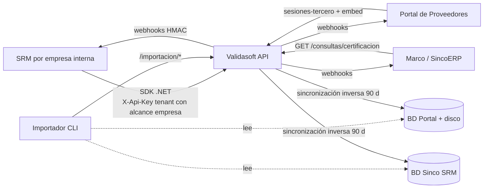
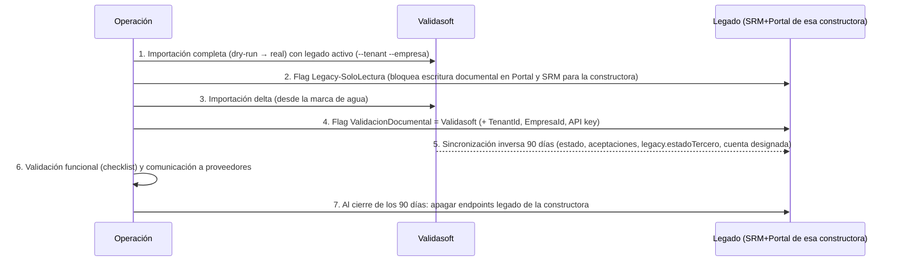

# 08 — Integración y migración

| Estado | Fecha | Responsable |
|---|---|---|
| Borrador | 2026-10-28 | Arquitectura |

**Propósito.** Definir cómo SRM, Portal de Proveedores y Marco (SincoERP) consumen Validasoft (SDKs, flags, webhooks, embed, consulta rápida), cómo se migran los datos históricos sin perder qué versión aprobó cada empresa, y cómo se hace el corte por empresa (T-18) con sincronización inversa y rollback.

**Relacionados:** [01-analisis-legado-srm-portal.md](01-analisis-legado-srm-portal.md) · [02-modelo-documental-compartido.md](02-modelo-documental-compartido.md) · [03-dominio-y-eventos.md](03-dominio-y-eventos.md) · [05-api-contratos-y-webhooks.md](05-api-contratos-y-webhooks.md) · [07-seguridad-identidad-y-tenancy.md](07-seguridad-identidad-y-tenancy.md) · [09-plan-de-hitos-y-responsabilidades.md](09-plan-de-hitos-y-responsabilidades.md) · [decisiones/registro.md](decisiones/registro.md) · ADR-0007, ADR-0008

> Actualizado el 2026-10-28 con las decisiones del registro: tenant = grupo con **empresas internas** (P-11-2, ADR-0008: una instancia del SRM = una empresa; `empresaId` en todos los eventos), identidad multipaís (P-1-1), reconciliación de identidad por clave única (P-12-1), webhooks + pull desde el MVP (P-12-2), SDK .NET y TS (P-12-3), revisión solo en Validasoft durante la coexistencia (P-12-4), sandbox por API key (P-11-4), cuenta designada por el tercero (P-3-3), alcance de la migración (P-13-x), modo de respaldo en Marco (adición 9).

> Actualizado el 2026-11-11 (integración abierta, IO-1…IO-10): el núcleo no nombra ni asume el SRM, el Portal ni AyF; todo es mecanismo genérico (API, webhooks, SDK, embebido, referencias externas por sistema, adaptadores de origen). la guía «integrar un sistema nuevo en 5 pasos» ([integracion.md §1.1](integracion.md#11-integrar-un-sistema-nuevo-en-5-pasos)) y el embebido del tercero ([§8.1](integracion.md#81-el-tercero-embebido-bóveda-expediente-y-ficha); aquí, §2.3), §3.4 contrato del sistema legado («el interruptor»), §6.6 importador genérico y §9 auditoría de acoplamiento. Donde abajo se lee SRM, Portal o Marco, es **un ejemplo de sistema integrador**: lo mismo vale para cualquier ERP, portal o CRM.

> Actualizado el 2026-11-10 (H9, CN-1…CN-7 del registro): §2 y la guía paso a paso de §2.1 describen lo implementado (SDK .NET y TypeScript, consulta de certificación, pull, rotación de API keys); §5 precisa la consulta.

---

## 1. Principios de integración

1. **Un solo punto de verdad.** Validasoft es dueño de documentos, versiones, decisiones y certificados. Los sistemas cliente guardan referencias (`expedienteId`, `folio`) y una copia de respaldo del estado recibida por webhook, nunca binarios.
2. **Sin doble escritura desde los clientes.** Durante la coexistencia, es Validasoft quien escribe hacia el legado (sincronización inversa), no al revés.
3. **Contratos públicos versionados.** Todo lo que un cliente consume está en `Validasoft.Contratos` / `@validasoft/sdk`, generado desde OpenAPI; cambiar un contrato rompe el build.
4. **Webhooks firmados e idempotentes y modo pull, ambos desde el MVP** (P-12-2); webhooks por defecto, pull de respaldo para redes cerradas.
5. **Corte por empresa, reversible.** Cada empresa interna (razón social) migra cuando está lista; el flag vuelve atrás sin pérdida.
6. **Una instancia del SRM = una empresa interna de un tenant.** El SRM de cada razón social usa una API key del tenant con alcance a **su** empresa; todo evento público lleva `tenantId` y `empresaId` (ADR-0008).
7. **Identidad del tercero reconciliada por clave única** `(país, tipo, número normalizado)` entre el ERP y Validasoft (P-12-1): los datos maestros validados contra documento prevalecen; cada sistema guarda el id externo del otro (`validasoftTerceroId` en el ERP; `referenciaExterna{sistema,id}` en Validasoft).
8. **La revisión ocurre solo en Validasoft** (P-12-4): el SRM no mantiene UI de revisión; recibe estados y aplica en AyF.



---

## 2. SDKs

| | `Validasoft.Sdk` (.NET) | `@validasoft/sdk` (TypeScript) |
|---|---|---|
| Dónde | `src/Validasoft.Sdk` (pruebas en `tests/Validasoft.Sdk.Tests`) | `packages/sdk` (pruebas Vitest en `src/*.test.ts`) |
| Target | Multi-target **`net7.0;net8.0;net10.0`** (T-16; `net7.0` mientras exista el SRM); `Validasoft.Contratos` también (CN-5) | ESM (`tsc`), Node 20+ y navegador; sin dependencias (fetch + Web Crypto) (CN-6) |
| Generación | Escrito a mano sobre los DTO de `Validasoft.Contratos` (sin Kiota, Refit ni Polly: el SRM .NET 7 no arrastra dependencias) | Tipos escritos a mano con los nombres de `Validasoft.Contratos` (sin `openapi-typescript`/`openapi-fetch`) |
| Incluye | `ClienteValidasoft` (`IClienteValidasoft`): `Vinculos`, `Invitaciones`, `Expedientes`, `Certificados`, `Consultas`, `Eventos` (con `RecorrerAsync`), `Sesiones`; `ParaEmpresa(id)` y `ComoUsuario(usuario)`; `Idempotency-Key` automática en todo POST (la misma en los reintentos); reintentos solo de lo idempotente (GET, PUT y POST con clave explícita); errores como `ExcepcionValidasoft { Estado, Codigo, Detalle, Correlacion }`; `FirmanteDeAsercionesDelegadas` (RS256/ES256); `VerificadorDeWebhooks` (tolerancia 5 min, varios secretos durante la rotación) | `ClienteValidasoft` con los mismos grupos (`vinculos.crear`, `consultas.certificacion`, `eventos.recorrer`…), `crearFirmanteDeAserciones()` (PKCS#8), `verificarWebhook()` / `validarWebhook()` / `leerCabecera()` (cabeceras de `fetch` o de Node), `ErrorValidasoft` |
| Versionado | SemVer alineado con la API (`1.x`); `dotnet pack` produce `Validasoft.Contratos` y `Validasoft.Sdk` (la documentación XML solo se genera al empaquetar) | `pnpm --filter @validasoft/sdk build` deja `dist/`; `publishConfig` publica `dist` (en el workspace se consume `src`) |
| Publicación | **Listo para publicar** (SB-7): workflow `sdk-publicar.yml` al crear un tag `sdk-v<versión>`, versión única, README y CHANGELOG por paquete (§2.4). No se ha publicado nada | Igual: `@validasoft/sdk` sale con el mismo tag, en **ESM y CommonJS** |
| Sandbox | **Implementado** (SB-1…SB-6, §2.2): una llave `vsk_test_…` opera en un tenant hermano con la configuración del grupo y ningún dato; correos al buzón, IA y listas simuladas; `Sandbox` en el cliente (`ObtenerAsync`, `ReiniciarAsync`, `CorreosAsync`, `EsperarCorreoAsync`) | Igual (`sandbox.obtener()`, `reiniciar()`, `correos()`, `esperarCorreo()`) |
| Idiomas oficiales | Solo .NET y TypeScript (P-12-3); otros lenguajes consumen OpenAPI directamente | — |
| Prohibido | Lógica de negocio en el SDK; reintento de POST creadores sin clave de idempotencia | igual |

Toda llamada del SDK opera en el contexto `tenant + empresa`: el cliente se construye con la API key (que fija el tenant) y la empresa por defecto (`X-Empresa`); con una llave de varias empresas, `ParaEmpresa(id)` cambia la empresa.

> **La guía completa para un integrador externo —alta del sistema, llaves, sandbox, identidad delegada, embebido, webhooks, pull, consulta de certificación, errores, límites y versionado— es [integracion.md](integracion.md).** Lo que sigue (§2.1) es la versión corta para el SRM, Marco y el Portal; §2.2 explica el sandbox, §2.3 remite a los cinco pasos para un sistema nuevo y al embebido del tercero, y §2.4 trata la publicación de los paquetes.

### 2.1 Guía de integración paso a paso (H9, implementado)

Lo mismo para el SRM, el Portal, Marco u otro ERP. Ejemplo compilable completo: [`docs/ejemplos/IntegradorSrm`](ejemplos/IntegradorSrm/Program.cs) (minimal API en `net7.0`, la versión del SRM; se compila con la solución). Las pruebas que lo ejercitan de punta a punta: `tests/Validasoft.Integracion.Tests/IntegracionSdkApiTests.cs` (SDK .NET contra la API en memoria) y `e2e/pruebas/integracion.spec.ts` (SDK TypeScript contra la API real).

**1. Registrar el sistema.** Un administrador del grupo crea el sistema con su **clave pública** (RSA ≥ 2048 o EC P-256; la privada nunca sale del sistema) y, si va a embeber pantallas, los orígenes desde los que lo hará (Configuración › Sistemas, o `POST /api/v1/sistemas { codigo: "SRM", nombre, clavePublicaPem, origenesPermitidos: ["https://srm.cliente.co"] }`).

**2. Crear su API key.** Configuración › API keys › «Nueva API key» con el sistema, **solo** las empresas de esa instancia y los permisos mínimos:

| Sistema | Permisos (scopes) |
|---|---|
| SRM (una instancia = una empresa) | `vinculos:leer`, `vinculos:escribir`, `vinculos:bloquear`, `expedientes:leer`, `expedientes:administrar`, `certificados:leer`, `eventos:leer` (pull) o `webhooks:administrar` (si él mismo administra su suscripción), y los de lectura que use su embebido (`configuracion:leer`, `flujos:leer`) |
| Marco / ERP | `consultas:leer` (+ `eventos:leer` si alimenta su copia local por pull) |
| Portal | `vinculos:leer`, `documentos:leer`, `terceros:leer` (constructoras aún en legado, §4) |

La clave completa se muestra **una sola vez**; va al gestor de secretos del sistema (en el SRM, cifrada con `IDataProtector`), nunca en claro ni en el repositorio.

**3. Configurar el SDK.**

```csharp
// .NET (SRM): un cliente tipado por IHttpClientFactory.
services.AddSingleton(new OpcionesValidasoft
{
    UrlBase = new Uri(config["Validasoft:UrlBase"]!), ApiKey = config["Validasoft:ApiKey"]!,
    EmpresaId = Guid.Parse(config["Validasoft:EmpresaId"]!),
    Firmante = new FirmanteDeAsercionesDelegadas("SRM", File.ReadAllText(config["Validasoft:ClavePrivadaPemArchivo"]!))
});
services.AddHttpClient<IClienteValidasoft, ClienteValidasoft>(http => http.Timeout = TimeSpan.FromSeconds(5));
```

```ts
// TypeScript (backend Node 20+; nunca en el navegador: la API key es secreta).
const validasoft = new ClienteValidasoft({ urlBase: process.env.VALIDASOFT_URL!, apiKey: process.env.VALIDASOFT_API_KEY!, empresaId,
  firmante: crearFirmanteDeAserciones('SRM', clavePrivadaPkcs8) });
```

**4. Invitar al tercero.** El SRM crea el vínculo con su referencia y una clave de idempotencia estable (un reintento no duplica); Validasoft reconcilia el tercero por identificación (P-12-1) y envía la invitación:

```csharp
var vinculo = await validasoft.Vinculos.CrearAsync(new CrearVinculoDto(null,
    new CrearTerceroDto(new IdentificacionDto("CO", "NIT", "900123456"), "Juridica", "Aceros S.A.S.", null, [contacto]),
    "PROVEEDOR", null, correoProveedor, new ReferenciaExternaDto("SRM", "ADP-00123")), claveIdempotencia: "srm-sol-00123");
// Reenviar: validasoft.Invitaciones.EnviarAsync(vinculo.Id, new InvitacionDto(null));
// Buscar después por la referencia: validasoft.Vinculos.PorReferenciaAsync("SRM", "ADP-00123");
```

**5. Actuar en nombre de una persona y embeber pantallas.** Cada petición en nombre de un usuario lleva una aserción `X-Usuario-Delegado` nueva (JWT de ≤ 5 min con `jti` de un solo uso; el SDK la firma en cada intento). El permiso efectivo es la intersección de la llave y los roles de la persona (ADR-0011). Para la pantalla embebida, el **backend** del sistema canjea la identidad por una sesión de 30 minutos y la pasa al iframe por `postMessage` (contrato de [05 §2.9.4](05-api-contratos-y-webhooks.md) y docs/06 §3.2):

```csharp
var laura = validasoft.ComoUsuario(new UsuarioDelegado(usuarioSrm.Id, usuarioSrm.Nombre, usuarioSrm.Correo));
var sesion = await laura.Sesiones.CrearAsync();   // { token, expira } → iframe {UrlBase}/app/#/e/{empresa}/bandeja
```

**6. Recibir webhooks.** Suscripción en Configuración › Webhooks (o `POST /api/v1/webhooks { url, tipos, empresas, sistemaId }`); el secreto `whsec_…` se ve una vez. El receptor (en el SRM, `POST /api/integracion/validasoft/webhook`, §3.2): lee el cuerpo **tal cual**, lo valida, deduplica por id del evento, responde 200 en menos de 5 s y procesa en cola:

```csharp
var verificador = new VerificadorDeWebhooks(new[] { secretoActual, secretoAnterior }); // el anterior solo durante una rotación
var evento = verificador.Validar(n => request.Headers[n].FirstOrDefault(), cuerpo);      // 401 si lanza WebhookInvalidoException
if (await entregas.RegistrarAsync(evento.Id)) cola.Encolar(evento);                    // dedupe por Validasoft-Event-Id (T-6)
```

```ts
const evento = await validarWebhook({ secretos: [secreto], firma: leerCabecera(req.headers, 'validasoft-signature'), cuerpo: cuerpoCrudo });
```

**7. Pull en lugar de webhooks** (redes que no aceptan conexiones entrantes): los mismos sobres, en orden de cursor. Se guarda el `cursor` del último evento procesado y se retoma desde ahí cada minuto:

```csharp
await foreach (var evento in validasoft.Eventos.RecorrerAsync(desde: cursorGuardado, tipos: ["certificado.emitido", "vinculo.bloqueado"]))
{
    Procesar(evento);              // mismo mapa evento → acción que el webhook; dedupe por evento.Id
    cursorGuardado = evento.Cursor; // persistirlo
}
```

**8. Consulta de certificación (Marco).** Antes de pagar o contratar: `GET /api/v1/consultas/certificacion?pais=CO&tipoIdentificacion=NIT&numero=900123456&tipoVinculo=PROVEEDOR` (o `?vinculoId=`) con `X-Empresa`; scope `consultas:leer`. La respuesta (`ConsultaCertificacionDto`, 05 §5.6) trae `ETag` y `Cache-Control: private, max-age=300`: dentro de los 5 minutos se usa la copia; después se pregunta con `If-None-Match` y un **304** confirma que sigue igual.

```csharp
var r = await validasoft.Consultas.CertificacionAsync(new ConsultaDeCertificacion("NIT", nit, "PROVEEDOR"), etag: copia?.ETag);
var datos = r.NoModificado ? copia!.Datos : r.Datos!;   // datos.Bloqueado ⇒ no pagar; datos.MotivoBloqueo dice por qué
```

| `motivoBloqueo` | Cuándo (`bloqueado: true`) |
|---|---|
| `Bloqueo` | Vínculo bloqueado (lista restrictiva, fraude…) o certificado suspendido |
| `Revocado` | Certificado revocado, o vínculo anulado o desvinculado |
| `Vencido` | Vínculo o certificado vencido |
| `PlazoRevalidacion` | Certificado «con pendientes» cuyo plazo de revalidación venció (A-2) |

Sin vínculo con la empresa (o tercero desconocido): `200 { certificado: false, estadoVinculo: "SinVinculo" }`. Si Validasoft no responde en 2 s o devuelve 5xx, Marco responde el mismo contrato desde su copia con `fuenteRespaldo: true` y `antiguedadSegundos` (§5; el ejemplo lo hace).

**9. Rotar la API key sin cortar el servicio.** Configuración › API keys › «Rotar» (o `POST /api/v1/api-keys/{id}/rotar { anteriorValidaHasta }`): sale una clave nueva con los mismos permisos, alcance y sistema, y la actual sigue valiendo el tiempo elegido (24 h por defecto, hasta 30 días; «ahora» corta de inmediato). Procedimiento: rotar → poner la nueva en el gestor de secretos y desplegar → verificar que el sistema la usa → la anterior deja de valer sola a su hora (401). Revocar sigue siendo inmediato.

### 2.2 Sandbox (H9, SB-1…SB-6)

**Para qué.** Que un integrador pruebe su sistema de punta a punta —invitación, carga, aprobación, certificado, webhooks, consulta— sin tocar producción, sin enviar un correo real a nadie, sin gastar IA ni consultas de listas y pudiendo empezar de cero cuando quiera.

**Modelo (SB-1).** Una llave `vsk_test_{grupo}_…` pertenece al grupo de producción —se emite, rota y revoca allí, y sobrevive a los reinicios— pero **opera en el sandbox**: un **tenant hermano** (`Tenant.TenantDeProduccionId`) que se crea y siembra **cuando se pide** (`POST /api/v1/sandbox` o emitir la primera llave con `sandbox: true`). Como es otro tenant, todo lo que Marten parte por `tenant_id` queda aislado sin cambiar una consulta (vínculos, expedientes, certificados, usuarios, eventos, webhooks, informes, KPIs, auditoría). Lo global se aísla aparte ([07 §5.4](07-seguridad-identidad-y-tenancy.md)): los **terceros** de un sandbox son otros (clave única con el tenant por delante), los **correos** van al buzón, la **IA** y las **listas** son simuladas, los certificados no son verificables en `/public/v1/verificar`, y el sandbox no aparece en la consola de Plataforma ni en el acceso con el correo.

**Siembra (SB-3).** Copia de la configuración de producción: una **copia de pruebas de cada empresa** (otro id; nombre «… (sandbox)»; prefijo de folio con una `T` por delante), tipos de vínculo y de documento, áreas (sin miembros), flujos, motivos, plantillas, textos legales (los de la empresa real o uno de prueba) y los sistemas integrados con su id y clave pública —así la aserción que firma tu sistema vale en los dos entornos—, más un plan de IA con la llave simulada y el proveedor de listas simulado. **Ningún dato**: ni terceros, ni vínculos, ni documentos, ni usuarios. Las personas que llegan por identidad delegada nacen **administradoras** del sandbox (acotadas por los scopes de la llave).

**Reinicio (SB-5).** `POST /api/v1/sandbox/reiniciar` borra la partición del tenant sandbox, los terceros de pruebas con su bóveda, archivos, enlaces de acceso, sesiones y eventos públicos, y siembra de nuevo con la configuración de ese momento. Conserva los **ids de las empresas**, las **llaves** y el **cursor** de los eventos: el integrador no cambia su configuración.

**Contrato.** Rutas, DTO y códigos en [05 §2.6.3](05-api-contratos-y-webhooks.md); permiso `sandbox:administrar`; toda respuesta de una credencial de prueba lleva `Validasoft-Entorno: sandbox`. Paso a paso con ejemplos en [integracion.md §5](integracion.md#5-sandbox-probar-sin-riesgo).

### 2.3 Integrar un sistema nuevo y embeber al tercero (IO-1…IO-6)

Está en la [guía de integración](integracion.md): los **cinco pasos para integrar un sistema nuevo** (sistema y llave, referencias externas, eventos, consulta de lo aceptado y pantallas) en [§1.1](integracion.md#11-integrar-un-sistema-nuevo-en-5-pasos) y el **embebido genérico del tercero** (su bóveda, su expediente o su ficha en un iframe, con una sesión corta que canjea el backend del sistema) en [§8.1](integracion.md#81-el-tercero-embebido-bóveda-expediente-y-ficha), con el ejemplo ejecutable [`docs/ejemplos/anfitrion-tercero`](ejemplos/anfitrion-tercero/index.html). Todo es genérico: ni el núcleo ni los contratos nombran un sistema (el SRM, el Portal y Marco son los primeros, no los únicos) y sin ellos funciona igual; el importador responde 404 `origen-no-registrado` si no hay adaptador de origen (§6.6). El contrato de la sesión del tercero está en [05 §2.9.4](05-api-contratos-y-webhooks.md).

### 2.4 Publicación de los SDK (SB-7)

Los tres paquetes —`Validasoft.Contratos` y `Validasoft.Sdk` (NuGet), `@validasoft/sdk` (npm)— salen **juntos con la misma versión semántica**:

| Pieza | Dónde |
|---|---|
| Versión única | `src/Empaquetado.props` (`VersionSdk`) y `packages/sdk/package.json`; `node infra/sdk/version.mjs <versión>` cambia las dos y `--verificar sdk-v<versión>` falla si el tag, los manifiestos o el CHANGELOG no coinciden |
| Metadatos NuGet | `src/Empaquetado.props`: autor, repositorio, licencia (`LICENCIA-SDK.md`), README y CHANGELOG dentro del paquete, símbolos `.snupkg`, Source Link, build determinista en CI |
| npm | `packages/sdk/package.json`: `exports` ESM y CJS con tipos (`publishConfig`), `files`, repositorio, licencia y procedencia (`provenance`); `pnpm --filter @validasoft/sdk verificar` construye y comprueba que las dos salidas cargan y validan un webhook firmado |
| README y CHANGELOG | `src/Validasoft.Sdk`, `src/Validasoft.Contratos` y `packages/sdk` (instalación, configuración, invitación, consulta, webhooks y sandbox) |
| CI | `ci.yml` empaqueta los NuGet y construye el paquete npm **sin publicar** en cada cambio |
| Publicación | `.github/workflows/sdk-publicar.yml`, al crear un tag `sdk-v<versión>`: verifica (tag = manifiestos = CHANGELOG), prueba, empaqueta, espera la aprobación del entorno `publicacion-sdk`, publica en NuGet (`NUGET_API_KEY`) y en npm (`NPM_TOKEN`, con procedencia) y crea el release con las notas del CHANGELOG |

**Cómo configurar los secretos** (lo hace un administrador del repositorio; nunca se escriben en el repositorio): *Settings › Secrets and variables › Actions › New repository secret*: `NUGET_API_KEY` (API key de nuget.org con permiso «Push new packages and package versions» sobre `Validasoft.*`) y `NPM_TOKEN` (token «Automation» de npm con escritura sobre `@validasoft/sdk`); opcionalmente *Settings › Environments › publicacion-sdk › Required reviewers* para que una persona apruebe cada publicación.

**Para publicar una versión:** `node infra/sdk/version.mjs 1.2.0` → escribir la entrada `## [1.2.0]` en los dos CHANGELOG → merge a `main` → crear y empujar el tag `sdk-v1.2.0`. **Pendiente antes del primer tag:** que Legal confirme la licencia (hoy `LICENCIA-SDK.md` es un texto provisional de uso para integrarse) y crear el entorno y los secretos.

---

## 3. SRM

### 3.1 Flag por empresa
`adp_srm.ADPConfig` código `ValidacionDocumental` = `Legacy` | `Validasoft` (hoy el SRM lee su configuración de esa tabla, p. ej. `Base_URL_Portal`; ver `C:\Fuentes_Git\SRM\BackEnd\SRM.Repository\Portal\StorePortal.cs:22-48`), más `Validasoft_TenantId`, `Validasoft_EmpresaId` y la API key cifrada (`IDataProtector`, nunca en claro como `Token_Zuppla`). Una instancia del SRM corresponde a **una empresa interna**; si un grupo tiene cinco instancias del SRM, las cinco apuntan al mismo tenant con cinco `empresaId` distintos. Con `Legacy` nada cambia. Con `Validasoft`:

| Acción del SRM | Antes (legado) | Después |
|---|---|---|
| Invitar proveedor (`POST /GestionProveedor/asignacion/portal`, `SolicitudesProvRoutes.cs:33`) | `Account/invitarproveedor` al Portal, contraseña por correo | `POST /api/v1/expedientes` (cabecera `X-Empresa`) con `tercero{identificacion{pais,tipo,numero}}` normalizado por el SDK, `referenciaExterna {sistema:"SRM", id:"ADP-00123"}` e `invitacion:{canal:"Correo"}`; `flujo` puede omitirse (se aplican las reglas de selección y el flujo por defecto, I-12). Validasoft reconcilia el tercero por clave única (P-12-1) y devuelve `terceroId` (nuevo o existente) y `requisitosCubribles`; **nada de la bóveda se comparte con la empresa hasta que el proveedor acepte la invitación** (B-1). El SRM guarda `ValidasoftTerceroId`, `ValidasoftExpedienteId`, `VinculoId`, `folio` (`-E-`) y `enlaceTercero` en `adp_srm.Solicitudes` (columnas nuevas) |
| Consultar/cambiar cuenta bancaria del proveedor (`TercerosGI/informacionbancaria`, `BancosConstructora`) | El Portal guardaba la cuenta por constructora | La cuenta que viaja a AyF es la **`CuentaDesignada`** del vínculo, elegida por el tercero y aprobada por dos usuarios de la empresa (P-3-3, P-4-7); el SRM la recibe en `vinculo.cuenta_designada` y en `certificado.emitido.datos.cuentaDesignada` |
| Recalcular estado al subir documentos (`/PortalProveedorERP/novedades/requeridos`, `NovedadesRoutes.cs:34`) | El Portal llamaba al SRM | Webhooks `expediente.documento_cargado`, `expediente.enviado_a_revision`, `expediente.con_observaciones`, `expediente.aprobado` |
| Aprobar/rechazar por perfil (`AprobacionBL.cs:327`) | Pantallas legacy + `TercerosERP/estado` | La revisión ocurre en Validasoft; el SRM recibe `expediente.requisito_veredicto`, `expediente.area_aprobada`, `expediente.rechazado` y `certificado.emitido` |
| Vencimiento (`background/vencimiento-proveedor/procesar`, `ProcesarVencimientosEndpoint.cs:12`) | Job disparado por el Portal a las 22:00 | Se apaga; llegan `documento.por_vencer`, `documento.vencido` y `vinculo.estado_cambiado { causa: "Vigencia" }` |
| Actualización post-aprobación (`actualizacion-proveedor/crear`, `actualizar-estado-portal`) | Portal → SRM → Portal | Se apaga; llegan `documento.version_nueva` y `vinculo.revalidacion_pendiente` / `vinculo.revalidado` / `vinculo.cambio_menor` |
| Aplicar en AyF (`IAplicadorCambioAyF`) | Al aprobar detalle | Al recibir `certificado.emitido` o `vinculo.revalidado`, aplicando solo las entradas de `cambios[]` con `aplicaEnErp = true` |

### 3.2 Receptor de webhooks en el SRM
`POST /api/integracion/validasoft/webhook` (nuevo módulo Carter en `SRM.API/Features/IntegracionValidasoft/`):
1. Verifica `Validasoft-Signature` con el secreto de la empresa (cifrado con `IDataProtector`, no en claro).
2. **Descarta** (200 sin acción, con log) todo evento cuyo `empresaId` no sea el de esta instancia: la suscripción de webhook se crea con filtro por empresa, pero el receptor vuelve a comprobarlo.
3. Dedupe por **`Validasoft-Event-Id`** (T-6; `Validasoft-Delivery` cambia en cada reintento y solo sirve para trazar el intento) en la tabla `adp_srm.ValidasoftEntregas` con clave primaria `evento_id` (columnas: `evento_id`, `delivery_id`, `tipo`, `empresa_id`, `recibido`, `procesado`, `error`).
4. Responde 200 en < 1 s y procesa en cola propia (Wolverine no está en el SRM; usar `Channel` + `BackgroundService` existente `QueuedHostedService`, `SRM.BackgroundServices\Core\Infrastructure\QueuedHostedService.cs:12`, que hoy no recibe trabajo).
5. Si la red no permite webhooks entrantes, el mismo módulo corre en modo **pull** (`GET /api/v1/eventos?desde=cursor&empresaId=`) cada minuto con el mismo mapa de acciones (P-12-2).
6. Mapa evento → acción:

| Evento | Acción en SRM | Equivalente legado que reemplaza |
|---|---|---|
| `expediente.abierto` (+ `vinculo.creado`, `expediente.flujo_seleccionado`) | Guardar ids (`terceroId`, `vinculoId`, `expedienteId`, `folio`); `SolEstado` ← `legacy.estadoTercero` (−3) | `CrearSolicitud` |
| `expediente.invitacion_aceptada` + `documento.compartido` | Marcar "proveedor activo en el portal"; a partir de aquí la bóveda es visible para la empresa (B-1) | `Usuario/activarERP` |
| `tercero.datos_maestros_cambiados` · `tercero.relacion_cambiada` | Actualizar razón social/dirección/representante principal en la copia local; si la empresa lo configuró, proponer actualización en AyF (los datos validados por documento prevalecen, P-12-1) | `actualizacion-proveedor/crear` (sector General/Legal) |
| `expediente.documento_cargado` · `expediente.enviado_a_revision` | Actualizar `DocumentacionPendiente` desde el `ExpedienteDto` (`GET /expedientes/{id}` si hace falta) | `ValidarEstadoTercero.Validar` |
| `vinculo.estado_cambiado` | `SolEstado` ← `legacy.estadoTercero`; `SolEstadoVencimiento` si `causa = Vigencia`; auditoría `SolicitudesAuditoriaEstado` | `TercerosERP/estado` |
| `expediente.requisito_veredicto` · `expediente.area_aprobada` | Registrar en bandeja informativa (solo lectura) | `LogAprobaciones` (ya no se escribe) |
| `expediente.con_observaciones` | Novedad al gestor | `NovedadERP` |
| `expediente.aprobado` | Marcar aprobación completa (el certificado llega aparte) | `ValidarAprobacionCompleta` |
| `certificado.emitido` | `SolEstado` ← 3; guardar `folio` (`-C-`), `urlVerificacion`, `hash`; crear/actualizar tercero en AyF con `datos.tercero`, `datos.cuentaDesignada` y las entradas de `cambios[]` con `aplicaEnErp = true` | `validaCreacionAutomaticaProv` + `FinancieroBL` |
| `certificado.con_pendientes` | Si `bloqueante = true`, marcar "revalidación vencida" y advertir en pagos; el vínculo **no** cambia de estado (T-8) | — (no existía) |
| `certificado.suspendido` / `certificado.restablecido` / `certificado.revocado` / `certificado.reemplazado` / `certificado.vencido` | Actualizar estado del certificado local | — |
| `expediente.rechazado` / `expediente.caducado` / `expediente.anulado` | `SolEstado` ← −1 / −6 / −2 | rutas de `AprobacionProvRoutes` |
| `documento.version_nueva` | Marcar proveedor "revalidación pendiente" si `efectoEnEmpresa.requiereRevalidacion` (nuevo subestado informativo) | `actualizacion-proveedor/crear` |
| `vinculo.revalidacion_pendiente` / `vinculo.revalidado` / `vinculo.cambio_menor` | Subestado; al revalidar, aplicar `cambios[]` en AyF si `aplicaEnErp` | `AprobarDetalleHandler` |
| `vinculo.cuenta_designada` | Actualizar la cuenta bancaria del tercero en AyF (ya viene aprobada por dos usuarios de la empresa) | `AsignarBancoConstructora` + aprobación bancaria |
| `vinculo.bloqueado` / `vinculo.desbloqueado` | Marcar proveedor bloqueado/desbloqueado en el SRM (solo informativo; la decisión vive en Validasoft) | — (no existía) |
| `documento.por_vencer` / `documento.vencido` | `SolEstadoVencimiento`, `SolFechaVencimiento`; correo lo envía Validasoft | `JobVencimientoProveedor` |
| `vinculo.desvinculado` / `vinculo.reintegrado` / `vinculo.anulado` | `SolEstado` ← −8 / −3 / −2 | `DesvincularProvPortal` |

Todos los nombres anteriores son los del catálogo [05 §7](05-api-contratos-y-webhooks.md); la CI de trazabilidad (documento 11) comprueba que cada evento citado aquí exista allí.

Mientras el SRM mantenga sus enums, cada evento trae `legacy.estadoTercero` (tabla de mapeo en doc 03 §mapeo) además de `tenant` (slug) y `empresaId` en el sobre común de 05 §6.2.

### 3.3 Lo que se apaga en el SRM (por empresa con flag `Validasoft`)
`/PortalProveedorERP/*` (`NovedadesRoutes.cs:18-140`, `DocumentosRoutes.cs:144,168`), `background/GestionProveedor` (`MapBackGroundProveedor.cs:14`), `background/vencimiento-proveedor/procesar`, `actualizacion-proveedor/*` de escritura, `Documentos/proximosvencer` hacia el Portal (`DocumentosRequericosBL.cs:347,865,963`), `GET /TokenAdproveedor` (`MapConfigroutes.cs:52`, expone la API key; se elimina para todas), pantallas legacy `menuProveedor.html`/`AprobacionProveedor.html` (se reemplazan por enlace profundo a `web` con token exchange, doc 07).

### 3.4 El interruptor: contrato que un sistema legado debe cumplir para dejar de escribir en sus tablas (IO-7)

No se toca el repositorio del SRM ni el del Portal: este es el contrato, válido para **cualquier** sistema que hoy valide terceros por su cuenta. Por empresa (instancia), cuando el flag del sistema pasa a «usar Validasoft» (§3.1), el sistema deja de escribir la validación documental en sus propias tablas y se comporta así:

| El sistema… | Cómo, con qué mecanismo genérico |
|---|---|
| **Se identifica** | Guarda la clave de su tercero y de su vínculo en Validasoft (`referenciaExterna`, [integracion.md §1.1](integracion.md#11-integrar-un-sistema-nuevo-en-5-pasos) paso 2) y el id de Validasoft (`terceroId`, `vinculoId`) en sus tablas. Busca por clave, no por identificación. |
| **Invita y pide** | `POST /terceros` + `POST /vinculos` (con clave de idempotencia estable: el id de su solicitud), `POST /vinculos/{id}/invitaciones`, `POST /expedientes`. No sube documentos ni decide aprobaciones: eso vive en Validasoft. |
| **Escucha** | `vinculo.creado`, `vinculo.invitacion_aceptada`, `vinculo.activado`, `vinculo.bloqueado` / `desbloqueado` / `desvinculado` / `reintegrado` / `anulado`, `expediente.observado` / `aprobado` / `rechazado` / `caducado` / `desaprobado`, `certificado.emitido` / `suspendido` / `revocado` / `vencido`, `vinculo.cuenta_designada`, `vinculo.contactos_actualizados`, `seccion.aceptada`, `documento.por_vencer` / `vencido`. Mismo sobre por webhook y por pull; deduplica por `Validasoft-Event-Id`; responde 200 en menos de 5 s y procesa en cola. |
| **Consulta** | `GET /vinculos/{id}/ficha` (lo aceptado, representante, cuenta, contactos, referencias), `GET /vinculos/{id}/cuenta-designada` (con `cuentas:aprobar`, el número completo), `GET /consultas/certificacion` antes de pagar o contratar, `GET /vinculos/{id}/certificado`. |
| **Muestra** | Enlaza o embebe las pantallas ([integracion.md §8.1](integracion.md#81-el-tercero-embebido-bóveda-expediente-y-ficha) para el tercero; §2.1 paso 5 para las personas de la empresa). Retira sus pantallas de revisión y de carga de documentos. |
| **Aplica en su ERP** | Con un **adaptador propio** (en el sistema legado o en un servicio aparte, nunca en el núcleo de Validasoft) que traduce los eventos y la ficha a las operaciones de su ERP, de forma idempotente por `terceroId`/`vinculoId`, y solo lo que `aplicaEnErp` indica. |
| **Deja de hacer** | Escribir adjuntos, estados de validación, vencimientos y actualizaciones en sus tablas; los jobs de vencimiento y de recordatorios; los endpoints que el portal le llamaba (§3.3). Si vuelve a `Legacy`, la sincronización inversa de §7 deja sus tablas al día. |

**Ejemplo de adaptador: el SRM hacia AyF.** El núcleo entrega las **calidades tributarias de Colombia** (`responsableIva`, `autorretenedor`, `declaranteRenta`, `granContribuyente`, `autorretenedorIca`, `regimenSimple`, `granContribuyenteBogota`, `regimenEspecial`, `autorretenedorRft`, `descuentoSenaFic`, `profesionalIndependiente`, `exentoRetencion`, `agenteRetenedorIva`, `obligadoAFacturar` y `exentoReteCree`) y cada ERP las mapea a **sus** campos; el del SRM hacia el PUT de terceros de AyF es:

| Calidad (Validasoft) | Campo de AyF | Nota |
|---|---|---|
| `responsableIva` · `autorretenedor` · `declaranteRenta` · `granContribuyente` · `autorretenedorIca` · `regimenSimple` · `regimenEspecial` · `descuentoSenaFic` · `profesionalIndependiente` | `RegimenIva` · `AutoRetenedor` · `DeclaranteRenta` · `GranContribuyente` · `AutoRetenedorICA` · `RegimenSimple` · `RegimenEspecial` · `DescuentoSenaFic` · `ProfesionalIndependiente` | S/N directos |
| `granContribuyenteBogota` · `exentoRetencion` · `agenteRetenedorIva` | `GranContribuyenteBta` · `ExentoRetefuente` · `AgenteRetenedorIVA` | S/N directos |
| `obligadoAFacturar` | `NoObligadoFacturar` | AyF recibe la **negación** |
| `autorretenedorRft` · `exentoReteCree` | — | AyF no las recibe (el PUT no las toca: el adaptador conserva lo que AyF ya tenga) |
| `null` en cualquier calidad | el valor actual de AyF | «sin derivar» = no se sobrescribe (el PUT de AyF pone «N» a todo S/N que no se envía) |

Banco: `bancoCodigo` (código de compensación) → `BcoCod` de AyF; `bancoSwift` y `contactoPagos` viajan con la cuenta designada (el SRM las tenía en el sector bancario). Representante: `lugarExpedicion` → `Expedicion`. Contacto por empresa de rol `Pagos` / `Comercial` → los contactos del tercero del ERP. Decisiones que aún necesita el equipo de Marco para aplicarlo (cuenta de servicio, bloqueo, cifrado de secretos) están en [16 §3.2](16-estado-y-pendientes.md).

---

## 4. Portal de Proveedores

| Fase | Qué cambia | Qué deja de hacer |
|---|---|---|
| **P1 — Embed** (H9) | En "Documentos" y en los sectores con soporte, el Portal pide `POST /api/v1/sesiones-tercero {vinculoId | expedienteId}` con la API key del tenant/empresa correspondiente a la constructora activa → recibe `token` corto → abre `<iframe src="…/embed/expediente/{token}">` (o `/embed/boveda/{token}` para la vista multi-empresa) y escucha `postMessage`. La cuenta bancaria del sector "Información bancaria" se lee desde `GET /vinculos/{id}` (`cuentaDesignada`) y su cambio se hace en el embed de `/cuentas`. Los informes y licitaciones siguen igual | Escribir en `Adjuntos`, `AdjuntoTercero`, `AdjuntosConstructora`, `SoportesProveedor`, `BancosConstructora`, disco `/Archivos/*` (`AdjuntoService.cs:447-540`); llamar `DocumentosERP/requeridos` al SRM; `ServiceBackgroudVencimiento` (`BackService\ServiceBackgroudVencimiento.cs`) |
| **P2 — Redirección** (H11) | El menú "Documentos" y los avisos llevan a `public` de Validasoft con el mismo magic link; el Portal queda como directorio multi-constructora, licitaciones e informes, y lista expedientes vía `GET /vinculos?tercero=` | Usuario fijo `provportal` y las 4 llamadas al marco por constructora (`IERPSinco`/`ManagerToken`); `ActualizacionTerceroConstructora`; `VencimientosProveedor` |

Webhooks que el Portal consume (opcional en P1, necesario en P2): `vinculo.estado_cambiado`, `expediente.aprobado`, `expediente.rechazado`, `vinculo.revalidacion_pendiente`, `certificado.emitido`, `certificado.con_pendientes` → para pintar campana y estado por constructora con `legacy.estadoTercero`.

Autorregistro: el formulario del Portal (`MapLoginRoutes.cs:296`) deja de llamar a su propio `ValidacionDocumentalService` y usa `POST /public/v1/autorregistro` de Validasoft (identificación multipaís, consentimiento de plataforma, RUT/cédula/cámara en dos pasos); el tercero queda **invisible** hasta que una empresa lo vincule (P-1-9) y la lectura IA la hace la plataforma una sola vez cuando el tercero acepta el aviso (B-2), de modo que los hechos quedan para todas las empresas que luego lo vinculen. Cada constructora del Portal se mapea a `(tenantId, empresaId)`: la tabla `Constructoras` recibe dos columnas nuevas y la API key del Portal tiene alcance a todas las empresas que administra.

**Tercero compartido entre constructoras migradas y no migradas (I-18).** El disco y las tablas `Adjuntos*` del Portal son por tercero, no por constructora, así que durante la coexistencia un proveedor puede tener una constructora en Validasoft y otra en legado. Regla: desde que la **primera** empresa que lo vincula migra, la carga documental de ese tercero se hace **solo** en Validasoft (el Portal redirige su sección "Documentos" al embed aunque la constructora activa siga en legado); las constructoras no migradas leen el estado y los documentos del tercero vía `GET /vinculos` y `GET /terceros/{id}/documentos` con una API key de **lectura** por constructora legado (scope `documentos:leer`, `vinculos:leer`), y la sincronización inversa escribe para ellas `AdjuntosConstructora` y `TercerosConstructora` con `legacy.estadoTercero`. Así no hay dos lugares donde subir el mismo RUT.

---

## 5. Marco (SincoERP)

- **Consulta rápida:** `GET /api/v1/consultas/certificacion?pais=CO&tipoIdentificacion=NIT&numero=900123456&tipoVinculo=proveedor` con cabecera `X-Empresa` (número **normalizado sin DV**, P-1-1) → `ConsultaCertificacionDto` **exactamente como lo define [05 §4](05-api-contratos-y-webhooks.md)**: `certificado`, `folio` (`-C-`), `estado: EstadoCertificado`, `estadoVinculo: EstadoVinculo | "SinVinculo"`, `vinculoId`, `terceroId`, `vigenteHasta`, `revalidacionPendiente[]{tipo, plazo, bloqueante}`, `documentosVencidos[]`, `bloqueado`, `motivoBloqueo: Bloqueo | PlazoRevalidacion | Vencido | Revocado` (CN-2), `cuentaDesignada{numeroEnmascarado, banco}`, `urlVerificacion`, `legacy.estadoTercero`, `fuenteRespaldo`, `antiguedadSegundos`; `ETag` + `Cache-Control: private, max-age=300`, `If-None-Match` ⇒ 304; objetivo p99 < 100 ms en H9 y < 50 ms en H11. **Implementado (CN-1)** sin la proyección `EstadoCertificacionTercero`: tres viajes por índice único o llave primaria (tercero + tipo de vínculo, vínculo, certificado + expediente de actualización); la proyección queda para H11 si la medición con k6 no alcanza.
- **Tabla de respaldo y modo solo lectura de emergencia (adición 9):** Marco se suscribe a `certificado.emitido`, `certificado.con_pendientes`, `certificado.suspendido`, `certificado.restablecido`, `certificado.reemplazado`, `certificado.revocado`, `certificado.vencido`, `vinculo.estado_cambiado`, `vinculo.revalidacion_pendiente`, `vinculo.revalidado`, `vinculo.cuenta_designada`, `vinculo.bloqueado`, `vinculo.desbloqueado`, `documento.vencido` y mantiene la tabla local `adp_cs.validasoft_certificacion_local`:

  | Columna | Tipo | Origen |
  |---|---|---|
  | `tercero_pais`, `tercero_tipo_identificacion`, `tercero_numero` | `char(2)`, `varchar(10)`, `varchar(32)` (clave única junto con `empresa_id` y `tipo_vinculo`) | `datos.tercero` del evento |
  | `empresa_id` | `uuid` | `empresaId` del sobre |
  | `tipo_vinculo` | `varchar(40)` | `datos.tipoVinculo` |
  | `vinculo_id`, `validasoft_tercero_id` | `uuid` | ids externos (P-12-1) |
  | `estado_vinculo` | `varchar(20)` (`EstadoVinculo`) | `vinculo.estado_cambiado` |
  | `certificado_folio`, `certificado_emision` | `varchar(40)`, `int` | `certificado.*` |
  | `estado_certificado` | `varchar(20)` (`EstadoCertificado`) | `certificado.*` |
  | `bloqueado`, `motivo_bloqueo` | `bit`, `varchar(20)` (`Bloqueo` \| `PlazoRevalidacion` \| `Vencido`) | `certificado.con_pendientes.bloqueante` (A-2), `vinculo.bloqueado`/`certificado.suspendido` (B-5), `vinculo.estado_cambiado` a `Vencido` |
  | `vigente_hasta` | `date` | `certificado.*` / `vinculo.estado_cambiado` |
  | `revalidacion_pendiente` | `bit` | `vinculo.revalidacion_pendiente` / `vinculo.revalidado` |
  | `cuenta_designada_banco`, `cuenta_designada_enmascarada` | `varchar(60)`, `varchar(12)` | `vinculo.cuenta_designada` |
  | `url_verificacion`, `hash_contenido` | `varchar(200)`, `char(64)` | `certificado.emitido` |
  | `legacy_estado_tercero` | `int` | `legacy.estadoTercero` (solo coexistencia) |
  | `ultimo_evento_id`, `ultimo_evento_en`, `actualizado_en` | `uuid`, `datetime2`, `datetime2` | sobre del evento (dedupe: se ignora un evento con `ocurridoEn` anterior al guardado) |
  | `fuente` | `varchar(10)` (`webhook` \| `pull` \| `manual`) | cómo llegó la última actualización |

  Alimentación: receptor de webhooks de Marco (misma firma HMAC y dedupe por `Validasoft-Event-Id` que el SRM, T-6) o `GET /eventos?desde=` en redes cerradas; cada noche un *reconciliador* compara una muestra del 5 % contra `GET /consultas/certificacion` y corrige diferencias. Degradación: si Validasoft no responde en 2 s o devuelve 5xx, Marco responde el mismo contrato de `ConsultaCertificacionDto` desde la tabla local con `fuenteRespaldo: true` y `antiguedadSegundos = ahora − actualizado_en`; las pantallas del ERP lo muestran como aviso ("estado de hace 3 h"), nunca lo ocultan; si `antiguedadSegundos > 86 400` el ERP exige confirmación humana para operaciones de pago.
- **SSO:** desde pantallas del marco se abre `web` en la empresa correspondiente (`/t/{tenant}/e/{empresa}/…`) con token exchange `urn:validasoft:erp-token` (doc 07), sin segundo login.
- **AyF:** los cambios aprobados que afectan al tercero del ERP (razón social, representante legal principal, **cuenta designada**) viajan en `cambios[]` del evento; el aplicador vive en el SRM (hoy `IAplicadorCambioAyF`) y, a futuro, en Marco directamente. La identidad del tercero en AyF se reconcilia por clave única (P-12-1); AyF guarda `validasoftTerceroId`.

---

## 6. Importación de históricos

### 6.1 Herramienta
`Validasoft.Herramientas.Importacion` (CLI .NET):
```
importar --tenant acme --fuente portal --conexion "<cs Azure SQL>" --archivos \\srv\Archivos --desde 2019-01-01 --dry-run
importar --tenant acme --fuente srm    --conexion "<cs Sinco>" --reanudar --informe rechazos-acme.csv
```
Escribe **solo** por la API `/api/v1/importacion/*` (scope `importacion:escribir`, nunca directo a PostgreSQL); reanudable por `ClaveLegado`; `--dry-run` produce el informe completo sin escribir. Parámetros `--tenant` (grupo destino) y `--empresa` (razón social destino de esa constructora/instancia del SRM): una corrida importa **una constructora/SRM hacia una empresa interna**; varias corridas sobre el mismo tenant comparten terceros y bóveda.

**Alcance decidido (P-13-x):** terceros y vínculos **activos** con la última versión de cada documento y la aceptada por cada constructora, más **3 años** de historial de decisiones (P-13-1); los documentos del Portal que ninguna constructora aprobó entran a la bóveda como versión actual **sin** aceptada (P-13-2); de los usuarios del Portal se migran correo y nombre y el acceso es por magic link, sin contraseñas (P-13-3); el resto del histórico queda consultable en el legado en solo lectura.

**Identificaciones (P-1-1):** el importador normaliza cada identificación del legado al catálogo multipaís (`pais = CO` salvo evidencia contraria, `tipo` desde el código del legado, `numero` solo dígitos, `dv` validado y separado); colisiones (`900123456-7` vs `9001234567`) se fusionan en un solo tercero con informe de la fusión.

### 6.2 Identidad e idempotencia
- `ClaveLegado = {origen}:{tabla}:{id}` (p. ej. `portal:AdjuntoTercero:48112`, `srm:Solicitudes:7731`).
- Id en Validasoft = **UUID v5** (namespace fijo de Validasoft, nombre = `ClaveLegado`) → reejecutar es idempotente y las referencias cruzadas se resuelven sin tabla de equivalencias.
- Cada entidad importada guarda `ClaveLegado` en metadatos; los eventos llevan `ActorTipo = Integracion` con `Origen = Migracion` (los valores de `ActorTipo` son los de 03 §3) y la fecha original del legado en `OcurridoEn`.

### 6.3 Orden de carga y mapeo

| Paso | Origen (legado) | Destino (Validasoft) | Reglas |
|---|---|---|---|
| 1 | `Constructoras` (Portal) + `ADPConfig` (SRM) | `Tenant` (uno por **cliente/grupo**) + `Empresa` (una por **constructora/NIT**, ADR-0008), API key con alcance a la empresa, prefijo de folio por empresa, región y clave KMS del tenant | Las constructoras de un mismo grupo (mismo cliente comercial) caen en un tenant; Producto confirma el agrupamiento antes del dry-run |
| 2 | `usuariosERP`, perfiles de aprobación (`adp_srm_apr.PerfilAprobacion`) | Usuarios (correo como identidad; un usuario presente en varias constructoras del grupo se crea una vez con roles **por empresa**), roles, áreas | `PerfilAprobacion.OrdenApr` → etapas secuenciales; flag `Sarlaft` → verificación `ListasRestrictivas` |
| 3 | `TipoAdjuntoTercero` (Portal) | `tipo_documento_canonico` (anexo A de 03, T-10) + `tipo_documento_tenant` (+ `tipo_documento_empresa` cuando dos constructoras del mismo grupo tenían días distintos, B-4) | 12/18 → `CAMARA_COMERCIO` con condición `tercero.tipoPersona`; 1011 → `AUTORIZACION_TRATAMIENTO_DATOS`; 1013/1015/1019/1183/1185 → ámbito `PorVinculo`; `DocumentosObservacionConstructora` → ayuda; `DocumentosVencimientoConstructora.DiasVencimiento` → `reglaFrescura` (en el override por empresa si difiere entre constructoras del grupo) |
| 4 | `adp_srm.DocumentosRequeridos` + `FlujosAprobacion` | `Flujo` + `FlujoVersion` publicada "v1-migrada" | `TipoRequerido` → predicados (`Todos`, `vinculo.especialidades ContieneAlguno`, `tercero.tipoPersona En`, `vinculo.etiquetas`) |
| 5 | `Terceros`, `TerInformacionGeneral`, contactos | `boveda.tercero` | Clave natural país+tipo+número normalizado; conflictos y fusiones → informe |
| 5-rel | `TerCamaraComercio` / `TerDatosContacto` tipo representante, socios | **Personas relacionadas** (B-3): cada representante legal, suplente o socio se crea como `tercero` persona natural (clave por cédula) + `relacion_entre_terceros {tipo, principal, vigenteDesde}` vía `importacion/relaciones`; la cédula que el Portal tenía como adjunto del proveedor se importa a la bóveda **de la persona** (`RelacionImportadaDto.cedulaSha256`); el `Principal` es el que la regla legada mandaba a AyF (P-1-6) | Una misma persona representante de dos proveedores se crea una vez |
| 5-bis | `TerCuentaBancaria` + `BancosConstructora` + certificaciones | `cuenta_bancaria` (global, N por tercero) + `cuenta_designada(tenant, empresa, vinculo)` | La cuenta que cada constructora tenía en `BancosConstructora` pasa a ser la designada de ese vínculo (P-3-3); la certificación es una versión de `CERTIFICACION_BANCARIA` ligada a la cuenta |
| 6 | `TercerosConstructora` + `Solicitudes` | `Vinculo` (`VinculoCreado`, estado por tabla de mapeo) | Un vínculo por (tenant, **empresa**, tercero, `proveedor`) |
| 7 | `Adjuntos` + `AdjuntoTercero` + disco | `Documento` + `VersionCargada` (binario → MinIO, sha256; dedupe) | **Versión actual global = la última cargada por el tercero** (`AdjuntoTercero.AdjTerId` mayor por tipo). Las anteriores se cargan como versiones históricas. Archivos ausentes en disco → informe, versión marcada `BinarioNoDisponible` |
| 8 | `AdjuntosConstructora` (`ACActivo=1`) por constructora | `version_aceptada` del vínculo (**por empresa**) | Si la aceptada coincide con la actual → `VersionAceptadaRegistrada` vigente; **si no coincide → nace `Desactualizada` con `plazoRevalidacionDias = 90`** (B-8: no bloquea antes; `AceptacionImportadaDto.plazoRevalidacionDias`) y una fila en `BandejaRevalidaciones` de esa empresa. Como el legado no tiene extracción de la versión aceptada antigua, la comparación automática solo puede ser por **hash** (`Identica`/`Distinta`): la revalidación `Automatico` cierra sola únicamente si el archivo es idéntico; el resto es trabajo humano estimado en el plan de corte. Nunca se hereda la aceptación de otra constructora del mismo grupo (ADR-0008) |
| 9 | `SoportesProveedor` + sectores con `IdSoporte` (`TerInfoTributaria`, `TerInfoFinanciera`, `TerSISO`, `TerInformacionGeneral`, `TerCamaraComercio`) | Versiones de tipos clase `Formulario` (esquema canónico + extensión de tenant) + soporte adjunto | Un documento por sector con los datos JSON de la fila validados contra el esquema; campos que no caben en el canónico van a la extensión del tenant; `ActualizacionTerceroConstructora` Pendiente/Rechazada → requisito `Desactualizado`/`Observado` en esa empresa |
| 10 | `LogAprobaciones`, `LogAprobacionesRechazo`, `SolicitudesAuditoria*` | `Expediente` histórico con `ExpedienteImportado` + `VeredictoImportado` (usuario y fecha originales) | Motivos "documento" → observaciones sobre el requisito del tipo |
| 11 | `VencimientosProveedor` abiertos, `SolEstadoVencimiento` | `DocumentoVencidoEnVinculo`/`VinculoPorVencer(Causa: Vigencia)` + `Expediente(Renovacion)` abierto | `OrigenActualizacion=Ratificacion` → `RequisitoRatificado` |
| 12 | `EstudioSeguridad*`, `AdjuntosSarlaft` | Verificaciones `EstudioDeCumplimiento`, `ListasRestrictivas` con evidencia como versión | Vigencias según `DiasVtoOficial` |
| 13 | Vínculos en estado Completada/3 | `CertificadoEmitido` retroactivo (folio `{PrefijoEmpresa}-C-{Año}-{Secuencia}-M`, T-9) | Contenido con las versiones aceptadas importadas; `ConsentimientosRegistrados` **no** se importan (el legado no tiene evidencia equivalente): la autorización se pide en el primer ingreso |

### 6.4 Hechos compartidos para el histórico
Las versiones importadas no tienen hechos IA. La re-verificación masiva con la **Batches API** (50 % de coste) se ejecuta **solo sobre terceros que ya aceptaron el aviso de tratamiento de la plataforma en su primer ingreso** (B-8/P-6-5: nunca se envían a la IA documentos de quien no ha consentido) y solo sobre la **versión actual** de cada documento global; una cola nocturna recoge los terceros que van aceptando. Hasta entonces esas versiones se muestran con "hechos pendientes" (hash, antivirus y MIME sí se calculan) y las revalidaciones divergentes se resuelven por hash o por humano dentro del plazo de 90 días.

### 6.5 Informe de rechazos
CSV por fila: `ClaveLegado, tenant, empresa, paso, motivo, dato, accionSugerida` (tercero duplicado o fusionado, identificación inválida para su país, archivo ausente, estado no mapeable, tipo de adjunto sin canónico, formulario que no valida contra el esquema). Cero rechazos críticos (pasos 5–8) es condición para el corte.

### 6.6 Importador de la ficha maestra y sincronizador de coexistencia (F4, FM-39…FM-45; genérico: IO-1)
La ficha (docs/14) se importa **dentro de la API**, no por la CLI de §6.1: necesita la misma regla única de las secciones, el outbox de Wolverine (para la revalidación de F2) y la bóveda. Rol Plataforma (`plataforma:tenants`).

**Importador genérico + adaptadores de origen.** El importador y el sincronizador no conocen ningún sistema: leen y traducen los terceros de un **adaptador** (`IAdaptadorDeOrigen`: `Codigo`, `ValidarArchivo`, `DesdeArchivo`, `Conectado`, `Configurado`; cada tercero llega como `TerceroDeOrigen { Clave, UnidadesAceptadas, Traducir }`) y hacen lo común: crear o encontrar el tercero (id UUID v5 de `{sistema}:{clave}`), registrar cada sección como versión (la misma regla del wizard), anotar la **referencia externa** del tercero en ese sistema y aceptar por empresa según el mapa de **unidades**. El Portal es el primer adaptador (`Validasoft.Adaptadores.Portal`, opcional: `Validasoft.Api` lo registra y el núcleo no lo referencia); el código del origen (`portal`) va en la ruta. Para otro sistema se escribe otro adaptador de la misma forma y se registra con `AddSingleton<IAdaptadorDeOrigen, …>()`; sin adaptadores, 404 `origen-no-registrado`. Las filas de abajo usan `portal` como ejemplo del `{origen}`.

| Entrada | Qué hace |
|---|---|
| `POST /api/v1/plataforma/importacion/{origen}` | Encola una corrida (202): `dryRun`, `fuente` (`Archivo` con el JSON en `archivo`, o `Conectado`: el origen configurado del adaptador), `unidades[] { unidad, empresaId }` (aceptación importada; en el Portal, la unidad es la constructora), `tamanoLote` (1–500, 100) e `importarCatalogos` (sí). 404 `origen-no-registrado`, 409 `origen-no-configurado`. |
| `GET /api/v1/plataforma/importacion/{origen}/{id}` | Estado (`Encolada`, `EnCurso`, `Completada`, `Fallida`), cursor, lotes y resumen: terceros creados/encontrados/rechazados, versiones creadas/sin cambios/rechazadas por sección, aceptaciones (creadas, existentes, sin vínculo), catálogos y hasta 500 avisos. |
| `GET …/{id}/rechazos` | CSV (UTF-8 con BOM): `claveLegado, clave, seccion, periodo, campo, codigo, motivo, dato, accionSugerida`. |
| `POST …/{id}/reanudar` | Vuelve a encolar una corrida fallida; sigue desde su cursor (409 `corrida-completada`). |
| `POST /api/v1/plataforma/importacion/{origen}/terceros/{clave}/sincronizar` | Sincronizador: reimporta un tercero desde el origen configurado con origen `SistemaExterno` (antes `Portal`; lo ya guardado se lee igual). |

**Origen del Portal (el adaptador de ejemplo).** `IOrigenPortal` lee los catálogos y, por lotes de `Terid`, cada tercero con sus filas (`Terceros`, `TerInformacionGeneral`, `TerDireccionEstructurada`, `TerInfoTributaria`, `TerRetencionICA`, `TerInfoFinanciera`, `TerTransaccionMonedaExtranjera*`, `TerCamaraComercio`, `TerSISO`, `TerEspecialidad`, `TercerosConstructora`; catálogos `Ciudades`, `ActividadEconomica`, `Bancos`, `GruposTercero` → `CategoriasTercero` → `EspecialidadesTercero`, `Paises`). `OrigenPortalSqlServer` hace solo `SELECT` parametrizados con `Microsoft.Data.SqlClient` (cadena en `Validasoft:Importacion:Portal:CadenaDeConexion`, sin valor por omisión; se recomienda usuario de solo lectura y `ApplicationIntent=ReadOnly`). `OrigenPortalArchivo` lee un JSON con la misma forma (`{ catalogos, terceros[] }`, nombres de tabla y columna del Portal): lo usan las pruebas, un dry-run sin red y, con `Validasoft:Importacion:Portal:Archivo`, el sincronizador en desarrollo. La imagen de la firma de las declaraciones PEP (HU 49093) está en el disco del Portal, no en su base: `IOrigenDeArchivosDelPortal` la lee de una carpeta (`Validasoft:Importacion:Portal:Firmas:RutaBase`, con el contenido de `DeclaracionesPEP`), de una URL (`Firmas:UrlBase` y `Firmas:Token`, del entorno) o de una simulada en memoria (pruebas); solo se importa si su SHA-256 es la huella que el Portal guardó y, si no, la declaración se importa sin imagen y con un aviso (DP-20).

**Traductor del adaptador del Portal (puro, `TraductorDelPortal`).** Correcciones de FM-10/FM-11; detalle en FM-40:

| Dato del Portal | En la ficha |
|---|---|
| `TigNumeroIdentificacion` + `TerDigitoVerificacion` | Identificación normalizada; DV **recalculado** (módulo 11); si el Portal traía otro, advertencia `dv-recalculado` |
| `TigTipoPersona` N/J, `TigTipoDocumento` (CC, NIT, CE, TI, PA, PT ⇒ PPT, EXT ⇒ `ID_FISCAL` del país) | Tipo de persona e identificación; inválidos ⇒ el tercero entero se rechaza |
| `TigCiudad`, `TerRetencionICA.IdCiudad` | DANE = `CiuCodDepartamento` (2) + `CiuCodMunicipio` (3); sin código ⇒ rechazo `ciudad-sin-dane` |
| `TigActEconomicaPri`, `IdActividadEconomica` | CIIU de 4 dígitos |
| `TigPais`, `TerNacionalidad`, `TerPaisResidencia`, países de moneda extranjera | ISO 3166-1 por `Paises.Sigla`/nombre; si no, rechazo |
| `TerDireccionEstructurada` | Formato AyF (CL ⇒ Calle, CR ⇒ Carrera, AK ⇒ AvenidaCarrera…); si no cabe entera, solo la dirección en texto (advertencia) |
| Las 14 S/N de `TerInfoTributaria` | Códigos de la casilla 53 (tabla en FM-40); `NoObligFacturar` = «obligado a facturar» ⇒ 52 |
| `ResolucionGC`/`FechaGC`, `ResolucionAutoRete`/`FechaAutoRete` | Resoluciones (0 y fechas por omisión del legado = vacío) |
| `TerInfoFinanciera` (una fila por año) | Una versión por año presente; filas todas en cero (las creaba el GET del Portal) no se importan; fecha de corte = 31-dic del año (advertencia) |
| `TerCamaraComercio` | Personas: rol por `TerTipoRegistro`/`TerTipoRepresentacion`; fechas y porcentajes de texto tipados; deduplicadas por rol + identificación; firma de revisoría fiscal |
| `TerSISO`, `TerEspecialidad` | Las 8 preguntas; especialidades `PE{EspId}` |

Después, cada sección pasa por la regla única de la ficha (FM-16): un error de formato quita ese dato (rechazo con su acción sugerida) y la versión se importa con sus faltantes. Nada se inventa.

**Idempotencia.** Tercero con id UUID v5 de `ClaveLegado = portal:{Terid}` (o el ya registrado con la misma identificación, al que se le anota la clave); la versión de cada sección se registra con el mismo guardado del wizard, así que la misma huella no crea nada y un cambio crea solo la versión siguiente de esa sección. Una corrida repetida no duplica ni versiona; el dry-run no escribe datos (solo su propio informe).

**Aceptación importada.** Con el mapa de constructoras, si el tercero estaba `Completada` (3) o `Actualizacion` (4) en una constructora mapeada, cada vínculo suyo con esa empresa recibe `SeccionAceptada` con origen `Importacion` (sin expediente ni folio) para la versión vigente de cada sección. No publica `seccion.aceptada` y no se mueve en corridas posteriores. Si el vínculo aún no existe se cuenta en `sinVinculo` y se acepta al volver a correr.

**Sincronizador (coexistencia, un solo sentido).** Mientras la empresa no haga el corte, **el Portal** llama `POST …/terceros/{terid}/sincronizar` después de cada guardado de una sección `Ter*` (o un job lo llama por lotes de terceros modificados), con una API key de Plataforma. Un cambio crea una versión con origen `SistemaExterno` y, en la misma transacción, pide `SincronizarRequisitosDelVinculo` a cada vínculo aceptado: la empresa que ya la tenía aceptada abre su revalidación de F2. El Portal no necesita leer la respuesta (idempotente: repetir la llamada no crea nada). Qué tiene que hacer el Portal: (1) guardar la URL y la API key cifradas; (2) llamar al endpoint tras `SaveChanges` de cualquier `Ter*` del tercero, sin bloquear al usuario (cola con reintentos); (3) dejar de hacerlo cuando la empresa haga el corte (§7). Validasoft nunca escribe en las tablas del Portal.

---

## 7. Corte por empresa (dentro del tenant)

La unidad de corte es la **empresa interna** (una constructora / una instancia del SRM). El tenant se crea con la primera empresa que migra; las siguientes se suman reutilizando terceros y bóveda ya importados. La sincronización inversa dura **90 días** por empresa (P-13-4).



| Paso | Detalle | Rollback |
|---|---|---|
| 1 | Importación con informe sin críticos; usuarios de la empresa prueban en Validasoft con datos reales en entorno de pruebas | — |
| 2 | `Legacy-SoloLectura`: el Portal muestra aviso "estamos migrando tus documentos; vuelve en X horas"; el SRM bloquea invitaciones | Quitar flag |
| 3 | Delta por `FechaCreacion > marca` en `Adjuntos`, `ActualizacionTerceroConstructora`, `LogAprobaciones` | — |
| 4 | Activar `Validasoft`; Portal pasa a P1 (embed) para ese tenant; correos a proveedores con el nuevo enlace | Volver a `Legacy`: las tablas legado están al día por la sincronización inversa; binarios nuevos se exportan con `mc mirror` al disco del Portal |
| 5 | Suscriptor interno de Validasoft (filtrado por `empresaId`) escribe en `adp_srm.Solicitudes`, `SolicitudesAuditoriaEstado`, `TercerosConstructora`, `AdjuntosConstructora` (solo la aceptada actual), `BancosConstructora` (cuenta designada) **y, para que el rollback sea completo, `Adjuntos` + `AdjuntoTercero` con el binario copiado al disco del Portal** (`mc mirror` nocturno a `/Archivos/{tercero}/`); sin esas filas el Portal no "vería" los archivos nuevos al volver a `Legacy` | — |
| 6 | Checklist: bandejas coinciden en conteo; 10 proveedores de muestra verificados; certificados verificables; un tercero compartido con otra empresa del grupo muestra decisiones distintas en cada una | — |
| 7 | Apagar rutas de §3.3 y jobs del Portal para la constructora; retirar la sincronización inversa | Reactivar sincronización si otra empresa del tenant sigue en legado (es por empresa) |

**Comunicación a proveedores:** correo desde Validasoft (plantilla `MigracionBienvenida`, remitente de plataforma con el nombre de la empresa y `Reply-To` de la empresa, P-10-4) con el magic link a `/boveda`, explicando que sus documentos ya están cargados, cuáles están vigentes para cada empresa y cuáles requieren renovación; sin contraseña nueva (regla 8 del legado, P-13-3). Si varias empresas del mismo grupo migran en fechas distintas, el proveedor recibe **un solo** correo por hecho y día (P-10-3) que lista las empresas incorporadas. El Portal muestra el mismo mensaje en su campana. En el primer ingreso el proveedor acepta la autorización de tratamiento de la plataforma (incluida la IA externa, P-6-5); hasta entonces sus versiones se procesan sin IA.

---

## 8. Riesgos

| Riesgo | Mitigación |
|---|---|
| Espejos distintos por constructora para el mismo tercero | La actual es la última del tercero; las aceptaciones que no coinciden nacen `Desactualizada` con plazo de **90 días** (B-8), se cierran solas solo si el archivo es idéntico por hash, y el resto se planifica como carga humana del corte (conteo en el dry-run) |
| Bloqueo masivo de certificados a los 15 días del corte | No aplica: las importadas divergentes usan `plazoRevalidacionDias = 90` (B-8), alineado con la sincronización inversa |
| IA sobre documentos de terceros que no han consentido | La re-verificación histórica se difiere al primer ingreso de cada tercero (B-8); hasta entonces solo hechos sin IA |
| Archivos ausentes o corruptos en el disco del Portal | Informe; versión `BinarioNoDisponible`; se pide al tercero re-subir vía aviso consolidado |
| Webhooks hacia un SRM detrás de firewall | Modo pull `GET /eventos?desde=cursor` con el mismo contrato |
| Reintentos de webhook duplican acciones en el SRM | Dedupe por `Validasoft-Event-Id` (T-6) + acciones idempotentes por `expedienteId` |
| El SRM no puede desplegar el receptor a tiempo | Modo pull desde un job del SRM cada minuto como puente temporal |
| Coste de re-verificación histórica | Batches API solo sobre versiones actuales; priorización por nivel contratado |
| Doble fuente durante los 90 días | La inversa es unidireccional (Validasoft → legado) y el legado está en solo lectura documental |
| Proveedor confundido por dos portales | P1 embed mantiene el Portal como puerta de entrada; comunicación única; mismo magic link |
| Agrupar constructoras en el tenant equivocado | El agrupamiento tenant↔constructoras lo confirma Producto por escrito antes del dry-run; mover una empresa de tenant después exige exportarla (ADR-0008 "cómo se revierte") |
| Cuenta bancaria distinta por constructora en el legado | Se preserva como `cuenta_designada` por vínculo; el tercero ve todas sus cuentas en `/cuentas` y puede unificarlas cuando quiera (cada cambio pasa por la aprobación de la empresa) |

---

## 9. Auditoría de acoplamiento (IO-8)

Búsqueda de todo lo que nombra o asume SRM, Portal, AyF, Marco, Sinco o constructora en `src/`, `apps/`, `packages/`, contratos, eventos, enums y textos (2026-11-11), y qué quedó:

| Dónde | Qué nombraba o asumía | Qué quedó |
|---|---|---|
| `Dominio/Ficha/Portal/*` (traductor, modelo, códigos y calidades inversas) | las tablas y columnas del Portal (`Terid`, `TerInfoTributaria`…) | **Movido** a `Validasoft.Adaptadores.Portal` (proyecto opcional); el dominio ya no tiene la carpeta |
| `Aplicacion/Ficha/ImportacionDePortal*`, `OrigenesDelPortal` y rutas `…/importacion/portal` | importador atado al Portal: `Terid` entero, constructoras, fuente `SqlServer` | **Generalizado**: `Aplicacion/Importacion` (`IAdaptadorDeOrigen`), rutas `…/importacion/{origen}`, clave y cursor de texto, `unidades`, fuente `Conectado` |
| `Infraestructura/Portal/OrigenPortalSqlServer` y el paquete `Microsoft.Data.SqlClient` | lector de SQL Server del Portal en la infraestructura | **Movido** al adaptador; la infraestructura ya no depende de SqlClient |
| `OrigenDeSeccion.Portal` (persistido en `VersionDeSeccionRegistrada`) | origen de una versión | `SistemaExterno`; un convertidor lee el `Portal` ya guardado (upcasting, IO-2) y el sistema va en el autor |
| `Tercero.ClaveLegado` (`portal:48112`) e `IdDeLegado.ClaveTerceroPortal/TerceroPortal` | clave del tercero atada al Portal | **Unificado** en `ReferenciaDeTercero` por sistema y tenant (IO-3); `IdDeLegado.Clave/Tercero(sistema, clave)` da el mismo UUID v5 que antes para `portal:48112` |
| `SeccionAceptada.ClaveLegado` | `portal:…|constructora:7` | `{sistema}:{clave}|unidad:{unidad}` (solo informativa) |
| `Dominio/Ficha/IntegracionErp.cs`: `ReglaDeCalidad(CampoAyf, CampoPortal)` y textos «va a AyF» | el mapeo a campos de AyF y del Portal vivía en el núcleo | **Quitado**: tabla de calidades tributarias de Colombia sin campos de sistemas (+ `ExentoReteCree`); el mapeo es del adaptador del ERP (§3.4, ejemplo AyF) |
| Contratos de ficha, importación y consulta («formato de AyF», «el representante que recibe AyF», `ImportarPortalDto`, `ConstructoraEmpresaDto`, `Terid`) | nombres y supuestos | **Neutros**: `ImportarTercerosDto`, `UnidadEmpresaDto`, `clave`, `representanteLegal`, formato estructurado colombiano |
| Textos de la web y de la app del tercero («SRM · PRV-002», «(SRM, Marco…)», «Marco y ERP») | ejemplos con sistemas concretos | **Reescritos** con «ERP», «portal», «un sistema integrado»; el sistema que se muestra sale de la sesión, con «ERP» por omisión |
| `ConsultaCertificacionDto.legacy.estadoTercero` | estado numérico del legado SRM/Portal | **Se conserva** como puente genérico de coexistencia de cualquier sistema (nulo mientras no haya mapeo; documentado así) |
| Comentarios y documentación de paridad («como en el SRM», `DesaprobarAFlujo` del SRM, «proveedor principal de Sinco») | historia de por qué existe una regla | **Se conservan**: no hay lógica; explican la paridad exigida en el diseño |
| `docs/ejemplos/IntegradorSrm`, `docs/ejemplos/anfitrion-tercero` y los ejemplos de código de §2 | ejemplos con un sistema concreto | **Ejemplos**, claramente fuera del núcleo (el segundo no nombra ningún sistema) |
| `apps/web/embed-demo.html`, semillas y datos de prueba («Constructora Norte») | datos de demostración | Fuera del núcleo; las empresas de prueba son datos, no tipos |

Lo que **no** cambió por ser genérico desde el inicio: sistemas integrados (`SistemaIntegrado`), API keys por sistema, identidad delegada, webhooks y pull, SDKs, referencias externas del vínculo y la consulta de certificación.

## Decisiones abiertas
0. ~~Nombres de eventos y contrato de consulta distintos de 05~~ **Cerrada** (I-5/#3/#22): este documento usa solo el catálogo de 05 §7 y `ConsultaCertificacionDto`; la CI de trazabilidad lo verifica.
1. **Dónde vive el aplicador de AyF** a largo plazo (SRM vs Marco). *Propuesta:* SRM en H9, Marco cuando exponga API de terceros. *Quién decide:* Arquitectura + equipo Marco.
2. ~~Duración de la sincronización inversa~~ **Cerrada** (registro P-13-4): 90 días por empresa.
3. **Folio de certificados retroactivos** (emitir o no para vínculos ya Completados). *Propuesta:* emitir con sufijo `-M` y fecha original. *Quién decide:* Producto.
4. **Autorregistro del Portal** en P1: ¿crea el tercero en Validasoft desde el día 1 o solo en P2? *Propuesta:* desde P1 para que la verificación IA no se duplique. *Quién decide:* equipo Portal.
5. ~~Pull vs webhooks~~ **Cerrada** (registro P-12-2): ambos desde el MVP; webhooks por defecto, pull de respaldo.
6. **Agrupamiento de constructoras en tenants** para la migración (qué constructoras del Portal pertenecen al mismo cliente/grupo). *Propuesta:* lista elaborada por Comercial y confirmada por Producto antes del primer dry-run. *Quién decide:* Producto.

## Fuentes verificadas
- SRM: `C:\Fuentes_Git\SRM\BackEnd\SRM.Repository\Portal\StorePortal.cs:22-48` (API key y URL del Portal en BD); `SRM.API\Routes\MapProveedores\Endpoint\SolicitudesProvRoutes.cs:33,44` (invitación); `SRM.API\Routes\MapProveedores\Endpoint\NovedadesRoutes.cs:18-140` y `DocumentosRoutes.cs:144,168` (rutas `/PortalProveedorERP/*`); `SRM.API\Routes\BackgroundService\MapBackGroundProveedor.cs:14`; `SRM.API\Features\JobVencimientoProveedor\Endpoints\ProcesarVencimientosEndpoint.cs:12,44-49`; `SRM.API\Routes\MapConfig\MapConfigroutes.cs:52` (`GET /TokenAdproveedor`); `SRM.Services\SRM.Services.Proveedores\DocumentosRequeridos\DocumentosRequericosBL.cs:347,865,963` (`Documentos/proximosvencer`); `SRM.Services\SRM.Services.Proveedores\Aprobacion\AprobacionBL.cs:327`; `SRM.BackgroundServices\Core\Infrastructure\QueuedHostedService.cs:12`; `SRM.Services\SRM.Services.Features\ActualizacionProveedor\Commands\AprobarDetalle\AprobarDetalleHandler.cs:74-156,256-268`.
- Portal: `C:\Fuentes_Git\PortalProveedores\backend\librerias\Code.Services\Documents\Service\AdjuntoService.cs:447-540,619-760` (disco, `AdjuntosConstructora`, versión espejo); `Code.Model\Entity\dbo\TercerosConstructora.cs:9-32`; `Code.Model\Entity\dbo\VencimientosProveedor.cs:6-52`; `Code.Model\Entity\dbo\ActualizacionTerceroConstructora.cs:9-104`; `Code.Model\Entity\dbo\SoportesProveedor.cs`; `Code.Model\Entity\dbo\Constructora.cs` (`ConstRuta_API`, `ConsApiKey`); `Code.API\MapRoutes\MapLogin\MapAccountRoutes.cs:42` (`invitarproveedor`); `Code.API\MapRoutes\MapLogin\MapLoginRoutes.cs:296` (autorregistro); `Code.API\MapRoutes\MapDocumentos\MapDocumentosERPRoutes.cs:19-87`; `Code.API\BackService\ServiceBackgroudVencimiento.cs`; `Code.Services\Operations\ActualizacionProveedor\README.md` §5–§7 (`provportal`, 4 llamadas al marco, caché 400 min).
