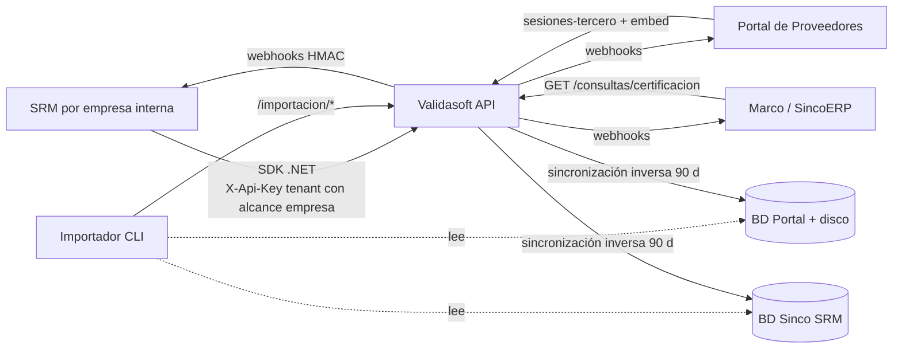
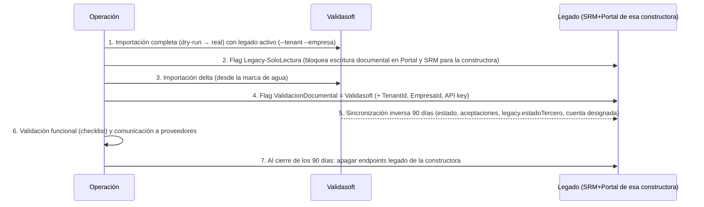

# 08 — Integración y migración

| Estado | Fecha | Responsable |
|---|---|---|
| Borrador | 2026-10-28 | Arquitectura |

**Propósito.** Definir cómo SRM, Portal de Proveedores y Marco (SincoERP) consumen Validasoft (SDKs, flags, webhooks, embed, consulta rápida), cómo se migran los datos históricos sin perder qué versión aprobó cada empresa, y cómo se hace el corte por empresa (T-18) con sincronización inversa y rollback.

**Relacionados:** [01-analisis-legado-srm-portal.md](01-analisis-legado-srm-portal.md) · [02-modelo-documental-compartido.md](02-modelo-documental-compartido.md) · [03-dominio-y-eventos.md](03-dominio-y-eventos.md) · [05-api-contratos-y-webhooks.md](05-api-contratos-y-webhooks.md) · [07-seguridad-identidad-y-tenancy.md](07-seguridad-identidad-y-tenancy.md) · [09-plan-de-hitos-y-responsabilidades.md](09-plan-de-hitos-y-responsabilidades.md) · [decisiones/registro.md](decisiones/registro.md) · ADR-0007, ADR-0008

> Actualizado el 2026-10-28 con las decisiones del registro: tenant = grupo con **empresas internas** (P-11-2, ADR-0008: una instancia del SRM = una empresa; `empresaId` en todos los eventos), identidad multipaís (P-1-1), reconciliación de identidad por clave única (P-12-1), webhooks + pull desde el MVP (P-12-2), SDK .NET y TS (P-12-3), revisión solo en Validasoft durante la coexistencia (P-12-4), sandbox por API key (P-11-4), cuenta designada por el tercero (P-3-3), alcance de la migración (P-13-x), modo de respaldo en Marco (adición 9).

---

## 1. Principios de integración

1. **Un solo punto de verdad.** Validasoft es dueño de documentos, versiones, decisiones y certificados. Los sistemas cliente guardan referencias (`expedienteId`, `folio`) y una copia de respaldo del estado recibida por webhook, nunca binarios.
2. **Sin doble escritura desde los clientes.** Durante la coexistencia, es Validasoft quien escribe hacia el legado (sincronización inversa), no al revés.
3. **Contratos públicos versionados.** Todo lo que un cliente consume está en `Validasoft.Contratos` / `@validasoft/sdk`, generado desde OpenAPI; cambiar un contrato rompe el build.
4. **Webhooks firmados e idempotentes y modo pull, ambos desde el MVP** (P-12-2); webhooks por defecto, pull de respaldo para redes cerradas.
5. **Corte por empresa, reversible.** Cada empresa interna (razón social) migra cuando está lista; el flag vuelve atrás sin pérdida.
6. **Una instancia del SRM = una empresa interna de un tenant.** El SRM de cada razón social usa una API key del tenant con alcance a **su** empresa; todo evento público lleva `tenantId` y `empresaId` (ADR-0008).
7. **Identidad del tercero reconciliada por clave única** `(país, tipo, número normalizado)` entre el ERP y Validasoft (P-12-1): los datos maestros validados contra documento prevalecen; cada sistema guarda el id externo del otro (`validasoftTerceroId` en el ERP; `referenciaExterna{sistema,id}` en Validasoft).
8. **La revisión ocurre solo en Validasoft** (P-12-4): el SRM no mantiene UI de revisión; recibe estados y aplica en AyF.



---

## 2. SDKs

| | `Validasoft.Sdk` (.NET) | `@validasoft/sdk` (TypeScript) |
|---|---|---|
| Target | Multi-target **`net7.0;net8.0;net10.0`** (T-16; `net7.0` mientras exista el SRM) | ESM + CJS, Node 20+ y navegador |
| Generación | Kiota desde `/openapi/v1.json` + capa manual `IValidasoftClient` | `openapi-typescript` + `openapi-fetch` |
| Incluye | DTOs de `Validasoft.Contratos`, `Idempotency-Key` automático (UUID v5 de la operación), Polly solo en idempotentes (GET, PUT, `confirmar`), `WebhookVerifier.Validar(headers, body, secreto)` con tolerancia de reloj 5 min, deserializador de eventos tipados | Tipos de eventos, `verificarWebhook()` (HMAC-SHA256 Web Crypto/Node), helper de paginación por cursor |
| Versionado | SemVer alineado con la API (`1.x`); `Contratos` publicado como NuGet en GitHub Packages en cada release | npm interno (GitHub Packages) |
| Publicación | Workflow `imagenes.yml` (GitHub Actions, doc 04 §11) | igual |
| Sandbox | Una API key de prueba (`vsk_test_…`, P-11-4) dentro del mismo tenant: mismos endpoints, datos aislados, webhooks a URL de prueba, sin correos reales (van a un buzón de sandbox) | igual |
| Idiomas oficiales | Solo .NET y TypeScript (P-12-3); otros lenguajes consumen OpenAPI directamente | — |
| Prohibido | Lógica de negocio en el SDK; reintento de POST creadores sin clave de idempotencia | igual |

Toda llamada del SDK opera en el contexto `tenant + empresa`: el `IValidasoftClient` se construye con la API key (que fija el tenant) y, si la key tiene alcance a varias empresas, con `empresaId` explícito por llamada.

Ejemplo de uso (firma, sin implementación):
```
var expediente = await cliente.Expedientes.CrearAsync(new CrearExpedienteRequest { … }, idempotencyKey: "srm-adp-00123-inv-7");
var evento = WebhookVerifier.Validar(request.Headers, bodyBytes, secreto); // lanza si la firma no coincide
```

---

## 3. SRM

### 3.1 Flag por empresa
`adp_srm.ADPConfig` código `ValidacionDocumental` = `Legacy` | `Validasoft` (hoy el SRM lee su configuración de esa tabla, p. ej. `Base_URL_Portal`; ver `C:\Fuentes_Git\SRM\BackEnd\SRM.Repository\Portal\StorePortal.cs:22-48`), más `Validasoft_TenantId`, `Validasoft_EmpresaId` y la API key cifrada (`IDataProtector`, nunca en claro como `Token_Zuppla`). Una instancia del SRM corresponde a **una empresa interna**; si un grupo tiene cinco instancias del SRM, las cinco apuntan al mismo tenant con cinco `empresaId` distintos. Con `Legacy` nada cambia. Con `Validasoft`:

| Acción del SRM | Antes (legado) | Después |
|---|---|---|
| Invitar proveedor (`POST /GestionProveedor/asignacion/portal`, `SolicitudesProvRoutes.cs:33`) | `Account/invitarproveedor` al Portal, contraseña por correo | `POST /api/v1/expedientes` (cabecera `X-Empresa`) con `tercero{identificacion{pais,tipo,numero}}` normalizado por el SDK, `referenciaExterna {sistema:"SRM", id:"ADP-00123"}` e `invitacion:{canal:"Correo"}`; `flujo` puede omitirse (se aplican las reglas de selección y el flujo por defecto, I-12). Validasoft reconcilia el tercero por clave única (P-12-1) y devuelve `terceroId` (nuevo o existente) y `requisitosCubribles`; **nada de la bóveda se comparte con la empresa hasta que el proveedor acepte la invitación** (B-1). El SRM guarda `ValidasoftTerceroId`, `ValidasoftExpedienteId`, `VinculoId`, `folio` (`-E-`) y `enlaceTercero` en `adp_srm.Solicitudes` (columnas nuevas) |
| Consultar/cambiar cuenta bancaria del proveedor (`TercerosGI/informacionbancaria`, `BancosConstructora`) | El Portal guardaba la cuenta por constructora | La cuenta que viaja a AyF es la **`CuentaDesignada`** del vínculo, elegida por el tercero y aprobada por dos usuarios de la empresa (P-3-3, P-4-7); el SRM la recibe en `vinculo.cuenta_designada` y en `certificado.emitido.datos.cuentaDesignada` |
| Recalcular estado al subir documentos (`/PortalProveedorERP/novedades/requeridos`, `NovedadesRoutes.cs:34`) | El Portal llamaba al SRM | Webhooks `expediente.documento_cargado`, `expediente.enviado_a_revision`, `expediente.con_observaciones`, `expediente.aprobado` |
| Aprobar/rechazar por perfil (`AprobacionBL.cs:327`) | Pantallas legacy + `TercerosERP/estado` | La revisión ocurre en Validasoft; el SRM recibe `expediente.requisito_veredicto`, `expediente.area_aprobada`, `expediente.rechazado` y `certificado.emitido` |
| Vencimiento (`background/vencimiento-proveedor/procesar`, `ProcesarVencimientosEndpoint.cs:12`) | Job disparado por el Portal a las 22:00 | Se apaga; llegan `documento.por_vencer`, `documento.vencido` y `vinculo.estado_cambiado { causa: "Vigencia" }` |
| Actualización post-aprobación (`actualizacion-proveedor/crear`, `actualizar-estado-portal`) | Portal → SRM → Portal | Se apaga; llegan `documento.version_nueva` y `vinculo.revalidacion_pendiente` / `vinculo.revalidado` / `vinculo.cambio_menor` |
| Aplicar en AyF (`IAplicadorCambioAyF`) | Al aprobar detalle | Al recibir `certificado.emitido` o `vinculo.revalidado`, aplicando solo las entradas de `cambios[]` con `aplicaEnErp = true` |

### 3.2 Receptor de webhooks en el SRM
`POST /api/integracion/validasoft/webhook` (nuevo módulo Carter en `SRM.API/Features/IntegracionValidasoft/`):
1. Verifica `Validasoft-Signature` con el secreto de la empresa (cifrado con `IDataProtector`, no en claro).
2. **Descarta** (200 sin acción, con log) todo evento cuyo `empresaId` no sea el de esta instancia: la suscripción de webhook se crea con filtro por empresa, pero el receptor vuelve a comprobarlo.
3. Dedupe por **`Validasoft-Event-Id`** (T-6; `Validasoft-Delivery` cambia en cada reintento y solo sirve para trazar el intento) en la tabla `adp_srm.ValidasoftEntregas` con clave primaria `evento_id` (columnas: `evento_id`, `delivery_id`, `tipo`, `empresa_id`, `recibido`, `procesado`, `error`).
4. Responde 200 en < 1 s y procesa en cola propia (Wolverine no está en el SRM; usar `Channel` + `BackgroundService` existente `QueuedHostedService`, `SRM.BackgroundServices\Core\Infrastructure\QueuedHostedService.cs:12`, que hoy no recibe trabajo).
5. Si la red no permite webhooks entrantes, el mismo módulo corre en modo **pull** (`GET /api/v1/eventos?desde=cursor&empresaId=`) cada minuto con el mismo mapa de acciones (P-12-2).
6. Mapa evento → acción:

| Evento | Acción en SRM | Equivalente legado que reemplaza |
|---|---|---|
| `expediente.abierto` (+ `vinculo.creado`, `expediente.flujo_seleccionado`) | Guardar ids (`terceroId`, `vinculoId`, `expedienteId`, `folio`); `SolEstado` ← `legacy.estadoTercero` (−3) | `CrearSolicitud` |
| `expediente.invitacion_aceptada` + `documento.compartido` | Marcar "proveedor activo en el portal"; a partir de aquí la bóveda es visible para la empresa (B-1) | `Usuario/activarERP` |
| `tercero.datos_maestros_cambiados` · `tercero.relacion_cambiada` | Actualizar razón social/dirección/representante principal en la copia local; si la empresa lo configuró, proponer actualización en AyF (los datos validados por documento prevalecen, P-12-1) | `actualizacion-proveedor/crear` (sector General/Legal) |
| `expediente.documento_cargado` · `expediente.enviado_a_revision` | Actualizar `DocumentacionPendiente` desde el `ExpedienteDto` (`GET /expedientes/{id}` si hace falta) | `ValidarEstadoTercero.Validar` |
| `vinculo.estado_cambiado` | `SolEstado` ← `legacy.estadoTercero`; `SolEstadoVencimiento` si `causa = Vigencia`; auditoría `SolicitudesAuditoriaEstado` | `TercerosERP/estado` |
| `expediente.requisito_veredicto` · `expediente.area_aprobada` | Registrar en bandeja informativa (solo lectura) | `LogAprobaciones` (ya no se escribe) |
| `expediente.con_observaciones` | Novedad al gestor | `NovedadERP` |
| `expediente.aprobado` | Marcar aprobación completa (el certificado llega aparte) | `ValidarAprobacionCompleta` |
| `certificado.emitido` | `SolEstado` ← 3; guardar `folio` (`-C-`), `urlVerificacion`, `hash`; crear/actualizar tercero en AyF con `datos.tercero`, `datos.cuentaDesignada` y las entradas de `cambios[]` con `aplicaEnErp = true` | `validaCreacionAutomaticaProv` + `FinancieroBL` |
| `certificado.con_pendientes` | Si `bloqueante = true`, marcar "revalidación vencida" y advertir en pagos; el vínculo **no** cambia de estado (T-8) | — (no existía) |
| `certificado.suspendido` / `certificado.restablecido` / `certificado.revocado` / `certificado.reemplazado` / `certificado.vencido` | Actualizar estado del certificado local | — |
| `expediente.rechazado` / `expediente.caducado` / `expediente.anulado` | `SolEstado` ← −1 / −6 / −2 | rutas de `AprobacionProvRoutes` |
| `documento.version_nueva` | Marcar proveedor "revalidación pendiente" si `efectoEnEmpresa.requiereRevalidacion` (nuevo subestado informativo) | `actualizacion-proveedor/crear` |
| `vinculo.revalidacion_pendiente` / `vinculo.revalidado` / `vinculo.cambio_menor` | Subestado; al revalidar, aplicar `cambios[]` en AyF si `aplicaEnErp` | `AprobarDetalleHandler` |
| `vinculo.cuenta_designada` | Actualizar la cuenta bancaria del tercero en AyF (ya viene aprobada por dos usuarios de la empresa) | `AsignarBancoConstructora` + aprobación bancaria |
| `vinculo.bloqueado` / `vinculo.desbloqueado` | Marcar proveedor bloqueado/desbloqueado en el SRM (solo informativo; la decisión vive en Validasoft) | — (no existía) |
| `documento.por_vencer` / `documento.vencido` | `SolEstadoVencimiento`, `SolFechaVencimiento`; correo lo envía Validasoft | `JobVencimientoProveedor` |
| `vinculo.desvinculado` / `vinculo.reintegrado` / `vinculo.anulado` | `SolEstado` ← −8 / −3 / −2 | `DesvincularProvPortal` |

Todos los nombres anteriores son los del catálogo [05 §7](05-api-contratos-y-webhooks.md); la CI de trazabilidad (documento 11) comprueba que cada evento citado aquí exista allí.

Mientras el SRM mantenga sus enums, cada evento trae `legacy.estadoTercero` (tabla de mapeo en doc 03 §mapeo) además de `tenant` (slug) y `empresaId` en el sobre común de 05 §6.2.

### 3.3 Lo que se apaga en el SRM (por empresa con flag `Validasoft`)
`/PortalProveedorERP/*` (`NovedadesRoutes.cs:18-140`, `DocumentosRoutes.cs:144,168`), `background/GestionProveedor` (`MapBackGroundProveedor.cs:14`), `background/vencimiento-proveedor/procesar`, `actualizacion-proveedor/*` de escritura, `Documentos/proximosvencer` hacia el Portal (`DocumentosRequericosBL.cs:347,865,963`), `GET /TokenAdproveedor` (`MapConfigroutes.cs:52`, expone la API key; se elimina para todas), pantallas legacy `menuProveedor.html`/`AprobacionProveedor.html` (se reemplazan por enlace profundo a `web` con token exchange, doc 07).

---

## 4. Portal de Proveedores

| Fase | Qué cambia | Qué deja de hacer |
|---|---|---|
| **P1 — Embed** (H9) | En "Documentos" y en los sectores con soporte, el Portal pide `POST /api/v1/sesiones-tercero {vinculoId | expedienteId}` con la API key del tenant/empresa correspondiente a la constructora activa → recibe `token` corto → abre `<iframe src="…/embed/expediente/{token}">` (o `/embed/boveda/{token}` para la vista multi-empresa) y escucha `postMessage`. La cuenta bancaria del sector "Información bancaria" se lee desde `GET /vinculos/{id}` (`cuentaDesignada`) y su cambio se hace en el embed de `/cuentas`. Los informes y licitaciones siguen igual | Escribir en `Adjuntos`, `AdjuntoTercero`, `AdjuntosConstructora`, `SoportesProveedor`, `BancosConstructora`, disco `/Archivos/*` (`AdjuntoService.cs:447-540`); llamar `DocumentosERP/requeridos` al SRM; `ServiceBackgroudVencimiento` (`BackService\ServiceBackgroudVencimiento.cs`) |
| **P2 — Redirección** (H11) | El menú "Documentos" y los avisos llevan a `public` de Validasoft con el mismo magic link; el Portal queda como directorio multi-constructora, licitaciones e informes, y lista expedientes vía `GET /vinculos?tercero=` | Usuario fijo `provportal` y las 4 llamadas al marco por constructora (`IERPSinco`/`ManagerToken`); `ActualizacionTerceroConstructora`; `VencimientosProveedor` |

Webhooks que el Portal consume (opcional en P1, necesario en P2): `vinculo.estado_cambiado`, `expediente.aprobado`, `expediente.rechazado`, `vinculo.revalidacion_pendiente`, `certificado.emitido`, `certificado.con_pendientes` → para pintar campana y estado por constructora con `legacy.estadoTercero`.

Autorregistro: el formulario del Portal (`MapLoginRoutes.cs:296`) deja de llamar a su propio `ValidacionDocumentalService` y usa `POST /public/v1/autorregistro` de Validasoft (identificación multipaís, consentimiento de plataforma, RUT/cédula/cámara en dos pasos); el tercero queda **invisible** hasta que una empresa lo vincule (P-1-9) y la lectura IA la hace la plataforma una sola vez cuando el tercero acepta el aviso (B-2), de modo que los hechos quedan para todas las empresas que luego lo vinculen. Cada constructora del Portal se mapea a `(tenantId, empresaId)`: la tabla `Constructoras` recibe dos columnas nuevas y la API key del Portal tiene alcance a todas las empresas que administra.

**Tercero compartido entre constructoras migradas y no migradas (I-18).** El disco y las tablas `Adjuntos*` del Portal son por tercero, no por constructora, así que durante la coexistencia un proveedor puede tener una constructora en Validasoft y otra en legado. Regla: desde que la **primera** empresa que lo vincula migra, la carga documental de ese tercero se hace **solo** en Validasoft (el Portal redirige su sección "Documentos" al embed aunque la constructora activa siga en legado); las constructoras no migradas leen el estado y los documentos del tercero vía `GET /vinculos` y `GET /terceros/{id}/documentos` con una API key de **lectura** por constructora legado (scope `documentos:leer`, `vinculos:leer`), y la sincronización inversa escribe para ellas `AdjuntosConstructora` y `TercerosConstructora` con `legacy.estadoTercero`. Así no hay dos lugares donde subir el mismo RUT.

---

## 5. Marco (SincoERP)

- **Consulta rápida:** `GET /api/v1/consultas/certificacion?pais=CO&tipoIdentificacion=NIT&numero=900123456&tipoVinculo=proveedor` con cabecera `X-Empresa` (número **normalizado sin DV**, P-1-1) → `ConsultaCertificacionDto` **exactamente como lo define [05 §4](05-api-contratos-y-webhooks.md)**: `certificado`, `folio` (`-C-`), `estado: EstadoCertificado`, `estadoVinculo: EstadoVinculo | "SinVinculo"`, `vinculoId`, `terceroId`, `vigenteHasta`, `revalidacionPendiente[]{tipo, plazo, bloqueante}`, `documentosVencidos[]`, `bloqueado`, `motivoBloqueo: Bloqueo | PlazoRevalidacion | Vencido`, `cuentaDesignada{numeroEnmascarado, banco}`, `urlVerificacion`, `legacy.estadoTercero`, `fuenteRespaldo`, `antiguedadSegundos`; desde la proyección `EstadoCertificacionTercero`, `ETag` + `Cache-Control: max-age=300`, objetivo p99 < 100 ms en H9 y < 50 ms en H11.
- **Tabla de respaldo y modo solo lectura de emergencia (adición 9):** Marco se suscribe a `certificado.emitido`, `certificado.con_pendientes`, `certificado.suspendido`, `certificado.restablecido`, `certificado.reemplazado`, `certificado.revocado`, `certificado.vencido`, `vinculo.estado_cambiado`, `vinculo.revalidacion_pendiente`, `vinculo.revalidado`, `vinculo.cuenta_designada`, `vinculo.bloqueado`, `vinculo.desbloqueado`, `documento.vencido` y mantiene la tabla local `adp_cs.validasoft_certificacion_local`:

  | Columna | Tipo | Origen |
  |---|---|---|
  | `tercero_pais`, `tercero_tipo_identificacion`, `tercero_numero` | `char(2)`, `varchar(10)`, `varchar(32)` (clave única junto con `empresa_id` y `tipo_vinculo`) | `datos.tercero` del evento |
  | `empresa_id` | `uuid` | `empresaId` del sobre |
  | `tipo_vinculo` | `varchar(40)` | `datos.tipoVinculo` |
  | `vinculo_id`, `validasoft_tercero_id` | `uuid` | ids externos (P-12-1) |
  | `estado_vinculo` | `varchar(20)` (`EstadoVinculo`) | `vinculo.estado_cambiado` |
  | `certificado_folio`, `certificado_emision` | `varchar(40)`, `int` | `certificado.*` |
  | `estado_certificado` | `varchar(20)` (`EstadoCertificado`) | `certificado.*` |
  | `bloqueado`, `motivo_bloqueo` | `bit`, `varchar(20)` (`Bloqueo` \| `PlazoRevalidacion` \| `Vencido`) | `certificado.con_pendientes.bloqueante` (A-2), `vinculo.bloqueado`/`certificado.suspendido` (B-5), `vinculo.estado_cambiado` a `Vencido` |
  | `vigente_hasta` | `date` | `certificado.*` / `vinculo.estado_cambiado` |
  | `revalidacion_pendiente` | `bit` | `vinculo.revalidacion_pendiente` / `vinculo.revalidado` |
  | `cuenta_designada_banco`, `cuenta_designada_enmascarada` | `varchar(60)`, `varchar(12)` | `vinculo.cuenta_designada` |
  | `url_verificacion`, `hash_contenido` | `varchar(200)`, `char(64)` | `certificado.emitido` |
  | `legacy_estado_tercero` | `int` | `legacy.estadoTercero` (solo coexistencia) |
  | `ultimo_evento_id`, `ultimo_evento_en`, `actualizado_en` | `uuid`, `datetime2`, `datetime2` | sobre del evento (dedupe: se ignora un evento con `ocurridoEn` anterior al guardado) |
  | `fuente` | `varchar(10)` (`webhook` \| `pull` \| `manual`) | cómo llegó la última actualización |

  Alimentación: receptor de webhooks de Marco (misma firma HMAC y dedupe por `Validasoft-Event-Id` que el SRM, T-6) o `GET /eventos?desde=` en redes cerradas; cada noche un *reconciliador* compara una muestra del 5 % contra `GET /consultas/certificacion` y corrige diferencias. Degradación: si Validasoft no responde en 2 s o devuelve 5xx, Marco responde el mismo contrato de `ConsultaCertificacionDto` desde la tabla local con `fuenteRespaldo: true` y `antiguedadSegundos = ahora − actualizado_en`; las pantallas del ERP lo muestran como aviso ("estado de hace 3 h"), nunca lo ocultan; si `antiguedadSegundos > 86 400` el ERP exige confirmación humana para operaciones de pago.
- **SSO:** desde pantallas del marco se abre `web` en la empresa correspondiente (`/t/{tenant}/e/{empresa}/…`) con token exchange `urn:validasoft:erp-token` (doc 07), sin segundo login.
- **AyF:** los cambios aprobados que afectan al tercero del ERP (razón social, representante legal principal, **cuenta designada**) viajan en `cambios[]` del evento; el aplicador vive en el SRM (hoy `IAplicadorCambioAyF`) y, a futuro, en Marco directamente. La identidad del tercero en AyF se reconcilia por clave única (P-12-1); AyF guarda `validasoftTerceroId`.

---

## 6. Importación de históricos

### 6.1 Herramienta
`Validasoft.Herramientas.Importacion` (CLI .NET):
```
importar --tenant acme --fuente portal --conexion "<cs Azure SQL>" --archivos \\srv\Archivos --desde 2019-01-01 --dry-run
importar --tenant acme --fuente srm    --conexion "<cs Sinco>" --reanudar --informe rechazos-acme.csv
```
Escribe **solo** por la API `/api/v1/importacion/*` (scope `importacion:escribir`, nunca directo a PostgreSQL); reanudable por `ClaveLegado`; `--dry-run` produce el informe completo sin escribir. Parámetros `--tenant` (grupo destino) y `--empresa` (razón social destino de esa constructora/instancia del SRM): una corrida importa **una constructora/SRM hacia una empresa interna**; varias corridas sobre el mismo tenant comparten terceros y bóveda.

**Alcance decidido (P-13-x):** terceros y vínculos **activos** con la última versión de cada documento y la aceptada por cada constructora, más **3 años** de historial de decisiones (P-13-1); los documentos del Portal que ninguna constructora aprobó entran a la bóveda como versión actual **sin** aceptada (P-13-2); de los usuarios del Portal se migran correo y nombre y el acceso es por magic link, sin contraseñas (P-13-3); el resto del histórico queda consultable en el legado en solo lectura.

**Identificaciones (P-1-1):** el importador normaliza cada identificación del legado al catálogo multipaís (`pais = CO` salvo evidencia contraria, `tipo` desde el código del legado, `numero` solo dígitos, `dv` validado y separado); colisiones (`900123456-7` vs `9001234567`) se fusionan en un solo tercero con informe de la fusión.

### 6.2 Identidad e idempotencia
- `ClaveLegado = {origen}:{tabla}:{id}` (p. ej. `portal:AdjuntoTercero:48112`, `srm:Solicitudes:7731`).
- Id en Validasoft = **UUID v5** (namespace fijo de Validasoft, nombre = `ClaveLegado`) → reejecutar es idempotente y las referencias cruzadas se resuelven sin tabla de equivalencias.
- Cada entidad importada guarda `ClaveLegado` en metadatos; los eventos llevan `ActorTipo = Integracion` con `Origen = Migracion` (los valores de `ActorTipo` son los de 03 §3) y la fecha original del legado en `OcurridoEn`.

### 6.3 Orden de carga y mapeo

| Paso | Origen (legado) | Destino (Validasoft) | Reglas |
|---|---|---|---|
| 1 | `Constructoras` (Portal) + `ADPConfig` (SRM) | `Tenant` (uno por **cliente/grupo**) + `Empresa` (una por **constructora/NIT**, ADR-0008), API key con alcance a la empresa, prefijo de folio por empresa, región y clave KMS del tenant | Las constructoras de un mismo grupo (mismo cliente comercial) caen en un tenant; Producto confirma el agrupamiento antes del dry-run |
| 2 | `usuariosERP`, perfiles de aprobación (`adp_srm_apr.PerfilAprobacion`) | Usuarios (correo como identidad; un usuario presente en varias constructoras del grupo se crea una vez con roles **por empresa**), roles, áreas | `PerfilAprobacion.OrdenApr` → etapas secuenciales; flag `Sarlaft` → verificación `ListasRestrictivas` |
| 3 | `TipoAdjuntoTercero` (Portal) | `tipo_documento_canonico` (anexo A de 03, T-10) + `tipo_documento_tenant` (+ `tipo_documento_empresa` cuando dos constructoras del mismo grupo tenían días distintos, B-4) | 12/18 → `CAMARA_COMERCIO` con condición `tercero.tipoPersona`; 1011 → `AUTORIZACION_TRATAMIENTO_DATOS`; 1013/1015/1019/1183/1185 → ámbito `PorVinculo`; `DocumentosObservacionConstructora` → ayuda; `DocumentosVencimientoConstructora.DiasVencimiento` → `reglaFrescura` (en el override por empresa si difiere entre constructoras del grupo) |
| 4 | `adp_srm.DocumentosRequeridos` + `FlujosAprobacion` | `Flujo` + `FlujoVersion` publicada "v1-migrada" | `TipoRequerido` → predicados (`Todos`, `vinculo.especialidades ContieneAlguno`, `tercero.tipoPersona En`, `vinculo.etiquetas`) |
| 5 | `Terceros`, `TerInformacionGeneral`, contactos | `boveda.tercero` | Clave natural país+tipo+número normalizado; conflictos y fusiones → informe |
| 5-rel | `TerCamaraComercio` / `TerDatosContacto` tipo representante, socios | **Personas relacionadas** (B-3): cada representante legal, suplente o socio se crea como `tercero` persona natural (clave por cédula) + `relacion_entre_terceros {tipo, principal, vigenteDesde}` vía `importacion/relaciones`; la cédula que el Portal tenía como adjunto del proveedor se importa a la bóveda **de la persona** (`RelacionImportadaDto.cedulaSha256`); el `Principal` es el que la regla legada mandaba a AyF (P-1-6) | Una misma persona representante de dos proveedores se crea una vez |
| 5-bis | `TerCuentaBancaria` + `BancosConstructora` + certificaciones | `cuenta_bancaria` (global, N por tercero) + `cuenta_designada(tenant, empresa, vinculo)` | La cuenta que cada constructora tenía en `BancosConstructora` pasa a ser la designada de ese vínculo (P-3-3); la certificación es una versión de `CERTIFICACION_BANCARIA` ligada a la cuenta |
| 6 | `TercerosConstructora` + `Solicitudes` | `Vinculo` (`VinculoCreado`, estado por tabla de mapeo) | Un vínculo por (tenant, **empresa**, tercero, `proveedor`) |
| 7 | `Adjuntos` + `AdjuntoTercero` + disco | `Documento` + `VersionCargada` (binario → MinIO, sha256; dedupe) | **Versión actual global = la última cargada por el tercero** (`AdjuntoTercero.AdjTerId` mayor por tipo). Las anteriores se cargan como versiones históricas. Archivos ausentes en disco → informe, versión marcada `BinarioNoDisponible` |
| 8 | `AdjuntosConstructora` (`ACActivo=1`) por constructora | `version_aceptada` del vínculo (**por empresa**) | Si la aceptada coincide con la actual → `VersionAceptadaRegistrada` vigente; **si no coincide → nace `Desactualizada` con `plazoRevalidacionDias = 90`** (B-8: no bloquea antes; `AceptacionImportadaDto.plazoRevalidacionDias`) y una fila en `BandejaRevalidaciones` de esa empresa. Como el legado no tiene extracción de la versión aceptada antigua, la comparación automática solo puede ser por **hash** (`Identica`/`Distinta`): la revalidación `Automatico` cierra sola únicamente si el archivo es idéntico; el resto es trabajo humano estimado en el plan de corte. Nunca se hereda la aceptación de otra constructora del mismo grupo (ADR-0008) |
| 9 | `SoportesProveedor` + sectores con `IdSoporte` (`TerInfoTributaria`, `TerInfoFinanciera`, `TerSISO`, `TerInformacionGeneral`, `TerCamaraComercio`) | Versiones de tipos clase `Formulario` (esquema canónico + extensión de tenant) + soporte adjunto | Un documento por sector con los datos JSON de la fila validados contra el esquema; campos que no caben en el canónico van a la extensión del tenant; `ActualizacionTerceroConstructora` Pendiente/Rechazada → requisito `Desactualizado`/`Observado` en esa empresa |
| 10 | `LogAprobaciones`, `LogAprobacionesRechazo`, `SolicitudesAuditoria*` | `Expediente` histórico con `ExpedienteImportado` + `VeredictoImportado` (usuario y fecha originales) | Motivos "documento" → observaciones sobre el requisito del tipo |
| 11 | `VencimientosProveedor` abiertos, `SolEstadoVencimiento` | `DocumentoVencidoEnVinculo`/`VinculoPorVencer(Causa: Vigencia)` + `Expediente(Renovacion)` abierto | `OrigenActualizacion=Ratificacion` → `RequisitoRatificado` |
| 12 | `EstudioSeguridad*`, `AdjuntosSarlaft` | Verificaciones `EstudioDeCumplimiento`, `ListasRestrictivas` con evidencia como versión | Vigencias según `DiasVtoOficial` |
| 13 | Vínculos en estado Completada/3 | `CertificadoEmitido` retroactivo (folio `{PrefijoEmpresa}-C-{Año}-{Secuencia}-M`, T-9) | Contenido con las versiones aceptadas importadas; `ConsentimientosRegistrados` **no** se importan (el legado no tiene evidencia equivalente): la autorización se pide en el primer ingreso |

### 6.4 Hechos compartidos para el histórico
Las versiones importadas no tienen hechos IA. La re-verificación masiva con la **Batches API** (50 % de coste) se ejecuta **solo sobre terceros que ya aceptaron el aviso de tratamiento de la plataforma en su primer ingreso** (B-8/P-6-5: nunca se envían a la IA documentos de quien no ha consentido) y solo sobre la **versión actual** de cada documento global; una cola nocturna recoge los terceros que van aceptando. Hasta entonces esas versiones se muestran con "hechos pendientes" (hash, antivirus y MIME sí se calculan) y las revalidaciones divergentes se resuelven por hash o por humano dentro del plazo de 90 días.

### 6.5 Informe de rechazos
CSV por fila: `ClaveLegado, tenant, empresa, paso, motivo, dato, accionSugerida` (tercero duplicado o fusionado, identificación inválida para su país, archivo ausente, estado no mapeable, tipo de adjunto sin canónico, formulario que no valida contra el esquema). Cero rechazos críticos (pasos 5–8) es condición para el corte.

---

## 7. Corte por empresa (dentro del tenant)

La unidad de corte es la **empresa interna** (una constructora / una instancia del SRM). El tenant se crea con la primera empresa que migra; las siguientes se suman reutilizando terceros y bóveda ya importados. La sincronización inversa dura **90 días** por empresa (P-13-4).



| Paso | Detalle | Rollback |
|---|---|---|
| 1 | Importación con informe sin críticos; usuarios de la empresa prueban en Validasoft con datos reales en entorno de pruebas | — |
| 2 | `Legacy-SoloLectura`: el Portal muestra aviso "estamos migrando tus documentos; vuelve en X horas"; el SRM bloquea invitaciones | Quitar flag |
| 3 | Delta por `FechaCreacion > marca` en `Adjuntos`, `ActualizacionTerceroConstructora`, `LogAprobaciones` | — |
| 4 | Activar `Validasoft`; Portal pasa a P1 (embed) para ese tenant; correos a proveedores con el nuevo enlace | Volver a `Legacy`: las tablas legado están al día por la sincronización inversa; binarios nuevos se exportan con `mc mirror` al disco del Portal |
| 5 | Suscriptor interno de Validasoft (filtrado por `empresaId`) escribe en `adp_srm.Solicitudes`, `SolicitudesAuditoriaEstado`, `TercerosConstructora`, `AdjuntosConstructora` (solo la aceptada actual), `BancosConstructora` (cuenta designada) **y, para que el rollback sea completo, `Adjuntos` + `AdjuntoTercero` con el binario copiado al disco del Portal** (`mc mirror` nocturno a `/Archivos/{tercero}/`); sin esas filas el Portal no "vería" los archivos nuevos al volver a `Legacy` | — |
| 6 | Checklist: bandejas coinciden en conteo; 10 proveedores de muestra verificados; certificados verificables; un tercero compartido con otra empresa del grupo muestra decisiones distintas en cada una | — |
| 7 | Apagar rutas de §3.3 y jobs del Portal para la constructora; retirar la sincronización inversa | Reactivar sincronización si otra empresa del tenant sigue en legado (es por empresa) |

**Comunicación a proveedores:** correo desde Validasoft (plantilla `MigracionBienvenida`, remitente de plataforma con el nombre de la empresa y `Reply-To` de la empresa, P-10-4) con el magic link a `/boveda`, explicando que sus documentos ya están cargados, cuáles están vigentes para cada empresa y cuáles requieren renovación; sin contraseña nueva (regla 8 del legado, P-13-3). Si varias empresas del mismo grupo migran en fechas distintas, el proveedor recibe **un solo** correo por hecho y día (P-10-3) que lista las empresas incorporadas. El Portal muestra el mismo mensaje en su campana. En el primer ingreso el proveedor acepta la autorización de tratamiento de la plataforma (incluida la IA externa, P-6-5); hasta entonces sus versiones se procesan sin IA.

---

## 8. Riesgos

| Riesgo | Mitigación |
|---|---|
| Espejos distintos por constructora para el mismo tercero | La actual es la última del tercero; las aceptaciones que no coinciden nacen `Desactualizada` con plazo de **90 días** (B-8), se cierran solas solo si el archivo es idéntico por hash, y el resto se planifica como carga humana del corte (conteo en el dry-run) |
| Bloqueo masivo de certificados a los 15 días del corte | No aplica: las importadas divergentes usan `plazoRevalidacionDias = 90` (B-8), alineado con la sincronización inversa |
| IA sobre documentos de terceros que no han consentido | La re-verificación histórica se difiere al primer ingreso de cada tercero (B-8); hasta entonces solo hechos sin IA |
| Archivos ausentes o corruptos en el disco del Portal | Informe; versión `BinarioNoDisponible`; se pide al tercero re-subir vía aviso consolidado |
| Webhooks hacia un SRM detrás de firewall | Modo pull `GET /eventos?desde=cursor` con el mismo contrato |
| Reintentos de webhook duplican acciones en el SRM | Dedupe por `Validasoft-Event-Id` (T-6) + acciones idempotentes por `expedienteId` |
| El SRM no puede desplegar el receptor a tiempo | Modo pull desde un job del SRM cada minuto como puente temporal |
| Coste de re-verificación histórica | Batches API solo sobre versiones actuales; priorización por nivel contratado |
| Doble fuente durante los 90 días | La inversa es unidireccional (Validasoft → legado) y el legado está en solo lectura documental |
| Proveedor confundido por dos portales | P1 embed mantiene el Portal como puerta de entrada; comunicación única; mismo magic link |
| Agrupar constructoras en el tenant equivocado | El agrupamiento tenant↔constructoras lo confirma Producto por escrito antes del dry-run; mover una empresa de tenant después exige exportarla (ADR-0008 "cómo se revierte") |
| Cuenta bancaria distinta por constructora en el legado | Se preserva como `cuenta_designada` por vínculo; el tercero ve todas sus cuentas en `/cuentas` y puede unificarlas cuando quiera (cada cambio pasa por la aprobación de la empresa) |

---

## Decisiones abiertas
0. ~~Nombres de eventos y contrato de consulta distintos de 05~~ **Cerrada** (I-5/#3/#22): este documento usa solo el catálogo de 05 §7 y `ConsultaCertificacionDto`; la CI de trazabilidad lo verifica.
1. **Dónde vive el aplicador de AyF** a largo plazo (SRM vs Marco). *Propuesta:* SRM en H9, Marco cuando exponga API de terceros. *Quién decide:* Arquitectura + equipo Marco.
2. ~~Duración de la sincronización inversa~~ **Cerrada** (registro P-13-4): 90 días por empresa.
3. **Folio de certificados retroactivos** (emitir o no para vínculos ya Completados). *Propuesta:* emitir con sufijo `-M` y fecha original. *Quién decide:* Producto.
4. **Autorregistro del Portal** en P1: ¿crea el tercero en Validasoft desde el día 1 o solo en P2? *Propuesta:* desde P1 para que la verificación IA no se duplique. *Quién decide:* equipo Portal.
5. ~~Pull vs webhooks~~ **Cerrada** (registro P-12-2): ambos desde el MVP; webhooks por defecto, pull de respaldo.
6. **Agrupamiento de constructoras en tenants** para la migración (qué constructoras del Portal pertenecen al mismo cliente/grupo). *Propuesta:* lista elaborada por Comercial y confirmada por Producto antes del primer dry-run. *Quién decide:* Producto.

## Fuentes verificadas
- SRM: `C:\Fuentes_Git\SRM\BackEnd\SRM.Repository\Portal\StorePortal.cs:22-48` (API key y URL del Portal en BD); `SRM.API\Routes\MapProveedores\Endpoint\SolicitudesProvRoutes.cs:33,44` (invitación); `SRM.API\Routes\MapProveedores\Endpoint\NovedadesRoutes.cs:18-140` y `DocumentosRoutes.cs:144,168` (rutas `/PortalProveedorERP/*`); `SRM.API\Routes\BackgroundService\MapBackGroundProveedor.cs:14`; `SRM.API\Features\JobVencimientoProveedor\Endpoints\ProcesarVencimientosEndpoint.cs:12,44-49`; `SRM.API\Routes\MapConfig\MapConfigroutes.cs:52` (`GET /TokenAdproveedor`); `SRM.Services\SRM.Services.Proveedores\DocumentosRequeridos\DocumentosRequericosBL.cs:347,865,963` (`Documentos/proximosvencer`); `SRM.Services\SRM.Services.Proveedores\Aprobacion\AprobacionBL.cs:327`; `SRM.BackgroundServices\Core\Infrastructure\QueuedHostedService.cs:12`; `SRM.Services\SRM.Services.Features\ActualizacionProveedor\Commands\AprobarDetalle\AprobarDetalleHandler.cs:74-156,256-268`.
- Portal: `C:\Fuentes_Git\PortalProveedores\backend\librerias\Code.Services\Documents\Service\AdjuntoService.cs:447-540,619-760` (disco, `AdjuntosConstructora`, versión espejo); `Code.Model\Entity\dbo\TercerosConstructora.cs:9-32`; `Code.Model\Entity\dbo\VencimientosProveedor.cs:6-52`; `Code.Model\Entity\dbo\ActualizacionTerceroConstructora.cs:9-104`; `Code.Model\Entity\dbo\SoportesProveedor.cs`; `Code.Model\Entity\dbo\Constructora.cs` (`ConstRuta_API`, `ConsApiKey`); `Code.API\MapRoutes\MapLogin\MapAccountRoutes.cs:42` (`invitarproveedor`); `Code.API\MapRoutes\MapLogin\MapLoginRoutes.cs:296` (autorregistro); `Code.API\MapRoutes\MapDocumentos\MapDocumentosERPRoutes.cs:19-87`; `Code.API\BackService\ServiceBackgroudVencimiento.cs`; `Code.Services\Operations\ActualizacionProveedor\README.md` §5–§7 (`provportal`, 4 llamadas al marco, caché 400 min).
