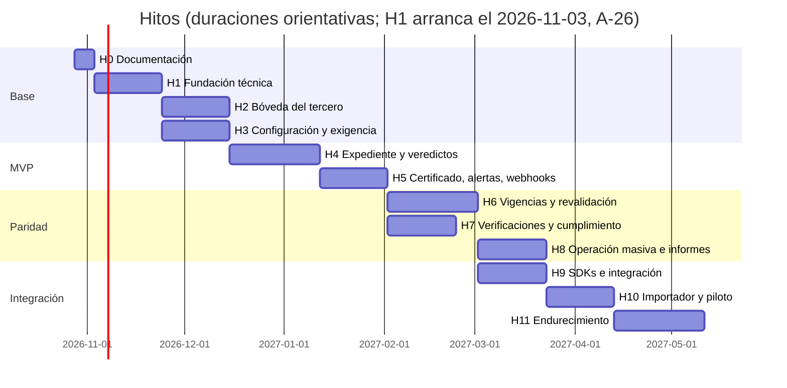

# 09 — Plan de hitos y responsabilidades

| Estado | Fecha | Responsable |
|---|---|---|
| Borrador | 2026-10-28 | Arquitectura |

**Propósito.** Dividir la construcción de Validasoft en hitos pequeños y verificables, cada uno con objetivo, alcance, entregables, responsables, criterios de aceptación y dependencias, de modo que el alcance se valide paso a paso y cualquier cambio se refleje hacia adelante y hacia atrás.

**Relacionados.** [00-vision-y-alcance.md](00-vision-y-alcance.md) · [02-modelo-documental-compartido.md](02-modelo-documental-compartido.md) · [03-dominio-y-eventos.md](03-dominio-y-eventos.md) · [04-arquitectura-plataforma.md](04-arquitectura-plataforma.md) · [05-api-contratos-y-webhooks.md](05-api-contratos-y-webhooks.md) · [11-trazabilidad-por-hito.md](11-trazabilidad-por-hito.md) · [decisiones/registro.md](decisiones/registro.md).

---

## 1. Gobierno (decisiones P-17-x)

| Tema | Decisión |
|---|---|
| Producto | Una persona (el usuario) aprueba alcance, modelo documental y plan; Arquitectura aprueba lo técnico |
| Herramienta | **GitHub**: repositorio `Validasoft`, Issues + Projects (una épica por hito, un issue por entregable), GitHub Actions como CI |
| Ramas | `main` protegida; `feature/H<n>-<tema>`; PR con dos aprobaciones y CI verde; commits convencionales en español (`feat(expedientes): …`) |
| Definición de hecho (DoD) | Criterios de aceptación cumplidos **y** pruebas automatizadas verdes **y** demo grabada **y** documentos/ADRs actualizados **y** sin decisiones abiertas bloqueantes del siguiente hito |
| Cadencia | Revisión semanal de 1 h con Producto; demo al cierre de cada hito; retrospectiva de alcance: qué cambió hacia atrás y hacia adelante |
| Decisiones | Toda decisión nueva entra en `decisiones/registro.md`; las estructurales, en un ADR |

## 2. Roles y responsabilidades

| Rol | Responsabilidad principal | Aprueba |
|---|---|---|
| **Producto** (usuario) | Alcance, prioridades, reglas de negocio, aceptación de hitos, decisiones del registro | 00, 02, 09, 11, demos |
| **Arquitecto / Tech lead** | Diseño, ADRs, revisión de PRs, coherencia entre módulos, deuda técnica | 03, 04, 05, 07, 08 |
| **Backend A** (dominio y validación) | `Vinculo`, `Expediente`, `Certificado`, reglas, áreas, vigencias, sagas | — |
| **Backend B** (documentos, infraestructura e integraciones) | Bóveda, MinIO, IA, notificaciones, webhooks, SDKs, importador, Docker/CI | — |
| **Frontend A** (`apps/web` + `packages/ui`) | Design system, bandejas, expediente, editor de flujos, panel de plataforma | 06 (con Arquitecto) |
| **Frontend B** (`apps/public`) | Magic link, bóveda del tercero, Dropzone móvil, verificador, embed, PWA | — |
| **QA / automatización** | Pruebas de integración, e2e Playwright, contract tests, k6, fixtures de IA | Criterios de aceptación |
| **DevOps** | GitHub Actions, imágenes, compose/Helm, observabilidad, backups, secretos | Despliegues |
| **Legal / Cumplimiento** (consulta) | Autorización de datos, retención, contrato de encargo, texto de consentimiento IA | 07 (parte legal) |

Equipo mínimo: 3–4 personas (Backend A, Backend B, Frontend A/B compartido, QA/DevOps compartido) con Arquitecto a tiempo parcial. Duraciones orientativas para ese equipo.

## 3. Mapa de hitos

## 4. Hitos en detalle

Formato: **Objetivo** · **Dentro** · **Fuera** · **Entregables** · **Responsable · Apoyo · Aprueba** · **Criterios de aceptación** · **Depende de** · **Efectos hacia atrás/adelante**.

### H0 — Documentación y decisiones (1 semana)
- **Objetivo**: alcance y diseño cerrados en documentos revisables; decisiones bloqueantes respondidas; dos auditorías externas (negocio y técnica) resueltas.
- **Dentro**: `docs/00–11`, `MAPA.md`, `adr/0001–0010`, `decisiones/cuestionario.md`, `decisiones/registro.md`, `decisiones/relectura-2026-10-28.md`.
- **Fuera**: código, infraestructura, repositorio remoto.
- **Entregables**: los documentos; relectura cruzada; trazabilidad por hito (11).
- **Responsable** Arquitecto · **Apoyo** todos · **Aprueba** Producto.
- **Criterios**: Producto aprueba 00, 02, 09 y 11; las 22 bloqueantes respondidas; las decisiones propagadas a los documentos; sin contradicciones entre 02/03/05/06 (nombres de eventos, proyecciones y endpoints idénticos).
- **Depende de**: —.
- **Efectos**: fija el modelo (versión única, dos capas de vigencia, tenant = grupo con empresas internas) que todos los hitos siguientes implementan.

### H1 — Fundación técnica (3 semanas)
- **Objetivo**: esqueleto ejecutable en Docker con tenancy, identidad, medición de uso y CI.
- **Dentro**: solución .NET 10 (`Api`, `Worker`, `Dominio`, `Aplicacion`, `Infraestructura`, `Contratos`), Marten con los esquemas `plataforma`, `boveda`, `validacion` (conjoined por tenant + `empresa_id`) e `identidad` en **un solo `DocumentStore` conjoined con tenants técnicos** (T-1/T-2; el *spike* que demuestra una transacción entre `boveda` y `validacion` es criterio de aceptación), la entidad `Empresa` dentro del tenant, Wolverine (transporte PostgreSQL, outbox), OpenIddict + Identity (login, 2FA TOTP, API keys con scopes y alcance por empresa, grants `urn:validasoft:erp-token` y `urn:validasoft:magic-link`), middleware de tenant/empresa (`IDeEmpresa` + `ISesionDeEmpresa`, filtro obligatorio por `empresa_id` en `validacion`, 404 para recursos de otra empresa o tenant, T-3/T-4), permisos `empresas:administrar`, `plataforma:*` y `plataforma:soporte` con **accesos de soporte** concedidos por el Administrador del tenant (B-6), **auditoría de configuración e identidad** básica (`RegistroDeCambioDeConfiguracion`, `RegistroDeIdentidad`, `GET /auditoria`), **catálogo de tipos de identificación por país** con validadores (NIT, CC, CE, PA, RFC, CUIT…), **medición de uso** por tenant y empresa desde el día 1, KMS/clave por tenant (configurable), región como atributo del tenant, OpenAPI 3.1, ProblemDetails, rate limit, OTel, health, compose (postgres, minio, mailpit, otel-lgtm), GitHub Actions (build, test, lint, contract snapshot), `packages/ui` (tema, `ChipEstado`, `Folio`, `KpiCard`, `BarraProgresoEtapas`, `SelectorEmpresa`, `SelectorIdentificacion`), `apps/web` con login OIDC, `/plataforma` (crear tenant y empresas) y `/auditoria` (consulta), test arquitectónico (NetArchTest).
- **Fuera**: cualquier regla de negocio de documentos o expedientes.
- **Responsable** Backend B · **Apoyo** DevOps, Frontend A · **Aprueba** Arquitecto.
- **Criterios**: `make up` levanta todo; login con 2FA; crear tenant con dos empresas internas desde `/plataforma`; API key con alcance a una empresa recibe **404** al usar `X-Empresa` de otra; el spike T-2 escribe un evento en `boveda` y otro en `validacion` en la misma transacción; rotar una API key deja `RegistroDeCambioDeConfiguracion` y `RegistroDeIdentidad`; `GET /health/ready` ok; pipeline verde; NetArchTest pasa; identificación `CC 1.234.567` y `NIT 900123456-7` se normalizan y validan.
- **Depende de**: H0.
- **Efectos**: P-11-2 (tenant = grupo) obliga a que todo agregado posterior lleve `EmpresaId`.

### H2 — Bóveda del tercero (3 semanas)
- **Objetivo**: documentos globales y por vínculo con versiones inmutables, hechos compartidos y compartición.
- **Dentro**: `Tercero` (clave multipaís) y **`RelacionEntreTerceros`** (representantes, socios, UBO, miembros como terceros persona natural con bóveda propia, ADR-0010), `Documento`/`VersionDocumento` (archivo y **formulario** con esquema JSON canónico versionado + `extension_tenant` de campos privados), subida en dos pasos (prefirmada, hash, magic bytes, 20 MB/50 páginas, PDF/JPG/PNG/WebP/HEIC→PDF en cliente), catálogo canónico con la semilla definitiva (**03 Anexo A**) y versionado, **`Vinculo` mínimo con invitación aceptada** para poder compartir (`comparticion_version` solo tras `InvitacionAceptada` + consentimientos, sin exclusión por el tercero; ADR-0009, A-8), descarga prefirmada con `DocumentoAccedido`, previews en worker, `VerificacionDocumentalSaga` (antivirus → preclasificación → extracción → **comparación con versión anterior** → señales básicas de manipulación; la IA solo si la plataforma la tiene habilitada y el tercero registró `ConsentimientoIa`, B-2/B-8), regla "una sola versión actual" con restitución al retirar, política de retención preparada (`retirado`, `retencion_hasta`), `FrescuraDocumentoTercero` (estructura), `apps/public` bóveda básica (subir, ver estado por empresa, personas relacionadas; en H2 el tercero entra con un enlace de demo emitido por la semilla, T-13).
- **Fuera**: veredictos, expedientes, vigencias efectivas, autorregistro (H4).
- **Responsable** Backend B · **Apoyo** Backend A, Frontend B · **Aprueba** Arquitecto, Producto (demo).
- **Criterios**: subir RUT crea v1 y queda `Actual`; subir el mismo archivo no crea v2; dos empresas de tenants distintos ven la misma versión **solo después de que el tercero aceptó la invitación de cada una** (antes solo `requisitosCubribles`); una versión ilegible queda `Devuelta` sin alertar; la IA extrae `fecha_expedicion` de un fixture; `Comparacion` detecta cambio de dirección y lo marca en `CamposCambiados[]`; la cédula del representante se valida contra la persona relacionada, no contra el NIT; descarga sin compartición → 403 `version-no-compartida`; sin consentimiento o sin clave de IA, la versión se promueve con hechos básicos (`ConIa=false`, `pendienteRevisionHumana=true`) y la carga no se bloquea.
- **Depende de**: H1.
- **Efectos**: define los hechos que H4 y H6 consumen; el esquema de formularios condiciona el renderizador de H4; el `Vinculo` mínimo lo completa H4.

### H3 — Configuración y motor de exigencia (3 semanas, en paralelo con H2)
- **Objetivo**: flujos configurables con reglas de exigencia en un solo lugar.
- **Dentro**: tipos de documento por tenant (mapeo canónico desde el Anexo A de 03, restricción de ámbito, regla de frescura, ayuda, plantilla versionada, nivel de revisión, campos críticos adicionales) y **overrides por empresa** (`tipo_documento_empresa`; jerarquía tenant → empresa → regla del flujo con nombres únicos: `reglaFrescura`, `nivelRevision`, `diasRevalidacion`, `politicaDesactualizada`, `aprobadoresRequeridos`, `porcentajeMuestreo`, B-4), `TiposAceptados` en la regla, áreas, motivos base + propios, `Flujo`/`FlujoVersion` publicable, `ReglaDeExigencia` + `EvaluadorDeExigencia` (puro, con atributos `tercero.*`, `vinculo.*` incluidos `montoEstimado` y `nivelRiesgo`), semilla "Habilitación de proveedores" (Compras, Legal, Financiera, Cumplimiento; SST opcional; 2 aprobadores en bancaria), **`ReglaDeSeleccionDeFlujo` + `IEvaluadorDeSeleccion` y flujo por defecto obligatorio por (empresa, tipo de vínculo)** (`GET/PUT /flujos/reglas-seleccion`, simulador), editor de flujo en `apps/web` con pestaña "Reglas de selección" y vista previa del tercero; toda edición de configuración deja `RegistroDeCambioDeConfiguracion` (auditoría desde H1).
- **Fuera**: ejecución de expedientes.
- **Responsable** Backend A · **Apoyo** Frontend A · **Aprueba** Producto.
- **Criterios**: tabla de casos del evaluador 100 % verde (PN/PJ, país, etiquetas, tipo de vínculo, monto, requisito "de la persona relacionada con rol X"); publicar una versión congela sus reglas; cambiar el ámbito a `PorVinculo` funciona y a `Global` se rechaza; un override de empresa más laxo que el tenant ⇒ 422 `override-mas-laxo`; publicar sin flujo por defecto ⇒ 422 `falta-flujo-por-defecto`.
- **Depende de**: H1.
- **Efectos**: cualquier atributo nuevo del tercero (H2) debe exponerse al evaluador.

### H4 — Expediente inicial y veredictos (4 semanas)
- **Objetivo**: del enlace al cierre con todas las áreas aprobadas.
- **Dentro**: `Vinculo` completo (por empresa interna; `InvitacionAceptada` + `ConsentimientosRegistrados` disparan la compartición, ADR-0009; `POST /expedientes` devuelve `requisitosCubribles` sin nombres de documentos), **autorregistro invisible** (`POST /public/v1/autorregistro`, `public:/registro`, T-13), `Expediente(Inicial)` con folio propio `-E-` (T-9), saga `ProcesoDeValidacion`, snapshot de requisitos, etapas (paralelo por defecto), **veredicto sobre versión solo `Aprobado` u `Observado`** (con `noAdmitirEstaVersion`) y **rechazo del expediente** como acción terminal del área con `PuedeRechazarExpediente` (B-7), motivos y campos afectados, observar/reenviar con invalidación, override de administrador con justificación, eximir con permiso `requisitos:eximir`, bloqueo privado del tercero por empresa (`vinculos:bloquear`), cuatro ojos configurable, caducidad 30 días con reapertura, SLA con escalamiento, cierre automático, `FlujoSeleccionado` al abrir (regla/explícito/por defecto), **`CambiarFlujoDeExpediente` (admin, `Abierto`/`Observado`, conserva veredictos) y `AplicarVersionDeFlujoAExpedientesAbiertos` con simulación de impacto**, proyecciones `BandejaRevision`, `ExpedienteDetalle`, `TimelineExpediente`; `apps/web` bandeja con columnas por área, detalle con visor + `PanelIA` + `PanelVeredicto` y acción "Cambiar flujo"; `apps/public` `/e/:token` (magic link + OTP), requisitos, formularios dinámicos, Dropzone móvil con fotos→PDF, resultado IA, aceptación de T&C/autorización con evidencia.
- **Fuera**: certificado, correo transaccional completo (solo campana y correo de invitación).
- **Responsable** Backend A · **Apoyo** Frontend A, Frontend B, QA · **Aprueba** Producto.
- **Criterios**: e2e: solicitar → el tercero acepta la invitación y consentimientos (solo entonces la empresa ve sus documentos) → sube → área observa → v2 → aprueban → `ExpedienteAprobado`; timeline completo; `Idempotency-Key` replay; el rechazo del expediente es terminal y el administrador abre expediente nuevo; una versión observada con `noAdmitirEstaVersion` no vuelve a aceptarse en ese vínculo; dos empresas del mismo tenant no ven las decisiones de la otra (404); expediente creado sin `flujo` toma el de la regla de selección o el flujo por defecto.
- **Depende de**: H2, H3.
- **Efectos**: fija los contratos de lectura que 06 enumera; cualquier estado nuevo obliga a actualizar 03 y 10.

### H5 — Certificado, notificaciones y webhooks → **MVP** (3 semanas)
- **Objetivo**: cerrar los cinco pasos de la marca y hacer el sistema consumible.
- **Dentro**: `Certificado` por vínculo (folio `{PrefijoEmpresa}-C-{Año}-{Seq}-{n}`, contenido canónico RFC 8785, hash, QR, PDF/A-2b, sello **Ed25519** de plataforma, T-9/T-12), `GET /public/v1/verificar/{folio}` (UI `/verificar/:folio`) con datos mínimos, motor de notificaciones (Fluid + MailKit + campana + SSE) con el catálogo de alertas (P-10-1), evidencia de entrega SMTP, remitente de plataforma con `Reply-To` de la empresa, webhooks firmados con entregas/reintentos, dedupe por `Validasoft-Event-Id` (T-6) y modo pull, eventos públicos v1 con `certificado.emitido` como canónico (sin `expediente.certificado`, T-15), seed `demo`.
- **Fuera**: vigencias, verificaciones externas.
- **Responsable** Backend B · **Apoyo** Frontend B · **Aprueba** Producto.
- **Criterios**: demo de punta a punta en Docker sin tocar SRM/Portal; webhook con firma válida entregado y con firma inválida rechazado; `/eventos?desde=` devuelve lo mismo que los webhooks; verificador público compara hash; un tercero con tres empresas recibe un solo correo por hecho y día.
- **Depende de**: H4.
- **Efectos**: el catálogo de eventos públicos queda congelado como v1; cambios posteriores son aditivos.

### H6 — Vigencias, revalidación y versiones nuevas (4 semanas)
- **Objetivo**: el ciclo de vida largo del vínculo.
- **Dentro**: `VersionAceptada` con dos capas de vigencia y `motivo_vigencia`, `VencimientoProgramado` + job diario, avisos consolidados (`FrescuraDocumentoTercero`), gracia y críticos, `Expediente(Renovacion)`, ratificación según canónico, **revalidación obligatoria** al cambiar la versión actual (saga `Revalidacion`, `Desactualizada`, plazo y bloqueo configurables), `Expediente(Actualizacion)` por empresa, comparación de versiones lado a lado, cuentas bancarias globales con `CuentaDesignada` elegida por el tercero y saga `CambioCuentaDesignada` (aprobación de la empresa con permiso `cuentas:aprobar`, 4 ojos por defecto), `/vencimientos` + Excel + notificación, `/revalidaciones` en `apps/web`, bóveda del tercero con vencimiento por empresa.
- **Fuera**: niveles de revisión automática (H7), campañas (H8).
- **Responsable** Backend A · **Apoyo** Frontend A, Frontend B · **Aprueba** Producto.
- **Criterios**: test de reloj simulado (aviso T-15, vencido T0 con gracia 15, ratificar, renovar); escenarios E1–E10 del documento 02 automatizados en nivel `Manual` (los casos de esos escenarios que requieren nivel `Automatico` se completan en H7); la misma versión de Cámara vence en A a 30 días y en B a 90; observación con `noAdmitirEstaVersion` de A invisible para B; una versión nueva alerta a todas exactamente una vez y la saga decide por empresa si abre revalidación o registra cambio menor (T-7); el vínculo `Vencido` vuelve a `Activo` al cerrar cualquier expediente aprobado que resuelva sus críticos (I-15); retirar la versión actual restituye la anterior y cancela revalidaciones abiertas (I-11); la ratificación renueva la vigencia sin pasar por ningún área (A-7); una aceptación `Desactualizada` sin revalidar deja el certificado `ConPendientes` informativo 15 días y luego bloqueante (`GET /consultas/certificacion` → `bloqueado: true, motivoBloqueo: PlazoRevalidacion`, webhook `certificado.con_pendientes` con `bloqueante: true`) hasta revalidar, sin cambiar el estado del vínculo (A-2, T-8); dos aprobaciones de la cuenta designada del mismo usuario ⇒ 409.
- **Depende de**: H5.
- **Efectos**: los eventos `documento.version_nueva` y `vinculo.revalidacion_pendiente` se añaden al catálogo público (aditivo).

### H7 — Verificaciones externas, cumplimiento y revisión automática (3 semanas, en paralelo con H6)
- **Objetivo**: paridad con SAGRILAFT/oficial y el servicio de revisión automática.
- **Dentro**: `IVerificador` listas restrictivas (proveedores con contrato vigente + evidencia manual), coincidencias `CoincidenciaPorAnalizar`, reconsulta periódica, estudio de cumplimiento (legado) a cargo del rol `Cumplimiento` (2FA obligatorio), beneficiario final (UBO) y PEP como formularios globales referenciados por `FORMULARIO_SARLAFT` (I-20), expiración de cédula y listas del representante saliente **tras confirmación humana** o confianza ≥ 0,98 (esc. 6), **suspensión y restablecimiento del certificado por bloqueo** (`Suspendido`, B-5), niveles `Manual/Asistido/Automatico` con umbrales, muestreo, presupuesto de decisiones y degradación, derecho a revisión humana, métricas de equidad, detección completa de manipulación, re-verificación con Batches API solo de terceros con consentimiento (B-8), informe SAGRILAFT.
- **Fuera**: matriz de riesgo configurable (H8), RUES/DIAN.
- **Responsable** Backend B · **Apoyo** Backend A, QA · **Aprueba** Producto, Cumplimiento.
- **Criterios**: verificación bloqueante pendiente impide `ExpedienteAprobado`; evidencia descargable; en `Automatico`, `SinCambios` aprueba solo, cambio de representante legal va a humano, Cámara de 45 días con regla de 30 se observa sola al tercero; una coincidencia `Confirmada` en listas bloquea el cierre y notifica a Cumplimiento (03 §13); bloquear un vínculo suspende su certificado y desbloquearlo lo restablece; muestreo del 5 % aparece en la bandeja de auditoría; los escenarios E1–E10 con nivel `Automatico` quedan verdes.
- **Depende de**: H5 (y hechos de H2); los escenarios automáticos dependen de H6.
- **Efectos**: habilita el modelo comercial por decisión (medición ya existe desde H1).

### H8 — Operación masiva, informes y administración (3 semanas)
- **Objetivo**: lo que usan a diario analistas y administradores.
- **Dentro**: `InvitacionMasivaSaga` (Excel/CSV, lote, pausa), campañas de renovación, delegación y reasignación, separación de funciones, conflicto de intereses del revisor, ficha 360 del tercero, informe de estado, KPIs por flujo y tenant, auditoría consultable y exportable (ZIP firmado de bóveda y expediente), plantillas Liquid restringidas, digest, dominio propio de correo (DKIM), marca blanca, planes y límites (con datos de medición), habeas data formal, matriz de riesgo configurable, embed + postMessage, PWA offline.
- **Fuera**: integración con sistemas externos.
- **Responsable** Frontend A · **Apoyo** Backend A, Frontend B · **Aprueba** Producto.
- **Criterios**: lote de 1 000 invitaciones con reintentos; KPIs desde proyección (sin mocks); exportación ZIP verificable; solicitud de supresión atendida con constancia; embed funciona en una página de prueba.
- **Depende de**: H6, H7.
- **Efectos**: cierra las adiciones del experto no cubiertas antes.

### H9 — SDKs e integración con SRM, Portal y Marco (3 semanas)
- **Objetivo**: los sistemas actuales hablan con Validasoft sin duplicar revisión.
- **Dentro**: `Validasoft.Contratos` + `Validasoft.Sdk` (NuGet multi-target `net7.0;net8.0;net10.0`, T-16), `@validasoft/sdk`, sandbox por API key; SRM: flag `ValidacionDocumental = Legacy|Validasoft` por empresa, cliente en invitación, receptor de webhooks firmado con dedupe por `Validasoft-Event-Id`, mapa evento→acción con los nombres de 05 §7 (`certificado.emitido`, `vinculo.revalidado`, `vinculo.cuenta_designada`, …) y `legacy.estadoTercero`, aplicación en AyF al certificar, apagado de `PortalProveedorERP/*` y `background/*` cuando el flag es `Validasoft`; Portal: embed de la bóveda (fase 1), retiro de `provportal` y de escritura en `Adjuntos*`; Marco: `GET /consultas/certificacion` (con `pais`, número normalizado, `X-Empresa`, `bloqueado` + `motivoBloqueo`) + tabla de respaldo `adp_cs.validasoft_certificacion_local` (08 §5) con `fuenteRespaldo=true`.
- **Fuera**: migración de históricos.
- **Responsable** Backend B · **Apoyo** Backend A, Arquitecto · **Aprueba** Arquitecto, Producto.
- **Criterios**: con flag `Validasoft`, invitar crea expediente y `certificado.emitido` habilita al proveedor en AyF; con `Legacy` nada cambia; el Portal ya no escribe en `Adjuntos*`; Marco responde desde respaldo si Validasoft está caído; el receptor del SRM deduplica reenvíos por `Validasoft-Event-Id`; k6 `GET /consultas/certificacion` 500 rps p99 < 100 ms.
- **Depende de**: H5 (contratos), H6 **y H7** (B-8: una empresa que active el flag no pierde SAGRILAFT/oficial de cumplimiento).
- **Efectos**: fija la política de compatibilidad de la API (12 meses de deprecación).

### H10 — Importador y piloto de migración (3 semanas)
- **Objetivo**: migrar una empresa real (constructora) con rollback probado.
- **Dentro**: CLI `Validasoft.Herramientas.Importacion` (dry-run, reanudable, CSV de rechazos), `/importacion/*` (incluidas `relaciones` para representantes), mapeo legado → bóveda/validación (última versión = actual; espejos divergentes nacen `Desactualizada` con **`plazoRevalidacion` de 90 días**, B-8; huérfanos sin aceptada; usuarios con correo y magic link; 3 años de decisiones; un tenant por cliente y una empresa por constructora/NIT), re-verificación masiva con Batches API **solo de terceros que ya aceptaron la autorización** (B-8), **corte por empresa** (`Legacy-SoloLectura` → delta → flag → sincronización inversa 90 días por empresa, T-18) con el caso del tercero compartido entre constructoras migradas y no migradas (08 §7), rollback, comunicación a proveedores.
- **Fuera**: retiro definitivo del legado.
- **Responsable** Backend B · **Apoyo** DevOps, Producto · **Aprueba** Producto.
- **Criterios**: dry-run sin rechazos críticos; reejecución idempotente (UUID v5, cero duplicados); espejos divergentes importados no bloquean certificados antes de 90 días; ningún documento de un tercero sin consentimiento viaja a la IA; piloto en pruebas con rollback ensayado y 0 pérdidas de binarios (conteo por hash).
- **Depende de**: H9.
- **Efectos**: puede destapar tipos de documento del legado sin canónico → ampliar semilla (vuelve a H3 como cambio menor).

### H11 — Endurecimiento y retiro del legado (continuo, primer corte 4 semanas)
- **Objetivo**: operar con confianza y apagar lo viejo.
- **Dentro**: k6 (`/consultas/certificacion` 500 rps **p99 < 50 ms** — umbral que reevalúa gRPC, ADR-0007; `/verificar` 100 rps), SLA 99,5 %/RPO 15 min/RTO 4 h con backups y restauración automatizada, dashboards, Object Lock (compliance para referenciadas por certificados, T-14), ClamAV obligatorio, sello de tiempo RFC 3161, RabbitMQ/Helm opcionales, regiones adicionales, retiro de endpoints y jobs del legado empresa a empresa.
- **Responsable** DevOps · **Apoyo** Backend B, Arquitecto · **Aprueba** Arquitecto.
- **Criterios**: objetivos de carga; restauración en pipeline; endpoints legado apagados por tenant migrado; auditoría de seguridad externa sin hallazgos críticos.
- **Depende de**: H10.

## 5. Matriz de dependencias y efectos cruzados

| Si cambia… | Revisar… |
|---|---|
| El modelo de tenant/empresa (H1) | Todas las claves de `validacion`, roles, API keys, webhooks (`empresaId` en payloads), importador |
| El catálogo canónico o sus campos clave (H2/H3) | Comparación de versiones, reglas de decisión automática (H7), migración (H10) |
| Los hechos compartidos (H2) | PanelIA (06), reglas automáticas (H7), evidencias del certificado (H5) |
| Las máquinas de estado (H4/H6) | 03, 10, `legacy.estadoTercero` (H9), bandejas (06) |
| El catálogo de eventos públicos (H5) | SDKs, receptor del SRM (H9), documento 05 (solo cambios aditivos) |
| Las reglas de vigencia (H6) | Certificado (H5), informes (H8), consulta de Marco (H9) |
| El modelo de personas relacionadas (H2, ADR-0010) | Semilla canónica (`dePersonaRelacionada`), evaluador de exigencia (H3), `IdentidadCoincide` (H2), expiración del representante saliente (H7), importador (`/importacion/relaciones`, H10), ficha 360 y `/personas` (06) |
| La secuencia consentimiento → compartición (ADR-0009) | `Vinculo` mínimo en H2, `requisitosCubribles` y `aceptar` invitación (H4), SDK e invitación del SRM (H9), importación de comparticiones (H10) |
| La jerarquía de configuración tenant → empresa → regla (B-4) | `ConfiguracionEfectiva` (03 §10), overrides en 05/06 (H3), motor de decisión (H7), semilla y migración de perfiles del SRM (H10) |

## 6. Riesgos del plan

| Riesgo | Mitigación |
|---|---|
| Tenant = grupo con empresas internas aisladas añade una dimensión a todo | Decidirlo en H1 (hecho), test arquitectónico que exige `EmpresaId` donde aplique |
| Catálogo canónico mal sembrado rompe la compartición | Semilla revisada por Cumplimiento en H2; proceso de propuesta de tipos |
| Coste/latencia de IA | Preclasificación barata, caché de prompts, presupuesto por tenant, degradación a Manual |
| Dependencia de un equipo pequeño | Hitos independientes (H2‖H3, H6‖H7) para no bloquear |
| Migración con datos inconsistentes del legado | Dry-run obligatorio, CSV de rechazos, piloto con rollback |

## Decisiones abiertas

1. **Fecha de inicio real de H1 y composición del equipo.** *Propuesta:* 2026-11-03 con 3 personas (el Gantt ya lo asume). *Quién decide:* Producto.
2. **Empresa piloto para H10 y fecha de corte** (única decisión; 00 remite aquí, A-3). *Propuesta:* la constructora con menos proveedores activos y contrato vigente de listas restrictivas; corte al cerrar H10. *Quién decide:* Producto y Operaciones.
3. **Si H7 (revisión automática) se vende desde el MVP o después de medir dos meses.** *Propuesta:* medir en H5–H6, vender en H8. *Quién decide:* Producto/Comercial.

## Fuentes verificadas

Ver [01-analisis-legado-srm-portal.md](01-analisis-legado-srm-portal.md) para los endpoints y jobs del legado que se apagan en H9–H11, y [decisiones/registro.md](decisiones/registro.md) para el origen de cada regla aquí aplicada.
