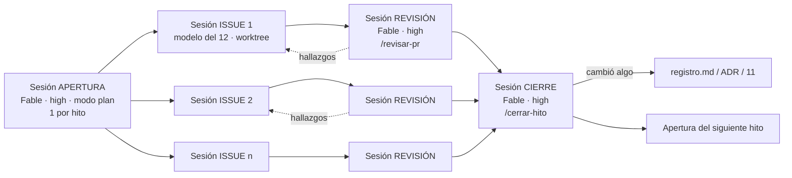

# 13 — Flujo de trabajo con Claude Code: sesiones, prompts y orden

| Estado | Fecha | Responsable |
|---|---|---|
| Borrador | 2026-10-29 | Arquitectura |

**Propósito.** Decir exactamente cómo ejecutar el plan (09, 11, 12) con Claude Code en la app de escritorio: qué sesión abrir, con qué modelo y esfuerzo, qué prompt darle, en qué orden, cuándo seguir en el mismo chat y cuándo abrir otro, y cómo se pasan trabajo entre sesiones.

**Relacionados.** [12-plan-de-ejecucion-con-claude.md](12-plan-de-ejecucion-con-claude.md) · [09](09-plan-de-hitos-y-responsabilidades.md) · [11](11-trazabilidad-por-hito.md) · [MAPA.md](MAPA.md).

## 1. Cinco principios que evitan el caos

1. **Los documentos son la memoria compartida; git es el estado.** Las sesiones no "se acuerdan" unas de otras. Lo que una sesión decide se escribe en `docs/` (registro, ADR, 11) y lo que construye llega por PR. Nunca dependas de lo que "dijiste en otro chat".
2. **Una sesión por issue.** Un chat largo con muchos temas degrada la calidad: el contexto se llena y el modelo mezcla reglas. Un issue de GitHub = una sesión = un PR.
3. **Contexto mínimo y exacto.** Cada sesión carga **solo** el documento dueño de su tarea (03 para dominio, 05 para API, 06 para UI, 08 para integración) y el bloque del hito en 11. No se pega "todo el repo de docs".
4. **Diseñar con Fable, construir con Opus/Sonnet, revisar con Fable.** El modelo y el esfuerzo se fijan **por sesión** antes del primer mensaje (ver §3).
5. **Las sesiones se hablan por tres canales, en este orden de preferencia:** (a) el PR y sus comentarios, (b) los documentos, (c) un mensaje directo entre sesiones solo para pasar un hallazgo puntual (una sesión de revisión que devuelve algo a la sesión del issue). No se usan chats "conversando" entre modelos para diseñar.

## 2. Preparación, una sola vez (medio día)

Antes de H1, en una sesión **Fable 5.1 · high** sobre `C:\Fuentes_Git\Validasoft`:

```
Prepara el repositorio para trabajar por hitos con Claude Code, siguiendo docs/13-flujo-de-trabajo-con-claude-code.md:
1. Crea CLAUDE.md en la raíz con: idioma español, dueños de documentos (03 dominio, 05 contratos, 06 UI), regla "nada cambia sin registro/ADR", convención de ramas feature/H<n>-<tema>, commits convencionales, DoD de 09 §1, y la instrucción "antes de tocar código lee docs/decisiones/registro.md y el bloque del hito en docs/11".
2. Crea .claude/skills/ con cuatro skills: abrir-hito, implementar-issue, revisar-pr, cerrar-hito, con los prompts de docs/13 §5 como contenido.
3. Crea .github/ con plantillas de issue (entregable de hito) y de PR (checklist DoD), CODEOWNERS y el workflow ci.yml mínimo (build/lint; se amplía en H1).
4. Crea .claude/launch.json con las configuraciones api, worker, web y public (se completan en H1).
No escribas código de producto. Haz un solo PR "chore: preparación para trabajar por hitos".
```

Con esto, cada sesión nueva arranca ya con las reglas cargadas (CLAUDE.md) y con los prompts disponibles como `/abrir-hito`, `/implementar-issue`, `/revisar-pr`, `/cerrar-hito`.

## 3. Cómo fijar modelo y esfuerzo en cada sesión

| Qué | Dónde en la app | Cuándo |
|---|---|---|
| Modelo | Selector de modelo de la sesión (o `/model claude-fable-5-1`, `/model claude-opus-5-5`, `/model claude-sonnet-5-5`, `/model claude-haiku-5-5`) | Antes del primer mensaje; cambiar a mitad de sesión solo para subir (nunca bajar en una tarea ya compleja) |
| Esfuerzo | Ajuste de esfuerzo de la sesión en la app (low / medium / high / xhigh) | Según la tabla del 12; `xhigh` solo en agregados, sagas, seguridad y migración |
| Modo rápido | Apagado en tareas `high`/`xhigh` | Encendido solo para Haiku/Sonnet mecánicas |
| Modo plan | Encendido para sesiones de apertura y para cualquier issue marcado Fable | Obliga a leer y proponer antes de editar |
| Worktree | Encendido para toda sesión de issue | Cada issue trabaja en su rama/worktree y abre su PR; evita pisarse |

Regla de escalada: si una sesión Sonnet/Haiku empieza a tocar invariantes, concurrencia, seguridad o datos de migración, **para, sube a Opus o Fable y a `high`** y vuelve a dar el prompt con el contexto. Insistir con el modelo chico sale más caro.

## 4. El ciclo de un hito (qué sesión, en qué orden)



### 4.1 Sesión de APERTURA (una por hito)
- **Modelo/esfuerzo**: Fable 5.1 · high · modo plan.
- **Carpeta**: el repo (sin worktree).
- **Qué hace**: convierte 09 + 11 + 12 en issues de GitHub con criterios de aceptación, dependencias y etiqueta de modelo; ordena el trabajo; detecta huecos antes de que nadie codifique.
- **Prompt**: `/abrir-hito H1` (ver §5.1).
- **Termina cuando**: los issues existen en GitHub y la sesión te muestra el orden y qué puede ir en paralelo.

### 4.2 Sesiones de ISSUE (una por issue; varias en paralelo si no tocan los mismos archivos)
- **Modelo/esfuerzo**: los de la fila del 12.
- **Carpeta**: worktree propio (la app lo crea al iniciar la sesión).
- **Prompt**: `/implementar-issue 42` (ver §5.2).
- **Mismo chat o nuevo**: todas las iteraciones del **mismo issue** van en el **mismo chat** (correcciones, tests, comentarios del PR). Un issue nuevo = chat nuevo, siempre.
- **Paralelismo**: lanza en paralelo solo issues que la sesión de apertura marcó como independientes (p. ej. en H2: agregado `Documento` y Dropzone móvil; **no** `Documento` y `Tercero` si comparten la bóveda).
- **Termina cuando**: el PR está abierto con CI verde, pruebas del issue y, si tocó contratos, 05/06/11 actualizados en el mismo PR.

### 4.3 Sesión de REVISIÓN (una por PR)
- **Modelo/esfuerzo**: Fable 5.1 · high.
- **Carpeta**: el repo en la rama del PR (sin worktree) o el mismo worktree.
- **Prompt**: `/revisar-pr 57` (ver §5.3). Internamente usa `/code-review` a `high` y además cruza el PR contra 03/05/11.
- **Cómo devuelve hallazgos**: comentarios en el PR (preferido). Si hay que corregir, **vuelves a la sesión del issue** y le dices: "Atiende los comentarios del PR #57". Esa sesión conserva el contexto del cambio; la de revisión no debe editar código.
- **Cuándo "hablar" entre sesiones**: solo si la revisión descubre algo que afecta a otro issue en curso; entonces desde la sesión de revisión envías un mensaje a esa sesión ("en el PR 57 cambió el nombre del evento X; alinea tu rama"). Es excepcional.

### 4.4 Sesión de CIERRE (una por hito)
- **Modelo/esfuerzo**: Fable 5.1 · high.
- **Prompt**: `/cerrar-hito H1` (ver §5.4).
- **Qué hace**: verifica criterio por criterio de 09, corre la suite completa, prepara el guion de demo, actualiza 11 (lo entregado), registra decisiones nuevas y propone ADR si hubo cambios estructurales, y lista los efectos hacia atrás/adelante (09 §5).
- **Termina cuando**: tú apruebas la demo y el cierre queda en un PR "docs: cierre H1".

## 5. Los prompts (contenido de los skills)

Los `<…>` son parámetros. Cada prompt está escrito para que la sesión **lea primero y pregunte si falta algo**; no asume.

### 5.1 `/abrir-hito <Hn>` — Fable · high · modo plan

```
Vas a abrir el hito <Hn> de Validasoft.
Lee, en este orden: docs/09 (sección del hito y §1 gobierno), docs/11 (bloque 2.<n> completo y matrices §3 del hito), docs/12 (tabla del hito), docs/decisiones/registro.md (todo) y el documento dueño de cada entregable (03, 05, 06, 07, 08 según corresponda).
Entrega, sin escribir código:
1. La lista de issues del hito: uno por entregable del 11, con título "<Hn>-<nn> <entregable>", descripción con el contrato exacto (endpoints/DTOs/eventos/pantallas copiados del 11), criterios de aceptación verificables, pruebas que lo demuestran, documento dueño, modelo y esfuerzo sugeridos (del 12), estimación y dependencias.
2. El orden de ejecución y qué issues pueden ir en paralelo (no comparten archivos ni agregados).
3. Huecos: todo lo que el 11 promete y 03/05/06 no definen con exactitud. Para cada hueco, propuesta concreta y en qué documento va.
4. Riesgos del hito y cómo se mitigan.
Cuando yo apruebe, crea los issues en GitHub con gh (etiquetas: hito/<Hn>, modelo/<nombre>, esfuerzo/<nivel>) y añádelos al Project del hito. No crees ramas ni código.
```

### 5.2 `/implementar-issue <número>` — modelo y esfuerzo del issue · worktree

```
Implementa el issue #<número> de Validasoft en este worktree.
Antes de tocar nada: lee CLAUDE.md, el issue completo (gh issue view <número>), docs/decisiones/registro.md y SOLO el documento dueño que el issue indica (y el bloque del hito en docs/11). Si el issue contradice un documento, para y pregúntame; el documento manda y, si hay que cambiarlo, se hace en el mismo PR con una fila en el registro.
Reglas:
- Español en código de dominio, rutas, eventos y docs; vertical slice (Endpoint/Comando/Validador/Handler); sin servicios genéricos; nombres exactamente como en 03 y 05.
- Escribe primero las pruebas que demuestran los criterios de aceptación del issue; luego el código; luego corre toda la suite (dotnet test / pnpm test) y el lint.
- Si tocaste un contrato (endpoint, DTO, evento, proyección, pantalla), actualiza docs/05, docs/06 o docs/03 y la tabla del hito en docs/11 en este mismo PR.
- Commits convencionales en español, pequeños. Al final abre el PR con la plantilla (checklist DoD) apuntando a main y referenciando el issue.
Cuando termines, dime qué criterios quedaron demostrados por qué prueba y qué no pudiste verificar.
```

Variantes del mismo chat (no abras otro):
- `Atiende los comentarios del PR #<n> y vuelve a correr la suite.`
- `El criterio 3 falla en CI; diagnostica y corrige sin cambiar el contrato.`
- `Esto empezó a tocar invariantes del agregado Vinculo; no sigas. Resume qué falta en un comentario del issue para que lo retome una sesión Fable.` (y abres una sesión Fable con `/implementar-issue` en el mismo worktree).

### 5.3 `/revisar-pr <número>` — Fable · high

```
Revisa el PR #<número> de Validasoft como revisor externo. No edites código: solo comenta en el PR.
1. Corre /code-review con nivel high sobre el PR.
2. Cruza el diff contra docs/03 (enums, eventos, invariantes), docs/05 (endpoints, DTOs, eventos públicos), docs/07 (permisos, tenant+empresa en toda consulta) y el bloque del hito en docs/11: cualquier nombre, campo o estado que no coincida es un hallazgo bloqueante.
3. Verifica que las pruebas demuestran cada criterio de aceptación del issue (no solo que pasan).
4. Verifica que si cambió un contrato, los documentos cambiaron en el mismo PR.
Publica los hallazgos como comentarios en el PR con gh (bloqueante / recomendado / menor) y dame un veredicto: aprobar, cambios requeridos, o "esto necesita decisión de Producto" (si es lo tercero, redacta la pregunta con opciones y recomendación para el registro).
```

### 5.4 `/cerrar-hito <Hn>` — Fable · high

```
Cierra el hito <Hn> de Validasoft.
1. Verifica en main cada criterio de aceptación de docs/09 para el hito, ejecutando lo que haga falta (make up, dotnet test, pnpm test, e2e). Marca cumplido / no cumplido con evidencia.
2. Actualiza docs/11: lo entregado tal cual quedó (endpoints, DTOs, eventos, pantallas), y marca diferencias frente a lo planeado.
3. Lista decisiones tomadas durante el hito que no están en docs/decisiones/registro.md; añádelas con fecha; si alguna es estructural, redacta el ADR.
4. Aplica la matriz de efectos de docs/09 §5: qué hitos anteriores o posteriores cambian por lo construido; propone los ajustes en 09 y 12.
5. Prepara el guion de demo (5 pasos, datos del seed) y la lista de decisiones abiertas que bloquean el siguiente hito.
Abre un PR "docs: cierre <Hn>" con todo lo anterior. No cierres el hito si queda un criterio sin cumplir: dime cuál y qué issue lo resuelve.
```

### 5.5 `/siguiente [modelo]` — cuando no quieres elegir tú el issue

```
Busca en el Project del hito en curso de Validasoft el primer issue en "Pendiente" que no tenga dependencias abiertas y cuya etiqueta modelo/… coincida con el modelo de esta sesión (si no indico modelo, cualquiera). Asígnamelo, muévelo a "En sesión", crea la rama feature/H<n>-<tema> y ejecuta /implementar-issue con ese número. Si no hay ninguno elegible, dime cuáles están bloqueados y por qué, y no empieces nada.
```

Qué ganas y qué pierdes sin pasar el item a mano: ganas no tener que mirar el tablero; conservas todo el valor del issue (alcance, criterios, contexto mínimo, trazabilidad) porque la sesión lo lee igual. Lo único que debes garantizar tú es abrir la sesión con el **modelo** correcto, porque `/siguiente` filtra por él. Lo que **no** debes hacer es abrir una sesión sin issue y decirle "sigue con H1": eso la obliga a reconstruir el alcance desde los documentos, mezcla trabajo de varios issues en un PR y rompe la trazabilidad del 11.

### 5.6 `/decision` — cuando una sesión se topa con algo no definido (cualquier modelo)

```
Encontraste algo que los documentos no definen: <describe>. No decidas tú. Redacta la pregunta para Producto en el formato del cuestionario (pregunta, por qué importa, opciones con consecuencias, recomendación, prioridad), déjala como comentario en el issue y sigue con lo que no dependa de ella. Yo la respondo y la registro.
```

## 6. Qué va en el mismo chat y qué no

| Situación | Mismo chat | Chat nuevo |
|---|---|---|
| Correcciones, tests y comentarios del mismo issue | ✔ | |
| Un segundo issue "pequeño" relacionado | | ✔ (siempre) |
| La revisión del PR | | ✔ (sesión de revisión, otro modelo) |
| Atender los comentarios de la revisión | ✔ (en la sesión del issue) | |
| El issue se volvió más complejo de lo previsto | | ✔ con modelo/esfuerzo mayor, mismo worktree |
| Pregunta rápida sobre el dominio mientras implementas | ✔ (pero carga el documento, no preguntes de memoria) | |
| Abrir o cerrar un hito | | ✔ |
| El chat supera ~2 horas de trabajo o empieza a "olvidar" reglas | | ✔: pide un resumen del estado, ciérralo y abre otro con `/implementar-issue` + "continúa desde: …" |

## 7. Cómo se pasan trabajo las sesiones (sin que "conversen")

1. **Apertura → issues**: por GitHub. Cada sesión de issue lee su issue; no necesita el chat de apertura.
2. **Issue → revisión**: por el PR. La sesión de revisión lee el diff y el issue.
3. **Revisión → issue**: por comentarios en el PR; tú vuelves al chat del issue y dices "atiende los comentarios".
4. **Cualquier sesión → Producto**: por `/decision` (comentario en el issue) y luego tú lo registras en `docs/decisiones/registro.md` (puedes pedirle a la sesión de cierre que lo haga).
5. **Mensaje directo entre sesiones** (desde la app, la sesión puede enviar un mensaje a otra sesión activa): úsalo solo para "el PR 57 renombró X; alinea tu rama antes de abrir tu PR". Nunca para diseñar ni para pedirle a otra sesión que haga tu trabajo.

## 8. Semana 1 de H1, paso a paso (ejemplo real)

| Día | Sesión | Modelo · esfuerzo | Prompt | Resultado |
|---|---|---|---|---|
| L | Preparación | Fable · high | §2 | CLAUDE.md, skills, plantillas, CI mínimo (PR 1) |
| L | Apertura H1 | Fable · high · plan | `/abrir-hito H1` | 17 issues en el Project, orden y paralelos |
| M | Issue H1-02 estructura | Haiku · low · worktree | `/implementar-issue 2` | PR 2 (solución y monorepo) |
| M | Issue H1-03 compose | Opus · medium · worktree | `/implementar-issue 3` | PR 3 (en paralelo con el 2: no comparten archivos) |
| M | Revisión PR 2 y 3 | Fable · high | `/revisar-pr 2`, `/revisar-pr 3` | Comentarios; merges |
| X | Issue H1-04 spike Marten | Fable · xhigh · plan · worktree | `/implementar-issue 4` | PR 4 con la prueba del store único; si falla, `/decision` |
| X | Issue H1-08 identificación multipaís | Sonnet · medium · worktree | `/implementar-issue 8` | PR 8 (independiente del 4) |
| J | Issue H1-05 tenancy y empresa | Fable · high · worktree | `/implementar-issue 5` | PR 5 (depende del 4) |
| J | Issue H1-06 identidad | Opus · high · worktree | `/implementar-issue 6` | PR 6 (paralelo al 5 si no tocan el mismo módulo) |
| V | Revisiones y merges | Fable · high | `/revisar-pr …` | main con 1–6 y 8 |
| V | Revisión semanal con Producto | — | demo de lo mergeado | Decisiones al registro |

La segunda y tercera semana repiten el patrón con los issues restantes; el viernes de la tercera semana corre `/cerrar-hito H1`.

## 9. Errores típicos y cómo evitarlos

| Error | Síntoma | Remedio |
|---|---|---|
| Un chat para todo el hito | El modelo mezcla reglas, "olvida" el registro, los PR se vuelven gigantes | Un issue por chat; worktrees |
| Pegar los 12 documentos en cada sesión | Contexto lleno, respuestas lentas y genéricas | Solo el documento dueño + bloque del 11 |
| Dejar que Sonnet decida un invariante | Código que "funciona" pero contradice 03 | Regla de escalada (§3); la revisión Fable lo atrapa |
| Decidir en el chat | La decisión se pierde; otra sesión hace lo contrario | `/decision` → registro → documentos |
| Revisar en la misma sesión que implementó | Se aprueba a sí misma | Sesión de revisión aparte, modelo distinto |
| Cambiar un contrato sin tocar 05/11 | El cliente generado y el 11 quedan mentirosos; CI de trazabilidad falla | Regla "mismo PR" del prompt 5.2 |

## 10. Puerta local antes de subir: la réplica del CI en contenedores Linux

Nada se sube sin pasar, **sobre la rama ya rebasada**, la suite completa igual que el CI. Esa suite es `infra/ci-local/`: corre en esta máquina (Windows con Docker Desktop y WSL2) lo mismo que `.github/workflows/ci.yml`, **dentro de contenedores Linux**, así que los errores de entorno (mayúsculas en las rutas, el SDK de .NET de Linux, Node 22, Testcontainers, Playwright en su imagen, servicios sin `localhost`) aparecen aquí y no en GitHub. Decisiones CI-1 a CI-9 en el [registro](decisiones/registro.md); manual completo en [infra/ci-local/README.md](../infra/ci-local/README.md).

```bash
infra/ci-local/ci-local.sh                         # backend + frontend + e2e sobre esta carpeta (Git Bash)
.\infra\ci-local\ci-local.ps1                      # lo mismo en PowerShell
infra/ci-local/ci-local.sh --solo frontend         # un trabajo (backend, frontend, e2e, imagen)
infra/ci-local/ci-local.sh --rama origin/main      # lo confirmado en una rama o commit, sin tocar carpetas
infra/ci-local/ci-local.sh --directorio <worktree> --salida <carpeta>
```

| Qué | Cómo |
|---|---|
| Qué corre | **backend** (SDK .NET 10 de Linux): `restore`, `build` en Release con advertencias como error, `test` de dominio, SDK, adaptador e integración (Testcontainers con el socket de Docker de la máquina), `pack` de los SDK. **frontend** (Node 22 y pnpm de `packageManager`): `pnpm install --frozen-lockfile`, `lint`, `typecheck`, `test`, `build`. **e2e**: PostgreSQL, Mailpit y MinIO en una red Docker propia sin puertos del host, la API en un contenedor con .NET + Node, y Playwright en `mcr.microsoft.com/playwright:v<versión de e2e/package.json>-noble` |
| De dónde salen los comandos | Del propio `ci.yml` (comandos, versiones, rutas de reportes, condiciones). Si el flujo cambia de forma, la corrida termina con `SINCRONÍA con ci.yml` y `pnpm test` falla (`infra/ci-local/sincronia.test.mjs`) hasta actualizar `infra/ci-local/lib/plan.mjs` |
| Qué prueba | Los archivos de la carpeta tal como están (incluye cambios sin confirmar) o, con `--rama`, lo confirmado. Para subir se corre sobre lo confirmado y rebasado |
| Qué imprime | Una línea por paso y un resumen: verde o rojo por trabajo, conteos de pruebas y, si algo falla, qué pruebas fallaron y el final del log. Logs completos y reportes (`.trx`, `playwright-report`, `test-results`) en la carpeta de salida (`--salida`; por omisión `<temp>/validasoft-ci-local/<id>`) |
| Varios agentes a la vez | Cada corrida tiene identificador propio (contenedores, proyecto de compose y carpeta de trabajo); ningún puerto del host. No toca la API del usuario (:5080), Mailpit (:8025), MinIO ni las bases que ya corren. Si una corrida murió sin limpiar: `ci-local.sh --limpiar` |
| Recursos | Cada contenedor de trabajo ve 4 CPU (lo del runner de GitHub, `--cpus`); sin ese tope el paralelismo de vitest o dotnet usa las 14 de la máquina y los demás agentes se quedan sin CPU |
| Cuánto tarda | Medido sobre `origin/main`, un trabajo tras otro y con las cachés llenas: **≈ 43 min** (frontend 16 min, backend 10 min, e2e 17 min), todo verde: 1096 pruebas de interfaz, 1232 de .NET y 106 de punta a punta. La primera vez suma las descargas. `--paralelo` acorta el total pero en una máquina compartida da falsos rojos por tiempos: para la puerta de subida, uno tras otro |

Reglas para los agentes: (1) la corrida completa y verde sobre la rama rebasada es la puerta; un informe que dice «no repetí la suite completa» se rechaza; (2) `--solo` y `--e2e-args` sirven para depurar, no como puerta; (3) si falla, se corrige y se repite, no se sube; (4) no se consulta el CI de GitHub (lo vigila el coordinador); (5) la caché de NuGet y de pnpm es compartida y no hace falta tocarla.

## Decisiones abiertas

1. **Herramienta para los issues**: GitHub Issues + Projects (P-17-2). *Propuesta:* un Project por hito con columnas Pendiente / En sesión / En revisión / Hecho. *Quién decide:* Arquitectura.
2. **Si la revisión semanal con Producto se hace en la sesión de cierre o en una sesión aparte "demo".** *Propuesta:* en la de cierre. *Quién decide:* Producto.

## Fuentes verificadas

Ver 09, 11 y 12.
