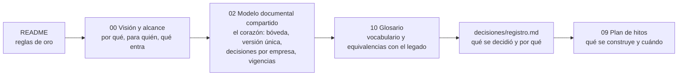
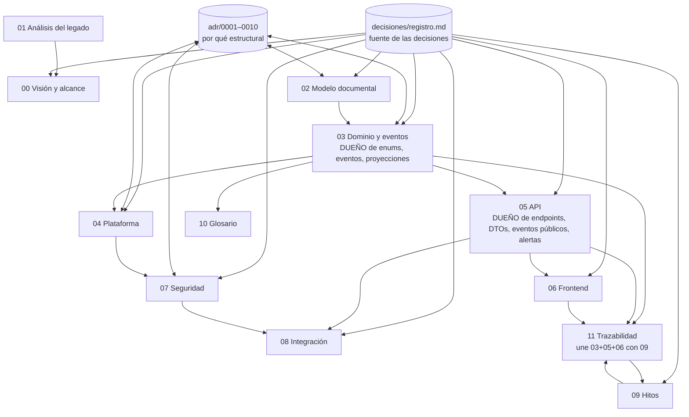
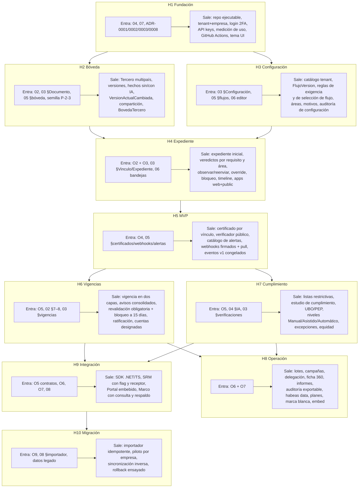
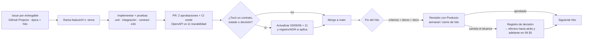
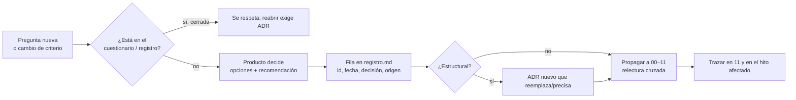

# Mapa del proyecto: cómo leer los documentos y cómo fluye el desarrollo

| Estado | Fecha | Responsable |
|---|---|---|
| Vigente | 2026-10-28 | Arquitectura |

**Propósito.** Orientar a quien llega al repositorio: en qué orden leer según su rol, cómo se relacionan los documentos entre sí, y cómo avanza el desarrollo de hito en hito con sus puertas de aprobación y sus bucles de corrección.

---

## 1. Flujo de lectura

### 1.1 Lectura mínima común (todos, ~40 min)

### 1.2 Lectura por rol (después de la mínima común)

```mermaid
flowchart TD
  subgraph P[Producto / Negocio]
    P1[01 Análisis del legado<br/>qué se reemplaza] --> P2[11 Trazabilidad por hito<br/>qué entrega cada hito] --> P3[decisiones/cuestionario.md<br/>las 97 preguntas y sus opciones]
  end
  subgraph AR[Arquitecto / Tech lead]
    A1[03 Dominio y eventos<br/>+ Anexo A semilla canónica] --> A2[04 Arquitectura de plataforma] --> A3[05 API, contratos y webhooks] --> A4[07 Seguridad, identidad y tenancy] --> A5[adr/0001–0010<br/>0009 consentimiento · 0010 personas relacionadas] --> A6[11 Trazabilidad]
  end
  subgraph BE[Backend A · dominio]
    B1[03 Dominio y eventos<br/>+ Anexo A] --> B2[05 API y contratos] --> B3[11 Trazabilidad · hitos H3, H4, H6]
  end
  subgraph BB[Backend B · documentos e integración]
    C1[04 Arquitectura] --> C2[05 API y contratos] --> C3[07 Seguridad] --> C4[08 Integración y migración] --> C5[11 · H1, H2, H5, H7, H9, H10]
  end
  subgraph FE[Frontend A / B]
    F1[06 Frontend y UX] --> F2[05 API · contratos de lectura y SSE] --> F3[11 · pantallas por hito]
  end
  subgraph IN[Integrador SRM / Portal / Marco]
    I1[01 Análisis del legado · mapa de endpoints] --> I2[05 API · webhooks y SDK] --> I3[08 Integración y migración]
  end
  subgraph QA[QA / DevOps]
    Q1[04 · testing, compose, CI] --> Q2[09 · criterios de aceptación] --> Q3[11 · pruebas por hito]
  end
  subgraph LG[Legal / Cumplimiento]
    L1[07 · retención, habeas data, consentimiento IA] --> L2[02 §10.3 retención] --> L3[registro · P-6-5, P-14-x, P-3-5]
  end
```

### 1.3 Cómo se relacionan los documentos

Regla práctica: si dos documentos dicen cosas distintas, manda **03** para el dominio y **05** para los contratos; el **registro** manda sobre ambos; un cambio de decisión siempre pasa por el registro y, si es estructural, por un ADR nuevo.

---

## 2. Mapa del desarrollo

### 2.1 Flujo general (del legado al producto en operación)

```mermaid
flowchart LR
  L[Legado SRM + Portal] -->|análisis 01| H0
  subgraph DOC[Hito 0 · Documentación]
    H0[Docs 00–11 + ADRs] --> Q[Cuestionario 97 preguntas] --> REG[Registro de decisiones] --> RL[Relectura cruzada] --> OK0{Producto aprueba<br/>00, 02, 09, 11}
  end
  OK0 -->|sí| H1
  OK0 -->|no| H0
  subgraph BASE[Base]
    H1[H1 Fundación<br/>tenant·empresa, identidad,<br/>medición, CI, design system]
    H2[H2 Bóveda del tercero<br/>versiones, hechos, compartición, IA]
    H3[H3 Configuración y exigencia<br/>catálogo, flujos, reglas, selección de flujo]
    H1 --> H2
    H1 --> H3
  end
  subgraph MVP[MVP]
    H4[H4 Expediente y veredictos<br/>áreas, etapas, observar, override]
    H5[H5 Certificado, alertas, webhooks]
    H2 --> H4
    H3 --> H4
    H4 --> H5
  end
  H5 --> OKM{Demo MVP<br/>5 pasos de la marca}
  subgraph PAR[Paridad con el legado]
    H6[H6 Vigencias y revalidación<br/>dos capas, Desactualizada, cuentas designadas]
    H7[H7 Verificaciones y revisión automática<br/>listas, cumplimiento, UBO/PEP, niveles IA]
    H8[H8 Operación masiva e informes<br/>lotes, campañas, auditoría exportable, planes]
    OKM --> H6
    OKM --> H7
    H6 --> H8
    H7 --> H8
  end
  subgraph INT[Integración y migración]
    H9[H9 SDKs + SRM/Portal/Marco]
    H10[H10 Importador y piloto<br/>corte por empresa, inversa 90 días]
    H11[H11 Endurecimiento<br/>carga, backups, retiro del legado]
    H6 --> H9
    H7 -->|"SAGRILAFT antes del flag"| H9
    H5 -.contratos v1.-> H9
    H9 --> H10 --> H11
  end
  H11 --> OPS[Producto en operación<br/>legado apagado tenant a tenant]
```

### 2.2 Qué entra y qué sale de cada hito

### 2.3 El ciclo dentro de cada hito

### 2.4 Ciclo de una decisión

---

## 3. Dónde está cada cosa (índice rápido)

| Busco… | Documento |
|---|---|
| Por qué existe el producto y qué no hace | 00 |
| Cómo funciona hoy el SRM/Portal y qué se apaga | 01 |
| Qué pasa con un RUT compartido por tres empresas | 02 §2, §7, §11 |
| Cuándo empieza a ver una empresa la bóveda del tercero | 02 §6.1, ADR-0009 |
| Cómo se modela el representante legal, los socios o el beneficiario final | 02 §4.5, 03 §4.5, ADR-0010 |
| Qué códigos de documento existen y sus defaults | 03 Anexo A |
| Qué pasa cuando un documento vence para una empresa y no para otra | 02 §8 |
| Cuándo la IA aprueba sola | 02 §9, 04 §IA |
| Estados y eventos exactos | 03 §3 |
| Quién aprueba, en qué orden, con cuántos aprobadores | 03 §etapas/áreas, registro R-2 |
| Cómo se elige el flujo de un expediente | 03 §ReglaDeSeleccionDeFlujo, 11 H3 |
| Un endpoint, un DTO, un webhook, una alerta | 05 (catálogos), 11 (por hito) |
| Qué ve el tercero / el revisor / el verificador | 06 |
| Quién puede ver qué, retención, consentimiento IA | 07 |
| Cómo se conecta el SRM / Portal / Marco y cómo se migra | 08 |
| Qué se entrega en cada hito y quién responde | 09, 11 |
| Qué significa una palabra | 10 |
| Qué se decidió, cuándo y por qué | decisiones/registro.md, adr/ |
| Qué se corrigió en la relectura | decisiones/relectura-2026-10-28.md |

## Decisiones abiertas
Ninguna propia; ver `decisiones/relectura-2026-10-28.md` para la lista consolidada.

## Fuentes verificadas
Ver 01 y 09.
