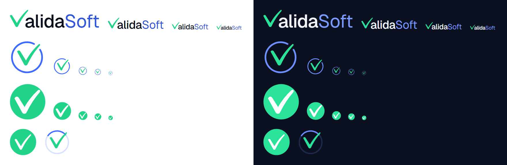

# Marca de Validasoft: el logo «Anillo»

| Estado | Fecha | Responsable |
|---|---|---|
| Vigente | 2026-11-12 | Producto (usuario) · Diseño |

**Propósito.** Dejar por escrito cómo se construye la marca, cuándo se usa cada pieza, qué no se debe hacer con ella y cómo se regeneran los recursos. Las decisiones están en el [registro](decisiones/registro.md) (MA-1 a MA-8). La única fuente de la geometría y de los colores es `packages/ui/src/marca/geometria.ts` y `packages/ui/src/tokens.ts`; todo lo demás (componentes, favicon, íconos de la app, GIF, correos, PDF) sale de ahí o se comprueba contra ahí.



## 1. La idea

Una **«V» que también es un check**: un trazo caligráfico con el brazo derecho más largo, que se lee como la primera letra de Validasoft y como «validado». Esa forma es la marca. Un **aro** la acompaña solo donde hace falta un símbolo compacto (la app instalada, la pestaña del navegador, las animaciones): el check rompe el aro por arriba a la derecha, como algo que se confirma y sale.

## 2. Las piezas

| Pieza | Qué es | Dónde va |
|---|---|---|
| **Logotipo** | La «V» (check verde) pegada a «alida» + «Soft»: se lee **ValidaSoft**. **Sin aro.** | Barras de las dos apps, ingreso, consola de Plataforma, verificador público, correos, PDF, documentación |
| **Ícono** | El aro abierto con el check un poco más grande, cuya punta sale por el hueco | App instalada (PWA), `apple-touch-icon`, avatar de la marca, notificaciones del tercero, pie del portal |
| **Favicon** | Círculo verde lleno con el check blanco (más grande y con contorno propio: a 16 px se sigue leyendo) | Pestaña del navegador (`favicon.svg` con modo claro/oscuro y PNG de 16, 32 y 48) |
| **Éxito** | El aro verde se dibuja, el círculo se llena y el check blanco se revela; «pop» final | Aprobación de un expediente, ficha completa, revisión aprobada del tercero, certificado vigente, GIF del correo de aprobación |
| **Carga** | Aro tenue, arco que gira y el check que se revela y se oculta | Carga previa al JavaScript (`index.html`), «Conectando con tu sistema…», GIF de carga |

## 3. Construcción

Todo está en un lienzo de coordenadas fijas; los números son los de `geometria.ts` y no se «aproximan» a mano.

- **Check («V»)**: `M24 38 C26 34 30 34 32 37 L47 61 C56 45 66 32 80 19 C82 17 85 19 83 22 C70 37 60 52 51 71 C49 75 44 75 42 71 Z`, relleno. Su caja es `22 16 64 60`.
- **Logotipo**: el check recortado a su caja, **del alto de la letra** y apoyado en la línea base; margen derecho de **−0,23 × el tamaño de la letra** (la cola del check se mete bajo la «a»); luego «alida» en **peso 500** con el color de texto y «Soft» en **peso 400** con el color de marca. Letra: Geist (`FUENTE.sans`), espaciado −0,015 em.
- **Ícono**: caja `-3 -6 110 110`; aro abierto `M71.1 10.3 A45 45 0 1 0 89 27.5` (trazo 5, extremos redondeados); el check escalado ×1,15 desde su vértice (`translate(47 70) scale(1.15) translate(-47 -70)`).
- **Favicon**: círculo de radio 48 y el check blanco centrado, ×1,12, con contorno de 2,4 (único lugar donde se engrosa el check).
- **Aro completo** (éxito y carga): círculo de radio 45, trazo 5.
- **Revelado del check**: un relleno no se «dibuja» con `stroke-dashoffset`, así que el check se revela con una **máscara**: una guía `M28 37 L46 68 L82 20` con trazo ancho (18) y blanco avanza y descubre el check a su paso.

### Colores

Salen de `tokens.ts` y no cambian con la paleta de una empresa: el logo de Validasoft nunca toma el color de la empresa que se muestra en pantalla.

| Parte | Claro | Oscuro | Token |
|---|---|---|---|
| Aro | `#3D6BFF` | `#6E8FFF` | `marcaAzul` |
| Check («V»), verde | `#22D38A` | `#2BE29A` | `marcaVerde` |
| «alida» | `#0A0F1C` | `#F2F5FB` | `marcaTexto` |
| «Soft» | `#2F55D9` | `#7C9BFF` | `marcaSoft` |
| Check sobre el círculo verde | `#FFFFFF` | `#FFFFFF` | — |
| Fondo de los íconos de la app y de los GIF oscuros | — | `#0B1120` | `superficieNivel1` oscuro |

### Animaciones

| | Éxito | Carga |
|---|---|---|
| Orden | Aro verde (0,45 s) → relleno (0,3 s) → check blanco con leve rebote (0,4 s) → «pop» 1 → 1,1 → 1 (0,3 s) | Arco del color del aro girando (1 s, lineal, sin fin; 80 de 210) + check revelándose y ocultándose (1,4 s) |
| Duración | 1,45 s, una vez | Sin fin |
| Menos movimiento (`prefers-reduced-motion`) | Aparece ya terminado y avisa su fin enseguida | Queda estática con un pulso suave de opacidad |
| Componente | `AnimacionExito` (con `onFin`) y `AnimacionExitoUnaVez` (se anima solo la primera vez de la sesión) | `Cargando` |

## 4. Cómo usarla

### Áreas de respeto y tamaños mínimos

- **Área de respeto**: alrededor del logotipo, **media letra** (0,5 × el tamaño de la letra) por cada lado; del ícono, **un octavo de su lado**. Nada entra ahí: ni texto, ni bordes, ni otro logo.
- **Tamaño mínimo del logotipo**: letra de **14 px** en pantalla (el conjunto mide ≈ 70 px de ancho) y **8 mm de alto de la «V»** en impreso.
- **Tamaño mínimo del ícono**: **24 px**. Por debajo, el favicon (el círculo verde), que está hecho para 16 px.
- En las barras de las apps el logotipo usa letra de 20 px.

### Usos correctos

- En su color sobre fondo claro (`Logo` claro) o con los colores de oscuro sobre fondo oscuro (`Logo` oscuro): en la web, el componente cambia solo con el tema.
- El logotipo en barras, ingreso, correos, PDF y documentos; el ícono solo donde no cabe el logotipo.
- El éxito en momentos que la persona provocó y que cierran algo (aprobar, completar, certificado vigente); la carga para esperas largas sin forma que mostrar.
- Donde se sabe qué va a llegar, la carga sigue siendo un **esqueleto** (UI-1): la carga de marca no lo reemplaza.

### Usos incorrectos

- Poner un aro al logotipo, o quitarle el aro al ícono.
- Cambiar los colores, usar la «V» en otro verde o pasar «Soft» a otro azul; usar el color de la empresa en el logo de Validasoft.
- Deformar, inclinar, rotar, agregar sombras, degradados o contornos (el único contorno es el del favicon).
- Separar la «V» de «alida» o escribir «Validasoft» con otra tipografía junto a la «V».
- Poner el logo claro sobre fondo oscuro (o al revés) o sobre una foto o un color que le quite contraste.
- Usar el logo de Validasoft como logo de la empresa: el de la empresa (si lo configuró) va primero; el de Validasoft es el respaldo.
- Animar el logo en cada confirmación: la animación de éxito es para momentos que cierran algo; los avisos comunes llevan su ícono de siempre.

## 5. Dónde está cada cosa

| Qué | Dónde |
|---|---|
| Geometría, colores y tiempos | `packages/ui/src/marca/geometria.ts`, `packages/ui/src/tokens.ts` |
| Componentes | `Logo` (`logotipo`, `icono`, `favicon`), `AnimacionExito`, `AnimacionExitoUnaVez`, `Cargando` en `@validasoft/ui` |
| Recursos generados | `marca/svg/`, `marca/png/` (incluye `hoja-de-marca.png`), `marca/gif/` |
| Favicon, íconos y manifest de las apps | `apps/web/public/` y `apps/public/public/`; enlazados en cada `index.html` |
| Carga previa al JavaScript | Entre las marcas `marca:splash:inicio` y `marca:splash:fin` de cada `index.html` |
| Marco y recursos de los correos | `src/Validasoft.Aplicacion/Comun/MarcoDeCorreo.cs` y `Comun/RecursosDeMarca/` |
| Logotipo en los PDF | `src/Validasoft.Infraestructura/Ficha/LogosDePdf.cs` (`LogoDeValidasoft`) |

### Correos

Todos los correos salen dentro de un marco (`MarcoDeCorreo`): el logotipo arriba y el contenido en una tarjeta blanca, con colores explícitos para que un cliente en modo oscuro no los invierta. Las imágenes **viajan dentro del mensaje** (`cid:`), no se piden por URL: muchos clientes bloquean las imágenes remotas y no queremos que un correo de validación haga peticiones a nadie. El correo de **aprobación** abre además con el **GIF de éxito** (anima una vez y se queda en el círculo verde con el check; un cliente que no anima GIF muestra el último cuadro). La vista previa de las plantillas incrusta el GIF como `data:` para mostrarlo.

### PDF

El logo de la **empresa** (PNG o SVG que configuró) sigue siendo el primero en el encabezado de la declaración PEP. Si no tiene, el respaldo es el **logotipo de Validasoft dibujado como vectores** en el lienzo propio del PDF (la «V» verde y «alida» «Soft» con las fuentes estándar del PDF; la tipografía de marca no se incrusta). El PDF del certificado lleva el logotipo bajo su título: lo valida la plataforma.

## 6. Cómo se regenera

```bash
pnpm --filter @validasoft/e2e navegadores      # la primera vez: Chromium de Playwright
pnpm --filter @validasoft/marca generar        # SVG, PNG, GIF, carga previa al JavaScript y los recursos de los correos
pnpm --filter @validasoft/marca generar -- --solo svg,png   # solo una parte (svg, png, gif, splash)
```

Requiere **Node 23.6 o superior** (el generador lee `gif.ts` y `png.ts` sin compilar). El generador abre un arnés (`marca/harness`) con los **componentes reales** de `@validasoft/ui`, congela cada animación en cada instante (Web Animations) y captura los cuadros con Playwright: lo que se ve en la app es lo que sale en el GIF. Los GIF van a 2× (96 px en pantalla = 192 px) con el fondo de cada modo; un codificador propio (`marca/gif.ts`: paleta por mediana, LZW, solo el rectángulo que cambia) los deja en ≈ 80 KB. El GIF de carga usa un ciclo de 2 s (dos vueltas del arco y un ciclo del check algo más lento que el de 1,4 s de la app) para repetirse sin saltos.

El resultado **se versiona**. Para que no se separe de la geometría hay pruebas que solo leen archivos (`marca/sincronia.test.ts`, en `pnpm test`): las copias de las apps y de los correos son idénticas a lo generado, los SVG llevan los números de `geometria.ts`, la carga de `index.html` y el PDF repiten la misma geometría y los mismos colores.

**Para cambiar la marca**: se cambia `geometria.ts` o `tokens.ts` (y, si cambia la «V» o sus colores, `LogosDePdf.cs`, que repite esos números), se corre el generador y se versiona lo que salga. Un cambio de la «V» que no llegue al PDF o a `index.html` hace fallar `sincronia.test.ts`.

## 7. Tipografía del logotipo en archivos sueltos

Los SVG del logotipo (`marca/svg/logotipo-*.svg`) llevan «alidaSoft» como **texto** con Geist (y respaldo `Segoe UI`, `system-ui`) y un `textLength` que fija el ancho; sin Geist instalada se ve con la fuente del sistema. Los **PNG** (`logotipo-claro@2x.png`, `logotipo-oscuro@2x.png`) y los GIF se renderizan con Geist y son la versión de referencia para quien no tenga la fuente.
